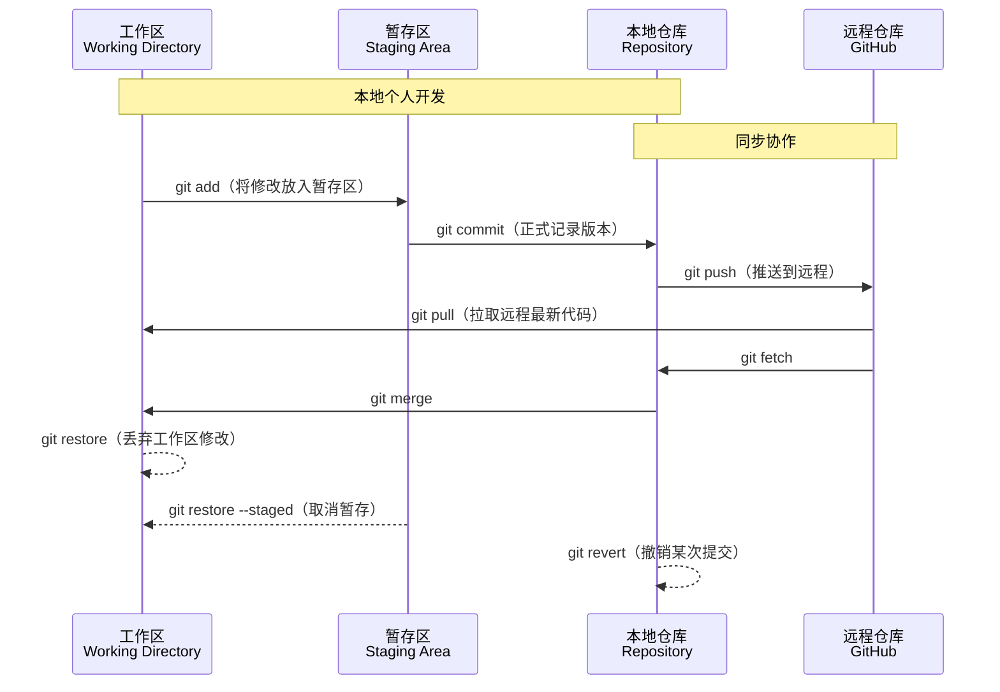
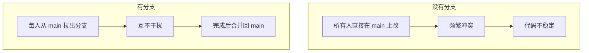
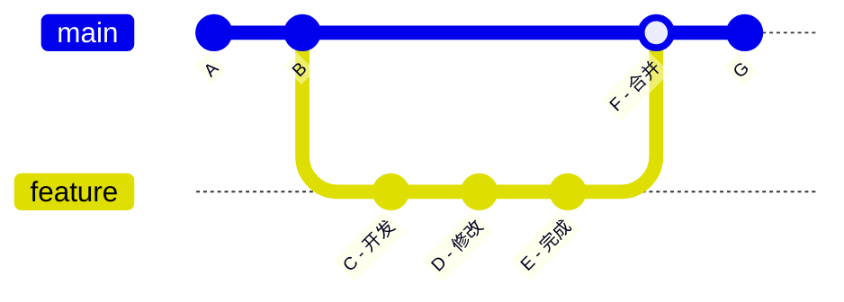
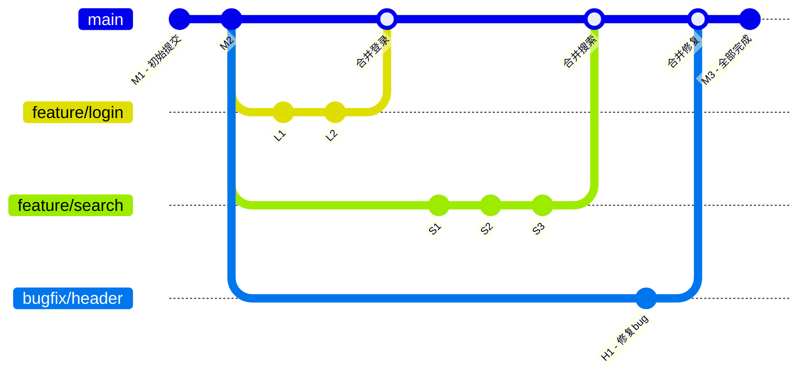
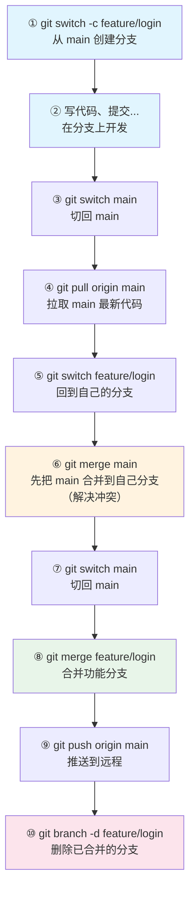
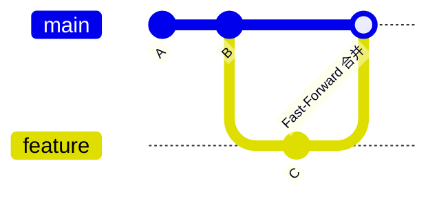
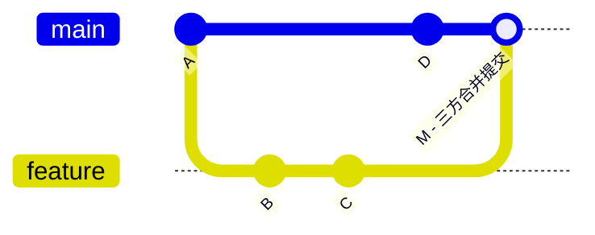
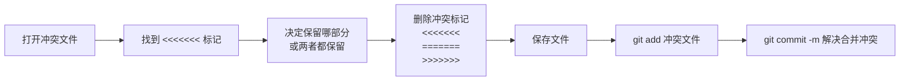
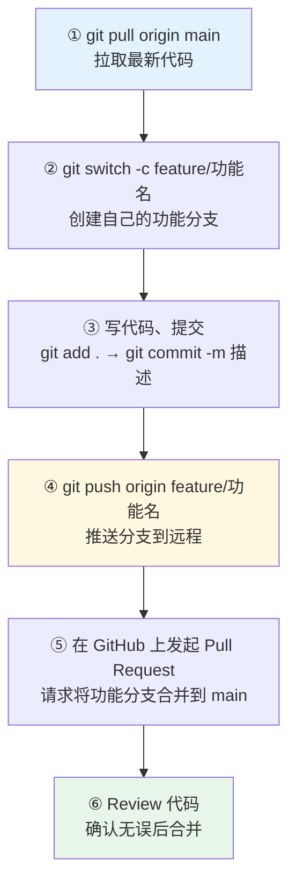

# Git 使用指南

> 面向零基础同学，涵盖 Git 核心概念、常用命令与团队协作流程。
具体内容参考https://www.bilibili.com/video/BV1ySLc6QEcB?vd_source=e27ae8b2dd2e75a0eb039cbbd80f0120 或 https://www.runoob.com/git/git-tutorial.html 

---

## 一、Git 是什么

Git 是一个**分布式版本控制系统**，用于记录文件的每一次修改，允许多人并行开发、随时回退、互不干扰。

**核心思想：** 每个人本地都有一份完整的仓库副本，通过「推送/拉取」与远程仓库（GitHub）同步。

---

## 二、三个区域

Git 将文件划分为三个区域，理解它们是掌握 Git 的关键：




| 区域 | 说明 |
|------|------|
| **工作区** | 你电脑上实际看到和编辑的文件 |
| **暂存区** | 预备提交的文件快照，用 `git add` 添加 |
| **本地仓库** | 用 `git commit` 正式记录的版本历史 |
| **远程仓库** | 托管在 GitHub 上的共享仓库，用 `git push/pull` 同步 |

---

## 三、初次配置

```bash
# 设置你的名字和邮箱（只需执行一次）
git config --global user.name "你的名字"
git config --global user.email "你的邮箱@example.com"
```

> `--global` 表示全局生效，所有仓库都会使用这个身份。

---

## 四、基础命令速查

### 4.1 创建与克隆仓库

```bash
# 新建仓库：在项目文件夹中初始化
git init

# 克隆远程仓库：把 GitHub 上的项目下载到本地
git clone https://github.com/用户名/仓库名.git
```

### 4.2 查看状态

```bash
git status          # 查看当前文件状态（已修改/已暂存/已提交）
git log             # 查看提交历史
git log --oneline   # 精简模式，每条记录一行
git diff            # 查看尚未暂存的修改内容
```

### 4.3 添加与提交

```bash
git add 文件名          # 将指定文件加入暂存区
git add .              # 将所有修改加入暂存区
git commit -m "说明"    # 提交暂存区内容，附带描述信息
```

**一次完整的提交流程：**
```bash
# 1. 编辑文件...
# 2. 查看改了什么
git status
# 3. 把改动放入暂存区
git add .
# 4. 提交到本地仓库
git commit -m "完成登录功能"
```

### 4.4 推送与拉取

```bash
git push origin main            # 将本地提交推送到远程 main 分支
git pull origin main            # 从远程 main 分支拉取最新代码并合并
git fetch                       # 只下载远程更新，不自动合并（更安全）
```

### 4.5 远程仓库管理

```bash
git remote -v                           # 查看已关联的远程仓库
git remote add origin 远程仓库地址       # 关联远程仓库（origin 是远程仓库的别名）
```

### 4.6 clone 与 pull 的区别

| | `git clone` | `git pull` |
|--|------------|-----------|
| **用途** | 从零创建本地仓库的完整副本 | 更新一个**已存在**的本地仓库 |
| **执行次数** | 只需要一次（首次） | 需要反复使用（日常同步） |
| **前提条件** | 本地没有这个仓库 | 本地已经有这个仓库 |
| **本质操作** | 下载整个仓库 + 自动关联远程 + 自动 checkout | `git fetch`（下载更新）+ `git merge`（合并到本地） |

```bash
# 第一次：克隆仓库到本地
git clone https://github.com/团队/项目.git

# 之后每天：拉取最新代码
git pull origin main
```

---

## 五、分支管理（重点）

分支是 Git 最强大的功能。它允许你在不影响主线的情况下开发新功能。

### 5.1 为什么需要分支



### 5.2 分支基本命令

```bash
git branch                  # 查看所有本地分支（当前分支前有 * 号）
git branch 分支名            # 创建新分支
git checkout 分支名           # 切换到指定分支
git checkout -b 分支名        # 创建并切换（常用）
git switch 分支名             # 切换分支（Git 2.23+ 新命令，更直观）
git switch -c 分支名          # 创建并切换（Git 2.23+）
git merge 分支名              # 将指定分支合并到当前分支
git branch -d 分支名          # 删除已合并的分支
```

### 5.3 分支工作流图解

#### 典型的团队协作流程



#### 多人并行开发



**说明：**
- `M1-M2`: 主线提交
- `L1-L2`: 同学 A 开发登录功能
- `S1-S3`: 同学 B 开发搜索功能
- `H1`: 同学 C 修复头部 bug
- 每个分支独立开发，完成后合并回 main

#### 分支生命周期



### 5.4 合并方式

#### Fast-Forward（快进合并）

当 main 分支没有新提交时，合并只是把指针前移：



> 合并后 feature 分支消失，main 指针直接移到 C。

#### 三方合并

当 main 和 feature 各自有新提交时，Git 会创建一个新的合并提交：



> 合并提交 M 包含两个分支的所有改动。

---

## 六、解决冲突

当两个人修改了同一文件的同一位置，合并时会产生冲突。

### 6.1 冲突的表现

```bash
git merge feature/login
# 输出：CONFLICT (content): Merge conflict in 文件名
```

冲突文件会被标记为：
```
<<<<<<< HEAD
你当前分支的内容
=======
被合并分支的内容
>>>>>>> feature/login
```

### 6.2 解决步骤



---

## 七、撤销与回退

```bash
# 撤销工作区的修改（未 add 时）
git checkout -- 文件名
git restore 文件名              # Git 2.23+ 新命令

# 撤销暂存（已 add 但未 commit 时）
git reset HEAD 文件名
git restore --staged 文件名     # Git 2.23+ 新命令

# 回退提交（已 commit）
git reset --soft HEAD~1     # 回退提交，保留修改在暂存区
git reset --mixed HEAD~1    # 回退提交，保留修改在工作区（默认）
git reset --hard HEAD~1     # 回退提交，丢弃所有修改（慎用！）

# 创建一个新提交来撤销之前的提交（安全方式，适合已 push 的情况）
git revert 提交哈希值
```

> `HEAD~1` 表示上一次提交，`HEAD~2` 表示上上次，以此类推。

---

## 八、.gitignore 文件

在项目根目录创建 `.gitignore` 文件，列出不需要被 Git 追踪的文件：

```gitignore
# 编译产物
*.o
*.pyc
__pycache__/

# 依赖目录
node_modules/
venv/

# IDE 配置
.vscode/
.idea/

# 系统文件
.DS_Store
Thumbs.db

# 环境变量（敏感信息！）
.env
```

> **原则：** 不要把依赖包、编译产物、密钥等提交到仓库。只提交源代码和配置文件。

---

## 九、GitHub 协作流程（推荐）


### 首次克隆仓库

```bash
# 收到邀请后，将仓库克隆到本地
git clone https://github.com/.../仓库名.git
cd 仓库名

# 设置自己的分支（避免直接在 main 上开发）
git switch -c feature/你的功能名
```

### 日常开发流程




---

## 十、常用场景速查

| 场景 | 命令 |
|------|------|
| 开始新功能 | `git switch -c feature/功能名` |
| 保存当前工作，切换分支 | `git stash` → 切换 → `git stash pop` |
| 查看某文件是谁改的 | `git blame 文件名` |
| 撤销最近一次提交（保留修改） | `git reset --soft HEAD~1` |
| 同步远程最新代码到本地 | `git pull origin main` |
| 查看远程仓库地址 | `git remote -v` |
| 强制推送（慎用！） | `git push --force` |
| 查看某个提交改了什么 | `git show 提交哈希` |

---

## 十一、提交规范

好的提交信息能让团队协作更高效：

```
格式：<类型>: <简短描述>

示例：
  feat: 添加用户登录功能
  fix: 修复首页图片加载失败
  docs: 更新 README 安装说明
  style: 调整代码缩进格式
  refactor: 重构数据库连接模块
  test: 添加登录模块单元测试
```

---

## 十二、常见问题 FAQ

**Q: push 时提示被拒绝怎么办？**
```bash
# 先拉取远程最新代码，再推送
git pull origin main
git push origin main
```

**Q: 不小心在 main 分支上开发了怎么办？**
```bash
# 把当前修改移到新分支
git stash
git switch -c feature/新功能名
git stash pop
```

**Q: 如何查看远程有哪些分支？**
```bash
git branch -r
```

**Q: 如何删除远程分支？**
```bash
git push origin --delete 分支名
```

**Q: clone 速度太慢怎么办？**
```bash
# 使用镜像或配置代理
git config --global http.proxy http://127.0.0.1:端口号
```


---

*建议收藏本文档，在实际开发中对照使用。遇到问题先 `git status` 看看当前状态并咨询 agent*
