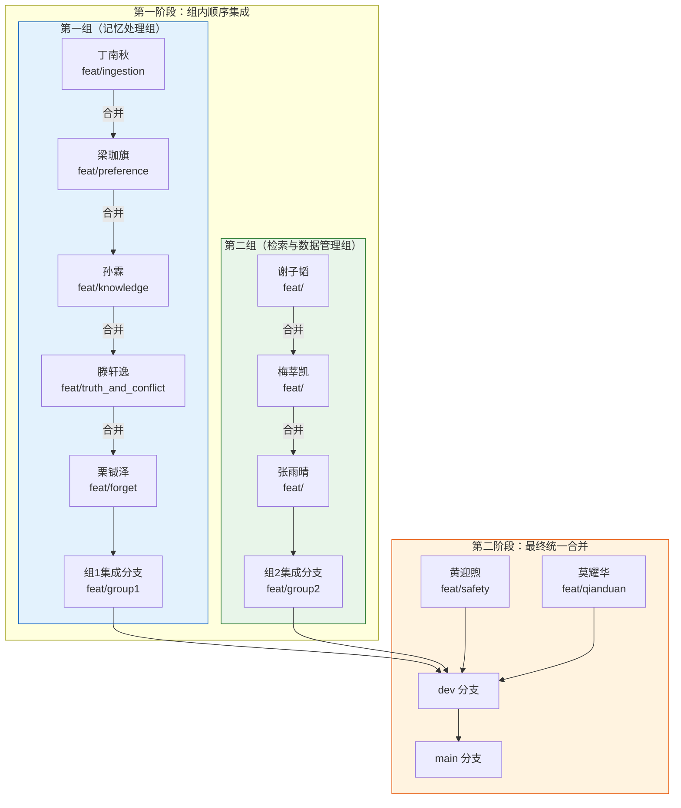

# Git 分支与版本管理指南

# **未经允许禁止向main分支提交代码！！！**


采用 **Git Flow** 简化版。

### 1.1 分支类型

| 分支类型 | 命名格式 | 生命周期 | 说明 |
|---------|----------|---------|------|
| 主分支 | `main` | 永久 | 生产环境代码，仅合并已测试通过的版本 |
| 开发分支 | `dev` | 永久 | 日常开发集成分支 |
| 功能分支 | `feat/<模块>-<功能>` | 临时 | 个人开发完成后合并到 dev |
| 修复分支 | `fix/<问题描述>` | 临时 | Bug 修复 |
| 发布分支 | `release/v<版本号>` | 临时 | 版本发布前的准备分支 |

### 1.2 人员分支规范

#### 人员分工与分支命名

| 成员 | 分工 | 分支名 |
|------|------|--------|
| 丁南秋 | 多源数据接入（清洗/标准化/质量评分） | `feat/dingnanqiu` |
| 梁珈旗 | 偏好记忆（抽取/置信度/版本管理） | `feat/liangjiaqi` |
| 孙霖 | 知识记忆（抽取/模板/工作流挖掘） | `feat/sunlin` |
| 滕轩逸 | 冲突处理（检测/解决）与事实记忆 | `feat/tengxuanyi` |
| 栗铖泽 | 遗忘功能 | `feat/lichengze` |
| 谢子韬 | 层次检索 | `feat/xiezitao` |
| 梅莘凯 | 数据库管理 | `feat/meishenkai` |
| 张雨晴 | 构建测评体系 | `feat/zhangyuqing` |
| 黄迎煦 | 安全模块 | `feat/huangyingxu` |
| 莫耀华 | 前端交互界面 | `feat/moyaohua` |

#### 分支合并流程总览

项目采用**分组并行开发 → 组内顺序集成 → 最终统一合并**的三阶段策略：



#### 详细合并步骤

**第一阶段：组内顺序集成**

**第一组—— 按以下顺序依次合并：**

| 步骤 | 操作 | 说明 |
|:----:|------|------|
| 1 | 丁南秋创建 `feat/dingnanqiu` | 基于 dev 创建，独立开发 |
| 2 | 梁珈旗创建 `feat/liangjiaqi` | 基于丁南秋分支创建 |
| 3 | 梁珈旗分支合入丁南秋分支 | `feat/dingnanqiu` ← `feat/liangjiaqi` |
| 4 | 孙霖创建 `feat/sunlin` | 基于丁南秋分支（已含梁珈旗代码）创建 |
| 5 | 孙霖分支合入丁南秋分支 | `feat/dingnanqiu` ← `feat/sunlin` |
| 6 | 滕轩逸创建 `feat/tengxuanyi` | 基于丁南秋分支创建 |
| 7 | 滕轩逸分支合入丁南秋分支 | `feat/dingnanqiu` ← `feat/tengxuanyi` |
| 8 | 栗铖泽创建 `feat/lichengze` | 基于丁南秋分支创建 |
| 9 | 栗铖泽分支合入丁南秋分支 | `feat/dingnanqiu` ← `feat/lichengze` |
| **结果** | **`feat/dingnanqiu` 包含五人代码** | **组1集成完成** |

**第二组—— 按以下顺序依次合并：**

| 步骤 | 操作 | 说明 |
|:----:|------|------|
| 1 | 谢子韬创建 `feat/xiezitao` | 基于 dev 创建，独立开发 |
| 2 | 梅莘凯创建 `feat/meishenkai` | 基于谢子韬分支创建 |
| 3 | 梅莘凯分支合入谢子韬分支 | `feat/xiezitao` ← `feat/meishenkai` |
| 4 | 张雨晴创建 `feat/zhangyuqing` | 基于谢子韬分支（已含梅莘凯代码）创建 |
| 5 | 张雨晴分支合入谢子韬分支 | `feat/xiezitao` ← `feat/zhangyuqing` |
| **结果** | **`feat/xiezitao` 包含三人代码** | **组2集成完成** |

**第二阶段：四大分支统一合并到 dev**

| 步骤 | 操作 | 说明 |
|:----:|------|------|
| 1 | 黄迎煦创建 `feat/huangyingxu` | 基于 dev 独立开发 |
| 2 | 莫耀华创建 `feat/moyaohua` | 基于 dev 独立开发 |
| 3 | 合并组1集成分支 | `dev` ← `feat/dingnanqiu` |
| 4 | 合并组2集成分支 | `dev` ← `feat/xiezitao` |
| 5 | 合并黄迎煦分支 | `dev` ← `feat/huangyingxu` |
| 6 | 合并莫耀华分支 | `dev` ← `feat/moyaohua` |
| **结果** | **dev 包含全部十人代码** | **可进入测试/发布流程** |

#### 操作命令示例

```bash
# ========== 第一组：顺序合并 ==========
# 丁南秋：创建并开发
git checkout dev
git checkout -b feat/dingnanqiu
# ... 开发
git push origin feat/dingnanqiu

# 梁珈旗：基于丁南秋分支创建
git checkout feat/dingnanqiu
git checkout -b feat/liangjiaqi
# ... 开发完成后，合并回丁南秋分支
git checkout feat/dingnanqiu
git merge feat/liangjiaqi
git push origin feat/dingnanqiu

# 孙霖：基于丁南秋分支（已含梁珈旗代码）创建
git checkout feat/dingnanqiu
git checkout -b feat/sunlin
# ... 开发完成后
git checkout feat/dingnanqiu
git merge feat/sunlin
git push origin feat/dingnanqiu

# 滕轩逸：同上
git checkout feat/dingnanqiu
git checkout -b feat/tengxuanyi
git checkout feat/dingnanqiu
git merge feat/tengxuanyi
git push origin feat/dingnanqiu

# 栗铖泽：同上
git checkout feat/dingnanqiu
git checkout -b feat/lichengze
git checkout feat/dingnanqiu
git merge feat/lichengze
git push origin feat/dingnanqiu
# 此时 feat/dingnanqiu 已包含五人代码 → 组1集成完成

# ========== 第二组：顺序合并 ==========
# 谢子韬：创建并开发
git checkout dev
git checkout -b feat/xiezitao
git push origin feat/xiezitao

# 梅莘凯：基于谢子韬分支创建
git checkout feat/xiezitao
git checkout -b feat/meishenkai
git checkout feat/xiezitao
git merge feat/meishenkai
git push origin feat/xiezitao

# 张雨晴：同上
git checkout feat/xiezitao
git checkout -b feat/zhangyuqing
git checkout feat/xiezitao
git merge feat/zhangyuqing
git push origin feat/xiezitao
# 此时 feat/xiezitao 已包含三人代码 → 组2集成完成

# ========== 第二阶段：最终合并到 dev ==========
# 黄迎煦、莫耀华基于 dev 独立开发
git checkout dev
git checkout -b feat/huangyingxu
git push origin feat/huangyingxu

git checkout dev
git checkout -b feat/moyaohua
git push origin feat/moyaohua

# 最终合并：将四大分支统一合入 dev
git checkout dev
git merge feat/dingnanqiu    # 合入组1（五人代码）
git merge feat/xiezitao      # 合入组2（三人代码）
git merge feat/huangyingxu   # 合入黄迎煦
git merge feat/moyaohua      # 合入莫耀华
git push origin dev
```

#### 注意事项

1. **合并顺序严格按照指定顺序执行**，避免依赖冲突
2. **每次合并前先拉取最新代码**：`git pull origin <目标分支>`
3. **合并冲突由当前提交者负责解决**
4. **各组集成完成后，统一合并到 dev 前需进行组内 Code Review**
5. **未经允许禁止向 main 分支提交代码**


---

## 二、工作流程

### 2.1 日常开发流程

```bash
# 1. 从 dev 拉取最新代码并创建功能分支
git checkout dev
git pull origin dev
git checkout -b feat/frontend-问卷组件

# 2. 开发过程中定期提交（小步提交，语义化注释）
git add .
git commit -m "feat(问卷): 添加问卷预览功能"

# 3. 开发完成后，推送到远程
git push origin feat/frontend-问卷组件

# 4. 在 GitLab/GitHub 创建 Merge Request → dev
# 5. 至少 1 人 Code Review 后合并
# 6. 删除已合并的功能分支
git branch -d feat/frontend-问卷组件
```

### 2.2 提交规范（Conventional Commits）

```
<type>(<scope>): <subject>

类型(type):
  feat     - 新功能
  fix      - 修复 Bug
  docs     - 文档更新
  style    - 代码格式（不影响逻辑）
  refactor - 重构
  test     - 测试相关
  chore    - 构建/工具变动

示例:
  feat(推荐服务): 实现协同过滤基础算法
  fix(问卷系统): 修复地图选点偏移问题
  docs(README): 更新部署文档
  feat(大屏): 新增方言分布热力图
```

---

## 三、版本管理（暂时不需要）

### 3.1 版本号规则（语义化版本）

```
v<主版本>.<次版本>.<补丁版本>

v1.0.0  →  首次交付版本
v1.1.0  →  新增功能（如新增方言岛推荐）
v1.1.1  →  Bug 修复
v2.0.0  →  重大架构变更
```

### 3.2 版本发布流程

```bash
# 1. 功能冻结，从 dev 创建发布分支
git checkout dev
git checkout -b release/v1.0.0

# 2. 仅修复 Bug，不添加新功能
git commit -m "fix(问卷): 修复提交闪退问题"

# 3. 测试通过后合并到 main 并打 Tag
git checkout main
git merge release/v1.0.0
git tag -a v1.0.0 -m "首次交付版本：问卷系统+基础推荐+数据大屏"
git push origin main --tags

# 4. 同时合并回 dev
git checkout dev
git merge release/v1.0.0

# 5. 删除发布分支
git branch -d release/v1.0.0
```


---

## 四、协作规范

### 4.1 合并规则

- **dev → main**：必须通过测试 + 至少 2 人 Review
- **功能分支 → dev**：至少 1 人 Review
- **禁止直接向 main 和 dev 推送代码**

### 4.2 冲突处理

```bash
# 合并前先拉取最新代码
git fetch origin
git rebase origin/dev

# 如有冲突，解决后
git add .
git rebase --continue
```

### 4.3 代码审查清单

- [ ] 代码符合项目编码规范
- [ ] 新增功能有对应测试用例
- [ ] 敏感信息（API Key、密码）未提交
- [ ] 提交信息符合 Conventional Commits 规范
- [ ] 数据库变更有迁移脚本

---

## 五、紧急修复流程

```bash
# 1. 从 main 创建 hotfix 分支
git checkout main
git pull origin main
git checkout -b fix/数据库连接泄漏

# 2. 修复并测试
git commit -m "fix(db): 修复连接池泄漏问题"

# 3. 同时合并到 main 和 dev
git checkout main
git merge fix/数据库连接泄漏
git tag -a v1.0.1 -m "修复数据库连接泄漏"
git push origin main --tags

git checkout dev
git merge fix/数据库连接泄漏
git push origin dev
```

---

## 六、常用命令速查

```bash
# 查看分支
git branch -a

# 查看提交历史
git log --oneline --graph

# 暂存当前工作
git stash
git stash pop

# 撤销工作区修改
git checkout -- <file>

# 撤销最近一次提交（保留修改）
git reset --soft HEAD~1

# 查看文件改动
git diff
git diff --staged
```
