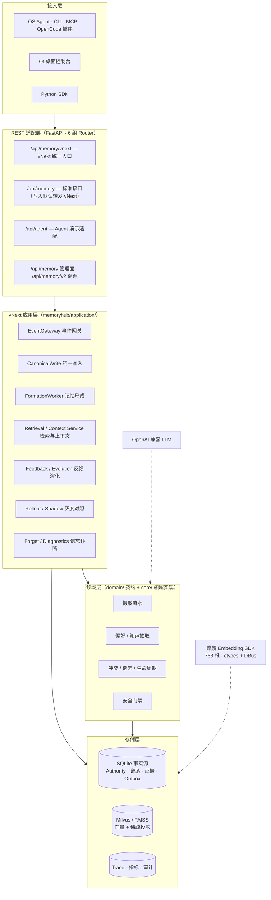

# Kylin MemoryHub

面向**银河麒麟桌面操作系统**的端侧 AI Agent 记忆引擎 —— 让 OS Agent 记住用户偏好、沉淀可复用的工作流知识，并在后续交互中低延迟、安全地复用这些记忆。

> 赛题：XA-202612《OS Agent 记忆优化及高效应用研究》（发榜单位：麒麟软件有限公司），题目原文见 [docs/赛题要求.md](docs/赛题要求.md)。

---

## 目录

- [核心能力](#核心能力)
- [系统架构](#系统架构)
- [仓库结构](#仓库结构)
- [快速开始](#快速开始)
- [Agent 接入](#agent-接入)
- [桌面控制台](#桌面控制台)
- [REST API 概览](#rest-api-概览)
- [评测与验收](#评测与验收)
- [测试](#测试)
- [麒麟部署（DEB）](#麒麟部署deb)
- [文档导航](#文档导航)

---

## 核心能力

| 能力 | 说明 |
|---|---|
| **多源数据整合** | 工具执行结果 / 用户行为 / 手动配置三类来源统一接入，清洗 → 标准化 → 质量评分 → 安全门禁四段流水，`source_hash` 幂等去重 |
| **偏好动态捕捉** | 规则 + LLM 双引擎抽取；`ToolPreferenceMiner` 从工具轨迹确定性挖掘工具选择偏好；版本链（version / parent_id / root_id）支持回溯 |
| **知识结构化整合** | workflow / case / template / fact 四类知识统一链路；等价/冲突判定 + LLM 合并 + 不可变版本快照；跨会话工作流挖掘 |
| **高效混合检索** | 麒麟 Embedding SDK（768 维）+ Milvus 稠密/稀疏混合检索，RRF 融合 + 6 因子重排 + 双层 LRU 缓存，目标 P99 ≤ 500ms |
| **记忆分层流转** | 短期（工作记忆）/ 中期（情景）/ 长期三层真实存储，定时 consolidation、健康度降级、艾宾浩斯遗忘曲线 |
| **安全与精准遗忘** | 声明式版本化敏感规则库 + 写入门禁 + AES-256 隔离区 + HMAC 哈希链审计；自然语言指令驱动的精准遗忘（LLM 意图解析 + 规则兜底 + 向量语义定位） |
| **反馈闭环（vNext）** | 使用/效用反馈 → 归因 → 记忆演化（REINFORCE / REVISE / SUPERSEDE / COEXIST / REVIEW），记忆越用越准 |
| **灰度与可回滚（vNext）** | legacy → shadow → dual-read → canary(5/25/50/100%) → vnext 五级切流，零容忍门禁 + 只读回滚 |
| **可观测性（vNext）** | 脱敏 Trace（FORMATION / EVOLUTION / RETRIEVAL / FORGET / INFRASTRUCTURE 五链）+ 指标 + 审计 SQLite 持久化，跨重启可查 |

## 系统架构

当前默认运行 **vNext 主链路**（`vnext.mode=vnext`），legacy 链路保留用于回滚与对照：



- **写入**：所有生产写入收敛到 Canonical Write → Authority 单写者（单事务：记忆 + 谱系 + 证据 + Outbox），向量/关键词/缓存经 Projection Outbox 异步投影，SQLite 是唯一事实源。
- **读取**：IntentRouter → RetrievalPlanner → 多通道执行（working / episode / vector / keyword / metadata / authority）→ RRF 融合 → 重排 → Scope 解析 → 预算控制 → 上下文装配。
- 详细设计见 [docs/architecture.md](docs/architecture.md) 与 [docs/vnext/design/ADR-vnext-memory-architecture.md](docs/vnext/design/ADR-vnext-memory-architecture.md)。

## 仓库结构

```
.
├── memoryhub/                     # 后端核心 Python 包
│   ├── app.py                     # FastAPI 入口（create_app + lifespan，模块级 app）
│   ├── config.py                  # dataclass 配置、生产门禁、vNext 切流
│   ├── adapter/                   # REST 路由层（api / agent_api / management_api / memory_v2_api / vnext_api）
│   ├── application/               # vNext 应用层（事件网关、canonical 写入、形成、检索、反馈、灰度、遗忘、看板）
│   ├── domain/                    # vNext 领域契约（candidate / episode / working / long_term / evolution）
│   ├── core/                      # 领域核心（ingestion / preference / knowledge / conflict / forget / safety / lifecycle / memory）
│   ├── retrieval/                 # 检索通道（vector / keyword / hybrid / milvus_hybrid / fusion / reranker / intent_router / planner / cache）
│   ├── storage/                   # 持久化（database / models / authority_repository / vnext_repositories / projection_outbox / vector_engine）
│   ├── observability/             # 脱敏 Trace、指标、审计存储
│   ├── embedding/                 # Embedding 抽象（kylin_client ctypes / mock_client）
│   ├── llm/                       # LLM 抽象（OpenAI 兼容客户端）
│   └── safety_rules/              # 版本化声明式安全规则库（JSON）
├── memoryhub_cli/                 # ┐ 源码桥接包（重定向到 agent-integration/ 下
├── memoryhub_client/              # │  的同名规范包，保证仓库根目录可直接
├── memoryhub_mcp/                 # ┘  python -m memoryhub_cli / memoryhub_mcp）
├── agent-integration/             # Agent 接入层（CLI / Python SDK / MCP server / OpenCode 插件）
├── desktop-client/                # Qt 5.15 Widgets 桌面控制台（C++17，CMake）
├── evaluation/                    # 评测体系（datasets / metrics / run_*.py / results 验收证据）
├── examples/vnext_demo/           # vNext 固定验收演示（六类场景 + run_demo.py）
├── scripts/                       # 运维脚本（服务启停 / 环境校验 / 迁移 / 投影修复）
├── packaging/linux/               # 银河麒麟 DEB 打包（build-deb.sh + 桌面/服务资产）
├── tests/                         # pytest 测试（133 个文件）
├── third_party/                   # 麒麟 SDK（向量引擎客户端源码 + embedding mock 动态库）
├── docs/                          # 当前文档（架构 / API / 配置 / 部署 / 评测 / vNext 规格）
├── old/                           # 历史文档归档（只读，不作为任何现状依据）
├── config.yaml                    # 本地开发配置
├── config.example.yaml            # 生产配置样板（含全部配置键与注释）
├── .env.example                   # 环境变量示例
├── opencode.json                  # OpenCode 项目级接入配置
├── pyproject.toml                 # 项目元数据、依赖与工具链配置
└── requirements.txt / requirements-dev.txt
```

## 快速开始

### 环境要求

- Python **3.11+**（Windows / Linux 均可开发；生产部署目标为银河麒麟 V10/V11）
- 可选：Node.js（OpenCode 插件）、CMake + Qt 5.15（桌面控制台）

### 安装与启动

```bash
# 1. 安装依赖（建议虚拟环境）
pip install -r requirements-dev.txt
# 或以可编辑模式安装（注册 memoryhub CLI / MCP 入口）
pip install -e .

# 2. 准备配置
cp .env.example .env          # 填入 LLM_API_KEY 等（可选，服务启动时自动加载）
# config.yaml 已提供本地开发配置（mock embedding + FAISS），可直接使用

# 3. 启动后端服务（默认 0.0.0.0:8099）
python -m uvicorn memoryhub.app:app --host 127.0.0.1 --port 8099
# 或使用服务脚本：scripts/start-memoryhub-service.sh（Linux）/ .ps1（Windows）

# 4. 验证
curl http://127.0.0.1:8099/api/memory/health
# 交互式 API 文档
# http://127.0.0.1:8099/docs
```

开发模式默认使用 `MockEmbeddingClient`（确定性向量）+ FAISS，无需麒麟环境即可跑通全链路；生产模式（`runtime.mode=production`）强制麒麟 Embedding SDK + Milvus，并有双层门禁校验（详见 [docs/configuration.md](docs/configuration.md)）。

## Agent 接入

三种接入方式共用同一 REST 契约（CLI 是底层母语，MCP / 插件是薄壳）：

```bash
# CLI
memoryhub search "周报格式" --json
memoryhub context "今天的工作计划"
memoryhub remember --type preference "我习惯用 Markdown 写周报"

# MCP server（stdio）
python -m memoryhub_mcp

# OpenCode 插件
node agent-integration/plugin/opencode/install_plugin.mjs
```

Python SDK：

```python
from memoryhub_client import MemoryHubClient

client = MemoryHubClient(base_url="http://127.0.0.1:8099", user_id="default")
client.write_canonical_events([...])          # vNext 统一写入
client.vnext_search({"query": "周报格式", "top_k": 5})
```

完整说明（全部子命令、MCP 工具清单、插件配置）见 **[agent-integration/README.md](agent-integration/README.md)**。

## 桌面控制台

Qt 5.15 Widgets（UKUI 风格，含毛玻璃侧边栏），覆盖记忆总览、检索、偏好/知识/事实、记忆分层、冲突、遗忘、安全、投影、vNext 看板、终端等 21+ 页面。

```bash
cd desktop-client
bash build-linux.sh              # 麒麟 / Linux
# Windows: powershell -ExecutionPolicy Bypass -File build-win.ps1
./build/memoryhub-client
```

构建详情与页面清单见 **[desktop-client/README.md](desktop-client/README.md)**。

## REST API 概览

| Router | 前缀 | 职责 |
|---|---|---|
| `vnext_api` | `/api/memory/vnext` | **vNext 统一入口**：事件写入、检索、上下文、任务恢复、遗忘、反馈、灰度控制、看板、诊断 |
| `api` | `/api/memory` | 标准接口：events / search / context / preferences / knowledge / facts(兼容转发) / forget / conflicts / feedback / sources / evaluate / extraction tasks |
| `management_api` | `/api/memory`（管理面） | 后台管理：记忆状态流转、健康度、短/中期查看、生命周期触发、安全审计/隔离区、系统配置 |
| `memory_v2_api` | `/api/memory/v2` | 溯源只读：lineage / evidence / audit / projections / search + replay |
| `agent_api` | `/api/agent`、`/api` | Agent 演示适配：step / replay / decision / demo-data、根级 health |

完整路由与数据契约见 **[docs/api.md](docs/api.md)**；vNext 契约规范见 [docs/vnext/spec/VNEXT_INTERFACE.md](docs/vnext/spec/VNEXT_INTERFACE.md)。

## 评测与验收

覆盖检索质量（Recall@K / MRR / NDCG / Precision）、延迟（P95/P99）、偏好提取、冲突处理、vNext 形成/检索/反馈、可靠性与全链路基准：

```bash
python evaluation/run_retrieval_eval.py        # 检索质量评测（dev/test 数据集）
python evaluation/run_latency_eval.py          # 延迟基准
python evaluation/run_vnext_eval.py            # vNext 形成/检索评测
python evaluation/run_vnext_comparison.py      # vNext vs legacy 对照
python -m examples.vnext_demo.run_demo --scenario all --output-dir examples/vnext_demo/output   # 固定验收演示（六类场景）
```

数据集、指标与已归档验收结果见 **[docs/evaluation.md](docs/evaluation.md)**。

## 测试

```bash
pytest                    # 全量（133 个测试文件，含 vNext 契约/场景/安全/回归）
pytest tests/test_vnext_docs.py -v   # 文档-代码一致性守护示例
```

开发流程与代码规范见 **[docs/development.md](docs/development.md)**。

## 麒麟部署（DEB）

```bash
bash packaging/linux/build-deb.sh    # 产出 packaging/linux/dist/kylin-memoryhub_<version>-<revision>_amd64.deb
sudo apt install ./packaging/linux/dist/kylin-memoryhub_0.1.0-1_amd64.deb
```

安装包含后端服务、桌面控制台、CLI/MCP、OpenCode 全局插件与 XDG 自启动配置；生产运行时（麒麟 Embedding SDK + Milvus）部署前请执行 `scripts/check_kylin_embedding_runtime.py` 逐项自检。详见 **[docs/deployment.md](docs/deployment.md)** 与 [packaging/linux/README.md](packaging/linux/README.md)。

## 文档导航

| 文档 | 内容 |
|---|---|
| [docs/README.md](docs/README.md) | 文档总索引 |
| [docs/architecture.md](docs/architecture.md) | 系统架构与数据流 |
| [docs/api.md](docs/api.md) | REST API 与数据契约参考 |
| [docs/configuration.md](docs/configuration.md) | 全部配置键、环境变量与生产门禁 |
| [docs/deployment.md](docs/deployment.md) | 部署、运维、备份与麒麟运行时 |
| [docs/evaluation.md](docs/evaluation.md) | 评测体系与验收结果 |
| [docs/development.md](docs/development.md) | 开发指南与测试 |
| [docs/vnext/](docs/vnext/) | vNext 规格与契约（spec/ 14 篇 + ADR + 总计划） |
| [docs/reference/](docs/reference/) | 麒麟 SDK 接口签名与运行时契约参考 |
| [agent-integration/README.md](agent-integration/README.md) | Agent 接入（CLI / MCP / 插件 / SDK） |
| [desktop-client/README.md](desktop-client/README.md) | 桌面控制台 |
| [packaging/linux/README.md](packaging/linux/README.md) | DEB 打包 |

> **`old/` 目录**为历史文档归档（历次重构计划、执行日志、历史验收快照、旧版 README 等），仅作过程留档与答辩佐证，**内容不代表当前实现**，请勿作为开发依据。
