# Kylin-MemoryHub 架构可视化

> **数据契约说明（v0.1.0）**：模块间统一事件以 [`memoryhub/adapter/schemas.py`](../memoryhub/adapter/schemas.py) 的 `MemoryEvent`（Schema 1.1）和 [`INTERFACE.md`](INTERFACE.md) 为准；本文中所有「代码事实」均以当前 `main` 分支源码为准（`memoryhub/app.py`、`memoryhub/core/*`、`memoryhub/retrieval/*`、`desktop-client/`、`agent-integration/`）。
>
> **生产栈 vs 开发栈**：默认架构图描绘「端侧生产栈」（麒麟 Embedding SDK + Milvus）；开发/测试栈使用 `MockEmbeddingClient` + `MilvusHybridRetriever(mock=True)` 或 `FAISSVectorEngine`（详见 `memoryhub/storage/vector_engine/__init__.py` 工厂）。`runtime.mode=production` 下强制生产栈，由 `memoryhub/config.py:validate_production_gate()` 与 `validate_production_runtime()` 双层门禁校验。
>
> **统一写入契约**：所有内容写入最终都收敛到 `MemoryWriteService.upsert_memory()`（`memoryhub/core/memory_write.py:98-158`）→ `DomainMemoryWriter` 单事务（`memoryhub/core/domain_writer.py`），下游 SQLite 是事实源，向量/关键词/缓存通过 `ProjectionOutboxWorker`（`memoryhub/storage/projection_outbox.py`）异步投影。`SafetyWriteGate.route()`（`memoryhub/core/safety/gate.py:181-`）是 `ApprovedWrite` 能力的唯一发放点。

---

## 1. 系统整体架构（分层视图）

> **代码事实**（v0.1.0）：应用入口 `memoryhub/app.py:171-866` 的 `create_app()` 注册 **5 个 Router**（`api.py:58` `/api/memory`、`agent_api.py:24` `/api/agent` + `:27` `/api`、`management_api.py:44` `/api/memory` 管理类、`memory_v2_api.py:18` `/api/memory/v2`）。8 个核心子模块：`ingestion / preference / knowledge / conflict / forget / safety / lifecycle / memory`；新增 `fact` 已并入 `knowledge/extract_facts`。检索器**生产唯一装配 `MilvusHybridRetriever`**（`retrieval/milvus_hybrid.py:106-520`），开发/测试模式才用 `HybridRetriever`（`retrieval/hybrid.py:23-308`）。

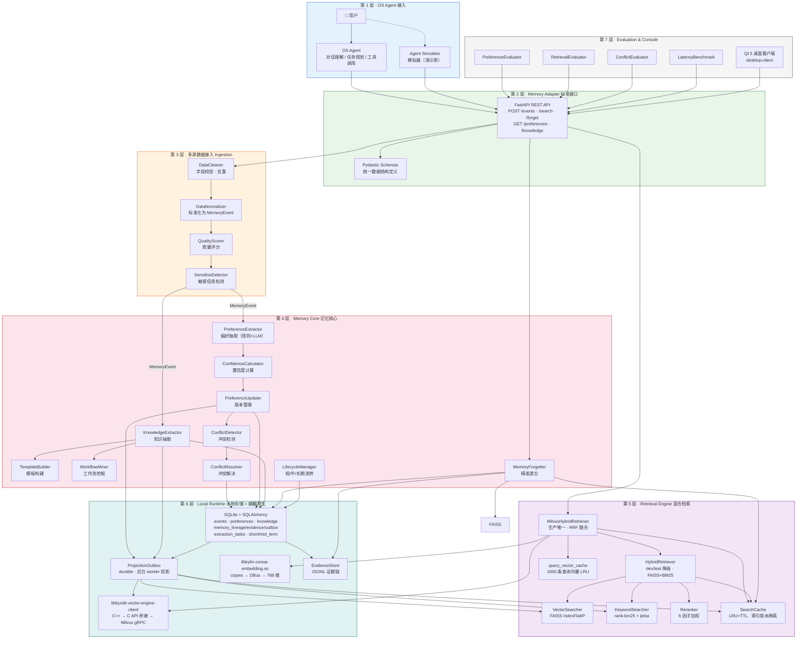

---

## 2. 写入数据流（事件 → 记忆）

> 当前 v0.1.0 已完成 Safety 数据/方法契约、版本化规则库、递归扫描、策略执行、
> 用户自定义敏感规则 Overlay、事件脱敏、同快照复检、最小化持久审计、REVIEW
> 加密隔离和强制写入 Gate。
> `POST /api/memory/events` 已接入完整摄取管线（`EventIngestionService`）：
> 幂等去重 → 质量评分 → 安全门禁 → 偏好/知识/事实抽取 → 失败重试队列。
> 所有内容写入（事件、显式偏好/知识、反馈更新）都必须经 `SafetyWriteGate`
> 签发能力后才落到受保护 sink（SQLite / Embedding / 向量 / 证据）。

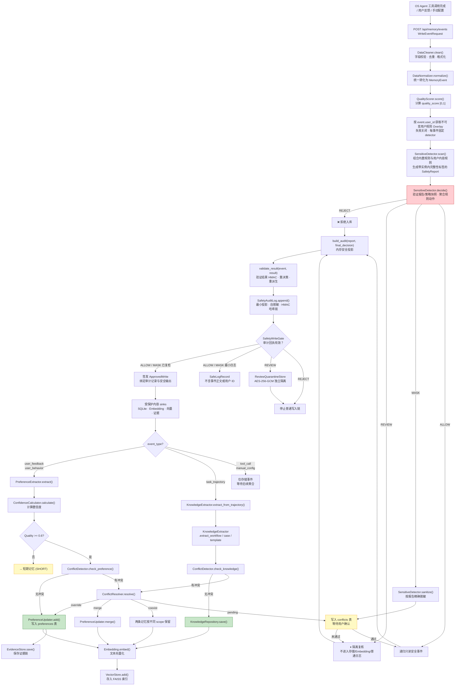

---

## 3. 检索数据流（生产栈 MilvusHybridRetriever）

> **代码事实**：生产环境仅装配 `MilvusHybridRetriever`（`memoryhub/retrieval/milvus_hybrid.py:106-520`），由 `memoryhub/app.py:711-738` 在 `runtime.mode=production` 下强制装配；开发/测试模式才使用 `HybridRetriever`（`retrieval/hybrid.py:23-308`，FAISS + BM25 手动加权）。生产检索器在 Milvus 引擎内部完成稠密 + 稀疏的 RRF（Reciprocal Rank Fusion）融合，Python 侧只取 Top-K。

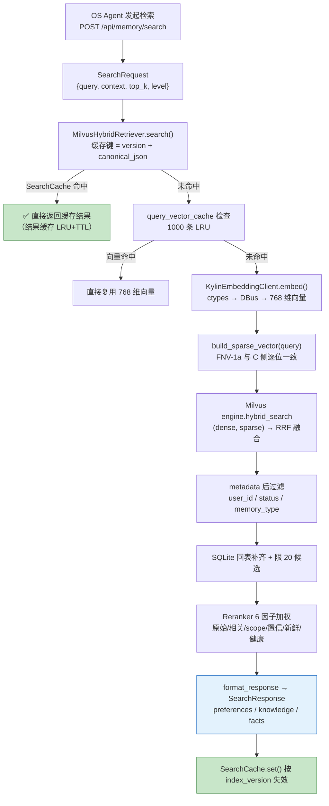

---

## 4. 精准遗忘数据流

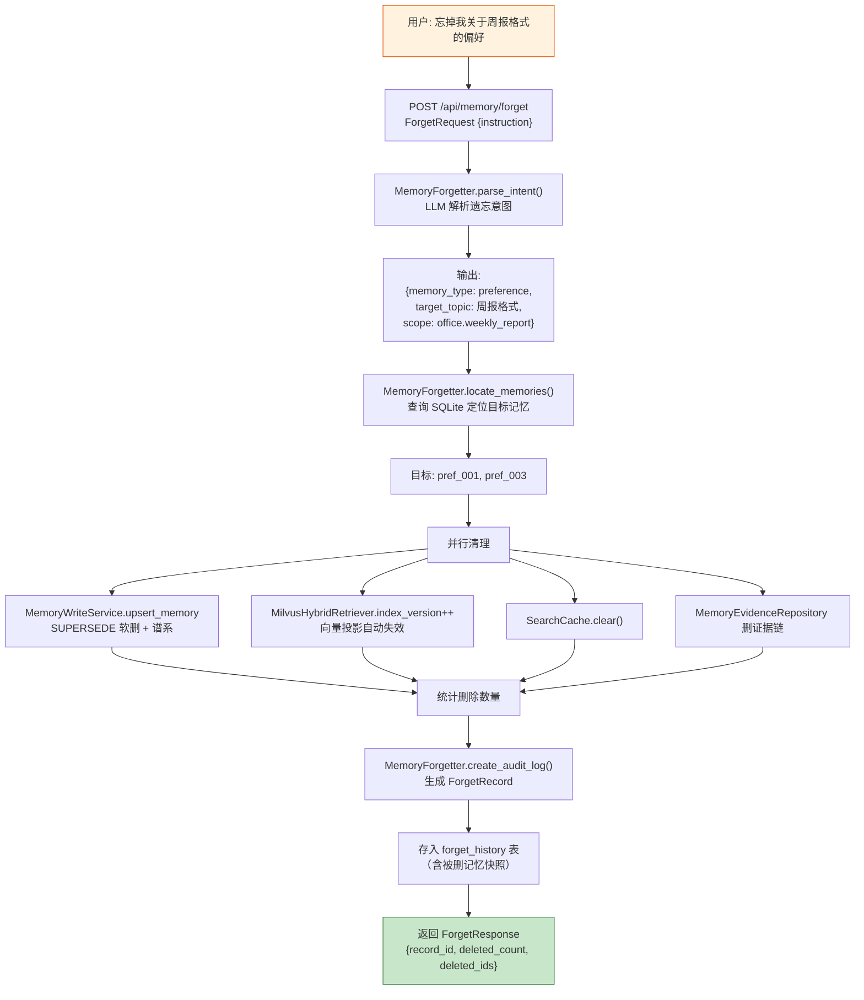

---

## 5. 记忆生命周期流转（三引擎 + Scheduler）

> **代码事实**：v0.1.0 已实现**三引擎 + 后台调度器**架构（`memoryhub/core/lifecycle/`）：`SessionConsolidator`（短期 → 中期）、`MemoryConsolidator`（中期 → 长期，含 `consolidate_tool_preferences()` 触发 `ToolPreferenceMiner`）、`MemoryDegrader`（长期低健康度 → 中期情景 `epi_dg_*`）。`LifecycleScheduler`（`scheduler.py:25-104`）后台线程每 300s 跑 `run_consolidation_cycle()`。手动触发入口 `POST /api/memory/lifecycle/{auto-forget,check,consolidate}`（`memoryhub/adapter/management_api.py:669-772`）。
>
> 健康度公式（`core/forget/health.py:54-75`）：`health = 0.6·time_decay + 0.4·usage_frequency`，上限 = confidence；艾宾浩斯 `R = e^(-t/S)`，其中 `S = half_life/ln2 · (1 + hits/10)`（复习强化）。`AutoForgetEngine` 阈值常量（`core/forget/auto_forget.py:20-22`）：`ARCHIVE_THRESHOLD=0.2` / `DEMOTE_THRESHOLD=0.4` / `REVIEW_THRESHOLD=0.6`。

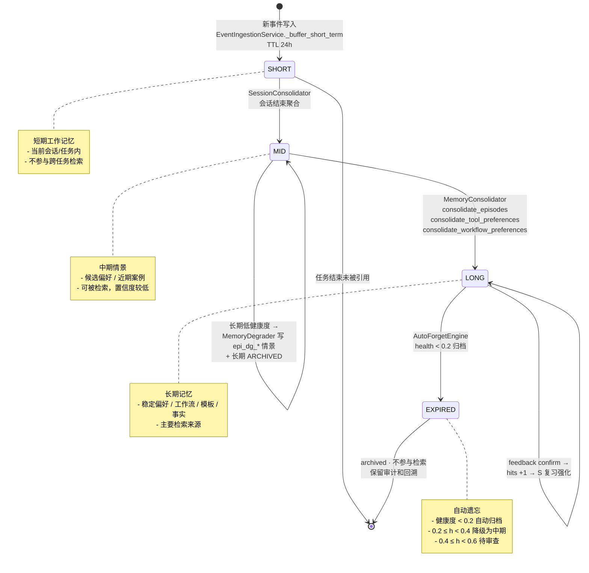

---

## 6. 模块依赖关系（v0.1.0 真实拓扑）

> **代码事实**：v0.1.0 在 `memoryhub/core/` 下有 **8 个核心子模块**：`ingestion / preference / knowledge / conflict / forget / safety / lifecycle / memory`（`memory` 是共享基元：BaseMemoryHandler / UnifiedConfidenceCalculator / EvidenceMerger / StructuredLLMAdapter / freshness_score）。`memoryhub/retrieval/` 拆分为生产检索器 `milvus_hybrid.py` + 降级 `hybrid.py`。`storage/vector_engine/` 拆分为 `faiss_engine / milvus_engine / _milvus_ctypes / sparse`（FNV-1a 稀疏向量）。

```mermaid
graph LR
    subgraph 入口层
        APP["app.py:171-866<br/>create_app() + lifespan"]
        API["adapter/api.py<br/>/api/memory"]
        Agent["adapter/agent_api.py<br/>/api/agent + /api"]
        Mgmt["adapter/management_api.py<br/>/api/memory 管理类"]
        V2["adapter/memory_v2_api.py<br/>/api/memory/v2"]
    end

    subgraph 数据结构层
        Schemas["adapter/schemas.py 1781 行<br/>⭐ 所有模块共享"]
        USchemas["adapter/user_rule_schemas.py"]
    end

    subgraph 核心逻辑层（8 模块）
        Ingestion["core/ingestion/<br/>+ adapters/"]
        Preference["core/preference/"]
        Knowledge["core/knowledge/<br/>（含 fact）"]
        Conflict["core/conflict/"]
        Forget["core/forget/<br/>（含 health）"]
        Safety["core/safety/<br/>（含 gate）"]
        Lifecycle["core/lifecycle/"]
        Memory["core/memory/<br/>（基元）"]
    end

    subgraph 检索层
        MilvusHybrid["retrieval/milvus_hybrid.py<br/>生产唯一"]
        Hybrid["retrieval/hybrid.py<br/>dev/test 降级"]
        VS["vector_search.py / keyword_search.py<br/>reranker.py / cache.py"]
    end

    subgraph 存储层
        DB["storage/database.py + models.py<br/>12 张表 + 8 个 Repository"]
        VEng["storage/vector_engine/<br/>milvus_engine / faiss_engine"]
        Sync["sync_service + projection_outbox +<br/>compensation_task"]
        Meta["memory_metadata.py<br/>lineage/evidence/outbox"]
    end

    subgraph 抽象层
        LLM["llm/openai_client.py"]
        Embed["embedding/kylin_client.py<br/>+ mock_client.py"]
        Rules["safety_rules/<br/>声明式规则库"]
    end

    APP --> API & Agent & Mgmt & V2
    APP --> DB & VEng & Embed & LLM & Rules

    API & Agent & Mgmt & V2 --> Schemas
    API --> Ingestion & Preference & Knowledge & Conflict & Forget & Safety & Lifecycle
    Mgmt --> DB & Forget & Lifecycle & Safety & Sync
    V2 --> Meta

    Ingestion --> Schemas & Safety & Rules
    Preference --> Schemas & Memory & Conflict & DB & Embed & LLM
    Knowledge --> Schemas & Memory & Conflict & DB & Embed & LLM
    Conflict --> Schemas & Memory & LLM
    Forget --> Schemas & Memory & DB
    Safety --> Schemas & Memory & LLM & Rules & DB
    Lifecycle --> DB & Memory & Sync

    MilvusHybrid --> Hybrid & VS & DB & Embed & VEng & Meta
    Hybrid --> VS & DB & Embed

    style Schemas fill:#ffcdd2,stroke:#c62828,stroke-width:3px
    style MilvusHybrid fill:#a29bfe,color:#fff
```

---

## 7. 麒麟 Embedding SDK 调用链

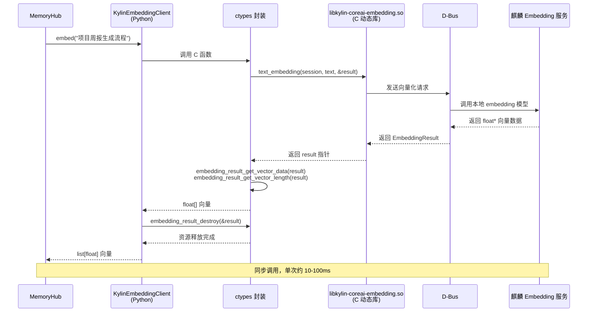

---

## 8. 混合检索融合策略

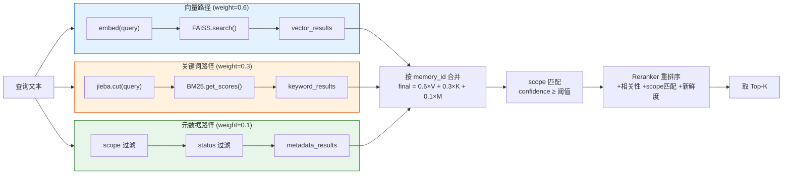

---

## 9. 偏好抽取决策流程

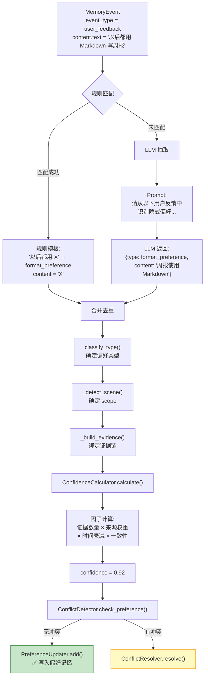

---

## 10. 端到端演示场景（周报生成）

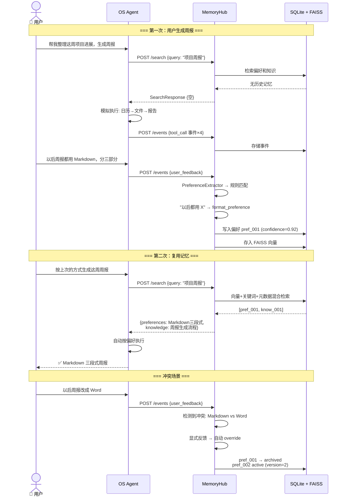

---

## 11. 前端页面与 API 对应关系

前端实现为 **Qt 5 原生桌面客户端**（`desktop-client/`），按当前 `main` 分支真实代码（`MainWindow.cpp:337-365` 注册 `registerPage(key, group, title, page)`）落地，共 **26 个 pageKey，6 大组**：

- **总览 / 内置终端**：`dashboard` / `terminal`（共 2）
- **记忆管理**：`mem/preference` / `mem/knowledge` / `mem/fact` / `mem/tiers`（共 4）
- **检索与冲突**：`search` / `conflicts` / `projections`（共 3）
- **遗忘与生命周期**：`forget/precise|pending|archived|recycle|health|history|settings`（共 7，全部在 `pages/ForgetPages.cpp`）
- **安全中心**：`safety/overview|user-rules|audit|quarantine`（共 4，全部在 `pages/SafetyPages.cpp`）
- **系统设置**：`settings/status|llm|config|demo`（共 4，全部在 `pages/SettingsPages.cpp`）

复用组件 12 个（`widgets/`）：`PageHeader / StatCard / ScoreRing / StatusTag / JsonViewer / EmptyState / DetailDrawer / MemoryFilterBar / ConfirmDialog / RoundedContainer / PageStateView / ProvenancePanel`。API 客户端 1 个（`api/ApiClient.cpp`，同步 + 异步 + Result 错误码）+ `j::` JSON 工具命名空间。

```mermaid
graph LR
    subgraph Qt5 桌面客户端（26 pageKey）
        P1["📊 总览 Dashboard"]
        P2["🧠 偏好 / 知识 / 事实 / 分层"]
        P3["🔍 检索测试 / 冲突中心 / 投影恢复"]
        P4["🗑 遗忘与生命周期（7 页）"]
        P5["🛡 安全中心（4 页）"]
        P6["⚙ 系统设置（4 页）"]
        P0["💻 内置 opencode 终端"]
    end

    subgraph REST API（5 Router）
        A1["GET /api/memory/preferences|knowledge|facts"]
        A2["POST /api/memory/search | /context"]
        A3["GET /api/memory/conflicts; POST .../resolve"]
        A4["POST /api/memory/forget[/preview]; GET .../history"]
        A5["PATCH /api/memory/memories/{id}/status; POST .../delete"]
        A6["GET /api/memory/memories/health"]
        A7["CRUD /api/memory/safety/user-rules"]
        A8["GET /api/memory/safety/audit-logs[/verify]"]
        A9["GET /api/memory/system/status | /config"]
        A10["GET /api/memory/safety/quarantine[/...]"]
        A11["POST /api/memory/lifecycle/{auto-forget,check,consolidate}"]
        A12["GET /api/memory/v2/memories/{id}/{lineage,evidence,audit}"]
        A13["GET /api/memory/short-term | /mid-term"]
        A14["GET /api/memory/extraction/tasks[/metrics]"]
    end

    P1 --> A1 & A6
    P2 --> A1 & A5 & A14
    P3 --> A2 & A3 & A12
    P4 --> A4 & A5 & A6 & A11 & A13
    P5 --> A7 & A8 & A10
    P6 --> A9
    P0 --> AgentSide["OS Agent / opencode 进程"]
    AgentSide --> A1 & A2
```

用户规则接口（`A7`）必须携带 `X-MemoryHub-User` 请求头；matcher 仅在创建或替换时
发送，读取响应不包含 matcher，数据库只存 AES-256-GCM 密文。其余管理类接口（审计
验链、隔离区放行、批量状态流转、健康度、生命周期触发）由 `management_api.py`
提供，详见 `desktop-client/README.md` 与接口文档。

---

## 12. 麒麟系统原生化（生产栈全景）

> **本章与《技术报告》第 9 章配套**；这里是图层面，最详细的代码事实见 `docs/MemoryHub_技术报告.md` §5 与 `docs/技术报告_框架_v1.docx` 第 9 章。

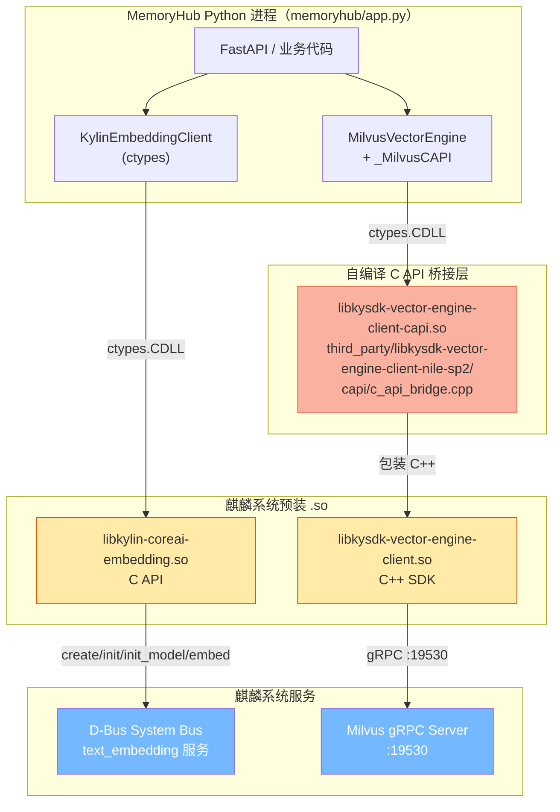

**生产栈硬约束**（`memoryhub/config.py:494-584` 双层校验）：

| # | 约束 | 违规行为 |
|---|---|---|
| 1 | `runtime.allow_fallback = false` | ProductionGateError |
| 2 | `embedding.provider = "kylin"`（禁止 mock / kylin_mock / auto） | 同上 |
| 3 | `embedding.dimension = 768` | 同上 |
| 4 | `vector_engine.provider = "milvus"`，`app_id` 非空 | 同上 |
| 5 | 运行时 `KylinEmbeddingClient.is_available()=true` 且 `get_dimension()=768`；`MilvusVectorEngine` 已连接且未关闭 | 同上 |

**端到端延迟预算**（`config.yaml retrieval.target_p95_ms / target_p99_ms`）：350ms / 500ms。`KylinEmbeddingClient` 单次超时 250ms；`MilvusVectorEngine` 单次超时 120ms。

**运行时契约部署前自检**：`scripts/check_kylin_embedding_runtime.py`（输出 `kylin_runtime_check.json`）逐项确认 8 条契约；`scripts/verify_kylin_environment.py` 验证开发栈 mock SDK。

---

## 13. Agent 接入三件套（CLI / MCP / OpenCode Plugin）

> **代码事实**：所有接入统一走同一份 REST 契约（`memoryhub/app.py` 5 Router）；CLI 是「记忆能力母语」，MCP / Plugin / 桌面控制台都是 CLI 薄壳或 REST 适配，逻辑零分叉。

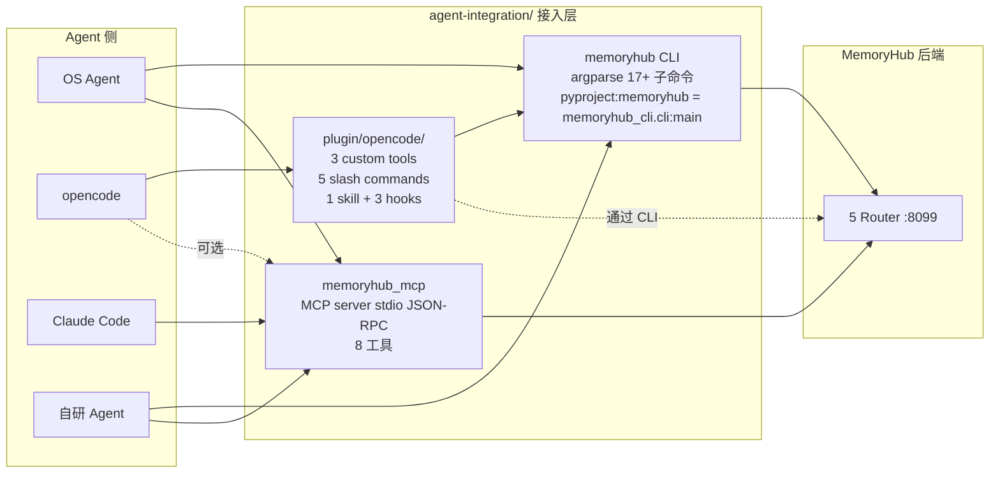

**CLI 17+ 子命令**（`agent-integration/memoryhub_cli/cli.py`）：`search / context / event / remember / update / forget [--preview] / list / get / provenance / projection list|replay / feedback / review / resolve / decide / knowledge fact propose / export / import / status / service / completion`。

**MCP 8 工具**（`memoryhub_mcp/tools.py:ToolRegistry._register()`）：
`memoryhub_health / search / get_context / write_event / remember / forget / feedback / knowledge_fact_propose`。

**OpenCode Plugin**（`agent-integration/plugin/opencode/`）：
- 3 custom tools：`memoryhub_search / memoryhub_get_context / memoryhub_remember`（薄壳调 CLI）
- 5 slash commands：`/memoryhub-context / -forget / -remember / -review / -status`
- 1 skill：`memory-awareness/SKILL.md`（agent 按 description 自动发现，判断何时调用记忆）
- 3 hooks：`tool.execute.after`（累积工具轨迹）+ `session.status(idle)` 冲刷 + `session.deleted` 兜底 + `experimental.session.compacting`（注入记忆到压缩期 prompt）

---

## 14. 统一写入契约（最关键工程纪律）

> **代码事实**：`MemoryWriteService.upsert_memory()`（`memoryhub/core/memory_write.py:98-158`）是所有写入来源的唯一收口；`DomainMemoryWriter`（`memoryhub/core/domain_writer.py`）把 `memory + lineage + evidence + outbox` 写在同一 SQL 事务里，要么全成要么全败。`SafetyWriteGate.route()`（`memoryhub/core/safety/gate.py:181-`）是 `ApprovedWrite` 能力的唯一发放点，**fail_closed 兜底**。

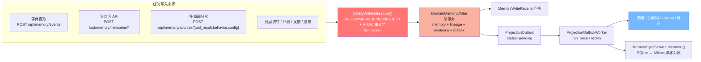

**4 处置 → sink 路由**（`SafetyWriteGate`）：

| 动作 | SQLite / Embedding / 向量 / 证据 | REVIEW 隔离区 | 持久审计 |
|---|---|---|---|
| `ALLOW` | ✓ ApprovedWrite | ✗ | ✓ |
| `MASK` | ✓ 脱敏后 ApprovedWrite（复检通过） | ✗ | ✓ |
| `REVIEW` | ✗ | ✓ AES-256-GCM 密文 | ✓ |
| `REJECT` | ✗ | ✗ | ✓ |

**Outbox 模式**：写入只到 durable outbox，由后台 `ProjectionOutboxWorker`（`memoryhub/storage/projection_outbox.py:25-99`）异步投影到 Milvus / 关键词 / 缓存；崩溃后由 `MemorySyncService.reconcile()` + `PendingIndexCompensationTask`（`storage/compensation_task.py:34-164`）补偿。`repair_at_startup()` 仅同步历史 `pending_index`，禁止全量重建。
