# Kylin-MemoryHub 架构可视化

---

## 1. 系统整体架构（分层视图）

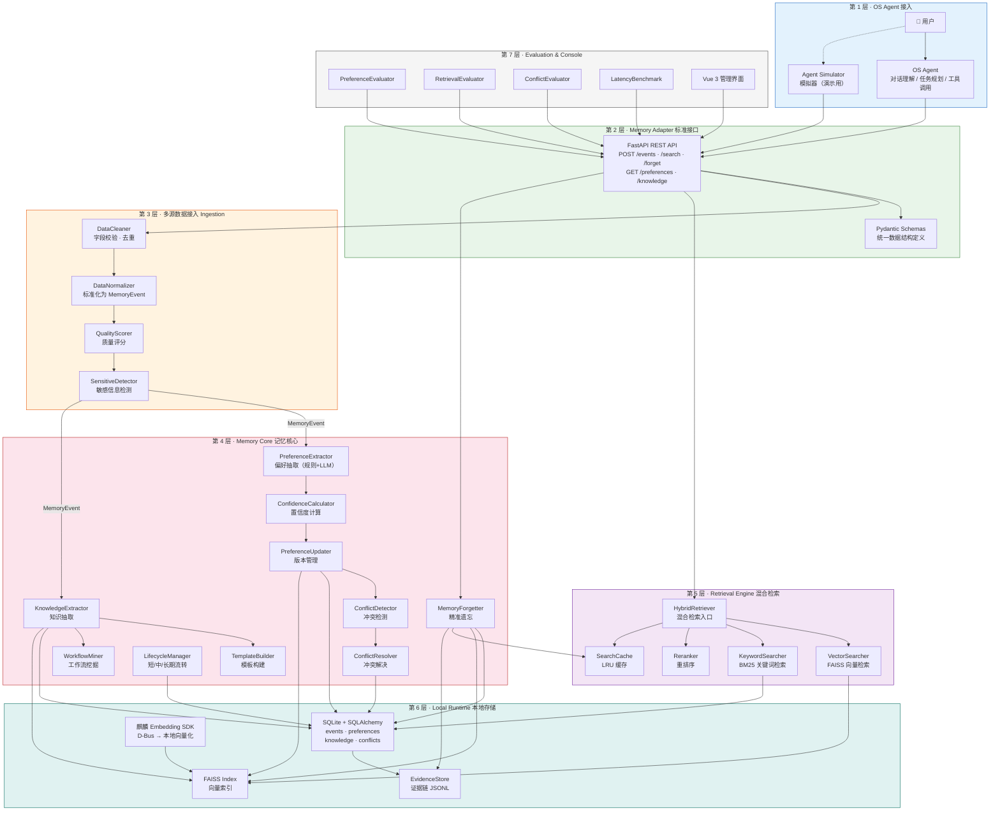

---

## 2. 写入数据流（事件 → 记忆）

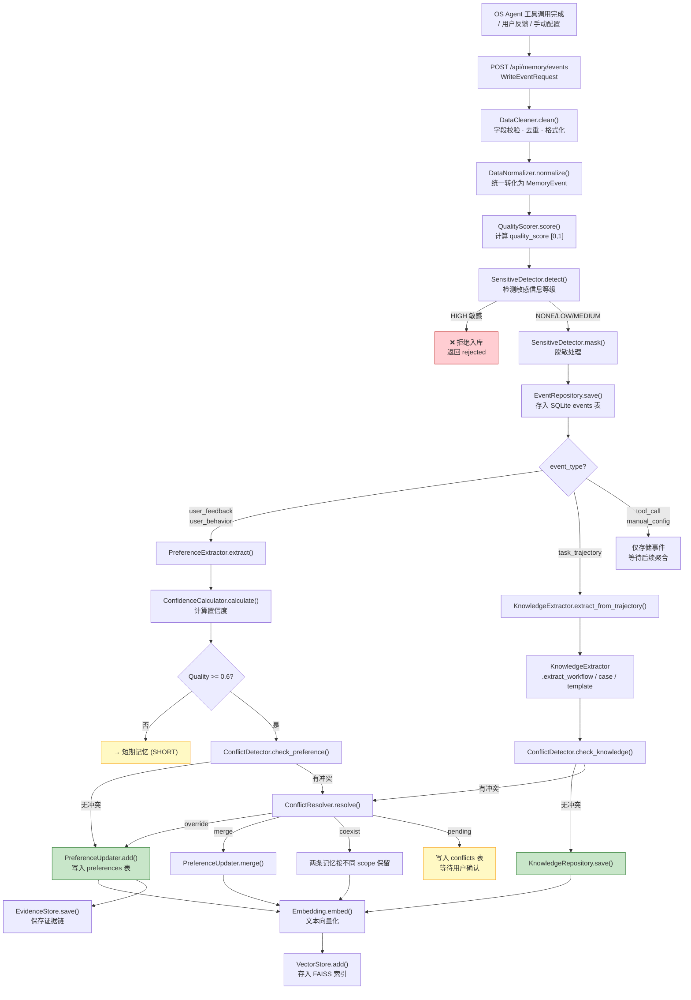

---

## 3. 检索数据流

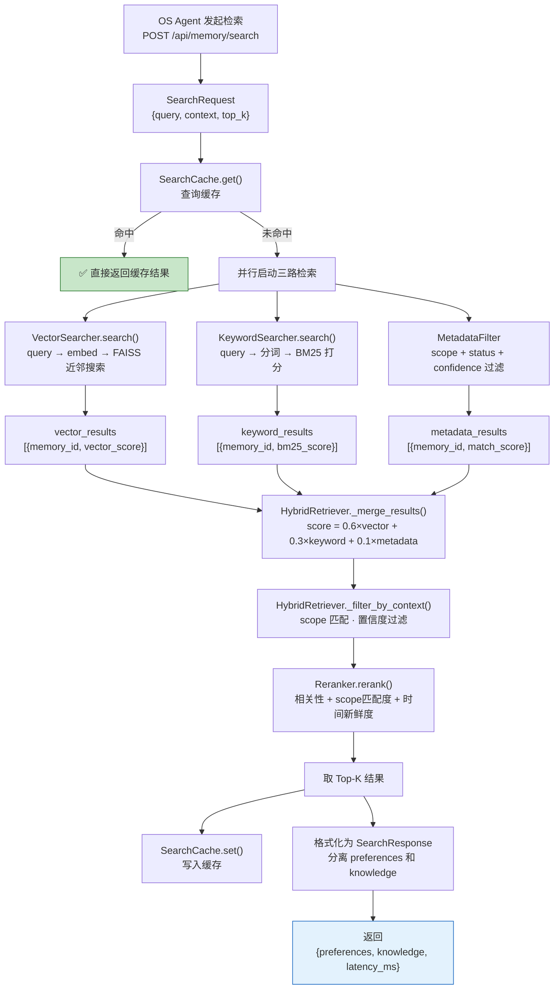

---

## 4. 精准遗忘数据流

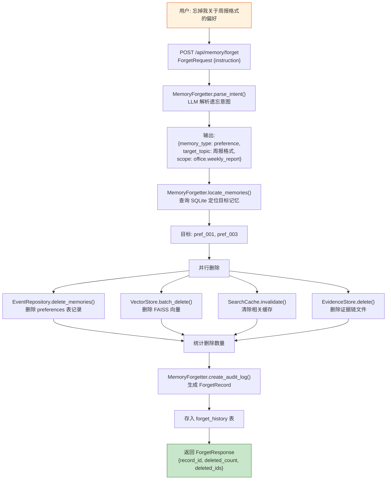

---

## 5. 记忆生命周期流转

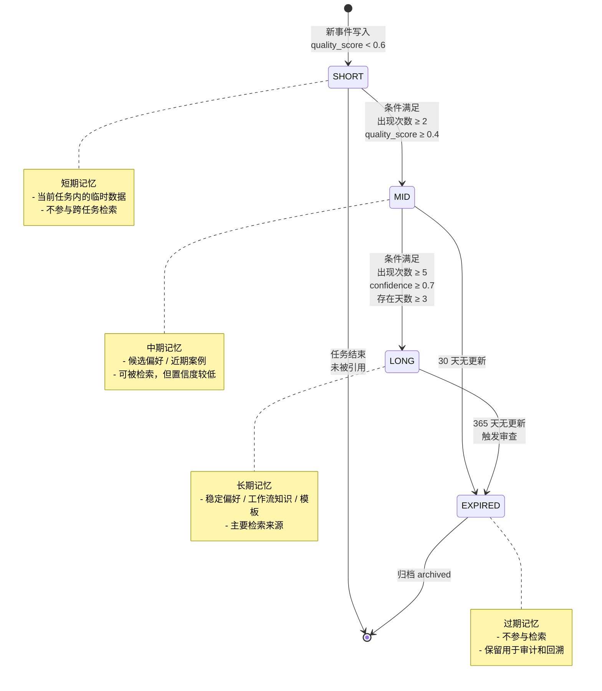

---

## 6. 模块依赖关系

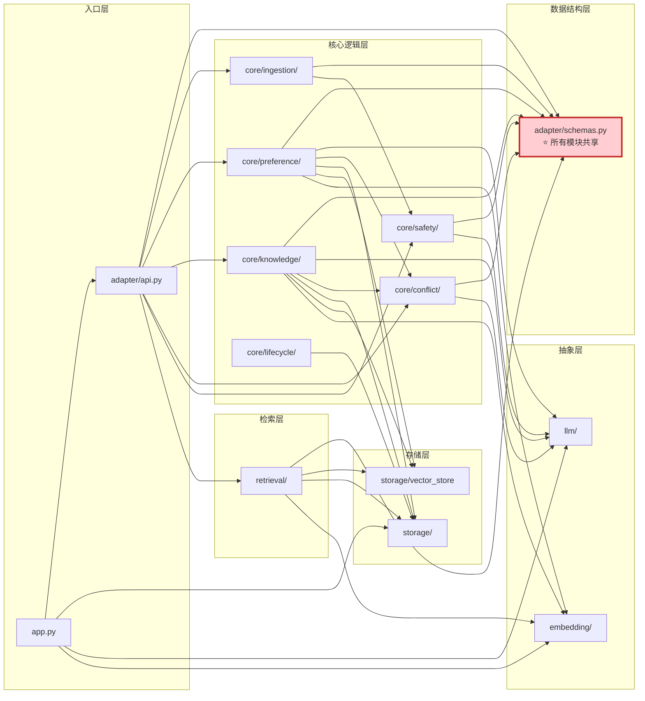

---

## 7. 麒麟 Embedding SDK 调用链

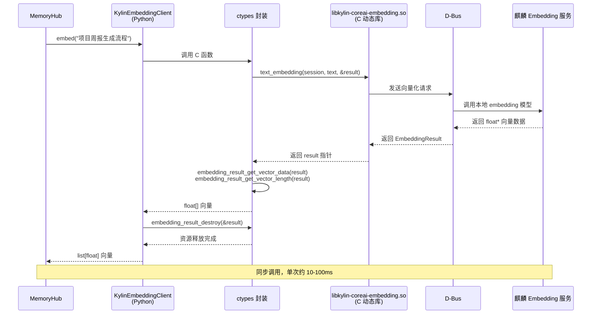

---

## 8. 混合检索融合策略

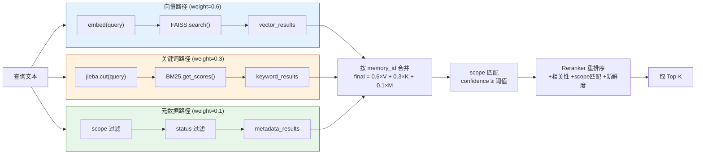

---

## 9. 偏好抽取决策流程

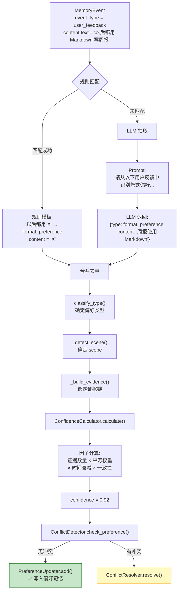

---

## 10. 端到端演示场景（周报生成）

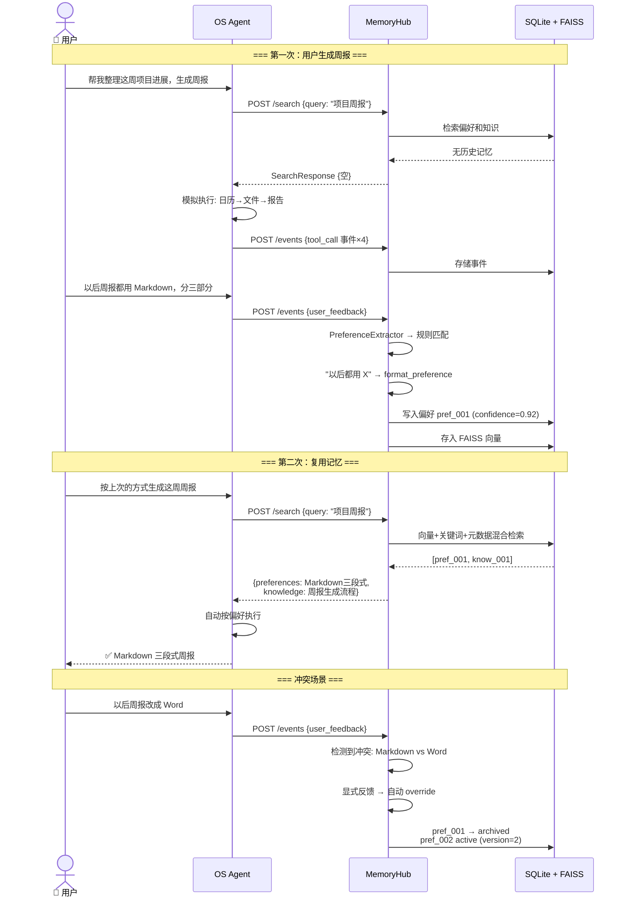

---

## 11. 前端页面与 API 对应关系

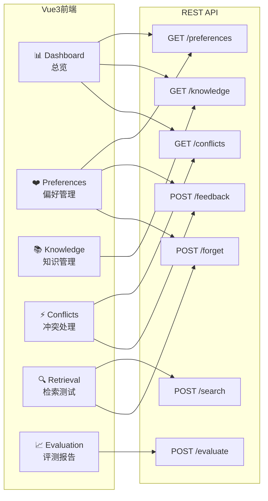
