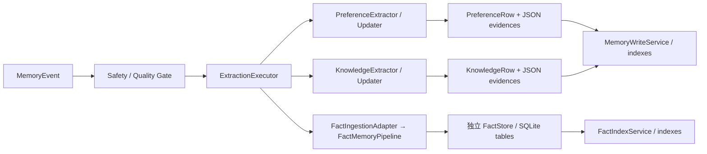
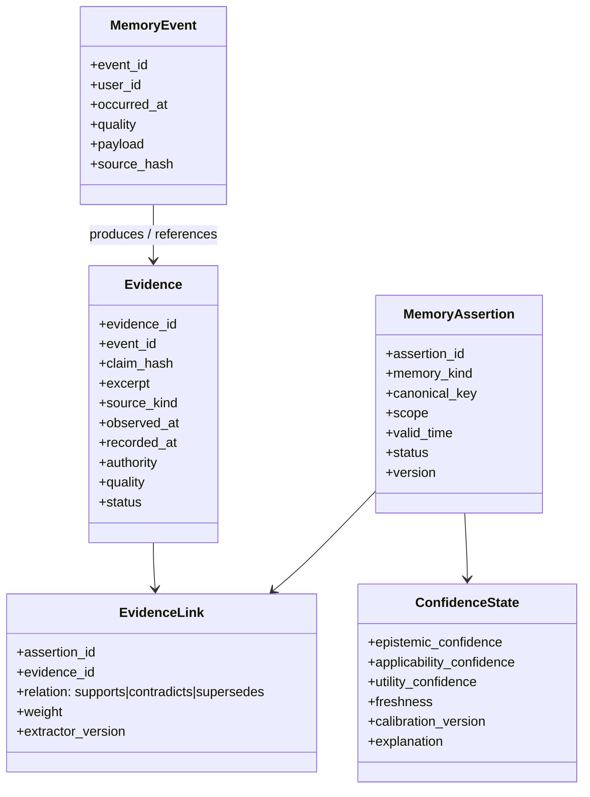
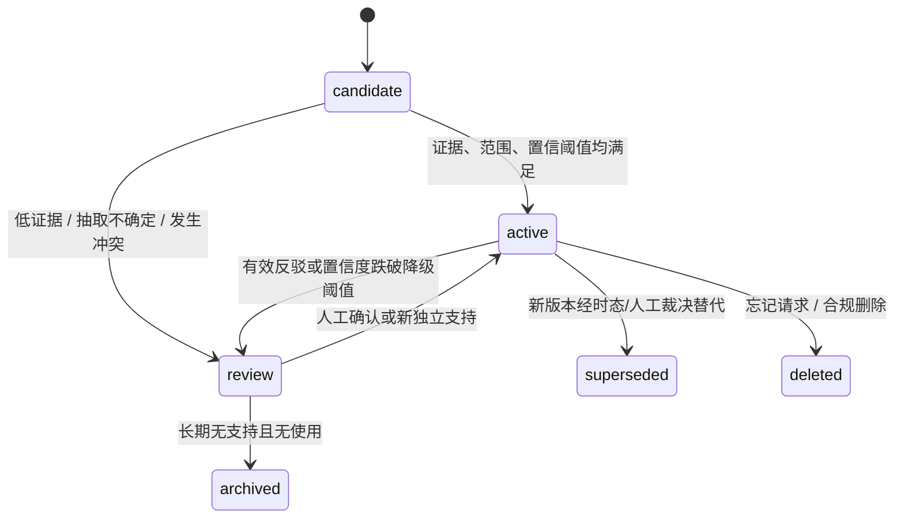

# Core 记忆模块优化与重构方案

> 审视范围：`memoryhub/core/{knowledge,fact,preference,ingestion,processing}`、统一 schema/存储/检索写入路径及相关测试。  
> 审视日期：2026-08-14。  
> 目标：把知识（Knowledge）、事实（Fact）、偏好（Preference）从三套“各自可运行”的实现，收敛为**同一事件、同一证据、同一置信度语义、同一生命周期**下的三种记忆视图；同时保留不同记忆类型的领域差异。

---

## 1. 执行摘要

当前 MVP 已具备事件接入、抽取、冲突、落库、索引和检索的主要构件，但三类记忆还没有真正形成一个统一的 memory-core：

- **知识与偏好**建立在 `MemoryEvent` / Pydantic / SQLAlchemy / `MemoryWriteService` 之上；
- **事实**则保留独立 dataclass、独立 SQLite `FactStore`、独立冲突模型和独立 LLM 兼容层；
- 三者都含有 `confidence` 和 `evidences`，但其含义、更新触发条件、存储位置和计算公式不同；
- 接入端有 `EventIngestionService` 与 `ExtractionExecutor`，同时又有 `EventProcessingCoordinator` 这条面向演示的平行路径，实际行为可能因 API 入口不同而变化；
- 事实模块把模型/端点固化为 DeepSeek 兼容调用，绕开了应用已装配的通用 LLM 配置与能力契约，是最需要优先处理的结构性问题。

**建议采用“统一记忆内核 + 类型化投影（typed projection）”的增量重构路线，而不是立即把三个模块硬合并成一个大类。**

核心落点：

1. 用 `MemoryCandidate`、`Evidence`、`MemoryAssertion`、`ConfidenceState`、`MemoryDecision` 组成统一领域模型；
2. 把 Knowledge / Fact / Preference 分别实现成各自的抽取器、规范化器和投影器；
3. 将 LLM 调用收敛到系统已有 `BaseLLMClient.generate()`，并用结构化输出校验、模型策略、重试和可观测性包裹；
4. 用证据级（而非记忆级）统计模型统一计算置信度，把“事实真伪”“偏好适用性”“知识可复用性”拆成可解释的独立维度；
5. 通过 Outbox / 统一写入服务协调数据库、证据、向量和关键词索引，避免目前事实路径的旁路写入。

---

## 2. 当前实现与问题定位

### 2.1 当前链路



关键实现事实：

- `memoryhub/core/ingestion/extraction.py` 的 `ExtractionExecutor` 已提供针对事件的幂等执行键，但事实、知识、偏好的身份与写入策略仍各不相同。
- `memoryhub/core/processing.py` 同时提供一条“演示适配层”处理链，且其中显式将 `llm_client=None`，因此同一事件通过不同入口可能使用不同的抽取能力与行为。
- `memoryhub/app.py` 启动时把应用级 `llm_client` 注入 `FactMemoryPipeline`，但事实子模块内部仍硬编码 `deepseek-chat` / `https://api.deepseek.com` 作为模型、端点默认值。
- 偏好与知识把 `Evidence` 内嵌到主表 JSON 列，并额外有 JSONL `EvidenceStore`；事实另设 `fact_evidence` 类关系，等于至少存在两套证据持久化模型。

### 2.2 优先级问题清单

| 优先级 | 问题 | 影响 | 证据位置 |
|---|---|---|---|
| P0 | 事实模块 LLM 调用绕开全局 LLM 配置，硬编码 DeepSeek 模型/端点 | 切换 provider、模型治理、超时/重试、审计、成本控制都不一致；非 OpenAI chat-completions 兼容 client 存在适配风险 | `core/fact/extractor.py`、`normalizer.py`、`conflict.py`、`llm.py` |
| P0 | 三种记忆并无统一证据模型与证据写入事务 | 无法回答“这条记忆为何可信、更新由哪些新证据触发”；跨存储不一致时难修复 | `FactStore`、主表 `evidences` JSON、`storage/evidence_store.py` |
| P0 | `confidence` 语义混杂 | LLM 置信度、事件质量、成功率、时间衰减、冲突结果被放进同一 0~1 数值；无法比较或调参 | `core/knowledge/confidence.py`、`core/preference/confidence.py`、`core/fact/models.py` |
| P1 | 冲突机制重复且行为不统一 | 偏好/知识走通用 `ConflictRecord`/版本逻辑；事实走独立 `ConflictResult`、`Resolution`、状态机；跨类型冲突无法表达 | `core/conflict/*`、`core/fact/conflict.py` |
| P1 | 事实作用域与时间语义不足 | 只有 `global/project`，`observed_at` 在提交时取当前时间，未区分“事件发生时间、主张生效时间、写入时间”；历史事实容易被错误覆盖 | `core/fact/models.py`、`core/fact/pipeline.py` |
| P1 | 事实候选提取直接喂入工具序列化文本 | 工具参数、结果、日志可能被 LLM 当作自然语言事实；结构化字段、来源权威性和工具状态未参与事实得分 | `core/fact/event_adapter.py` |
| P1 | 并行入口造成结果漂移 | 实际 API 路径与演示路径的 LLM、冲突、回退策略不一致，难以复现线上行为 | `core/processing.py`、`app.py` |
| P2 | 事实层使用独立 SQLite 访问方式 | 与 SQLAlchemy 事务、迁移、软删除、审计、备份策略及 `MemoryWriteService` 难以统一 | `core/fact/store.py` |
| P2 | 测试多为单模块/行为测试 | 尚缺跨记忆证据追溯、置信度校准、入口一致性、并发幂等、索引最终一致性验证 | `tests/test_fact/*`、`tests/test_knowledge/*`、`tests/test_preference_functionality.py` |

> 当前定向测试基线：`93 passed, 2 skipped`（事实、知识、偏好及数据流相关测试）。这说明 MVP 的既有行为被覆盖，但并不证明三类记忆的领域语义已统一。

---

## 3. 深度问题分析

### 3.1 三套模型形成了“概念同名、实现异构”

三类记忆都包含 `memory_id`、状态、置信度、证据、作用域、版本/访问等概念，但：

- **偏好**：`PreferenceMemory` 内含 `root_id`、`parent_id`、`quality_score`、`extract_source`，证据来自用户行为/手工配置/工具结果；
- **知识**：`KnowledgeMemory` 以工作流、案例、模板表达；其置信度又结合结构、步骤、成功次数和证据数量；
- **事实**：`Fact` 是 subject-predicate-object，使用独立实体、本体、事实状态和独立 evidence/conflict 表，但没有与通用 `Evidence`、`ConflictRecord`、`MemoryWriteService` 对齐。

结果是：检索层可以把它们都当“memory”，但核心层没有一个一致的回答：**一条记忆究竟是什么、根据什么被建立、在什么条件下被强化/降级/废弃。**

### 3.2 证据链不是“来源图”，而是三个不同的附件机制

目前证据至少有以下表示：

1. `PreferenceMemory.evidences` / `KnowledgeMemory.evidences` 的 JSON 列；
2. `EvidenceStore` 按 memory_id 追加的 JSONL；
3. 事实表中的 `source_text`、`source_id`，以及事实专有 evidence 保存；
4. 事件表中的 `source_hash`、`quality`、`tool_calls`。

问题不只是重复存储，还包括：

- 没有一个不可变的证据主键与内容哈希，以防重复计数；
- 记忆合并时仅按 `event_id/evidence_id` 去重，不能区分同一事件中的多条独立主张，也无法识别同源转述；
- 没有明确的 `supports / contradicts / supersedes / derived_from` 边；
- 无法记录 LLM 的抽取版本、prompt 模板版本、模型版本与结构化校验结果；
- 没有“证据已撤回、来源失效、事件被遗忘”时如何级联重算记忆的机制。

### 3.3 置信度目前不可横向解释，也无法可靠校准

当前公式各自合理，但不可合并：

- 知识使用加权因素与最弱项惩罚，并把 success/total/evidence 与旧分数混合；
- 偏好使用来源权重、时间衰减、一致性、证据数、冲突惩罚和 sigmoid；
- 事实基本采用抽取结果 `RawTriple.confidence`，再由冲突决策改变状态，缺少一致的证据聚合与时间有效性计算。

这会造成如下风险：

- “LLM 自报 0.9”可能比“多次工具成功验证”的 0.75 更高，但两者可信含义不同；
- 事实真值、偏好当前适用性、知识复用成功率都用 `confidence` 表示，检索或写入阈值无法统一；
- 证据增量、冲突、过期、人工确认后，不能用统一规则复算；
- 不能做可靠的离线校准（例如置信度为 0.8 的记忆，长期真实命中率是否约为 80%）。

### 3.4 事实模块的 LLM 使用方式需要重构

这是最明确的技术债：

1. **硬编码 Provider 语义**：提取器、归一化器、冲突检测器分别默认 `deepseek-chat` 和 DeepSeek endpoint；应用级 `LLMConfig` 的 provider/model/base URL 没有成为事实模块唯一配置来源。
2. **协议双轨**：系统已有 `BaseLLMClient.generate(prompt, system_prompt=...)`；事实模块又自建 `chat.completions.create` shim。它能临时兼容，但让模型参数、结构化输出、错误类型、工具调用和观测指标分叉。
3. **模型选择不可按任务治理**：三元组提取、实体消歧、谓词映射、冲突裁决的风险与成本不同，当前都隐式使用同一个硬编码模型。
4. **非结构化 JSON 解析脆弱**：虽然有代码围栏处理和规则回退，但未以 JSON Schema/Pydantic 强制验证、未保留拒绝原因、未记录模型响应/抽取版本。
5. **回退语义不安全**：LLM 失败后对自然语言文本做规则三元组抽取，可以保证可用性，却可能在信息不足时把候选写成客观事实。规则回退应产生低置信候选或 `review`，而非直接提升为可自动提交的事实。
6. **事实来源未参与模型推理边界**：`FactIngestionAdapter` 将工具调用参数和结果格式化为一段文本；LLM 可误把参数中的“期望值”理解成工具返回的“观察值”。

### 3.5 冲突和更新缺失事件时间/有效时间建模

当前事实在 `commit()` 时将 `observed_at` 设置为当前时间。它并不等于：

- 事件实际发生时间；
- 事实开始生效时间；
- 系统观察/获取时间；
- 系统写入时间。

所以“去年项目负责人是 A、今天改为 B”与“用户今天转述去年负责人是 A”都会获得近似的“新鲜度”。单值谓词的 replace 很容易错误处理历史记录。

偏好、知识同样需要区分“最后被支持时间”和“最后被成功复用时间”；目前版本链可以保留演进，但缺乏统一的时态与证据因果关系。

---

## 4. 目标架构：统一内核 + 类型化投影

### 4.1 设计原则

1. **事件是输入事实，记忆是可撤销的派生结论**：不能把 LLM 输出当作原始事实。
2. **证据先行**：每个记忆都必须由可定位、可去重、可撤回的证据支撑。
3. **置信度拆维度**：不再让一个数同时代表正确性、适用性、成功率和时效性。
4. **纯决策与副作用分离**：抽取、归一化、冲突、置信度计算均输出可审计 decision；写入由一个事务编排器完成。
5. **类型差异保留在 projection 层**：事实三元组、偏好策略、知识工作流是不同投影，不在底层重复实现生命周期。
6. **LLM 仅负责受控的语义步骤**：LLM 生成候选/判断，代码负责 schema 校验、范围约束、置信度、持久化和状态机。

### 4.2 建议领域模型



#### 关键对象说明

| 对象 | 用途 | 不可变性 |
|---|---|---|
| `MemoryEvent` | 通过安全门和质量门后的上游记录 | 不可变；遗忘时逻辑删除/加密隔离 |
| `Evidence` | 从 event 或可验证工具结果截取的最小支持单元 | 不可变，拥有内容哈希与来源定位 |
| `MemoryAssertion` | 一条可查询、可版本化的记忆主张 | 有状态、有版本 |
| `EvidenceLink` | 证据与主张的支持、反驳、替代关系 | 追加式 |
| `ConfidenceState` | 对当前 assertion 的可复算快照 | 可覆盖，但保留计算版本和解释 |
| `MemoryDecision` | 抽取/合并/冲突/升级人工的机器决策 | 不可变审计记录 |

### 4.3 三类记忆如何映射

| 类型 | `canonical_key` | 主要载荷 | 主要置信维度 | 默认更新策略 |
|---|---|---|---|---|
| Fact | `subject + predicate + scope` | object、实体链接、时态区间 | `epistemic + freshness` | 支持/反驳证据聚合；单值关系做时态替代 |
| Preference | `user + preference_type + normalized target + scope` | desired value、约束、显式性 | `applicability + freshness` | 显式偏好优先；隐式证据逐步累积；可按场景并存 |
| Knowledge | `user/org + task signature + scope + knowledge_type` | workflow/template/case | `utility + evidence + freshness` | 基于成功/失败复用事件演进版本，失败可降级/回滚 |

三种记忆可共享：身份、证据、冲突、版本、审计、遗忘、索引 outbox；各自保留规范化、相似度和领域规则。

---

## 5. 统一证据链方案

### 5.1 证据表与链接表

建议在现有 SQLAlchemy 数据库中新增，而不是继续扩张 JSONL/JSON/独立 SQLite 三套存储：

```text
memory_evidences
- evidence_id (PK)
- event_id (FK / 可空，允许外部受控来源)
- source_kind: user_statement | tool_result | system_observation | manual | imported
- content_hash
- excerpt
- structured_locator (JSON：tool_call_id / JSONPath / message span)
- occurred_at / observed_at / recorded_at
- authority_score
- quality_score
- status: active | retracted | invalidated
- metadata_json

memory_assertions
- assertion_id (PK)
- kind: fact | preference | knowledge
- canonical_key
- subject/predicate/object 或 payload_json
- scope_json
- valid_from / valid_to / transaction_time
- status: candidate | active | review | superseded | archived | deleted
- root_id / parent_id / version

assertion_evidence_links
- assertion_id
- evidence_id
- relation: supports | contradicts | derives | supersedes
- extractor_name / extractor_version
- model_provider / model / prompt_version
- extraction_score
- independent_source_group
- created_at
```

约束：

- `content_hash + structured_locator + event_id` 唯一，防止一次重试把同一证据重复计权；
- `assertion_id + evidence_id + relation` 唯一；
- 事件、证据、主张、决策都用同一 `user_id/tenant_id` 作为隔离键；
- 事实的实体/谓词可继续独立建表，但必须由 `FactProjection` 使用统一 assertion ID 与 evidence link。

### 5.2 证据独立性与权重

不能简单按证据数相加。应对每条证据产生：

```text
support_weight = source_authority
               × event_quality
               × extraction_entailment
               × freshness_decay
               × independence_discount
```

- **authority**：用户显式陈述、成功工具结果、受信配置、模型推断、导入文本应有不同上限；
- **extraction_entailment**：模型必须输出“证据片段是否蕴含该主张”，而不仅仅输出三元组；
- **freshness**：与记忆类型和谓词/偏好类别相关；
- **independence_discount**：同一 event、同一会话、同一工具调用、同一外部文档的重复转述只算一次或递减；
- **contradiction**：不覆盖旧证据，只添加反驳边并触发状态决策。

### 5.3 证据的撤回与遗忘

遗忘不应只删除一条投影记忆：

1. 目标事件/证据标记为 `retracted/deleted`；
2. 查询所有 `EvidenceLink`；
3. 对受影响 assertion 重算置信度；
4. 若不再满足激活阈值，转为 `review` 或 `archived`；
5. 同步更新索引 outbox；
6. 审计中只保留不可逆摘要与受影响 ID，遵循现有安全策略。

---

## 6. 置信度重构方案

### 6.1 从一个分数改为“向量 + 派生分数”

建议对外可继续返回 `confidence`（兼容 API），但内部固定存四个字段：

```text
C = {
  epistemic: 主张为真的可信度，主要用于 Fact；
  applicability: 当前用户/当前场景仍适用的可信度，主要用于 Preference；
  utility: 使用后成功/有帮助的可信度，主要用于 Knowledge；
  freshness: 未过期程度，所有类型都有。
}
```

对外兼容字段：

- Fact：`confidence = epistemic × freshness`
- Preference：`confidence = applicability × freshness`
- Knowledge：`confidence = utility × freshness`

同时保存 `confidence_explanation_json`：支持证据数、反驳证据数、独立来源组数、最新事件、有效样本、公式/校准版本、阈值命中情况。这样能让 API、控制台和人工复核解释“为什么是 0.67”。

### 6.2 推荐计算方法

#### A. Fact：Beta-Binomial 证据聚合 + 冲突惩罚

对于相同 canonical fact 的有效支持/反驳权重：

```text
alpha = alpha0 + Σ support_weight
beta  = beta0  + Σ contradiction_weight
base_epistemic = alpha / (alpha + beta)
confidence = base_epistemic × freshness × scope_fit
```

- `alpha0/beta0` 按谓词类别设置先验：例如用户手工配置、工具查询结果、自然语言推断不能共享同一先验；
- 同源证据经过独立性折扣；
- 只让具备可定位证据的候选达到 `active`；
- 单值关系发生冲突时，先形成并存的时态候选，再由规则/人工/LLM 决定 `valid_to`，不要直接依赖“新写入时间更晚”。

#### B. Preference：显式性优先的适用性模型

```text
applicability = sigmoid(
    explicit_override
  + weighted_confirmations
  - weighted_rejections
  + scope_match
  - staleness
)
```

规则：

- 用户明确指令（例如“以后全部用中文”）应创建高权重 evidence，可覆盖隐式推断；
- 隐式行为应累计观察次数并保留上下文，不能仅因一次行为建立强全局偏好；
- “未使用”不等于反证，明确纠正、选择另一个选项、负反馈才产生反驳；
- 语言/格式等长期偏好与短期任务策略应有不同半衰期和默认 scope。

#### C. Knowledge：Beta-Binomial / Wilson 下界衡量可复用性

知识记忆应区分“抽取质量”与“实际使用效果”：

```text
utility = lower_bound(successes, failures, prior, confidence_level)
final = min(structural_quality, evidence_support) × utility × freshness
```

- 用 Wilson lower bound 或 Beta 后验下界，而不是仅 `(success + 1)/(total + 2)`；样本少时应保守；
- 每次检索并被执行后，必须记录 `usage/outcome` evidence；
- 仅“被检索”不能提高 utility，成功、失败、人工采纳/拒绝才可以；
- 将当前 `success_count/total_count` 迁移为 `outcome` 类型的证据汇总，保证可追溯。

### 6.3 阈值状态机，而不是直接以分数决定覆盖



采用**进入阈值 > 退出阈值**的滞回策略，避免少量新证据让记忆在 `active/review` 间抖动。例如：Fact 进入 active ≥0.75，退出 active <0.60。

---

## 7. LLM 调用重构方案（事实模块优先）

### 7.1 收敛到应用级 `BaseLLMClient`

删除或冻结 `core/fact/llm.py` 中的 OpenAI chat compatibility shim，新增统一服务接口：

```python
class StructuredLLM:
    def generate_json(
        self,
        *,
        task: Literal["fact_extract", "entity_link", "predicate_map", "fact_resolve"],
        system_prompt: str,
        prompt: str,
        response_model: type[BaseModel],
        policy: LLMTaskPolicy,
    ) -> StructuredResult[T]: ...
```

它应：

- 只依赖应用启动时构造的 `BaseLLMClient`；
- 从 `AppConfig.llm` 和新增的 `memory_tasks` 配置读取 provider、model、timeout、temperature、最大 token、重试、是否允许降级；
- 将返回文本通过 Pydantic/JSON Schema 验证；
- 记录 task、模型、prompt version、耗时、响应 hash、解析错误类型，但默认不记录敏感正文；
- 输出统一错误类别（`unavailable`、`timeout`、`invalid_schema`、`policy_blocked`、`provider_error`）。

### 7.2 任务拆分与输出契约

| 任务 | 输入 | 输出 | 是否可直接写入 |
|---|---|---|---|
| `fact_extract` | 原文片段 + 来源类型 | 结构化候选、证据 span、蕴含分、时态线索 | 否，只创建 candidate |
| `entity_link` | mention + 局部候选实体 | `existing/new/ambiguous`、候选 ID、置信度 | 否；ambiguous → review |
| `predicate_map` | 关系文本 + 受控本体 | predicate ID / unknown | 否；unknown 默认不扩张本体 |
| `fact_resolve` | 已归一化的冲突 assertion + 证据摘要 | `replace/coexist/review` + 理由 | 否；规则/事务层验证后执行 |

所有输出均要带 `evidence_indices` 或 `evidence_span`。**没有能指回输入片段的主张，不得自动成为 active Fact。**

### 7.3 工具结果的正确输入方式

停止将工具调用“参数 + 结果”拼成自然语言后直接提取事实。改为：

1. 工具结果保留 JSON 结构及 JSONPath；
2. 为可信工具定义 mapper（例如 `result.owner.name → project.owner`）；
3. 只有缺少 mapper 的工具才进入 LLM 抽取，并明确标注：哪些字段是 request，哪些字段是 response；
4. request 参数只可作为检索上下文，**不能**作为支持事实的 evidence；
5. `tool_status=partial` 默认只生成 candidate/review，除非 mapper 能证明目标字段完整。

### 7.4 安全回退

- LLM 不可用：优先走结构化 mapper 和保守规则；
- 规则抽取成功但缺乏明确的时间/实体/谓词：只创建 `candidate`，置信上限例如 0.45；
- 不要因为“服务不可用”而把低质量自然语言推断自动提交为强事实；
- 提取失败必须计入可观测指标，并可写入 extraction retry，而不是由不同调用方各自吞异常。

---

## 8. 存储、事务与检索重构

### 8.1 统一写入编排器

将现在的 `MemoryWriteService` 演化为 `MemoryCommandService`：

```text
Evaluate event/candidate (pure)
  → create MemoryDecision
  → DB transaction:
       upsert assertion/projection
       insert evidence(s) and link(s)
       append conflict/decision audit
       insert index outbox event
  → async idempotent worker:
       vector / keyword / cache / fact graph sync
```

好处：

- Fact 不再自己提交 SQLite、证据和索引，而是与偏好/知识一起具备原子语义；
- 索引失败不会让数据库主记录和检索状态不可判定；
- 现有 `pending_index/index_version` 可以迁移为 outbox 消费状态；
- `ExtractionExecutor.execution_key` 可以成为所有类型写入幂等键的一部分。

### 8.2 保留投影表，逐步替代 `FactStore`

不建议一次性删除事实专用表。迁移后结构可为：

- 通用：`memory_assertions`、`memory_evidences`、`assertion_evidence_links`、`memory_decisions`、`memory_outbox`；
- Fact 投影：`fact_projection`、`entities`、`predicates`；
- Preference 投影：`preference_projection`；
- Knowledge 投影：`knowledge_projection`。

第一阶段可让 `FactStore` 仅作为读兼容仓库/迁移来源；新写入全部经过统一服务。等 API、索引、回归测试稳定后再弃用独立 sqlite connection。

### 8.3 检索时应使用“置信 + 适配 + 新鲜度”

检索排序不要只依赖向量相似度和单个 confidence：

```text
rank = semantic_relevance
     × scope_match
     × status_factor
     × confidence_for_kind
     × freshness
     × evidence_health
```

- Fact：当前有效、无未决强反证的断言优先；
- Preference：scope 最精确、显式来源、适用性高的优先；
- Knowledge：任务签名相似、utility 下界高、有近期成功复用的优先；
- `review`、`superseded` 不应作为默认上下文直接注入 Agent，只能在调试/审计模式返回。

---

## 9. 分阶段实施计划

### Phase 0：建立基线与防回归（约 2–4 天）

1. 为当前三类记忆补齐端到端样例：同一 `MemoryEvent` 分别产生 fact/preference/knowledge，验证 user/scope/证据/索引。
2. 固化“入口一致性”测试：`EventIngestionService` 与 `EventProcessingCoordinator` 要么产生同等结果，要么后者明确只允许开发模式。
3. 新增关键契约测试：
   - 同一 event 重试不重复增加证据权重；
   - 同一工具调用中 request 参数不会被当作事实证据；
   - 事件被删除后关联记忆重算；
   - 低质量规则回退不能自动激活事实；
   - 事实的 `occurred_at/observed_at/recorded_at` 不混淆。
4. 记录现有数据迁移数量、重复率、缺失 event_id 的事实数量和置信度分布。

**验收**：当前相关测试仍通过，并新增上述行为测试；所有写入入口可输出一致的 audit trace ID。

### Phase 1：修复事实 LLM 与事件时态（约 3–5 天，P0）

1. 增加应用级 `StructuredLLM`，由 `create_app()` 注入；
2. 删除事实各子模块对 DeepSeek endpoint/model 的硬依赖，保留 provider 无关的 task policy；
3. 抽取、归一化、冲突裁决均改为 schema 校验输出；
4. `FactCandidate` / `Fact` 增加 `event_id`、`occurred_at`、`observed_at`、`recorded_at`、`extractor_version`；
5. 改造 `FactIngestionAdapter`：优先 mapper，区分 request/response，保留结构化 locator；
6. LLM/规则回退统一生成 `candidate`，由 admission + confidence 决定能否激活。

**验收**：事实模块可使用当前配置中的 OpenAI / Ollama / 其他 `BaseLLMClient`；配置模型切换无需修改事实代码；所有 fact 均能反查 event/evidence。

### Phase 2：统一 Evidence 与 Decision（约 5–8 天，P0）

1. 落地 `memory_evidences`、`assertion_evidence_links`、`memory_decisions`；
2. 抽取器只返回 `MemoryCandidate + EvidenceDraft`；
3. 写入服务以单事务写 projection、evidence、links、audit、outbox；
4. 为事实建立 `FactProjection`，在新写路径不再调用独立 `FactStore.insert_fact()`；
5. 让偏好/知识从 JSON evidence 读取路径逐步迁移到 relation 表，旧字段作为只读兼容缓存；
6. 遗忘、撤回、重放事件均通过 evidence link 级联重算。

**验收**：任意 active memory 在控制台/API 中可列出完整证据、来源、支持/反驳关系和决策；数据库与索引可通过 outbox 恢复一致。

### Phase 3：置信度引擎替换（约 5–8 天，P1）

1. 新建 `core/confidence/`，提供：
   - `EvidenceAggregator`；
   - `FactConfidencePolicy`；
   - `PreferenceApplicabilityPolicy`；
   - `KnowledgeUtilityPolicy`；
   - `ConfidenceExplainer`；
   - 统一 `recompute(assertion_id)` 接口。
2. 双写/影子计算：保留原 `confidence`，同时生成 `confidence_v2`；
3. 通过真实或合成标注集计算 Brier score、ECE、覆盖率、分桶准确率；
4. 达到设定的校准目标后，用 v2 作为检索和状态转换依据；
5. 旧计算器保留一版兼容期后删除。

**验收**：所有置信度均可由 evidence link 和 policy version 完整复算；事实、偏好、知识可分别校准和比较，不再共享错误语义。

### Phase 4：统一冲突、生命周期、检索（约 4–6 天，P1）

1. 引入通用 `MemoryDecision` 状态机，事实专有裁决输出映射到通用 decision；
2. 用 valid-time / transaction-time 支持事实历史；
3. 将 `EventProcessingCoordinator` 收敛为测试/演示 façade，生产路径仅走 ingestion + executor；
4. 全量检索引入 kind-aware confidence、scope 和 freshness；
5. 清理独立 `FactStore` 写路径、重复 JSONL evidence 持久化。

**验收**：任何写入、冲突、遗忘、索引同步都能在同一 trace/audit 中查询；无生产入口绕过 Safety Gate、统一写入和置信度引擎。

---

## 10. 迁移与兼容策略

### 10.1 数据迁移

1. 新表先上线，旧表保持只读/双写；
2. 对 Preference/Knowledge：把 JSON `evidences` 转换为 `memory_evidences` + links；内容哈希去重；
3. 对 Fact：将 `source_text/source_id/observed_at` 迁为证据和断言字段；缺失 `event_id` 的历史记录标记 `legacy_import`；
4. 给全部历史断言生成 `canonical_key`、`root_id`、`confidence_policy_version`；
5. 先离线影子重算，不立即改变 active/review 状态；
6. 完成采样审查后再切读，保留 rollback 开关。

### 10.2 API 兼容

- 继续返回当前 `FactMemory`、`PreferenceMemory`、`KnowledgeMemory` 响应形态；
- 新增只读字段：`confidence_components`、`evidence_summary`、`decision_status`、`valid_time`；
- 保留旧 `confidence`，文档标记为派生兼容字段；
- 新的写入 API 支持 `dry_run=true`，返回 candidate、证据、决策和预估置信度，便于前端人工确认。

---

## 11. 推荐目录调整

```text
memoryhub/core/
  memory/
    models.py              # Candidate / Assertion / EvidenceLink / Decision
    service.py             # 统一命令与事务编排接口
    state_machine.py
    outbox.py
  confidence/
    base.py
    evidence_aggregator.py
    fact.py
    preference.py
    knowledge.py
    explainer.py
  llm/
    structured.py          # schema validation + task policy + telemetry
    tasks.py
  fact/
    projection.py          # 三元组、实体、谓词领域投影
    extractor.py
    normalizer.py
    resolver.py
  preference/
    projection.py
    extractor.py
    policy.py
  knowledge/
    projection.py
    extractor.py
    evaluator.py
  ingestion/
    service.py
    extraction.py
    mappers.py             # 可信工具结果映射器
```

删除/迁移目标：

- `core/fact/llm.py`：迁入统一 `core/llm/structured.py`；
- 事实模块内硬编码 `DEEPSEEK_*`：删除；
- `storage/evidence_store.py`：过渡期只读导入工具，主证据写入关系表；
- `core/processing.py`：去除生产业务语义，保留为测试/演示适配器或直接合并至标准 ingestion 路径。

---

## 12. 指标与测试建议

### 12.1 线上指标

- 各记忆类型：candidate → active/review/archive 转化率；
- 证据覆盖率：active memory 中有 `event_id + locator` 的比例；
- 证据独立度：每个 active memory 的独立 source group 分布；
- 事实冲突率、自动裁决率、人工升级率、错误覆盖率；
- LLM：task 维度成功率、schema 失败率、重试率、P50/P95、单位候选成本；
- Outbox：积压量、索引延迟、重放成功率；
- 置信度：Brier score、ECE、分桶真实命中率；
- 检索：按 memory kind 的 Recall/NDCG，以及“低置信错误注入率”。

### 12.2 最关键的回归测试

1. **端到端证据追溯**：给定 event，能从检索结果反查 assertion → links → evidence → event/工具字段路径。
2. **幂等性**：同一 event 重试 N 次，assertion、evidence link、confidence 均不重复增加。
3. **时态事实**：历史事实与当前事实可并存；当前查询只取有效区间，历史查询可复原。
4. **工具参数污染**：请求中的“期望负责人=张三”，工具响应为“负责人=李四”，只能以李四作为事实支持。
5. **跨类型联动**：用户明确偏好影响知识模板选择，但不得修改客观 Fact；项目事实变化可使依赖该事实的知识进入 review。
6. **遗忘级联**：删除唯一支持证据后，相关 assertion 自动降级，索引不再默认返回。
7. **置信校准**：固定标注集上，升级后的 policy 不得劣于旧算法的 Brier/ECE，并输出可解释差异。
8. **入口一致性**：生产写入入口没有绕过 safety、quality、evidence、outbox 或统一 LLM task policy。

---

## 13. 建议的首个开发迭代（最小切片）

为控制风险，首个迭代不直接做全量迁移，建议只完成以下可交付切片：

1. 建立 `StructuredLLM` 并替换事实提取 + 冲突裁决的硬编码 DeepSeek 调用；
2. 给 `FactCandidate/Fact` 增加 `event_id`、`event occurred_at` 和结构化证据 locator；
3. 引入 `EvidenceDraft` 与 `MemoryDecision`（先只供 Fact 使用）；
4. 将 Fact 写入改为通过 `MemoryWriteService` 的事务入口，同时写入统一 evidence link；
5. 增加 `confidence_components`，先保留现有事实 confidence 作为 `extraction_score`，不直接改变检索排序；
6. 做上述四个 Fact 重点回归测试（幂等、工具参数污染、时态、LLM schema fallback）。

这个切片能先消除最危险的 LLM 和证据旁路问题，并为偏好/知识迁移验证统一内核是否合理；随后再迁移两者的置信度和证据存储。

---

## 14. 结论

本项目下一阶段的重点不应是继续给三个模块分别加规则或微调公式，而应把它们共同依赖的“记忆结论形成机制”抽出来：**事件 → 证据 → 候选 → 决策 → 类型投影 → 可复算置信度 → 可恢复索引**。

这样做能同时解决：

- 知识、事实、偏好互不联动；
- 证据链不能统一追溯/撤回；
- 置信度无法解释、不可比较、难校准；
- 事实 LLM 调用配置分叉、结构化输出不稳；
- 事实更新误把写入时间当作事实时间；
- 多入口与多存储带来的行为漂移。

建议优先落地 Phase 1 与 Phase 2：先标准化事实的 LLM 与证据写入，再把统一内核扩展到偏好和知识。这样能够以较低迁移风险获得最高的架构收益。
