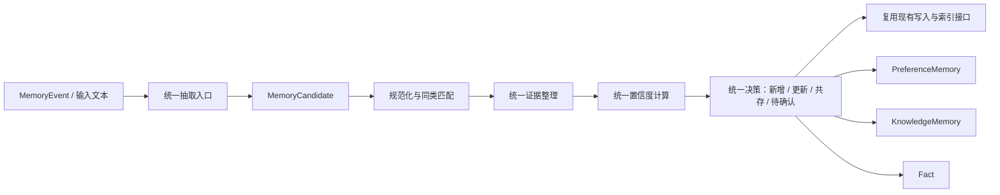

# Core 记忆模块统一化优化方案（低侵入版）

> 审视范围：`memoryhub/core/{knowledge,fact,preference,ingestion,processing}`，以及相关 schema、存储、写入和检索链路。
> 修订日期：2026-08-14。
> 设计约束：**三种记忆的方法应尽量一致或继承自同一基类；算法应简单、稳定、性能可控；优先复用既有数据结构和接口输入输出，避免大规模迁移。**

---

## 1. 结论与设计方向

此前方案中“统一内核 + 类型化投影”的方向正确，但引入了较多新领域对象、关系表、置信度维度和统计模型。对于当前已完成 MVP 的项目，这会带来较高的实现、迁移和验证成本，不符合“统一但不过度复杂”的目标。

本次调整后的推荐方案是：

> **保留现有 `PreferenceMemory`、`KnowledgeMemory`、`Fact` 及已有 API；新增一套轻量的统一记忆处理抽象。三种记忆共享同一处理阶段、证据整理方式、置信度框架、状态更新规则和 LLM 调用入口，仅把“内容抽取、同类匹配、少量类型权重”留在子类。**

### 1.1 要达到的统一性

三类记忆都经过同一套流程：



统一的是：

1. 入口和处理顺序；
2. 候选对象和处理结果；
3. 证据提取、去重、合并、追溯规则；
4. 置信度的因子、公式、阈值和解释格式；
5. 新增、更新、冲突、归档等状态决策；
6. LLM 的配置、调用、结构化校验和降级策略；
7. 写入后的索引同步与幂等处理。

保留差异的是：

- **Fact**：三元组、实体/谓词归一化、单值关系冲突；
- **Preference**：显式/隐式偏好识别、场景匹配；
- **Knowledge**：工作流/案例/模板提炼、复用结果更新。

### 1.2 不建议在本阶段做的事情

为控制复杂度，当前不建议：

- 新建完整的 `MemoryAssertion`、`EvidenceLink`、`ConfidenceState` 等一组平行主数据表；
- 立刻将 FactStore、PreferenceRepository、KnowledgeRepository 合并为一个仓储；
- 使用 Beta-Binomial、Wilson 下界、多维向量置信度等较重的统计模型；
- 修改既有 HTTP 接口的请求/响应格式；
- 一次性迁移 JSON evidence、JSONL evidence、事实 evidence 的全部历史数据；
- 用“强制大一统”替换已能工作的实体、谓词、工作流等领域模型。

这些可以作为未来系统规模扩大后的演进方向，但不应成为当前重构的前置条件。

---

## 2. 当前问题与优先级

| 优先级 | 问题 | 直接后果 | 优化原则 |
|---|---|---|---|
| P0 | 事实模块的 LLM 调用硬编码 DeepSeek 模型/端点 | 与应用级 `LLMConfig`、`BaseLLMClient` 分叉；切模型或 provider 时行为不一致 | 统一走已有应用级 LLM client |
| P0 | 三种记忆的置信度计算器完全独立 | 分数语义、阈值和更新方式不一致，难维护、难比较 | 共享一个简单公式，子类只提供因子权重 |
| P0 | 证据在三处以不同方式保存和合并 | 更新后难解释置信度来源，重复证据可能重复计分 | 不改现有字段，先统一 Evidence 的构造、去重和合并方法 |
| P1 | 处理入口存在 `EventIngestionService` 与演示 `EventProcessingCoordinator` 双轨 | 同一事件从不同入口进入可能得到不同结果 | 统一调用同一 handler；演示层只作为 façade |
| P1 | 三类记忆的更新/冲突方法名、返回值和决策语义不同 | 上层协调和测试难复用 | 以基类定义统一阶段和统一决策对象 |
| P1 | Fact 的 `observed_at` 取提交时刻 | 历史事实可能被误判为最新事实 | 优先使用事件发生时间，无法取得时再降级到写入时间 |
| P2 | Fact 独立 SQLite 写入路径与其他记忆不同 | 事务、索引、证据同步策略难统一 | 先包一层适配器，后续再考虑存储合并 |

---

## 3. 目标架构：统一处理基类，不强行统一数据模型

### 3.1 核心抽象

建议新增一个轻量模块，例如：

```text
memoryhub/core/memory/
  base.py           # BaseMemoryHandler、MemoryCandidate、MemoryDecision
  confidence.py     # UnifiedConfidenceCalculator
  evidence.py       # EvidenceNormalizer、EvidenceMerger
  llm.py            # StructuredLLMAdapter（复用应用级 BaseLLMClient）
```

不要求替换现有 `fact/`、`preference/`、`knowledge/` 文件夹。各模块只需新增/调整一个 Handler：

```text
FactMemoryHandler(BaseMemoryHandler)
PreferenceMemoryHandler(BaseMemoryHandler)
KnowledgeMemoryHandler(BaseMemoryHandler)
```

### 3.2 建议基类接口

```python
from abc import ABC, abstractmethod
from dataclasses import dataclass, field
from typing import Any, Literal


@dataclass
class MemoryCandidate:
    """内部统一候选；不替代现有 Fact/PreferenceMemory/KnowledgeMemory。"""
    memory_type: Literal["fact", "preference", "knowledge"]
    payload: Any                       # 保留原类型对象或其最小草稿
    user_id: str
    source_id: str = ""
    event_id: str = ""
    occurred_at: str = ""
    evidences: list[Any] = field(default_factory=list)
    quality_score: float = 1.0
    extraction_score: float = 0.5
    metadata: dict[str, Any] = field(default_factory=dict)


@dataclass
class MemoryDecision:
    """内部统一决策；可映射到现有 ConflictResult/ConflictRecord。"""
    action: Literal["new", "update", "coexist", "duplicate", "review", "reject"]
    reason: str
    confidence: float
    existing_id: str = ""
    candidate: MemoryCandidate | None = None


class BaseMemoryHandler(ABC):
    """三类记忆共用的编排模板。"""

    memory_type: str

    def process(self, source, *, context=None) -> list[MemoryDecision]:
        candidates = self.extract_candidates(source, context=context)
        decisions: list[MemoryDecision] = []
        for candidate in candidates:
            candidate.evidences = self.evidence_merger.normalize_and_merge(
                candidate.evidences
            )
            existing = self.find_similar(candidate)
            factors = self.build_confidence_factors(candidate, existing)
            confidence = self.confidence_calculator.calculate(factors)
            decision = self.decide(candidate, existing, confidence)
            decisions.append(decision)
        return decisions

    @abstractmethod
    def extract_candidates(self, source, *, context=None) -> list[MemoryCandidate]: ...

    @abstractmethod
    def find_similar(self, candidate: MemoryCandidate): ...

    @abstractmethod
    def build_confidence_factors(self, candidate, existing): ...

    @abstractmethod
    def apply(self, decision: MemoryDecision): ...
```

说明：

- `process()`、证据整理、置信度计算、决策框架统一；
- `extract_candidates()`、`find_similar()`、`build_confidence_factors()`、`apply()`由三种记忆按自身领域差异实现；
- `apply()`内部直接复用现有 `PreferenceUpdater`、`KnowledgeUpdater`、`FactMemoryPipeline.commit()` 或仓储接口；
- `MemoryCandidate`、`MemoryDecision`只存在于 core 内部，不要求改动现有 API schema；
- 现有模块可分阶段接入：先 Fact，再 Preference/Knowledge，不需要一次性重写。

### 3.3 三种 Handler 的职责边界

| Handler | 复用基类能力 | 自定义部分 | 复用的既有实现 |
|---|---|---|---|
| `FactMemoryHandler` | 证据整理、置信度、决策、LLM 入口、幂等 | 三元组抽取、实体/谓词归一化、单值关系冲突 | `TripleExtractor`、`EntityNormalizer`、`PredicateNormalizer`、`ConflictDetector`、`FactMemoryPipeline` |
| `PreferenceMemoryHandler` | 同上 | 显式/隐式识别、偏好类型和场景匹配 | `PreferenceExtractor`、`PreferenceUpdater` |
| `KnowledgeMemoryHandler` | 同上 | 工作流/案例/模板提取、任务相似匹配 | `KnowledgeExtractor`、`KnowledgeUpdater` |

这能解决“方法不统一”的问题，同时避免将 Fact 三元组、Preference payload、Knowledge steps 强行塞进同一个持久化结构。

---

## 4. 统一但轻量的证据链方案

### 4.1 保持现有数据结构，统一操作规则

不新增强制性证据表，不改变 `PreferenceMemory.evidences` 和 `KnowledgeMemory.evidences` 的输入输出，也不立即废弃事实模块的 `source_text/source_id` 与现有事实 evidence 存储。

改为新增一个统一工具类：

```python
class EvidenceMerger:
    def normalize(self, evidence) -> Evidence: ...
    def key(self, evidence) -> str: ...
    def normalize_and_merge(self, evidences: list[Evidence]) -> list[Evidence]: ...
    def summary(self, evidences: list[Evidence]) -> dict: ...
```

它统一完成：

1. 读取/补齐 `event_id`、`source_type`、`timestamp`、`quality` 等已有字段；
2. 按 `event_id + evidence_id` 去重；没有 ID 时按“来源 ID + 证据文本哈希”去重；
3. 保持时间顺序，避免不稳定的证据合并；
4. 限制最多保留 N 条有效证据（例如 20 条），防止主表 JSON 无限膨胀；
5. 为所有类型生成一致的 `evidence_summary`，但作为内部元数据或可选响应字段，不改变旧字段。

### 4.2 Fact 的低侵入适配

Fact 当前并非通用 `Evidence` 模型。第一阶段不需要修改 Fact 的表结构：

- 将 `Fact.source_id` 映射为 `event_id/source_id`；
- 将 `Fact.source_text` 映射为证据 excerpt；
- 将 `Fact.observed_at` 与 event 的 `occurred_at` 区分使用；
- 在 `FactMemoryHandler` 内生成与 Preference/Knowledge 相同的 evidence summary；
- 若后续确实需要跨类型完整审计，再新增 relation 表，而不是现在就迁移。

### 4.3 简单的证据有效性规则

所有类型采用相同规则：

- 同一 event 的重复抽取只计一次；
- `quality_score` 较低的事件可生成候选，但限制置信度上限；
- 被安全模块拒绝、被撤回、失败工具调用的内容不作为正向证据；
- 用户显式输入、手工配置、成功工具结果可以被视为更强来源；
- 证据数量只带来有限增益，防止 100 条重复记录把分数推到 1.0。

---

## 5. 统一且简单的置信度算法

### 5.1 目标

置信度计算要统一、可解释、可测试，并且足够简单：

- 一套公式；
- 4 个标准因子；
- 类型差异只表现为权重和个别因子的取值；
- 不使用复杂概率模型、训练模型或多重嵌套 sigmoid；
- 保持计算量为 `O(证据数)`，且证据数有上限。

### 5.2 统一因子

每条候选记忆都构造以下四个 `[0, 1]` 因子：

| 因子 | 含义 | 三种记忆的取值来源 |
|---|---|---|
| `source` | 来源可靠性 | 显式用户输入/成功工具结果/普通行为/规则回退 |
| `quality` | 输入和抽取质量 | `MemoryEvent.quality` 与 LLM/规则抽取分数的较保守组合 |
| `support` | 证据支持度 | 去重后的有效证据数量，按 1、2、3+ 条分档，不线性累加 |
| `freshness` | 当前仍有效的程度 | 距最后有效证据的时间衰减；不同类型只配置不同半衰期 |

建议引入统一数据类：

```python
@dataclass(frozen=True)
class ConfidenceFactors:
    source: float
    quality: float
    support: float
    freshness: float
```

### 5.3 统一公式

使用加权平均与一个轻量的弱项保护：

```text
base = w_source × source
     + w_quality × quality
     + w_support × support
     + w_freshness × freshness

confidence = clamp(base × (0.85 + 0.15 × min(source, quality)), 0, 0.95)
```

默认权重：

```text
w_source = 0.35
w_quality = 0.30
w_support = 0.20
w_freshness = 0.15
```

解释：

- 来源和质量占主要比例；
- 证据数量有增益但不压过来源质量；
- 新鲜度只做温和调整，不让长期但可靠的偏好/知识瞬间失效；
- 最弱项保护只惩罚“来源或抽取质量很差”的候选，避免一堆低质量重复证据抬高分数；
- 上限为 `0.95`，避免系统在没有人工确认时声称绝对确定。

### 5.4 因子计算保持一致，参数允许少量差异

#### 来源分 `source`

统一映射，可由各 Handler 传入 source type：

| 来源 | 分数 |
|---|---:|
| 用户明确指令 / 手工配置 | 0.95 |
| 成功且结构化的工具结果 | 0.85 |
| 用户行为或已完成任务轨迹 | 0.75 |
| 普通文本抽取 | 0.60 |
| 规则回退抽取 | 0.45 |

#### 质量分 `quality`

```text
quality = min(event_quality, extraction_score)
```

如果没有 event quality，使用 0.7 作为保守默认值；如果没有 LLM 抽取分数，规则路径使用 0.45～0.60 的固定分档。`min()` 比平均值更保守，也更容易理解。

#### 支持分 `support`

仅按有效、去重后的证据数量分档：

| 独立有效证据数 | support |
|---:|---:|
| 0 | 0.20 |
| 1 | 0.50 |
| 2 | 0.70 |
| 3 条及以上 | 0.85 |

“独立”在 MVP 阶段的简化定义：不同 `event_id`；没有 event_id 时使用不同 `source_id`。无需先实现复杂来源图。

#### 新鲜度 `freshness`

采用简单半衰期：

```text
freshness = 0.5 ** (age_days / half_life_days)
```

仅配置半衰期，不改变公式：

| 类型 | 默认半衰期 | 说明 |
|---|---:|---|
| Fact | 90 天 | 可被新事件或冲突更快更新 |
| Preference | 180 天 | 偏好通常较稳定，但仍可自然衰减 |
| Knowledge | 120 天 | 工具、流程和环境变化较快 |

对于明确全局偏好、人工配置、长期静态事实，可给 `freshness` 设下限 0.70 或配置更长半衰期，避免错误遗忘。

### 5.5 三类记忆仅使用轻量权重差异

算法和因子完全一样，仅允许权重做小幅调整：

| 类型 | source | quality | support | freshness | 原因 |
|---|---:|---:|---:|---:|---|
| Fact | 0.35 | 0.35 | 0.20 | 0.10 | 事实更强调证据与抽取准确性 |
| Preference | 0.45 | 0.25 | 0.15 | 0.15 | 用户显式来源最重要 |
| Knowledge | 0.30 | 0.30 | 0.25 | 0.15 | 多次成功轨迹/证据更重要 |

权重差异应由同一个 `MemoryConfidencePolicy` 配置，而不是三份计算器各写一套公式。

### 5.6 复用结果的简单更新规则

现有知识的 `success_count/total_count` 很有价值，不需要改表。只需要统一把它折算为对 `support` 的有限修正：

```text
success_rate = (success_count + 1) / (total_count + 2)
support = max(evidence_support, 0.5 + 0.35 × success_rate)
```

只用于 Knowledge；Preference 和 Fact 直接使用 evidence support。这样不会引入复杂统计模型，也能避免样本数为 0/1 时极端波动。

### 5.7 统一阈值与状态决策

所有类型先采用同一阈值：

| 条件 | 决策 |
|---|---|
| `confidence >= 0.70` 且无强冲突 | `active/new/update` |
| `0.50 <= confidence < 0.70`，或存在无法自动判断的冲突 | `review` |
| `confidence < 0.50` | `reject` 或仅保留候选，不写入检索主路径 |
| 与已有内容相同 | `duplicate`，只合并证据和重算分数 |
| 作用域不同且均有效 | `coexist` |

Fact 的单值谓词冲突可以额外进入 `review` 或 `replace`，但应复用同一个 `MemoryDecision.action` 名称，并将原有 `Resolution` 映射进去。这样上层不必理解两套冲突语义。

---

## 6. LLM 调用统一方案（Fact 优先修复）

### 6.1 问题

当前事实模块的 `extractor.py`、`normalizer.py`、`conflict.py` 使用 DeepSeek 默认模型与端点，并通过 `core/fact/llm.py` 自建 OpenAI Chat Completions 兼容层。应用实际已初始化通用 `llm_client`，因此这会形成配置、模型行为、异常处理和可测试性的分叉。

### 6.2 低侵入改法

不改上游接口，只改内部依赖：

1. 新增 `StructuredLLMAdapter`，包装现有 `BaseLLMClient.generate()`；
2. `TripleExtractor`、实体/谓词归一化、事实冲突裁决都依赖这个 Adapter；
3. Adapter 使用应用级 `llm_client` 和 `config.llm`，不在事实子模块硬编码 provider、URL 或模型名；
4. 调用输入仍是 `system_prompt + prompt`，输出仍解析为现有 `RawTriple` 或既有裁决对象；
5. 对 JSON 输出做 Pydantic/基础字段校验；校验失败返回明确错误或低置信候选；
6. 规则回退保留，但统一标记为较低 `extraction_score`，不能绕过统一阈值直接激活。

建议接口：

```python
class StructuredLLMAdapter:
    def generate_json(
        self,
        *,
        task_name: str,
        system_prompt: str,
        prompt: str,
        parser,
        temperature: float = 0.0,
    ):
        """复用 BaseLLMClient；返回经过 parser 校验的结果。"""
```

这里只新增内部 Adapter；`FactMemoryPipeline` 的构造参数、HTTP 接口和既有测试替身都可以继续使用 `llm_client`。

### 6.3 工具结果处理

FactIngestionAdapter 当前会把工具名称、参数和结果拼成文本。低侵入优化如下：

- 保持现有 `format_tool_call()` 返回文本的接口；
- 在拼接文本时显式区分“调用参数（仅上下文）”和“工具返回结果（可作为证据）”；
- `TripleExtractor` 的提示词明确规定：**只能使用“工具返回结果”字段作为事实证据，不得依据调用参数建立事实**；
- `tool_status=partial` 的候选统一将 `quality_score` 上限限制为 0.60；
- 后续再逐步为高频工具添加确定性 mapper，非本次重构前置条件。

---

## 7. 更新、冲突与时间规则统一

### 7.1 统一决策，不强制统一存储

推荐上层统一使用 `MemoryDecision`，然后映射到原逻辑：

| `MemoryDecision.action` | Preference | Knowledge | Fact |
|---|---|---|---|
| `new` | `PreferenceUpdater.add()` | `KnowledgeUpdater.add()` | `FactMemoryPipeline.commit()` 的 NEW |
| `update` | 版本更新 | 版本合并/更新 | replace 后写入新 Fact |
| `duplicate` | 合并 evidence、重算 confidence | 同左 | 不插入重复 Fact，更新/记录证据 |
| `coexist` | 不同 scope 共存 | 不同 scope/任务共存 | 多值谓词或不同 scope 共存 |
| `review` | 写冲突记录/待确认 | 写冲突记录/待确认 | 映射 `ESCALATE` |
| `reject` | 不落长期记忆 | 不落长期记忆 | 不提交 Fact |

### 7.2 统一更新顺序

所有类型遵循：

```text
抽取候选
→ 标准化
→ 查找同类已有记忆
→ 合并新旧证据
→ 计算统一 confidence
→ 作出统一 MemoryDecision
→ 复用原 updater/pipeline 写入
→ 触发已有索引同步
```

重点是先合并证据、后计算置信度、再决定写入，而不是各模块分别在不同阶段计算或覆盖。

### 7.3 Fact 的时间修正（不改外部结构）

保留现有 `Fact.observed_at` 字段，但其赋值顺序改为：

1. 优先 `MemoryEvent.occurred_at`；
2. 其次工具结果中可解析且可信的时间；
3. 最后才使用当前提交时间；
4. 若用了提交时间，在 metadata 或 source_id 标记为 `recorded_at_fallback`。

这不要求新增 `valid_from/valid_to` 字段，就能先避免“历史事件因今天写入而被视为最新”的主要问题。

---

## 8. 与既有数据结构、接口的兼容策略

### 8.1 明确不改动的内容

第一阶段应保持以下内容不变：

- `MemoryEvent`、`PreferenceMemory`、`KnowledgeMemory`、`Fact` 的公共字段；
- 当前 API 请求/响应主体；
- `FactMemoryPipeline.propose()/commit()/ingest()` 的公开方法；
- `PreferenceExtractor`、`PreferenceUpdater`、`KnowledgeExtractor`、`KnowledgeUpdater` 的主要调用方式；
- 现有 repositories、`MemoryWriteService`、`FactIndexService` 的公开调用方式；
- 已有 evidence JSON 字段、JSONL 存储和 Fact evidence 表的兼容读取能力。

### 8.2 允许的内部新增

允许新增但不强制暴露给 API 的内容：

- `BaseMemoryHandler`、三个 Handler；
- `MemoryCandidate`、`MemoryDecision`；
- `ConfidenceFactors`、`UnifiedConfidenceCalculator`；
- `EvidenceMerger`；
- `StructuredLLMAdapter`；
- 可选 metadata：`confidence_version`、`confidence_reason`、`event_id`、`occurred_at`。如果现有对象没有合适字段，可以先放在已有 `metadata` / `extra_payload` 中，而非迁移表结构。

### 8.3 存储演进原则

第一阶段只做“逻辑统一”，不做“物理合库”：

- 偏好和知识仍走 SQLAlchemy repository；
- 事实仍可使用 `FactStore`，但由 `FactMemoryHandler` 统一编排；
- 证据仍存原位置，但所有写入前都用 `EvidenceMerger` 去重；
- 只有当跨类型证据审计、复杂撤回、数据量增长已成为真实痛点时，再考虑公共证据关系表和统一仓储。

---

## 9. 分阶段实施计划

### Phase 0：基线与统一契约测试（2–3 天）

1. 新建 `MemoryDecision` 的最小实现和映射测试；
2. 建立同一事件分别经过 Fact/Preference/Knowledge 的端到端测试；
3. 固化重复 event、低质量 event、冲突 event、不同 scope event 的预期行为；
4. 验证 `EventIngestionService` 与 `EventProcessingCoordinator` 不会产生不可解释的差异；必要时后者只复用正式 Handler。

**验收**：不改 API，现有相关测试继续通过；新增跨类型行为测试。

### Phase 1：统一 LLM 和证据操作（3–5 天，P0）

1. 实现 `StructuredLLMAdapter`，用应用级 LLM client 替换 Fact 的硬编码 DeepSeek 路径；
2. 实现 `EvidenceMerger`，先接入三类 memory 的写入前合并；
3. Fact 从 event 中正确获取 `occurred_at`，并保留 fallback 标记；
4. 调整工具调用提示词和质量限制，避免调用参数污染事实；
5. 规则回退仅生成低分候选，统一走阈值决策。

**验收**：切换应用 LLM 配置无需改 Fact 代码；同一证据不会重复抬升三类记忆分数。

### Phase 2：统一 Handler 和置信度（4–6 天，P0）

1. 实现 `BaseMemoryHandler` 和三个 Handler；
2. 实现 `UnifiedConfidenceCalculator`，先以同一公式输出新分数；
3. 子类只提供因子和权重配置，删除/停用三套独立主公式；
4. `MemoryDecision` 映射回已有 updater、pipeline、冲突记录；
5. 保留现有 `confidence` 字段作为最终写入字段，不增加 API 字段；需要解释时优先写 `extra_payload/metadata`。

**验收**：三个 Handler 都有相同的 `process → decision → apply` 方法链；置信度实现只有一个核心公式。

### Phase 3：入口收敛和轻量运维优化（2–4 天，P1）

1. 生产路径统一通过 ingestion/executor/handler；
2. 演示协调器只调用 handler，不再自己分叉抽取和写入逻辑；
3. 将重复的冲突状态映射为 `MemoryDecision`；
4. 在检索重排中保留现有 `confidence` 使用方式，后续可增加相同的 freshness 轻量乘子；
5. 观察实际数据量与审计需求，再决定是否做物理存储合并。

**验收**：同一输入从不同入口获得一致的记忆类型、证据数量、confidence 和决策。

---

## 10. 关键测试清单

1. **基类一致性**：三个 Handler 均实现相同处理阶段，且返回 `MemoryDecision`；
2. **接口兼容**：现有 API 及 `FactMemoryPipeline` / updater 的公开方法测试不变；
3. **置信度一致性**：同一组 `ConfidenceFactors` 在三类记忆中得到同样分数；仅权重配置不同；
4. **重复证据**：同一个 `event_id` 重试多次，evidence 不重复，confidence 不上升；
5. **来源权重**：显式用户偏好高于一次隐式行为；成功工具结果高于普通文本抽取；
6. **低质量回退**：规则抽取或 partial tool result 不能自动进入高置信 active；
7. **Fact 时间**：历史 event 的 Fact 使用 `occurred_at`，不是当前 commit 时间；
8. **工具参数污染**：工具调用参数不能作为 Fact 的正向证据；
9. **冲突统一性**：三类记忆冲突都能映射为 `new/update/coexist/duplicate/review/reject`；
10. **入口一致性**：正式接入与演示入口对同一 event 使用同一 handler 后结果一致。

---

## 11. 推荐目录与改动范围

```text
memoryhub/core/
  memory/
    base.py               # BaseMemoryHandler / Candidate / Decision
    confidence.py         # 唯一核心公式与类型权重配置
    evidence.py           # 统一证据规范化、去重、合并
    llm.py                # 应用级 LLM 的结构化适配器
  fact/
    handler.py            # 新增，复用已有 extractor/normalizer/pipeline
  preference/
    handler.py            # 新增，复用已有 extractor/updater
  knowledge/
    handler.py            # 新增，复用已有 extractor/updater
```

优先修改的既有文件：

- `memoryhub/core/fact/extractor.py`：移除硬编码模型/端点依赖，接入统一 LLM Adapter；
- `memoryhub/core/fact/normalizer.py`、`memoryhub/core/fact/conflict.py`：同上；
- `memoryhub/core/fact/event_adapter.py`：补充 event 时间、工具结果与参数的区分；
- `memoryhub/core/ingestion/extraction.py`：改为调用各 Handler 的统一处理接口；
- `memoryhub/core/processing.py`：复用 Handler，避免演示路径另行处理；
- `memoryhub/core/preference/confidence.py`、`memoryhub/core/knowledge/confidence.py`：改为对统一计算器的兼容包装，逐步移除各自复杂主公式。

不应在第一阶段修改：

- `memoryhub/adapter/schemas.py` 的公共模型字段；
- 当前 REST API 的请求/响应契约；
- 所有存储表的主结构；
- 事实实体/谓词本体与检索索引的基本能力。

---

## 12. 结论

三种记忆的统一，不应依赖大规模改表、增加多套复杂对象或使用难以调参的概率算法。更合适的路径是：

> **统一处理基类、统一证据工具、统一置信度公式、统一决策对象、统一 LLM 入口；保留三种记忆各自的内容模型、仓储和少量领域规则。**

这样既能获得一致性：

- 方法名称和处理顺序一致；
- 置信度含义、公式、阈值一致；
- 证据去重、合并和解释一致；
- 冲突/更新决策一致；
- LLM 配置和失败回退一致；

又能保持项目稳定：

- 不要求改变现有数据结构；
- 不要求修改接口输入输出；
- 不要求一次性迁移事实存储；
- 可以按 Fact → Preference → Knowledge 的顺序逐步接入；
- 每一步都能用现有测试和新增契约测试验证。

建议将 **Phase 1 + Phase 2** 作为下一轮开发目标：先修复事实 LLM 分叉与证据操作，再落地统一 Handler 和轻量置信度引擎。这是风险最低、收益最高、最符合当前项目阶段的重构切片。
