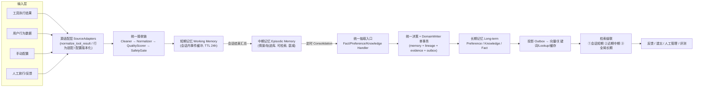

# Core 记忆模块重构计划 V2（赛题对齐版）

> **题目**：XA-202612《OS Agent 记忆优化及高效应用研究》
> **基线**：`dev-remem` 分支，2026-08-18（当前冲刺第 2 天，主干已落地）
> **关联文档**：`CORE_MEMORY_REFACTOR_PLAN.md`（统一核心 V1）、`MAIN_TO_REMEM_REFACTOR_ROADMAP.md`（当前冲刺路线图）、`ADR-001-unified-memory-write-contract.md`、`赛题要求.md`
> **本版定位**：V1 是"低侵入统一"，V2 基于赛题硬要求做**大胆改革 + 补结构**。继承 V1 已交付的统一核心与写入契约，推翻其中不符合赛题目标的设计，并补充赛题点名但当前缺失的结构（记忆分层流转、工具选择偏好、量化评测闭环等）。

---

## 0. TL;DR

- **赛题 7 项要求中**：①多源接入 ②偏好版本化 ⑤安全与遗忘 ④麒麟 embedding 已具备骨架但各有缺口；⑥记忆分层流转**基本是假分层**（只有一个 level 元数据字段）；⑦评测中检索/延迟有链路、**偏好与冲突评测是空壳**。
- **5 项硬指标**（评分表 25 分）：检索延迟 **已达标**（P99≈152ms）；知识检索召回 **R@5=0.555，距 0.85 差距很大**；偏好提取准确率、冲突处理正确率 **无评测入口、无基线**。
- **五大改革方向**：① 记忆分层落地为真实存储与流转引擎（赛题 6）；② 工具结果结构化 + 工具选择偏好确定性提取（赛题 1/2 的核心痛点）；③ 评测闭环 + 检索召回攻坚（赛题 7）；④ **事实记忆并入知识记忆**——不独立成类，降格为 `KnowledgeType.FACT` 子类型（§4.8）；⑤ **Agent 接入与统一 API 面**——CLI/Plugin/MCP 共用一套契约，含自反馈闭环、项目隔离与"艾宾浩斯遗忘曲线"创新点（§4.5.3、§4.9，对齐 `Agent接入设计.md`）。
- **一个贯穿原则**：所有写入仍收敛到 V1 交付的 **DomainWriter 单事务边界**；分层流转、工具挖掘、评测都挂在这条边界之上，不另起写路径。

---

## 1. 赛题要求逐条分析与差距

| 要求 | 赛题核心诉求 | 当前实现 | 差距 | 本计划改革方向 |
|---|---|---|---|---|
| **(1) 多源数据整合** | 工具执行结果、用户行为、手动配置统一接入 + 清洗/标准化/质量校验 | 有 `MemoryEvent` 契约 + Cleaner/Normalizer/QualityScorer/SafetyGate 四段流水 + source_hash 幂等 | ①`normalize_tool_result()` **未接入服务端**（仅测试在用），原始工具结果无对外入口；②用户行为/手动配置无专门采集适配器；③手动配置**无版本管理**（赛题点名"配置版本混乱"）；④偏好提取完全不读 `tool_calls` | 新增"源适配层"（工具/行为/配置三适配器）、配置版本化对象、工具结果结构化 schema、工具轨迹进入偏好提取 |
| **(2) 偏好动态捕捉** | 操作习惯、输出风格、安全策略自动提取 + 版本化 + 跨场景适配与回溯 | 7 类 `preference_type` 枚举齐全（含 TOOL_PREFERENCE）；规则+LLM 双引擎；`PreferenceUpdater` 冲突决策矩阵 + 版本链（version/parent_id/root_id） | ①**TOOL_PREFERENCE / WORKFLOW_PREF 零确定性提取**，LLM prompt 不含 tool_calls；②版本链只读不可回滚（无"回溯"闭环）；③跨场景靠 `is_global`/`*` 粗糙传播，无显式适配机制 | 新增 `ToolPreferenceMiner`、版本回滚接口、跨场景偏好传播与"偏好生效范围"解释 |
| **(3) 知识结构化整合** | 新旧知识冲突、关联检索优化、工作流/案例/模板结构化存储与智能调用 | `KnowledgeType`(workflow/case/template) 三类区分；`KnowledgeExtractor` 单轨迹产三类；`KnowledgeUpdater` 等价/冲突/LLM 合并 + 不可变版本快照；`TemplateBuilder` 泛化 | ①`WorkflowMiner`（跨多次执行挖掘）**未接入生产**；②演示链路**丢弃 CASE 知识**且与正式链路行为不一致；③冲突处理依赖阈值+LLM，LLM 不可用无确定性兜底（威胁 88% 指标）；④"智能调用"缺执行编排接口 | 接入 WorkflowMiner、统一两条链路、补确定性冲突裁决、新增"知识执行/复用"接口 |
| **(4) 端侧轻量化 + ≤500ms** | 调用麒麟 embedding SDK、轻量存储、检索延迟≤500ms | 麒麟 SDK 接入 + 生产门禁、SQLite 权威 + 向量投影、稀疏+稠密混合、双层 LRU 缓存、outbox 异步投影 | 延迟在 FAISS+ollama 环境达标，**真实麒麟+Milvus 端到端验收未执行**；无资源占用基线；无量化设计文档 | 真实环境验收、CPU/内存基线、轻量化取舍文档 |
| **(5) 敏感识别 + NL 指令精准遗忘** | 敏感信息识别过滤、自然语言指令驱动精准遗忘、数据安全合规 | 14 条内置敏感规则 + 脱敏幂等 + SafetyGate 门禁 + AES-256 隔离区 + 用户自定义规则；遗忘三模式（精确 ID/scope/关键词子串）+ 索引缓存级联清理 | ①**NL 遗忘是关键词规则匹配，非语义解析**（api.py docstring 写"LLM 解析"但实现是规则）；②无向量语义定位；③用户规则无 forget 类 | 遗忘意图升级为 LLM 结构化解析（规则兜底）、向量语义定位、forget 用户规则 |
| **(6) 兼容短/中期记忆流转** | 与短期、中期记忆间的数据流转机制 | `MemoryLevel`(short/mid/long) + level 列 + `LifecycleManager` 提升阈值 + `AutoForgetEngine` 健康度降级 + 遗忘曲线 | **假分层**：无独立短期/中期存储与工作记忆缓冲；检索不过滤 level（短期也参与跨任务检索，与设计文档相悖）；无 consolidation/合并去重；无定时调度（手动 API 触发） | **本计划最大新增结构**：真实短期（工作记忆）与中期（情景）存储 + 会话汇总 + 定时 consolidation + 检索按 level 级联 |
| **(7) 量化评测机制** | 标准化数据集验证偏好提取准确率、知识检索召回率等，形成测试报告 | 检索评测链路完整（Recall/MRR/NDCG/Precision/延迟/隔离/分组）；延迟 P99 达标；召回有基线（0.555） | ①`preference_eval.py`、`conflict_eval.py` **是空壳**（`NotImplementedError`）；②冲突仅 3 条样例；③test 数据集随机采样不可作验收；④无 Bootstrap CI | 补齐偏好/冲突数据集与评测器、召回攻坚（embedding 升级/精排/改写）、正式验收报告 |

**评分表对齐**（100 分制）：技术创新性(30) 靠 ①记忆分层流转 ②工具偏好挖掘 ③统一决策框架；方案可行性(30) 靠量化架构与轻量化论证；性能指标(25) 是本计划的主战场；实用性(10) 靠 OS Agent 与 Qt 桌面端落地；文档规范性(5) 靠完整技术文档 + 用户手册 + 适配测试报告。

---

## 2. 现有架构：保留什么、推翻什么

### 2.1 保留（已交付且方向正确）

1. **统一核心抽象**：`BaseMemoryHandler` 处理链、`MemoryCandidate/MemoryDecision`、`EvidenceMerger`、`UnifiedConfidenceCalculator`、`StructuredLLMAdapter`（V1 Phase 1-2）。
2. **统一写入边界**：`DomainWriter` 单事务（memory + lineage + evidence + outbox）+ `MemoryWriteReceipt` + ADR-001 三张权威表（V1 冲刺主干）。
3. **安全体系**：SafetyWriteGate 门禁、脱敏幂等、隔离区、审计日志、用户自定义规则。
4. **麒麟 embedding + 生产门禁**：kylin_client、validate_production_gate、混合检索、缓存、投影 outbox。
5. **API v2 溯源**：lineage/evidence/audit/projections/search 只读接口 + user scope 隔离 + 脱敏。

### 2.2 推翻（本计划的大胆改革）

| # | 现状问题 | 证据 | 改革 |
|---|---|---|---|
| R1 | **双轨处理入口且行为不一致**：`EventIngestionService`（正式）vs `EventProcessingCoordinator`（演示，丢弃 CASE、偏好用不同规则） | `processing.py:28,196`；`ingestion/service.py:61` | **单一权威链**：`EventProcessingCoordinator` 降级为纯 façade，内部只调 Handler 链；两条链路产出必须一致（用契约测试锁定） |
| R2 | **Fact 是"统一"的漏网之鱼**：初始创建不写 `memory_evidence`/`memory_lineage`，走私有 `fact_evidence`；`insert_fact` 仍是公开 legacy；独立 SQLite + 独立冲突模型 | `fact/store.py:326,375-447` | **大胆改革：事实不再独立成类**，降格为知识子类型 `KnowledgeType.FACT`，并入统一知识链（抽取/冲突/检索/评测）；消灭独立 SQLite 与冲突模型；`FactStore`/`FactMemoryPipeline` 迁移后冻结删除（详见 §4.8） |
| R3 | **决策集合不完整**：统一 Handler 只产出 reject/review/new/update，`duplicate/coexist` 永远不出现；Fact `ConflictResult` 未映射进 `MemoryDecision` | `core/memory/base.py:80-101` | `MemoryDecision` 8 动作成为三类的唯一决策面；Fact relation/resolution 映射为 MemoryDecision；Handler 覆写 `decide` |
| R4 | **双 freshness 公式 + 参数偏离设计**：Handler 走 `confidence.py` 时间常数式，检索走 `freshness.py` 半衰期式；半衰期 30/60/90 是设计的 1/3 | `confidence.py:66-69` vs `freshness.py:24-36` | 统一半衰期公式 + 单一 `MemoryConfidencePolicy`；半衰期对齐设计（Fact 90 / Pref 180 / Know 120），与遗忘曲线、健康度共用一套时间常数 |
| R5 | **假分层**：level 只是同表元数据，无独立存储、检索不过滤、无 consolidation、无调度 | `lifecycle/manager.py`；检索只按 status=active 过滤 | **真实分层**（见 §4.4） |
| R6 | **仍可被生产触发的写入旁路**：`adapter/service.py:224`（`event_ingestion_service is None` 时 `POST /events` 兜底直接 `preferences.save`）；多处 `write_service is None` 降级分支仍在 | `api.py:470-479`；`memory_write.py:157` 等 | 旁路降级分支统一收口到 writer（不依赖"生产装配恰好注入"）；`test_no_production_write_bypass.py` 扩大扫描范围 |
| R7 | `pending_index` 与旧补偿任务未按计划删除，与 outbox 双轨投影 | `app.py:744-757` | 删除 `pending_index` 写路径，统一到 outbox；`sync_service` 只保留迁移期兼容 |
| R8 | 门禁模式下 `upsert_memory` 吞掉 `MemoryWriteReceipt`（`return None`） | `memory_write.py:135-137` | 回执必须始终透出（门禁投影通过后仍构造并返回 receipt） |

---

## 3. 目标架构总览



**层级定义**：

| 层 | 角色 | 存储 | 保留策略 | 检索参与 |
|---|---|---|---|---|
| 短期（工作记忆） | 当前会话内的事件、工具调用、上下文 | 内存 LRU + SQLite 落盘 | 会话结束或 TTL≤24h | 仅当前会话（对话上下文注入） |
| 中期（情景记忆） | 跨会话的完成任务、工具轨迹、结果 | 新表 `mid_term_memory` | 健康度衰减（半衰期可配，如 30~90 天） | 近期同场景/同任务的相关经验 |
| 长期 | 偏好/知识/事实（现状不变） | preference/knowledge/fact + lineage/evidence/outbox | 健康度+遗忘曲线+生命周期 | 全局混合检索（现状） |

**流转规则**（赛题 6 与答题要求的核心说明材料）：
- 写入流：输入 → 短期（实时）→ 会话结束触发"会话汇总" → 中期（情景入库）→ 定时 `MemoryConsolidator` 消费中期 → 统一 Handler 抽取 → 长期 + lineage（transition 记录 `short→mid→long`）。
- 反哺流：长期退化（低健康度）→ 回中期保留为情景；中期活跃恢复 → 可再次提升；短期近期信息 → 直接服务当前检索。
- 一致性：所有"写"仍收敛到 DomainWriter；分层只决定"何时、以什么身份进入长期"，不产生第二套写路径。

---

## 4. 各模块详细设计

### 4.1 多源数据整合模块（赛题 1）

**问题根因**：数据源已有多源契约，但①工具结果结构化转换没有对外入口；②偏好/知识对 `tool_calls` 利用浅；③手动配置无版本。

**4.1.1 源适配层 `SourceAdapters`（新增）**

```text
memoryhub/core/ingestion/adapters/
  tool_result_adapter.py    # 将 normalize_tool_result 提升为服务端适配器
  behavior_adapter.py       # 用户行为（会话/点击/输入序列）→ MemoryEvent
  config_adapter.py         # 手动配置 → 版本化 ManualConfig 对象 → MemoryEvent
```

- **工具结果适配器**：把 `normalize_tool_result`（现 `normalizer.py:105-162`，仅测试在用）挂到对外入口，例如 `POST /api/memory/sources/tool_result`（工具名 + 原始结果 dict → 结构化 MemoryEvent）。结构化字段升级：在 `ToolCallResult` 之上增加 `output_schema`（结构化字段名/类型）、`success`、`duration_ms`，作为质量与偏好挖掘的输入。
- **行为适配器**：把会话交互序列（消息/选中项/纠错信号）打成 `USER_BEHAVIOR` 事件，携带 `behavior_type`（如 `selection`/`correction`/`confirm`），供偏好挖掘使用。
- **配置适配器 + 配置版本化（新增 ManualConfig 对象）**：
  ```text
  ManualConfig:
    config_id, user_id, config_type(输出风格/安全策略/通用), payload, version,
    parent_id, root_id, scope(SceneScope), source("manual_config"), created_at
  ```
  每次修改生成新版本（复用 Preference 的版本语义），作为偏好的**强来源**（source 因子 0.95，`extract_source="manual_config"`）。配置写入统一走事件流，但保留独立对象以便"配置版本混乱"的可回溯。

**4.1.2 质量校验强化**：现状 `QualityScorer` 已把 partial/error/timeout 纳入门控（partial≤0.60、error 拒绝）。补充：
- 工具结果 `output_schema` 与 `tool_name` 不匹配 → 降质量；
- 空结果 / 仅错误信息 → 不作正向证据（已部分覆盖）。

### 4.2 偏好记忆动态捕捉（赛题 2）

**问题根因**：枚举类型齐全但 `TOOL_PREFERENCE`/`WORKFLOW_PREF` 无确定性提取路径——这正是赛题点名的"工具选择偏好不精准"。

**4.2.1 `ToolPreferenceMiner`（新增，核心创新点）**
- 输入：中期记忆中的任务轨迹（`mid_term_memory.trajectory.tool_calls`）。
- 挖掘规则（规则优先 + LLM 兜底）：
  1. 同一 `(scene, task_type)` 下，同一"动作意图"步骤在候选工具中多次选择同一工具；
  2. 用户随后对该工具结果**无纠错**（positive signal），或曾经替换掉别的工具（weak negative for 被替换者）；
  3. 选择频率 ≥3 且成功率 ≥0.7 才产出候选；
  4. 时间衰减：近期偏好权重大。
- 输出：`MemoryCandidate(memory_type="preference", preference_type=TOOL_PREFERENCE, payload={"action":"use_tool","tool":...,"task_type":...}, scope=...)` → 进统一 Handler 链 → `PreferenceMemory`，**evidence 绑定工具轨迹片段**。
- 同理补 `WORKFLOW_PREF`：复用 `WorkflowMiner` 的输出（稳定公共步骤 → 用户操作流程偏好候选）。
- **偏好提取 LLM prompt 注入 `tool_calls` 轨迹**（现 `extractor.py:142-158` 不含），使 LLM 路径也能直接产出工具/流程偏好。

**4.2.2 版本化与回溯闭环**
- 现有 version/parent_id/root_id + `GET /preferences/{id}/versions` 已具备；**补 `POST /preferences/{id}/rollback`**（回滚到指定版本：新偏好文本=目标版本，动作=SUPERSEDE，parent=目标版本，写入审计 lineage）。
- **跨场景适配**：明确"偏好生效范围"解释——检索命中偏好时返回 `scope_rank`（精确场景 > task 通配 > global）；`is_global` 不再靠 `*` 隐含，改用显式 `preference_scope=global/scoped` 字段 + 决策记录，跨场景复用时可解释。

### 4.3 知识记忆结构化整合（赛题 3）

**问题根因**：结构已区分三类，但挖掘链不完整、两条链路不一致、冲突裁决确定性不足、缺"智能调用"。本计划同时把"客观关系事实"作为第 4 个子类型 `KnowledgeType.FACT` 并入本模块（替代原独立 Fact 实现，详见 §4.8）。

**4.3.1 接入 `WorkflowMiner`（生产打通）**
- `workflow_miner.py:62-153` 已有跨轨迹 LCS 挖掘，但未装配。在 consolidation 阶段，对同一 `(task_type)` 的 ≥3 条中期情景执行 `WorkflowMiner.mine()`，产出稳定 `WORKFLOW` 知识（替代/增强单轨迹抽取）。
- `TemplateBuilder` 挂在 workflow/case 之后做泛化模板。

**4.3.2 统一链路 + 修复 CASE 丢弃**
- 删除 `processing.py:196` 的 `{"workflow","template"}` 过滤，CASE 进入统一链；演示路径不再单独抽取（R1）。

**4.3.3 确定性冲突裁决（支撑 88% 指标）**
- 现状：`equivalent_threshold=0.72 / conflict_threshold=0.58`，LLM 不可用 → `NO_CONFLICT` 各自保留（`updater.py:232-233`）。
- 补充确定性裁决层（LLM 之前的"先手"）：
  1. **结构化等价**：同名 workflow + 相同 steps 集合 / 相同 tools 链 → equivalent（确定性）；
  2. **事实性矛盾**：同 task_type 下步骤顺序显著冲突或结果互斥 → concrete_conflict（确定性）；
  3. 仅语义相似且无法确定 → 才走 LLM；LLM 失败 → 记 `ambiguous` 冲突记录并 `REVIEW`（不静默各自保留）。
- 裁决正确率的评测口径见 §4.7。

**4.3.4 知识智能调用**
- 新增 `POST /api/memory/knowledge/{id}/execute`（或输出步骤编排意图）：返回该知识可复用的 tools 序列 + 参数模板（workflow/template 类型），供 Agent 组装工具调用，形成"知识沉淀→复用"闭环。检索阶段对 workflow/template 类型加 `reusable` 标记。

### 4.4 记忆分层流转（赛题 6）★ 本计划最大新增

**现状**：`MemoryLevel` + level 列 + `LifecycleManager`（classify/promote/expire）+ `AutoForgetEngine` 健康度降级 + `HealthCalculator` 遗忘曲线——**全是元数据操作，无真实存储与流转**。

**4.4.1 新增存储**

```sql
-- 短期记忆（工作记忆）：会话内缓冲
CREATE TABLE short_term_memory (
    id TEXT PRIMARY KEY,
    user_id TEXT NOT NULL,
    session_id TEXT NOT NULL,
    event_id TEXT,
    source_type TEXT,
    text TEXT,                 -- 可检索片段
    payload TEXT,              -- JSON（含 tool_calls 摘要）
    scene TEXT, task_type TEXT,
    created_at TEXT NOT NULL,
    ttl_until TEXT NOT NULL    -- 会话结束 或 now+24h
);
CREATE INDEX ix_short_session ON short_term_memory(user_id, session_id, created_at);

-- 中期记忆（情景记忆）：完成任务轨迹
CREATE TABLE mid_term_memory (
    episode_id TEXT PRIMARY KEY,
    user_id TEXT NOT NULL,
    session_ids TEXT,          -- JSON 数组
    scene TEXT, task_type TEXT,
    trajectory TEXT,           -- JSON：事件/tool_calls 序列
    tools TEXT,                -- JSON：使用的工具链
    outcome TEXT,              -- success / partial / failed
    summary TEXT,              -- 一段话总结（LLM 生成）
    occurred_at TEXT NOT NULL,
    last_accessed_at TEXT,
    decay_score REAL,          -- 遗忘曲线分数
    status TEXT DEFAULT 'active',   -- active / archived / deleted
    created_at TEXT NOT NULL
);
CREATE INDEX ix_mid_user_task ON mid_term_memory(user_id, task_type, occurred_at);
```

长期存储沿用现有 preference/knowledge/fact + `memory_lineage/evidence/outbox`（level 字段保留用于解释与查询标签，不再承担存储职责）。

**4.4.2 流转引擎**

- **会话汇总 `SessionConsolidator`**：会话结束（或事件超时）时，把 `short_term_memory` 中同会话事件按 `(scene, task_type)` 聚合成 `mid_term_memory` 情景，写入 trajectory、生成 summary，随后清空/归档短期。
- **长期合并 `MemoryConsolidator`**（定时任务）：
  1. 取到期（occurred_at 超过阈值）且 active 的中期情景；
  2. 对每个情景跑统一 Handler 链（`extract_candidates` → 决策 → `apply`），产出偏好/知识（Fact 由工具结果适配器单独供）；
  3. 写长期时 DomainWriter 记录 lineage，`transition_action` 标注 `episodic→long`；
  4. 处理完标记情景 `status='consolidated'`（可保留供检索，或按 TTL 归档）。
- **反哺 `MemoryDegrader`**：复用 `AutoForgetEngine` 的健康度降级——长期记忆健康度低 → 转为中期情景（保留轨迹/摘要），中期衰减至阈值 → 归档/删除。
- **定时调度 `LifecycleScheduler`**：新增常驻后台循环（或 APScheduler）周期执行 `run_lifecycle_check / consolidate / auto_forget`，替代当前"管理端手动 POST 触发"（`management_api.py:767-795`）。

**4.4.3 检索按 level 级联（修正"短期也参与跨任务检索"的现状矛盾）**

- 检索流程：query → ① 若带 `session_id`，先查 `short_term_memory`（会话上下文，注入对话）；② `mid_term_memory` 按 `(user_id, scene/task_type 匹配, occurred_at 窗口, decay_score)` 检索近期相关情景；③ 长期记忆走现有混合检索。结果融合按 level 加权（长期最高），响应 metadata 标注 `memory_level`。
- 长期检索新增 `level=long` 过滤（现状只过滤 status=active，见 `milvus_hybrid.py:245-253`），避免短期/中期混入全局泛化。

**4.4.4 与现有评估的关系**：`LifecycleManager.classify/should_promote/expire` 的阈值逻辑可保留并迁移到新引擎上（分类仍按 quality/confidence/出现次数），但 promote/expire 从"改字段"变为"真实数据移动 + lineage 记录"。

### 4.5 安全与精准遗忘（赛题 5）

**4.5.1 敏感识别（保留 + 补强）**
- 保留 14 条内置规则 + 脱敏幂等 + 门禁 + 隔离区。
- 补：`credential.any_key`（任意 `key=value` 形态密钥对，非仅字段名/API_KEY 正则）——现状对"自定义密钥名=值"不识别。

**4.5.2 NL 指令精准遗忘（升级为语义解析）**

- 现状 `parse_intent`（`forgetter.py:120-163`）是**纯规则关键词提取**，docstring 却宣称 LLM 解析，名实不符。
- 升级：
  1. `parse_intent` 接入 `StructuredLLMAdapter`，输出结构化意图 `{memory_type, scope, entities[], memory_id_candidates[], negate}`；失败回退现有规则；
  2. `locate_memories` 增加 `semantic` 模式：对候选记忆做向量相似度定位（query embedding 与 memory 索引比对），不再只有子串匹配；
  3. `user_rules` 支持 `forget` 类规则（如"删除所有涉及 X 的记忆"），与敏感规则同管道；
  4. 遗忘前后对比评测（见 §4.7）保证"精准"可量化。
- 遗忘写路径保持现状（已收敛到 `MemoryWriteService.sync_memory(remove=True)`，索引/缓存级联清理已验证）。

**4.5.3 艾宾浩斯遗忘曲线：保留并强化为创新点（已落地，`core/forget/health.py`）**

**保留理由**：艾宾浩斯遗忘曲线是本项目已实现、可解释且具辨识度的机制，直接支撑"技术创新性(30 分)"评分；赛题要求(5)"精准遗忘"与"记忆流转"（要求 6）都以"记忆是否会随时间遗忘、何时遗忘"为前提，本机制正是其统一时间核心。**本重构不删除它，反而把它升级为分层流转与自动遗忘的统一引擎。**

**现状实现**（`health.py:55-76,78-105`）——三因子健康度模型：
```text
HealthScore = 0.6 × R(t) + 0.4 × F(hits)        # 时间衰减60% + 使用频率40%
R(t) = e^(-t/S)                                  # 艾宾浩斯遗忘曲线
S = stability × (1 + access_count_30d/10)        # 稳定性 × 复习强化
F(hits) = min(1, hits/5)                         # 近30天使用频率
最终 = min(HealthScore, confidence)               # 置信度兜底
```
关键设计：**使用频率同时作用于 R(t) 的稳定性 S 和频率项 F**——访问越多、记忆越"牢"且越"健康"，这正是艾宾浩斯"复习对抗遗忘"的数字化表达。

**强化方向（与本次重构联动，四件套）**：
1. **记忆类型差异化稳定性 S**：Fact/Preference/Knowledge 配置不同 `stability`/半衰期（与 §2.2 R4 的统一 freshness 半衰期对齐为 90/180/120 天），消除当前 `HealthCalculator.DEFAULT_HALF_LIFE_DAYS=30` 与统一 freshness 各算各的割裂；
2. **与分层流转打通（§4.4）**：健康度作为短期/中期 TTL 与降级的驱动——中期情景按 R(t) 衰减，长期记忆健康度低于阈值 → 反哺为中期情景（§4.4.2 `MemoryDegrader`），形成"遗忘 = 逐层降级而非一次性删除"的渐进遗忘语义；
3. **与自反馈闭环打通（§4.9.2）**：`feedback confirm` → `access_count_30d+1`、`stability` 提升 → 曲线"复习反弹"；`reject` → 健康度/置信度下调 → 加速遗忘。形成"**越用越懂、不用则忘**"的可解释闭环；
4. **可解释输出**：健康度看板逐条展示 `R(t)、S、hits、HealthScore、confidence 兜底`，供产品页与评测报告引用（`GET /api/memory/memories/health` 已存在）。

**创新点叙事**："艾宾浩斯遗忘曲线（时间衰减）× 使用频率复习强化 × 置信度兜底"三因子健康度模型，统一驱动短期/中期/长期分层流转与自动遗忘优先级——同时回答了"记不记得住""何时忘""忘记谁"三个问题。

### 4.6 端侧轻量化与性能（赛题 4）

- **保持**：麒麟 SDK、SQLite 权威、投影 outbox、双层缓存、稀疏+稠密混合、批处理。
- **补齐**：
  1. 在真实银河麒麟 + 真实 Milvus + 生产配置下执行 `run_kylin_http_retrieval_evaluation.py` 端到端验收，产出 `latency ≥ p99 500ms` 与 QPS 报告（现有 152ms 是 FAISS+ollama 环境数据，不可作为交付证据）；
  2. 建立 CPU/内存占用基线（进程 RSS、embedding 批大小、向量引擎内存），写入技术文档的"轻量化论证"；
  3. 量化取舍文档：768 维固定契约、embedding_profile_id、模型升级重建索引与回滚（沿用 ROADMAP §7，补齐 `docs/KYLIN_EMBEDDING_RUNTIME_CONTRACT.md` 与 `scripts/check_kylin_embedding_runtime.py`）。
- 分层对延迟的影响：短期/中期检索走各自索引与缓存，设计上**不得**让分层增加长期检索的 p95 预算；分桶查询控制在长期检索的候选倍数之内。

### 4.7 量化评测机制（赛题 7）★ 补齐空壳

**4.7.1 评测矩阵（对应评分表 4 项硬指标）**

| 指标 | 入口 | 现状 | 目标 | 行动 |
|---|---|---|---|---|
| 偏好提取准确率 ≥85% | `evaluation/metrics/preference_eval.py`（空壳） | 无数据无基线 | ≥0.85 | 建设偏好数据集 + 实现评测器 |
| 知识检索召回率 ≥85% | `run_retrieval_eval.py`（已有） | golden R@5=0.555 / dev=0.683 | ≥0.85 | 召回攻坚（见下） |
| 检索延迟 ≤500ms | `run_latency_eval.py`（已有） | P99≈152ms（FAISS+ollama） | 真实麒麟+Milvus 复验达标 | 端到端验收 |
| 冲突处理正确率 ≥88% | `evaluation/metrics/conflict_eval.py`（空壳） | 仅 3 条样例 | ≥0.88 | 建冲突数据集 + 评测器 |

**4.7.2 偏好评测（新建）**
- 数据集：`evaluation/datasets/preference_golden_v1.json`——标注 N≥200 条事件（含工具结果/行为/配置/对话），每条带期望偏好 `{preference_type, target, value, scope}`。
- 指标口径：**精确匹配**（type+target 全对计 1，部分对计 0.5）；报告 micro/macro 准确率与 F1。评测器实现 `PreferenceEvaluator.run/evaluate_single/compute_metrics`（现 `preference_eval.py` 三方法全 `NotImplementedError`）。
- 通过 `POST /api/memory/evaluate/preference` 接入（现 `api.py:1308-1374` 对 preference 返回 501）。

**4.7.3 冲突评测（新建）**
- 数据集：把 `knowledge_merge_cases.json`（3 条）扩充到 N≥200 条（等价/补充/矛盾/歧义四类 + 三类记忆），带期望 `MemoryDecision` 动作。
- 评测器实现 `ConflictEvaluator`；正确率 = 裁决动作与标注一致的比例。与确定性裁决层（§4.3.3）绑定：评测需区分"确定性命中"与"LLM 命中"，LLM 不可用时的正确率也要 ≥0.88（因此确定性兜底是关键）。

**4.7.4 检索召回攻坚（0.555 → 0.85）**
根因已列于 `evaluation/results/final_acceptance_report.md`：nomic 中文语义弱、缺精排、跨域消歧失败、英文语料不足。行动：
1. **Embedding 升级**：中文域换 `bge-large-zh`（768 维契约不变，走 embedding_profile_id 重嵌入流程）；
2. **精排**：长期检索默认开启 cross-encoder 精排（或轻量 RRF 二次加权），`rerank_enabled` 生产打开并测延迟预算；
3. **Query Rewrite**：检索前用轻量改写补全（同义词/别名/中英），复用 `StructuredLLMAdapter`（低开销路径，可关）；
4. **跨域消歧**：query 带 scene/task_type 时按 scope 预过滤，再混合检索。
5. 验收用 golden R@5≥0.85 冻结数据集；补充 Bootstrap 95% CI。

---

### 4.8 事实记忆并入知识记忆：决策与技术实现（R2 的落地设计）

#### 4.8.1 决策与依据

**决策**：事实记忆**不再作为独立的一等记忆类型**；把"客观关系事实"降格为知识记忆的一个子类型 `KnowledgeType.FACT`，共用知识链的抽取、冲突、检索与评测。三元组（S/P/O）继续作为其内容表达与精确查询能力保留，但不再是独立存储/独立冲突/独立评测。

依据（按权重）：
1. **赛题不考核事实**：要求(2)(3)只提偏好与知识；评分表 4 项硬指标（偏好准确率≥85%、知识召回≥85%、延迟≤500ms、冲突正确率≥88%）均不涉及事实 → 独立成类纯增成本、不增分。
2. **Fact 是唯一未并进统一契约的"异类"**：独立 SQLite（`facts/fact_evidence/conflicts`）、独立冲突模型（`relation`+`Resolution`）、不写 `memory_evidence`/`memory_lineage` → 独立成类使"单一写入边界"目标永久背债。
3. **失败根因与知识同源**：实体共指、谓词归一、冲突裁决三类基建可共享，并入后一次修复、三处受益（见 §4.8.4）。
4. **不牺牲产品能力**：OS Agent 仍需要精确关系查询（"谁负责项目A""默认打印机是什么"），FACT 子类型保留该能力，只是不再是独立一等公民。

#### 4.8.2 目标形态与数据模型

- `KnowledgeType` 增加 `FACT`（现有 `WORKFLOW/CASE/TEMPLATE` 不变，`schemas.py:74-79`）。
- `KnowledgeMemory`（`schemas.py:1424-1466`）增加**可空字段**（仅 `knowledge_type=FACT` 时使用）：
  ```python
  subject: Optional[str] = None        # 主语规范化名（经实体归一）
  predicate: Optional[str] = None      # 谓词 ID（经谓词归一；无法归一可空 = 自由谓词）
  object_value: Optional[str] = None   # 客体值（原始文本）
  object_type: Optional[str] = None    # 客体实体类型（复用 EntityType）
  single_value: Optional[bool] = None  # 仅明确单值谓词为 True；其余 None/False 视为多值
  ```
  `content` 自动渲染为 `subject predicate object_value`，供统一混合检索；`name` 可放主语名，`steps/tools` 留空。
- ORM `KnowledgeRow`（`models.py:89-122`）增加对应 5 列 + `(user_id, subject, predicate)` 索引，支持精确关系查询（替代原 `facts` 表的 S/P/O 过滤）。
- 实体/谓词归一化服务（`EntityNormalizer`/`PredicateNormalizer`）**保留为共享服务**，从"Fact 模块私有"上移为知识链能力，按 §4.8.4 修复。

#### 4.8.3 抽取管线：结构化优先

- **结构化工具结果直接映射（不经 LLM，确定性）**：按 `ToolCallResult.output_schema` 把字段名→谓词、字段值→客体，直接生成 FACT 候选。解决"结构化信号被 `format_tool_call` 文本化丢弃"（`event_adapter.py:97-115`）的旧问题。
- **自由文本**：LLM 关系抽取（subject/predicate/object/object_type/evidence/confidence）+ 现有规则兜底（复用 `extractor.py:_rule_extract` 的中英文锚点模式）。
- **入口改造**：`FactIngestionAdapter.propose_from_event`（`event_adapter.py:22-75`）的"成功/partial 工具调用 → 事实候选"逻辑**保留并改造**为产出 `KnowledgeMemory(knowledge_type=FACT)` 候选，进入统一 Handler 链（`KnowledgeMemoryHandler`），不再走 `FactMemoryPipeline`。

#### 4.8.4 共指与归一修复（针对第一版"两个小孩"病根）

第一版测试证实的问题（`docs/0811功能性测试/仍然存在的问题.md`）："隔壁老王家有两个小孩，大的是哥哥，小的是妹妹"——**哥哥/妹妹被归一为老王实体的别名，或老二被并入老大**，导致性别等事实被判冲突、写不进去。修复四件事：

1. **关系词不做实体别名**：维护 `RELATION_WORDS` 黑名单（哥哥/妹妹/爸爸/负责人/CEO/成员…），这些词**不得**被 `EntityNormalizer`（`normalizer.py:88-349`）并入实体别名；它们只作为谓词/关系标签参与抽取。
2. **实体合并门槛收紧**：仅 `alias` 精确匹配或 LLM 高置信才合并；bigram/向量相似**单独不足以**合并（降低自动错误合并概率）。
3. **身份不确定的客体降级为值**：无法确定为实体时，`object_type=OTHER`、不强行并入既有实体。
4. **冲突触发时的保守裁决**：两事实共享 subject/predicate 但 object 归一可疑（如实体类型不同）→ `REVIEW`，不自动 `SUPERSEDE`。
5. **谓词归一放宽**：从"归到 10 个种子谓词，归不进就新建"改为"**谓词聚类 + 自动建语义组**"；`single_value` 仅对明确单值谓词生效，避免"同一关系多个谓词 ID → 单值判断失效"。

#### 4.8.5 冲突与版本：并入知识冲突链

`KnowledgeUpdater` 增加 FACT matcher（`_find_best_candidate`/`_similarity` 的 FACT 分支）：

```text
候选 vs 既有（同 user）：
  不同 subject 或不同 predicate        → COEXIST（不同主题共存）
  同 subject+predicate 且同 object      → DUPLICATE（reinforce：并入证据、重算置信，不覆盖）
  同 subject+predicate 且不同 object：
    既有.single_value == True          → 时间/来源更新则 SUPERSEDE（新版本+parent，旧版归档），否则 REVIEW
    既有.single_value in (None, False) → COEXIST
```

- 统一映射到 `MemoryDecision`（`schemas.py:99-109`）：`DUPLICATE / REINFORCE / SUPERSEDE / COEXIST / REVIEW`，写 `memory_lineage`（transition 标注 `created / superseded_by / coexists_with`）。
- **写冲突上限**：同一 `(subject, predicate, object)` 连续冲突 3 次 → 自动降级 `REVIEW`（记 `disputed` 状态）并停止自动尝试，解决"写不进去就一直重试"的死循环。
- 现有 `ConflictDetector` 的 `single_value`/多值语义（`conflict.py:44-108`）迁移进 matcher，删除独立冲突裁决路径。

#### 4.8.6 检索

- FACT 知识进入统一知识混合检索（`content` 渲染 "S P O" + `subject/predicate/object_type` 作为可过滤元数据）。
- 保留精确关系查询接口：`GET /api/memory/knowledge?knowledge_type=fact&subject=&predicate=`；旧 `/api/memory/facts*` 接口作兼容转发（见 §4.8.8）。

#### 4.8.7 评测

- 知识评测数据集扩展 FACT 类目，口径双档：**三元组精确匹配**（S/P/O 全对）+ **语义等价匹配**（embedding 相似判定等价，缓解"文本级匹配太苛刻"）。
- FACT 抽取准确率、FACT 冲突正确率并入知识评测报告，纳入 88% 冲突指标样本（评测器 `evaluation/metrics/conflict_eval.py` 按此扩展）。

#### 4.8.8 存量迁移、API 兼容与清理

1. **迁移**（扩展现有 `scripts/migrate_memory_provenance.py`）：
   - `facts` 表 → `knowledge` 表：`knowledge_type=FACT`，`subject/predicate/object_value/object_type` 映射，`content` 渲染 "S P O"；
   - `fact_evidence` → `memory_evidence`（按唯一约束去重）；
   - 冲突历史/版本 → `memory_lineage` 版本链（`created/superseded_by`）。
2. **API 兼容**（过渡期双读）：
   - `GET /api/memory/facts`、`/facts/{id}`、`/facts/{id}/evidence`、`/facts/conflicts`、`DELETE /facts/{id}` → 转发到知识层（`knowledge_type=FACT` 过滤）；
   - `POST /events` 的 fact 抽取改走统一链；`POST /facts/propose` 手工三元组提交保留为"知识候选提交"。
3. **冻结/删除**（新链稳定一个迭代后）：`FactMemoryPipeline`、`FactStore`（含 `facts/fact_evidence/conflicts` 表）、`FactConflictDetector`、独立 `FactMemoryHandler`、`FactIndexService` 删除；`insert_fact`（`store.py:326`）随 `FactStore` 一起移除。
4. **前端**：`FactPage` 改为"事实性知识"视图（复用知识组件 + 兼容转发 API），或保留页面但数据源切换。

#### 4.8.9 验收标准

- "隔壁老王…哥哥/妹妹"用例：**老二是独立实体，性别事实可正常写入**（REINFORCE/SUPERSEDE 语义正确）；
- 结构化工具结果**不经 LLM** 直接入库为 FACT 知识；
- 同 S/P/O 连续冲突 3 次后自动 REVIEW、不再无限重试；
- FACT 知识写 `memory_evidence`/`memory_lineage`/`outbox`（统一契约达成，`test_no_production_write_bypass` 覆盖）；
- 全量回归通过；知识评测含 FACT 类目；**业务代码零直接写 `facts` 表**。

---

### 4.9 Agent 接入与统一 API 面（双向优化，对齐 `docs/Agent接入设计.md`）

> 本节承接 `Agent接入设计.md`（opencode Plugin+CLI 双模式、CLI 为"母语"、Plugin 为薄壳），并做**双向同步**：核心重构决定接入层契约；接入层（Agent 消费记忆的真实场景）反推核心模块的补充要求。

#### 4.9.1 双向优化的边界

| 方向 | 内容 | 落点 |
|---|---|---|
| **Agent 视角 → 核心** | ①Agent 自动沉淀的工具轨迹是偏好/知识挖掘的**第一数据源**；②"记忆越用越懂"要求核心有**自反馈闭环**；③多项目/多 Agent 场景要求检索按 `user + project` 隔离；④上下文注入要按记忆分层级联 | §4.9.2~4.9.5 |
| **核心视角 → 接入** | 重构后的核心暴露**统一 API 契约**（§4.9.4），`Agent接入设计.md` 的 client/CLI/MCP 全部映射到这一套契约，消灭"接入层接口与核心分叉" | §4.9.4 |

#### 4.9.2 自反馈闭环（feedback → confidence + health 打通）

- **现状缺口**：`POST /api/memory/feedback`（update/confirm/reject）存在，但"检索命中 → LLM 使用 → feedback confirm"链路未闭环（`Agent接入设计.md` §1.6）；偏好"检索命中不更新置信度"的问题（`仍然存在的问题.md`）与之同根。
- **目标**：`feedback confirm/reject` 直接驱动——① `access_count_30d+1`、`stability` 提升（**艾宾浩斯复习强化**，§4.5.3）；② 统一置信度更新（confirm 增强证据、reject 下调）；③ 健康度重算（`AutoForgetEngine` 下一轮感知）；④ 幂等 + 可审计（reject 不静默删除，走 review/冲突记录）。
- 接入侧已就绪：`memory-awareness` skill 引导模型"使用某条记忆后 `feedback confirm`"（`Agent接入设计.md` §6.3），核心只需提供承载接口。

#### 4.9.3 上下文注入与检索的 project 隔离

- `POST /api/memory/context` 与 `POST /api/memory/search` 增加可选 `project` 过滤（`Agent接入设计.md` §12.3 原为【规划】，本计划升级为必做）；
- 上下文注入按**分层级联**（§4.4.3）：会话短期（工作记忆）→ 近期中期（情景）→ 长期（全局），响应标注 `memory_level`，让 Agent 知道"这是本会话刚发生的，还是历史沉淀的"。

#### 4.9.4 统一 API 契约（CLI / MCP / Agent 共用一套 REST 面）

> 原则：**CLI 是接入"母语"**（`Agent接入设计.md` §3），所有能力先落 CLI，Plugin 的 custom tools/commands 与 MCP 工具都是 CLI 薄壳，杜绝"接入层第三套实现"。

| 核心能力 | REST 统一面 | CLI（母语） | MCP/工具（跨 Agent 标准，低频走 CLI） |
|---|---|---|---|
| 多源事件写入（工具/行为/配置） | `POST /api/memory/events` | `memoryhub event` | `write_event` |
| 混合检索（+level/project/provenance） | `POST /api/memory/search` | `search` | `search` |
| 上下文注入（分层级联） | `POST /api/memory/context` | `context` | `get_context` |
| 显式写偏好/知识（含 FACT） | `POST /memories/preference\|knowledge` | `remember --type` | `remember` |
| 统一记忆更新 | `PUT /api/memory/{type}/{id}` | `update <id>` | （低频 → CLI） |
| 反馈强化（艾宾浩斯复习） | `POST /api/memory/feedback` | `feedback` | `feedback` |
| NL 精准遗忘（先预览） | `POST /forget` + `/forget/preview` | `forget --preview` | `forget` |
| 溯源 lineage/evidence/audit | `GET /api/memory/v2/memories/{id}/...` | `provenance <id>` | （低频 → CLI） |
| 投影恢复 | `GET/POST /api/memory/v2/projections` | `projection list/replay` | （管理 → CLI） |
| 健康/状态 | `GET /api/memory/system/status` | `status` | （运维 → CLI） |

同步动作：`Agent接入设计.md` §5.2 的 client 方法表、§7.2 的 CLI 命令面、§13 对照表按上表收敛；FACT 并入知识后，`propose_facts`/`decide_facts` 合并为"知识候选提交/裁决"（`knowledge` 类型），不再有独立 `facts` 工具。

#### 4.9.5 接入设计反推的核心模块补充要求

1. **工具结果结构化接入作为第一数据源**（§4.1 源适配层）：Agent 自动沉淀（`tool.execute.after` 轨迹）直接喂给 `normalize_tool_result` → 偏好/知识挖掘，接入层只做累积与转发，结构化由核心完成；
2. **feedback 必须幂等、可审计**：`reject` 走 review/冲突记录而非静默删除，保证"越用越懂"有据可查；
3. **forget 支持预演**：`/forget/preview` 先返回"会删除哪些记忆"再确认，对应接入层"先预览再确认"；
4. **检索响应携带 `memory_level` 与 provenance**：有溯源才有"越用越懂"的可解释基础（v2 `include_provenance`）。

---

## 5. 对当前重构的纠正与深化（技术细节指导）

这一节回答"在现有 dev-remem 进度上，具体怎么改"。均已在 §2.2 列出原则，这里给落地指引：

1. **Fact 并入知识记忆（R2，按 §4.8 执行）**：不再走"保持独立 + 并入契约"的中间态。本项完整设计见 §4.8（数据模型 §4.8.2、抽取 §4.8.3、共指修复 §4.8.4、冲突 §4.8.5、检索 §4.8.6、评测 §4.8.7、迁移与清理 §4.8.8、验收 §4.8.9）。当前冲刺内的**过渡动作**：把 `POST /events` 的 Fact 抽取写入口先行收口到统一写服务（避免继续累积新的独立 `facts` 数据），随后按阶段 B 落地 `KnowledgeType.FACT` 并迁移存量。
2. **决策集合补全（R3）**：`BaseMemoryHandler` 提供 `decide` 的完整 8 动作实现；原 `FactMemoryHandler`/`ConflictDetector` 的 relation/resolution（NEW/DUPLICATE/COEXIST/CONFLICT、REPLACE/KEEP_OLD/MERGE/COEXIST/ESCALATE）语义迁移进 FACT matcher（§4.8.5）并映射为 MemoryDecision（duplicate→DUPLICATE，coexist→COEXIST，replace→SUPERSEDE，escalate→REVIEW）。`PreferenceUpdater`/`KnowledgeUpdater` 返回的决策也统一命名。
3. **双轨合一（R1）**：`EventProcessingCoordinator.process()` 改为对每个事件调用 `ExtractionExecutor.run_*`（与 `EventIngestionService` 同链），删掉其内部 extractor 直调分支；补契约测试：同一事件从 REST 与 `/api/agent/replay` 进入，产出记忆集合一致。
4. **freshness/参数统一（R4）**：`UnifiedConfidenceCalculator.freshness_from_age_days` 删除，统一调用 `core/memory/freshness.py:freshness_score`（半衰期式）；半衰期改回 90/180/120；support 分档与阈值对齐设计或**明确写入新决策**（注意：阈值改变会影响现有测试与已存记忆的 confidence，需跑回归）。
5. **旁路封堵（R6）**：`adapter/service.py` 的 `write_events` 兜底改为优先构造 writer（`upsert_memory`），仅当 writer 也不可建时才允许直存；`test_no_production_write_bypass.py` 扫描范围扩展到 `updater/lifecycle/auto_forget/sync_service/adapter/service/preference/__init__`。
6. **门禁回执（R8）**：`guard_memory_write` 通过后返回 writer receipt，`upsert_memory` 在门禁路径不再 `return None`。
7. **KYLIN 契约（冲刺收尾）**：交付 `docs/KYLIN_EMBEDDING_RUNTIME_CONTRACT.md`（版本/架构/SDK 路径/DBus 服务名/模型名/768 维契约）、`scripts/check_kylin_embedding_runtime.py`、`/health` 暴露 SDK load/session/model/timeout/dimension 指标、`embedding_profile_id` 写入 outbox/collection metadata。
8. **评测空壳填实（§4.7）**：这是评分表 25 分的直接来源，优先级不低于任何功能开发。

---

## 6. 分阶段实施计划

> 时间假设：当前冲刺 08-28 结束；赛题交付期在其后（按揭榜挂帅节奏，预计 9 月上旬完成全部材料）。阶段可并行。

| 阶段 | 周期 | 交付物 | 验收（绑定指标） |
|---|---|---|---|
| **A. 当前冲刺收尾**（在 dev-remem 内完成） | 08-18~08-28 | 决策集合补全、双轨合一、freshness/参数统一、旁路封堵、KYLIN 契约文档与检查脚本、`pending_index` 移除；**Fact 写入口过渡收口**（`POST /events` 事实抽取先行走统一写服务，停止累积新 `facts` 数据） | 全部回归通过；`test_no_production_write_bypass` 扩展后通过；KYLIN 契约文档 + 检查脚本存在 |
| **B. FACT 并入知识记忆**（R2 决策落地） | 09-01~09-08 | `KnowledgeType.FACT` 子类型：数据模型（§4.8.2）、结构化映射 + LLM 关系抽取（§4.8.3）、共指/归一修复（§4.8.4）、冲突 matcher（§4.8.5）、精确关系查询（§4.8.6） | "哥哥/妹妹"用例老二独立实体可写入；结构化工具结果不经 LLM 入库；连续冲突 3 次自动 REVIEW；FACT 写 `memory_evidence/lineage/outbox` |
| **C. 存量迁移 + 清理**（FACT 稳定后） | 09-08~09-12 | `facts` 表 → `knowledge(FACT)` 迁移、`fact_evidence`→`memory_evidence`、冲突历史→`memory_lineage`、旧 `/facts*` API 兼容转发、`FactStore/FactMemoryPipeline` 冻结删除、前端 FactPage 切换 | 迁移校验（count/hash/user scope）通过；业务代码零直接写 `facts` 表；全量回归通过 |
| **D. 多源整合 + 工具偏好 + 配置版本化** | 09-08~09-12 | 源适配层（工具/行为/配置）、ToolPreferenceMiner、配置版本化对象、偏好 LLM prompt 注入 tool_calls、版本回滚接口 | 工具结果可经 API 结构化入库；TOOL_PREFERENCE/WORKFLOW_PREF 有确定性产出样例；配置版本可回溯 |
| **E. 记忆分层落地**（最大工作量） | 09-15~09-26 | short_term/mid_term 两张新表、SessionConsolidator、MemoryConsolidator、MemoryDegrader、LifecycleScheduler、检索按 level 级联 | 一次"事件→短期→中期→长期"端到端流转可观测（lineage 记录 transition）；短期/中期不污染跨任务检索 |
| **F. 评测闭环 + 召回攻坚** | 09-08~09-26（与 B~E 并行） | preference/conflict 数据集与评测器（含 FACT 类目）、embedding 升级 + 精排 + 改写、真实麒麟+Milvus 延迟复验、Bootstrap CI | 偏好准确率≥85%；召回 R@5≥85%；冲突正确率≥88%；真实环境延迟 P99≤500ms |
| **G. 语义遗忘 + 材料交付** | 09-22~09-30 | NL 语义遗忘（LLM 解析 + 向量定位 + forget 规则）、遗忘精准度评测、技术文档/用户手册/应用案例/麒麟适配报告/演示视频 | 遗忘语义解析 demo；评测报告含 4 项硬指标；材料齐全 |
| **H. Agent 接入统一 API 面**（对齐 `Agent接入设计.md`，双向同步） | 09-08~09-19（与 D~G 并行） | 统一 API 契约（§4.9.4）：`memoryhub` CLI 补全（provenance/projection/update/feedback/remember --type）、client 方法表收敛、MCP/Plugin 工具映射更新；**自反馈闭环**（feedback→confidence/health，§4.9.2）；**project 隔离检索**（§4.9.3）；`Agent接入设计.md` 同步 | CLI/MCP/Plugin 三面共用同一套 REST 契约；`feedback confirm` 后健康度/置信度可观测变化；检索/上下文支持 project 过滤；`Agent接入设计.md` 与代码零漂移 |

**依赖关系**：B（FACT）是 C（迁移清理）的前置，B/C 是 F 冲突评测的数据基础；D 的工具轨迹是 E 中期记忆的输入（可先行）；E 的 consolidation 消费 D 的挖掘结果；F 的冲突评测依赖 A 的决策集合补全；G 的语义遗忘依赖 F 的 embedding 向量定位；**H 依赖 B（FACT 并入知识后工具面收敛）与 D（源适配层）的接口稳定，且其 `feedback`/`project` 能力依赖核心侧 §4.9.2/4.9.3 落地**。

**关键路径**：A（收口）→ B（FACT 并入）→ C（迁移清理）→ G（材料）；E（分层）与 F（评测）并行；H（Agent 统一 API）与 D~G 并行，但**feedback 自反馈闭环与 project 隔离需在 G 材料交付前完成**；B 的共指修复与 D 的工具偏好共享归一化基建，可并行开发。

---

## 7. 风险与依赖

| 风险 | 影响 | 缓解 |
|---|---|---|
| 召回 0.555→0.85 是硬差距，embedding 升级效果不确定 | 评分表 25 分缩水 | 尽早做 embedding 对比实验（bge-large-zh vs 现 nomic），一周内出 golden 上 R@5 数据；不行再叠加精排+改写 |
| 分层流转（C）工作量大、涉及检索行为变更 | 进度挤占评测 | 分层先用"事件→中期→长期"最小闭环验证，再逐步放开检索级联；检索级联有 feature flag，可先只做短期注入 |
| 决策集合补全改变现有决策行为 | 回归风险 | 补全只"增加动作产出"，不动已有 new/update/review/reject 语义；冲突契约测试锁定 |
| 存量 `facts` 数据迁移到 FACT 知识量大、S/P/O 语义映射可能失真 | 迁移后查询结果与历史不一致 | 迁移脚本 dry-run + count/hash/user scope 校验；旧 `/facts*` API 兼容转发保读兼容；映射存疑的记录标 REVIEW 不静默丢弃 |
| `KnowledgeType.FACT` 并入后知识链处理三元组的性能/语义回归 | 影响知识召回与冲突指标 | FACT 冲突 matcher 独立分支、双档评测口径（精确+语义等价）；知识回归测试覆盖 FACT 类目 |
| 真实麒麟+Milvus 环境不可得 | 端侧验收缺证据 | 先交付 mock 环境全量数据 + 真实环境验收脚本，材料中明确"待真机"；能借到真机立即跑 |
| 阈值/半衰期参数调整引发既有记忆 confidence 变化 | 存量数据语义漂移 | 参数变更随迁移脚本重算或标注 `confidence_version`；技术文档记录参数与指标关联 |

---

## 8. 附录：交付物清单（对应"答题要求"）

- [ ] 技术文档：需求分析、软件架构、核心算法（统一决策/分层流转/工具偏好挖掘）、实现方案、部署指南 —— 由本计划 + ARCHITECTURE/TECHNICAL_SUMMARY 整合
- [ ] 效果验证报告：4 项硬指标评测 + 数据集说明 + 对比实验（消融）
- [ ] 记忆流转机制说明：短期/中期/长期交互逻辑与状态图（§4.4 + 图表）
- [ ] 应用案例 ≥1：真实场景（办公自动化/智能协作）端到端 demo
- [ ] 银河麒麟适配测试报告
- [ ] 功能测试报告 + 演示视频
- [ ] 用户手册（Qt 桌面端 + REST API 操作说明）
