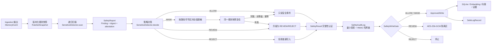
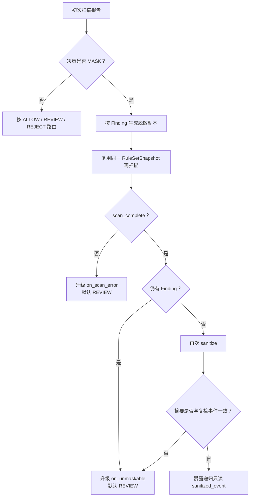

# Kylin-MemoryHub 安全模块技术文档

> 文档版本：1.0
>
> 适用项目版本：Kylin-MemoryHub 0.1.0
>
> 规则状态核对日期：2026-07-24
>
> 实现状态：版本化规则库、递归扫描、策略决策、脱敏后复检、最小化持久审计、
> REVIEW 加密隔离和强制写入 Gate 已实现。普通 SQLite、向量索引、证据链和
> Embedding 业务算法仍是项目其他模块的脚手架，只能作为受保护 sink 接入。

本文依据以下代码和仓库内文档编写：

- [`memoryhub/adapter/schemas.py`](../memoryhub/adapter/schemas.py)：`MemoryEvent` 与安全数据契约；
- [`memoryhub/safety_rules/`](../memoryhub/safety_rules/)：声明式规则模型、组件注册表和加载器；
- [`memoryhub/core/safety/detector.py`](../memoryhub/core/safety/detector.py)：扫描、决策、脱敏、复检和结果认证；
- [`memoryhub/core/safety/audit_log.py`](../memoryhub/core/safety/audit_log.py)：最小化持久审计和 HMAC 哈希链；
- [`memoryhub/core/safety/quarantine.py`](../memoryhub/core/safety/quarantine.py)：REVIEW 加密隔离；
- [`memoryhub/core/safety/gate.py`](../memoryhub/core/safety/gate.py)：普通存储、Embedding、向量、证据和日志的强制门禁；
- [`SAFETY_RULE_LIBRARY.md`](SAFETY_RULE_LIBRARY.md) 与
  [`SAFETY_ACCEPTANCE.md`](SAFETY_ACCEPTANCE.md)：规则溯源和验收边界。

本文中的“依据”“参考”“映射”不等于法律合规结论或国标符合性声明。规则默认动作
来自项目安全策略，不由法律、国标或 RFC 自动决定。

## 1. 安全模块整体框架

### 1.1 目标与信任边界

安全模块位于 `MemoryEvent` 和所有普通持久化/计算 sink 之间，解决四个问题：

1. 在事件进入长期记忆前发现凭据、个人信息和敏感个人信息；
2. 将“风险等级”和“处理动作”解耦，由可版本化策略确定脱敏、拒绝、复核或放行；
3. 保证只有经过完整扫描、必要脱敏和复检的安全副本能够进入存储、Embedding、
   向量索引和证据链；
4. 对每次安全处置生成不包含命中原文的最小审计记录，并阻止日志成为二次泄漏通道。

普通写入方不得直接消费原始 `MemoryEvent`，也不得自行拼装
`detect() → mask() → should_reject()`。生产入口必须是 `SafetyWriteGate`，其内部固定执行：

```text
process
  → validate_result
  → audit append
  → audit on-disk verify
  → route
  → guarded sinks
```

### 1.2 总体架构



### 1.3 组件职责

| 组件 | 主要职责 | 安全边界 |
|---|---|---|
| `RuleSetSnapshot` | 固定规则集版本、来源、编译结果、组件指纹和摘要 | 规则集必须整体加载成功；不允许部分加载或静默版本回退 |
| `SensitiveDetector` | 建立事件快照，递归扫描，决策，脱敏，复检，生成内存审计投影 | 一次 `process()` 复用同一规则/策略快照 |
| `SafetyReport` | 保存结构化 Finding、扫描完整性、事件/上下文摘要和实例内认证标签 | 不保存命中原文 |
| `SafetyResult` | 绑定报告、决策、审计、安全事件和复检报告 | `ALLOW/MASK` 才能携带递归只读安全事件 |
| `SafetyAuditLog` | 写入最小化 canonical JSONL，维护跨轮转 HMAC 哈希链 | 审计失败时所有普通下游调用数必须为 0 |
| `ReviewQuarantineStore` | 保存等待人工复核的原事件 | 仅保存 AES-256-GCM 密文；与审计密钥分离 |
| `SafetyWriteGate` | 验证结果、先审计后路由、签发普通写入能力 | 是普通写入的唯一生产边界 |
| `ApprovedWrite` | 携带只读安全事件、审计身份、输出摘要和进程内 MAC | 内容 sink 只能消费该能力对象 |
| `SafeLogRecord` | 向普通日志提供不含正文和用户标识的最小状态 | 普通日志不得接收裸事件、裸文本或 Finding 原文 |

### 1.4 核心安全不变量

- `SensitiveLevel = none | low | medium | high` 只表示风险，不直接决定动作。
- `SafetyAction = allow | mask | review | reject` 是独立策略结果。
- 动作严格度固定为 `REJECT > REVIEW > MASK > ALLOW`。
- 普通规则/等级覆盖只能收紧，不能把规则建议动作降级。
- 无命中且扫描完整时才直接 `ALLOW`。
- 扫描不完整至少进入 `REVIEW`；配置可进一步收紧为 `REJECT`。
- `MASK` 只有在脱敏后复检完整、无任何残留 Finding 且二次脱敏幂等时才可进入普通写入链。
- `REVIEW` 只进入独立加密隔离区；`REJECT` 不保留原事件。
- 持久审计先于普通路由完成；审计、隔离或能力验证失败均失败关闭。

## 2. 版本化规则库

### 2.1 三层版本结构

当前内置规则集由三层对象组成：

```text
catalog.json
  ├─ schema_version
  ├─ rule_set_id
  ├─ default_version
  └─ versions[]
       ├─ version
       ├─ resource
       └─ snapshot_digest

builtin-1.0.json / RuleSetDocument
  ├─ rule_set_id + version
  ├─ released_on + status_as_of
  ├─ sources[]
  ├─ governance_ref[]
  └─ rules[]

RuleDefinition
  ├─ rule_id + rule_version + enabled
  ├─ category + risk_level + default_action
  ├─ pattern + validator + masker
  ├─ target_paths + priority
  └─ standard_ref[]
```

当前快照：

| 项目 | 值 |
|---|---|
| `rule_set_id` | `kylin-memoryhub.safety` |
| `version` | `1.0` |
| `schema_version` | `1.0` |
| 规则数 | 14 |
| 来源数 | 17 |
| 机器可导出的溯源关联数 | 44 |
| `snapshot_digest` | `339ed6bf3a4aec59d9eca40af326f0b0ba734282552b8b8f2e3b60dcafe3b457` |
| `component_registry_digest` | `a64e10b18ec1bbb61b76d98d6922a7bd4f70fd51abd0df72f11995d0d1cfaf52` |

### 2.2 加载与完整性校验

加载器执行以下控制：

1. `catalog.json` 明确列出可用版本；未找到指定版本时显式失败，不回退到“最新文件”；
2. JSON 使用 UTF-8 严格解析，拒绝重复键、`NaN/Infinity`、未知字段和超过 2 MiB 的规则资源；
3. catalog 资源名按 POSIX 和 Windows 纯文件名规则校验，禁止目录穿越；
4. 规则集、单规则和组件引用使用严格的两段或三段版本语法；
5. 正则不得匹配空字符串，并通过保守的回溯风险检查；
6. validator/masker 只能引用版本化白名单组件，禁止任意 import、模块路径或 `eval`；
7. `redact_allow` 必须绑定声明了 `full_redaction` capability 的 masker；
8. 规范化文档、编译规则、编译器 schema 和实际引用组件指纹共同进入快照摘要；
9. catalog 中的 `snapshot_digest` 必须与运行时重算结果一致；
10. 同一 `source_id` 或同一 `rule_id@rule_version` 在历史快照中不得静默改变内容。

### 2.3 当前内置规则

声明式 `redact_allow` 在运行时编译为 `SafetyAction.MASK`。

| 规则 | 类别 | 风险 | 默认动作 | validator | replacement / 处置说明 |
|---|---|---:|---|---|---|
| `credential_field` | credential | high | reject | `builtin.non_placeholder@1.0` | 敏感字段路径命中，拒绝 |
| `credential.private_key` | credential | high | reject | `builtin.pem_private_key@1.0` | PEM 私钥候选，拒绝 |
| `credential.bearer_token` | credential | high | reject | `builtin.non_placeholder@1.0` | Bearer 上下文凭据，拒绝 |
| `credential.jwt` | credential | high | reject | `builtin.jwt@1.0` | 三段 JWT 结构候选，拒绝 |
| `api_key` | credential | high | reject | `builtin.non_placeholder@1.0` | 通用赋值启发式，拒绝 |
| `id_card` | sensitive_personal | high | redact_allow | `builtin.cn_resident_id@1.0` | `[REDACTED_ID_CARD]` |
| `sensitive_personal.bank_card` | sensitive_personal | high | redact_allow | `builtin.luhn_account@1.0` | `[REDACTED_FINANCIAL_ACCOUNT]` |
| `sensitive_personal.biometric_field` | sensitive_personal | high | reject | `builtin.non_placeholder@1.0` | 生物特征字段，拒绝 |
| `sensitive_personal.health_field` | sensitive_personal | high | review | `builtin.non_placeholder@1.0` | 健康信息字段，复核 |
| `sensitive_personal.location_trace_field` | sensitive_personal | high | review | `builtin.non_placeholder@1.0` | 精确位置/轨迹字段，复核 |
| `sensitive_personal.minor_age` | sensitive_personal | high | review | `builtin.under_fourteen@1.0` | 不满十四周岁候选，复核 |
| `email` | personal | medium | redact_allow | `builtin.email_ascii@1.0` | `[REDACTED_EMAIL]` |
| `phone` | personal | medium | redact_allow | `builtin.cn_mobile@1.0` | `[REDACTED_PHONE]` |
| `ip_address` | personal | low | redact_allow | `builtin.ip_address@1.0` | `[REDACTED_IP_ADDRESS]` |

规则采用“候选检测—语义验证”分层。正则和目标路径先缩小候选范围，再由 validator
检查日期、校验位、Luhn、IP 地址解析、JWT JSON 结构或非占位值。格式有效仍不等于
风险事实成立，代码目前通过路径、类别、风险和默认动作保守处置。

### 2.4 “标准—用途—规则”溯源矩阵

`RuleSource` 保存来源本身，`RuleSourceLink` 保存来源在某条规则中的具体用途。
用途枚举包括 `classification`、`syntax`、`semantic_validation`、`handling`、
`deidentification`、`effectiveness`、`lifecycle`、`audit`、`risk_policy` 和
`threat_model`。这样可避免把“分类依据”误写为“正则来源”，或把“项目动作”误写成
“国标要求”。

下表由 `RuleSetSnapshot.traceability_matrix` 对应的 44 条关联归并而成：

| 标准/来源 | 用途 | 关联规则或规则集 | 边界说明 |
|---|---|---|---|
| 《个人信息保护法》第 28 条 | `classification` | `id_card`、银行卡、生物特征、健康、位置轨迹、未成年人年龄 | 提供敏感个人信息分类依据，不提供正则和动作 |
| GB 11643-1999 | `syntax`、`semantic_validation` | `id_card` | 用于 18 位结构、日期、顺序码和 MOD 11-2 校验；不决定是否脱敏 |
| GB/T 35273-2020 | `classification` | `email`、`phone`、`ip_address` | 提供个人信息类别参考；不提供邮箱、手机号和 IP 检测正则 |
| GB/T 37964-2019 | `deidentification` | `id_card`、`sensitive_personal.bank_card` | 参考去标识化方法；去标识化不等于匿名化 |
| GB/T 41817-2022 | `lifecycle` | `@rule_set` | 规则需求、设计、测试、发布、变更和退役治理 |
| GB/T 42460-2023 | `effectiveness` | `@rule_set` | 参考脱敏效果评估；不定义固定掩码文本 |
| GB/T 45574-2025 | `handling` | 生物特征、健康信息字段规则 | 映射敏感个人信息处理保护要求；不作为字段正则来源 |
| GB/T 46903-2025 | `audit` | `@rule_set` | 参考合规审计流程、证据和报告；不规定本项目运行时字段 |
| TC260-PG-20244A | `classification` | 位置轨迹、未成年人年龄 | 是实践指南，不是国家标准；聚合风险尚未实现 |
| RFC 3986 / RFC 4291 | `syntax` | `ip_address` | 当前只生成 IPv4 候选并调用解析器；尚未启用 IPv6 候选正则 |
| RFC 5322 §3.4.1 | `syntax` | `email` | 当前只验证常见 ASCII addr-spec 子集 |
| RFC 6750 §2.1 | `syntax` | `credential.bearer_token` | 提供 Bearer 上下文和语法，不决定拒绝动作 |
| RFC 7468 §10—11 | `syntax` | `credential.private_key` | 覆盖部分 PEM 私钥文本边界，不覆盖所有厂商/OpenSSH 格式 |
| RFC 7519 §3 | `syntax` | `credential.jwt` | 验证三段 compact serialization 的 JSON 结构，不验证签名、有效期或授权 |
| OWASP Secrets Management Cheat Sheet | `threat_model` | `credential_field`、`api_key` | 提供凭据生命周期和泄漏威胁背景，不是格式标准 |
| `KMH-SAFETY-POLICY-1.0` | `syntax` | `api_key`、`phone` | 项目级通用凭据赋值和大陆手机号候选启发式 |
| `KMH-SAFETY-POLICY-1.0` | `semantic_validation` | 银行卡、未成年人年龄 | 项目级 Luhn 和年龄验证规则 |
| `KMH-SAFETY-POLICY-1.0` | `risk_policy` / `threat_model` | 14 条规则中的动作策略与 JWT 威胁模型 | 默认动作来自项目威胁模型，不来自法律、国标或 RFC |

当前未实现的规则族必须明确标为规划项：

- `personal_info_aggregate`：需要跨字段、跨事件或主体级聚合分析；
- `vendor_access_key` / `vendor_security_token`：需要厂商官方格式、版本和轮换资料；
- IPv6、国际化邮箱、护照等证件：需要新的候选、validator、测试和来源关联。

### 2.5 版本升级要求

- 来源版本变化时新增来源记录，不覆盖旧 `source_id`。
- 新国标“已发布”和“已实施”分开记录；征求意见稿不得替代现行生产依据。
- 规则语义变化必须提升 `rule_version`；规则集合变化必须发布新的规则集 `version`。
- 关闭规则通过新快照设置 `enabled=false`，保留旧快照和 digest。
- 来源变化不会自动改变动作；需重新评估适用范围、误报/漏报、脱敏效果和策略影响。
- 发布前使用不含真实个人信息和有效凭据的合成样本测试边界。

### 2.6 用户自定义敏感规则 Overlay

前端管理的用户规则与内置合规规则分开存储，不修改或重新发布
`RuleSetSnapshot`。每次处理事件时，系统按 `MemoryEvent.user_id` 读取该用户当前
启用规则，编译为不可变 `SafetyRuleOverlay`，再与内置快照组合成一次有效扫描计划。
初扫、决策、脱敏、复检、结果认证和审计始终复用同一个 detector 实例和组合摘要；
并发更新只影响下一条事件。

对外动作刻意使用无歧义名称：

| 前端 effect | 内部动作 | 语义 |
|---|---|---|
| `mask_match` | `MASK` | 用固定 `[REDACTED_USER_DEFINED]` 替换命中片段；复检通过后其余内容可继续 |
| `drop_event` | `REJECT` | 跳过整条 `MemoryEvent`，不进入普通记忆、Embedding、向量或证据 sink |

不新增第五种 `SKIP` 动作。若产品需要“只跳过一个已抽取的偏好/知识候选，同时保留同
事件的其他候选”，必须在候选拆分后增加候选级 Gate，不能把事件级 `REJECT` 偷换成
该语义。

用户规则只允许扫描 `/text`、`/payload/**` 和
`/tool_calls/*/{arguments,result,error}/**` 内容路径，排除事件/用户身份、
工具名、`redactions` 和质量诊断元数据。`mask_match` 的优先级低于全部内置规则，
因此不能盖过内置 `REVIEW/REJECT`；`drop_event` 可以收紧内置 `MASK`。固定脱敏
标记内的 Overlay 命中在复检时忽略，但跨出标记范围的候选仍须处理，避免用伪造标记
绕过扫描。

管理接口接受 `literal` 和 `advanced_regex`：

- `literal` 在服务端按扫描器相同的 Unicode 规范化语义转义为正则；
- `advanced_regex` 默认关闭；显式启用后经过长度、空匹配和保守回溯风险校验，只适合
  受信任本地管理端；
- 当前没有自然语言分类器。“C++ 的版本信息”这一描述不会自动推导出所有版本写法；
  可用 `C++` 的 `drop_event` 规则覆盖相关事件，或显式配置匹配完整版本串的受限正则。

matcher 本身可能是秘密，SQLite 只保存 AES-256-GCM 密文。主密钥经 HKDF 分离为
加密与 HMAC 指纹子密钥；用户引用、matcher 指纹和 Overlay 摘要均为域分离 HMAC。
组合 `rule_set_digest` 只包含内置摘要和带密钥 Overlay 摘要，不持久化低熵 matcher
的普通 SHA-256，避免审计摘要成为离线字典猜测 oracle。规则更新生成新 revision，
删除采用禁用/软删除；GET/list 不返回 matcher 或其确定性指纹，避免管理接口自身成为
在线字典 oracle。每用户累计规则（含 tombstone）最多 `max_rules_per_user` 条，每条
规则最多 100 个 revision，最后一个 revision 为软删除预留，限制历史表增长。

读取时先认证每个当前行的 AES-GCM AAD，再依据 `enabled/deleted` 过滤，防止翻转状态位
静默关闭规则。该逐记录认证不能检测有数据库写权限的攻击者删除整行或回放旧的合法
密文；此类回滚/删除威胁仍需依赖受控 SQLite 文件权限、备份/恢复审计，或未来增加外部
认证 head。

REST 管理接口以 `X-MemoryHub-User` 选择规则作用域。该值不是本模块提供的认证机制；
生产部署必须由可信本地网关从已认证主体生成并覆盖客户端输入，并向
`create_app()` 注入从认证会话解析主体的 `user_rule_identity_resolver`；默认无
resolver 时接口失败关闭。规则只影响未来写入，不自动重写或删除既有记忆。密钥、
存储、解密或 provider 异常均失败关闭，不得回退到“只加载内置规则”。
`memoryhub.app` 当前的通配 CORS 仅用于开发；生产还必须配置明确 origin 白名单。

## 3. 递归扫描 MemoryEvent：范围与遍历机制

> 用户需求中的第三、第四部分标题均为“递归扫描 MemoryEvent”。本文将其拆分为：
> 第三部分说明扫描范围和遍历机制；第四部分说明 Finding、扫描预算和失败关闭语义。

### 3.1 扫描范围

| 区域 | 扫描内容 | 说明 |
|---|---|---|
| 根字符串元数据 | `event_id`、`event_type`、`user_id`、`session_id`、`turn_id`、`scene`、`task_type` | `event_id/event_type/scene/task_type` 命中时报告使用固定标记，避免报告二次泄漏 |
| 正文 | `text` | 保存原始 Unicode 字符区间，支持精确脱敏 |
| 扩展负载 | 递归扫描 `payload` 的键和值 | 键参与路径匹配；敏感键名无法安全表达时报告不完整 |
| 工具调用 | `call_id`、`tool_name`、`arguments`、`result`、`error`、`sequence` | `arguments/result` 可为任意 JSON-like 嵌套值 |
| 已有脱敏标记 | `redactions[*]` | 防止外部输入伪造或夹带敏感值 |
| 质量信息 | `quality.issues[*]` | 防止校验/清洗错误信息复制原文 |

不作为自由文本扫描的字段：

- `source_type`、`quality.status`、`schema_version` 是受控枚举；
- `occurred_at` 和 `source_hash` 有严格格式约束。

### 3.2 有界快照

`MemoryEvent.payload` 和工具结果包含 `Any`，模型创建后调用方仍可能原地修改。
扫描器因此不会直接在调用方对象上计算摘要和遍历，而是先执行结构预检：

1. 使用显式栈遍历 JSON-like 值；
2. 在 Pydantic 序列化前检查深度、节点、路径和字节预算；
3. 拒绝循环引用、不稳定 mapping、非字符串键和不支持的对象类型；
4. 在预算内复制为独立事件快照；
5. 事件摘要和后续规则遍历共同消费该快照。

此顺序防止“摘要读取旧值、扫描读取新值”的可变对象竞态，也避免深层/超大输入在预算
生效前耗尽 Python 调用栈或内存。

### 3.3 显式栈递归遍历

`_traverse_value()` 使用显式栈而不是 Python 递归调用：

```text
push(root, path, normalized_path, depth=0)
while stack not empty and scan not stopped:
    pop node
    check depth / node count / path length
    if string:
        normalize → regex/path match → validator → candidate
    elif JSON scalar:
        stringify safe view → whole_value candidate
    elif mapping:
        detect cycle
        normalize and sort keys
        scan path-sensitive container marker
        push children in deterministic order
    elif sequence:
        detect cycle
        push indices in deterministic order
    else:
        record unsupported type issue
```

排序和稳定的候选选择规则保证同一事件、同一快照产生确定性结果。

### 3.4 Unicode 与路径语义

- 字符串先按 normalization unit 执行 NFKC，并移除零宽/格式控制字符。
- 正则和 validator 使用规范化安全视图。
- `SafetyFinding.start/end` 反投影到原始叶子字符串的 Unicode 字符半开区间
  `[start, end)`，脱敏时不会用规范化偏移误切原文。
- Finding 路径是严格 RFC 6901 JSON Pointer，只允许 `~0` 和 `~1` 转义。
- 规则 `target_paths` 在 RFC 6901 上增加整段 `*`、`**` glob；`~2` 仅在规则模板中
  表示字面星号，不允许进入实际 Finding 路径。
- 路径规则命中数字、布尔、`null`、对象或数组时使用 `target=whole_value` 和
  `start=end=0`，由脱敏器整体替换。

### 3.5 键名处理

映射键经同样的 Unicode 规范化后参与路径匹配，可阻止全角或零宽字符绕过
`password/token/secret` 等敏感路径。键名本身若命中邮箱、电话等内容规则，当前
JSON Pointer 无法表达“键名内部 span”，且把原键写入 Finding 会污染审计。因此扫描器：

1. 记录稳定 issue `scan.sensitive_member_name`；
2. 将报告标记为不完整；
3. 跳过该分支，避免把敏感键名复制到 Finding 或错误信息；
4. 由策略失败关闭到至少 `REVIEW`。

## 4. 递归扫描 MemoryEvent：Finding、预算与失败关闭

### 4.1 候选与 Finding

一条候选必须同时满足：

1. 内容正则命中；
2. 若规则包含 `target_paths`，规范化路径也必须命中；
3. 捕获组存在且候选值有效；
4. 版本化 validator 返回真。

重叠候选按以下稳定顺序解决：

```text
priority 降序
→ 原始跨度降序
→ 动作严格度
→ 规则 ID / 规则版本 / 注册顺序
```

同一路径只保留一个 `whole_value` 候选；祖先整值和后代局部命中作为不同风险事实同时
保留，避免低优先级祖先规则吞掉更严格的后代规则。脱敏阶段再按路径深度消除冗余替换。

`SafetyFinding` 只保存：

| 字段 | 含义 |
|---|---|
| `finding_id` | 报告内唯一 ID |
| `rule_name/rule_version` | 命中规则身份 |
| `level/suggested_action` | 风险和规则建议动作 |
| `field_path` | RFC 6901 路径 |
| `target` | `text_span` 或 `whole_value` |
| `start/end` | 原始字符串区间，或整值命中的 `[0,0)` |
| `replacement/maskable` | 固定替换标记及是否可脱敏 |
| `reason_code` | 稳定、可审计原因码 |
| `reason/standard_source` | 人可读说明和来源摘要 |

Finding 不保存命中原文。

### 4.2 SafetyReport

`SafetyReport` 绑定：

- `event_digest`：完整快照的 canonical JSON SHA-256；
- `rule_set_version/rule_set_digest`：本次扫描使用的规则快照；
- `context/context_digest`：`source_type/event_type/scene/task_type` 决策上下文；
- `findings/highest_level`：结构化命中与最高风险；
- `scanned_field_count`：实际尝试扫描的键、标量叶子和持久化字符串元数据数；
- `scan_complete/issues`：扫描是否完整及稳定错误码；
- `attestation`：同一 detector 实例内对报告字段的 HMAC-SHA256 完整性标签。

报告认证使用进程内随机密钥，不是跨进程签名。反序列化、缓存或跨组件边界后的结果必须
交回同一 detector 的 `validate_result()` 重新验证、重新决策，并在 `MASK` 分支重新派生
安全副本。

### 4.3 扫描预算

默认预算来自 [`config.example.yaml`](../config.example.yaml)：

| 预算 | 默认值 | 作用 |
|---|---:|---|
| `max_depth` | 32，硬上限 64 | 限制嵌套深度 |
| `max_field_chars` | 65,536 | 限制单字段字符数 |
| `max_scan_bytes` | 2,097,152 | 限制总 UTF-8 扫描字节数 |
| `max_scanned_fields` | 10,000 | 限制节点/字段数量 |
| `max_candidates` | 2,048 | 限制规则候选数 |
| `max_findings` | 1,024 | 限制最终 Finding 数 |
| `max_path_chars` | 4,096 | 限制原始/规范化路径长度 |

这些预算降低深层结构、超大工具结果、候选爆炸和路径膨胀的资源耗尽风险，但不等同于
正则引擎的硬超时或任意正则运行时间的形式化证明。

### 4.4 错误分类与失败关闭

| 阶段 | 行为 | 下游结果 |
|---|---|---|
| 有界快照前结构超限、循环引用、对象不稳定 | 抛出只含稳定代码的 `SafetyScanError` | Gate 转换为稳定 `gate.processing_failed`，不进入任何普通 sink |
| 快照后候选/Finding 超限或 validator 异常 | 保留已确认 Finding，`scan_complete=false` | `on_scan_error` 默认升级为 `REVIEW` |
| Finding 元数据与当前快照不一致 | 视为不可信 Finding | 至少按 `fallback_action` 与 `REVIEW` 的较严格者处置 |
| 路径不可脱敏、枚举/身份字段不能替换 | `maskable=false` 或脱敏失败 | 默认升级为 `REVIEW` |
| `scan_text()` 遇到预算问题 | 直接抛 `SafetyScanError` | 调用方必须失败关闭 |

所有公开安全异常只携带稳定错误码，不复制 Pydantic 输入、SDK 原始错误或待扫描文本。

## 5. 策略决策：脱敏、拒绝、复核、放行与脱敏后复检

### 5.1 决策模型

决策只消费已认证的 `SafetyReport`，不重新读取原事件。每个 Finding 的动作按以下顺序
确定：

1. 验证 Finding 是否与当前规则快照逐字段一致；
2. 选择规则级覆盖、等级级覆盖或规则建议动作；
3. 将覆盖与规则建议按严格度取较严格者，防止降级；
4. 应用符合治理要求的有限期 `ALLOW` 例外；
5. 不可脱敏或关闭自动脱敏时，将 `MASK` 升级为 `REVIEW`；
6. 扫描不完整时应用 `on_scan_error`；
7. `reject_on_detect=true` 时，任何命中强制 `REJECT`；
8. 对所有 Finding 按 `REJECT > REVIEW > MASK > ALLOW` 聚合。

风险等级不映射为固定动作。例如：

- API 凭据是 `HIGH + REJECT`；
- 身份证号是 `HIGH + MASK`；
- 健康信息是 `HIGH + REVIEW`。

### 5.2 四动作语义

| 动作 | 触发条件 | 原事件 | 普通存储/Embedding/日志 |
|---|---|---|---|
| `ALLOW` | 完整扫描且无命中，或符合严格治理条件的低风险例外 | 形成递归只读安全快照 | 允许，经 `ApprovedWrite` / `SafeLogRecord` |
| `MASK` | 所有有效命中均可全值脱敏，且自动脱敏开启 | 生成脱敏副本；原事件不进入普通链 | 仅复检通过后允许 |
| `REVIEW` | 健康/轨迹/未成年人等默认复核；扫描不完整；不可脱敏；复检失败 | 仅 AES-256-GCM 密文进入隔离区 | 全部禁止 |
| `REJECT` | 凭据、私钥、生物特征等默认拒绝；或全局强制拒绝 | 不保留 | 全部禁止 |

### 5.3 有限期 ALLOW 例外

普通 `rule_overrides` 和 `level_overrides` 不能配置 `ALLOW`。例外必须使用
`SafetyPolicyException`，并提供：

- 规则名；
- 至少一个 `source_type/event_type/scene/task_type/field_path` 选择器；
- 原因、负责人、版本；
- 带时区的 `valid_from/expires_at`；
- 可选的 `rule_set_digest` 绑定。

当前安全下限只允许低风险上下文标识（内置规则中为 IPv4）使用例外。凭据、身份证、
银行卡、手机号、邮箱和敏感个人信息不能通过例外降为 `ALLOW`。报告身份字段
`event_id/event_type/scene/task_type` 也不允许例外。

### 5.4 脱敏实现

`sanitize()` 校验报告认证和 `event_digest`，按 Finding 的路径和原始字符区间生成新事件，
不修改输入。规则使用固定类型标记，例如：

```text
[REDACTED_ID_CARD]
[REDACTED_FINANCIAL_ACCOUNT]
[REDACTED_EMAIL]
[REDACTED_PHONE]
[REDACTED_IP_ADDRESS]
```

固定标记不保留证件或手机号尾号，也不用于跨事件关联。自定义 masker 必须返回严格等于
replacement 的全值替换；输入已是安全 `[REDACTED...]` 标记时允许原样返回以保持幂等。

### 5.5 脱敏后复检



复检必须同时满足：

1. 使用与初扫完全相同的规则和组件快照；
2. `scan_complete=true` 且至少扫描一个字段；
3. 不存在任何残留 Finding；
4. 对复检事件再次脱敏后摘要不变，即脱敏幂等。

任何一步失败都不会返回半安全事件，而是将决策至少升级为 `REVIEW`。

### 5.6 结果认证

`SafetyResult` 绑定报告、决策、内存审计、安全事件和复检报告，并使用独立域标签的
HMAC-SHA256 覆盖全部字段。`validate_result()` 会：

- 重验报告和结果认证；
- 核对原事件摘要、规则快照和上下文绑定；
- 重新计算不能被削弱的有效决策；
- 对 `MASK` 重新派生安全副本；
- 拒绝跨候选拼接、字段注入、旧报告重放和被降级的动作。

## 6. 审计记录与安全事件写入存储、Embedding 和日志

### 6.1 设计结论

这里需要区分三类数据：

1. **安全内容事件**：仅 `ALLOW/MASK` 分支产生，由 `ApprovedWrite` 携带，允许进入
   SQLite、Embedding、向量索引和证据链；
2. **普通运行日志**：仅接收 `SafeLogRecord`，不接收事件正文、用户 ID、命中原文或
   原始错误；
3. **安全处置审计**：四种动作都生成 `SafetyAuditLogRecord`，写入独立安全审计链。

因此准确表述是：**只有安全事件才能进入普通存储、Embedding、向量、证据和普通日志；
所有安全决策都会进入独立的最小化安全审计。**

### 6.2 Gate 路由矩阵

| 最终动作 | SQLite / Embedding / 向量 / 证据 | 普通日志 | REVIEW 隔离区 | 安全审计 |
|---|---|---|---|---|
| `ALLOW` | `ApprovedWrite` | `SafeLogRecord` | 否 | 是 |
| `MASK` | 脱敏后 `ApprovedWrite` | `SafeLogRecord` | 否 | 是 |
| `REVIEW` | 禁止 | 禁止 | AES-256-GCM 密文 | 是 |
| `REJECT` | 禁止 | 禁止 | 否 | 是 |

`SafetyWriteGate` 先把审计写入磁盘并严格复验，再签发 `ApprovedWrite`。能力 MAC 绑定：

- Gate 签发者；
- 递归只读安全事件；
- 最终动作和输出摘要；
- 实际审计 `audit_id`、记录哈希和序号。

任一内容 sink 调用前再次验证能力。回调只能接收 `ApprovedWrite`，不能接收裸
`MemoryEvent` 或裸字符串。

### 6.3 持久审计字段

`SafetyAuditLogRecord` 保存：

- schema、链 ID、单调序号、`audit_id` 和 UTC 时间；
- 规则集、策略、组件版本及其 digest；
- 最终动作、稳定原因码、例外 ID、最高风险；
- 按规则类别统计的命中数、Finding 数、去重字段路径、脱敏数；
- 基于可信 `report.event_digest` 和设备密钥生成的 HMAC 输入指纹；
- 仅 `ALLOW/MASK` 存在的安全输出摘要；
- 处理耗时、前驱记录哈希和本记录 HMAC。

明确禁止保存：

- 原始事件正文、`payload`、工具参数/结果；
- 原始 user/session/turn ID；
- 原始事件 ID；
- 命中值、Token、完整个人信息；
- 规则 `reason` 和决策自然语言说明；
- 调用方提供的、可能伪造的 `source_hash` 作为可信输入指纹。

事件 ID 被转换为域分离 HMAC 引用。字段路径只保留 schema 控制的字段名和明确的列表
下标；动态路径段改为 `seg_<HMAC>`，并再次用同一规则快照扫描。因此审计记录本身也
执行最小化和二次防泄漏。

### 6.4 审计完整性与保留

- 使用 canonical UTF-8 单行 JSONL；
- HMAC 记录哈希覆盖完整最小投影、单调序号和前驱哈希；
- 认证 head 固定当前链头，可检测尾部截断；
- 轮转不重置哈希链；
- 保留清理只删除已关闭的连续旧分段，删除前原子写入认证 anchor；
- 严格解析拒绝重复键、非有限数、非 canonical 行和断链；
- POSIX 目标环境使用目录 `0700`、文件 `0600`、`O_NOFOLLOW`、文件锁和 `fsync`；
- 审计 HMAC 密钥与 REVIEW AES 密钥必须来自不同设备密钥/系统凭据。

同目录 head 无法抵抗拥有目录写权限的攻击者同时回放旧日志和旧 head。需要抵抗该威胁
时，应把链头周期性提交到独立 WORM、可信时间戳或签名服务。

### 6.5 REVIEW 隔离

`ReviewQuarantineStore` 使用独立 32 字节密钥执行 AES-256-GCM：

- AAD 绑定安全审计关联和版本化元数据；
- 临时文件 `fsync` 后原子发布，并复读校验回执；
- 错误密钥、篡改、过期、超限或伪造回执均失败关闭；
- 普通存储、Embedding、检索和日志不得读取隔离区；
- 到期后禁止读取，物理删除由定时清理任务执行。

### 6.6 当前接入边界

`Database`、`VectorStore`、`EvidenceStore` 和 Embedding 客户端的业务能力尚未全部完成。
后续实现不得重新增加接收原事件的旁路，必须注册为 `GuardedCallbacks` 的受保护 sink。
麒麟 Embedding 异常只能暴露稳定错误码，不能把输入文本或 SDK 原始消息写入异常和日志。

本次已实现规则 CRUD、`detector_provider()` 和 Gate 动态 detector 路由，但仓库现有
`POST /api/memory/events` 仍是 `NotImplementedError` 脚手架，因此默认应用尚没有真实
业务写入可供自动拦截。实现该端点时必须用
`SafetyWriteGate.from_user_rule_config(service, config.safety, ...)` 装配；该入口会在创建
审计/隔离目录前验证用户规则、审计和隔离三类密钥互不复用。所有普通 sink 只能接收
`ApprovedWrite`；在此之前不能宣称已完成端到端入库。

## 7. 参考论文、国标与其他规范来源

### 7.1 国家标准与国内规范

以下状态以 2026-07-24 为准：

| 标准/规范 | 状态与项目用途 | 实现边界 |
|---|---|---|
| [GB 11643-1999《公民身份号码》](https://std.samr.gov.cn/gb/search/gbDetailed?id=71F772D75D5FD3A7E05397BE0A0AB82A) | 强制性、现行；身份证号码结构和校验 | 只用于候选语义验证，不决定分类和动作 |
| [GB/T 35273-2020《信息安全技术 个人信息安全规范》](https://std.samr.gov.cn/gb/search/gbDetailed?id=A0280129495AEBB4E05397BE0A0AB6FE) | 推荐性、现行；个人信息类别和处理参考 | 不提供邮箱、手机号、IP 正则 |
| [GB/T 37964-2019《信息安全技术 个人信息去标识化指南》](https://std.samr.gov.cn/gb/search/gbDetailed?id=91890A0DA4AB80C6E05397BE0A0A065D) | 推荐性、现行；替换、泛化、扰动、假名化参考 | 去标识化不等于匿名化 |
| [GB/T 41817-2022《信息安全技术 个人信息安全工程指南》](https://std.samr.gov.cn/gb/search/gbDetailed?id=EB58F4DA9267B2A2E05397BE0A0A7D33) | 推荐性、现行；规则全生命周期治理 | 不直接生成任何正则或动作 |
| [GB/T 42460-2023《信息安全技术 个人信息去标识化效果评估指南》](https://std.samr.gov.cn/gb/search/gbDetailed?id=F789206610ADB223E05397BE0A0AE533) | 推荐性、现行；脱敏效果和重标识风险评估 | 当前代码的“无残留复检”不是完整重标识风险评估 |
| [GB/T 45574-2025《数据安全技术 敏感个人信息处理安全要求》](https://std.samr.gov.cn/gb/search/gbDetailed?id=33D40F1161155D92E06397BE0A0A5B93) | 推荐性、现行；敏感个人信息处理保护措施 | 不作为字段格式规范 |
| [GB/T 46903-2025《数据安全技术 个人信息保护合规审计要求》](https://openstd.samr.gov.cn/bzgk/std/newGbInfo?hcno=EC64C138A5B6A52AA5DC5A60188FC07E&refer=outter) | 推荐性、现行；2026-07-01 实施；审计流程和证据映射 | 本项目安全处置日志不是正式合规审计报告 |
| [TC260《网络安全标准实践指南——敏感个人信息识别指南》](https://www.tc260.org.cn/portal/article/2/20240918084858) | 敏感个人信息类别和聚合风险参考 | 是实践指南，不是国家标准；跨事件聚合尚未实现 |

法律分类还参考
[《中华人民共和国个人信息保护法》](https://www.npc.gov.cn/npc/c2/c30834/202108/t20210820_313088.html)
第 4 条和第 28 条。法律提供分类与义务框架，不提供检测正则、validator 或项目动作。

### 7.2 参考论文

| 论文 | 与本模块的关系 | 未据此声称的能力 |
|---|---|---|
| Meli, McNiece, Reaves, [*How Bad Can It Git? Characterizing Secret Leakage in Public GitHub Repositories*](https://www.ndss-symposium.org/wp-content/uploads/2019/02/ndss2019_04B-3_Meli_paper.pdf), NDSS 2019 | 支撑凭据泄漏威胁背景、模式检测与语义验证分层的必要性 | 当前规则不等于论文检测器，也不覆盖所有厂商凭据 |
| Papadopoulou et al., [*Neural Text Sanitization with Explicit Measures of Privacy Risk*](https://aclanthology.org/2022.aacl-main.18/), AACL-IJCNLP 2022 | 说明文本脱敏需同时考虑识别、风险和效用，而非只做字符串替换 | 当前实现是确定性规则扫描，不含论文中的神经风险模型 |
| Charpentier and Lison, [*Re-identification of De-identified Documents with Autoregressive Infilling*](https://aclanthology.org/2025.acl-long.60/), ACL 2025 | 说明“已掩码”不自动等于不可重识别，支持脱敏后复检和边界声明 | 当前复检只证明同快照无规则残留且幂等，不证明匿名化 |
| Schneier and Kelsey, [*Secure Audit Logs to Support Computer Forensics*](https://www.schneier.com/academic/archives/1999/05/secure_audit_logs_to.html), 1999 | 支撑认证日志、前驱关联和篡改检测的设计背景 | 当前实现使用固定设备 HMAC 密钥链，不是论文的完整前向安全密钥演进方案 |
| Bellare and Yee, [*Forward Integrity for Secure Audit Logs*](https://cseweb.ucsd.edu/~bsy/papers.html), 1997 | 支撑日志前向完整性和序号/时期思想 | 当前 HMAC 链不能在当前密钥泄漏后提供严格的前向完整性 |
| Wang et al., [*Unveiling Privacy Risks in LLM Agent Memory*](https://arxiv.org/abs/2502.13172), 2025 | 说明持久 Agent Memory 会形成独立的隐私提取攻击面 | 当前模块保护写入链，不代表已解决检索阶段的全部记忆提取攻击 |
| Wu et al., [*Agent-Memory Protocol: A Privacy-Focused Protocol for LLM Agents and User Memory Interaction*](https://proceedings.mlr.press/v317/wu26a.html), PMLR 2026 | 支撑在 Agent 与持久记忆边界实施隐私控制的总体方向 | 本项目未实现该论文协议，不应宣称协议兼容 |

论文是威胁模型和设计背景，不是声明式规则的规范性格式来源。生产规则的 `pattern`、
validator、动作和版本仍必须分别关联官方标准、协议、厂商文档或明确的项目策略。

### 7.3 其他协议和安全指南

- [RFC 3986](https://www.rfc-editor.org/rfc/rfc3986.html) 与
  [RFC 4291](https://www.rfc-editor.org/rfc/rfc4291.html)：IP 地址文本边界；
- [RFC 5322](https://www.rfc-editor.org/rfc/rfc5322.html)：邮箱 addr-spec 语法；
- [RFC 6750](https://www.rfc-editor.org/rfc/rfc6750.html)：Bearer Token 使用；
- [RFC 7468](https://www.rfc-editor.org/rfc/rfc7468.html)：PKIX/PKCS/CMS 文本编码边界；
- [RFC 7519](https://www.rfc-editor.org/rfc/rfc7519.html)：JWT 表示结构；
- [OWASP Secrets Management Cheat Sheet](https://cheatsheetseries.owasp.org/cheatsheets/Secrets_Management_Cheat_Sheet.html)：
  凭据识别、存储、轮换和审计的威胁模型背景。

### 7.4 合规与验收边界

- “引用某标准”只表示分类、验证、处理、评估或审计设计映射，不表示项目已经符合该标准。
- 安全处置审计只证明某次 `MemoryEvent` 使用了哪版规则/策略并执行了什么动作，不是正式
  个人信息保护合规审计报告。
- 目标银河麒麟环境仍需复验 POSIX 权限、软链接防护、断电恢复、多进程文件锁、设备密钥
  轮换和定时保留清理。
- 当前不包含跨事件个人信息聚合判断、全厂商凭据格式、严格前向安全日志、完整匿名化/
  重标识风险评估和检索阶段全部隐私攻击防护。

## 附录 A：实现与测试映射

| 能力 | 主要实现 | 主要测试 |
|---|---|---|
| 规则模型、catalog、digest、溯源矩阵 | `memoryhub/safety_rules/` | `tests/test_safety_rule_library.py` |
| 递归扫描、预算、Unicode、路径、Finding | `memoryhub/core/safety/detector.py` | `tests/test_safety_scanner.py` |
| 决策、例外、脱敏、复检、结果认证 | `detector.py`、`schemas.py` | `tests/test_safety_pipeline.py`、`test_safety_contract.py` |
| 审计最小投影、哈希链、轮转、保留 | `memoryhub/core/safety/audit_log.py` | `tests/test_safety_audit_log.py` |
| REVIEW 加密隔离、强制写入 Gate | `quarantine.py`、`gate.py` | `tests/test_safety_gate.py` |
| 用户规则 CRUD、加密版本库、动态 Overlay | `user_rules.py`、`adapter/user_rule_schemas.py`、`adapter/api.py` | `tests/test_user_sensitive_rules.py`、`tests/test_user_rule_api.py` |
| 配置与兼容开关 | `memoryhub/config.py`、`config.example.yaml` | `tests/test_safety_runtime_config.py` |
| 异常和日志原文泄漏防护 | `memoryhub/app.py`、`memoryhub/embedding/kylin_client.py` | `tests/test_safe_errors.py` |
