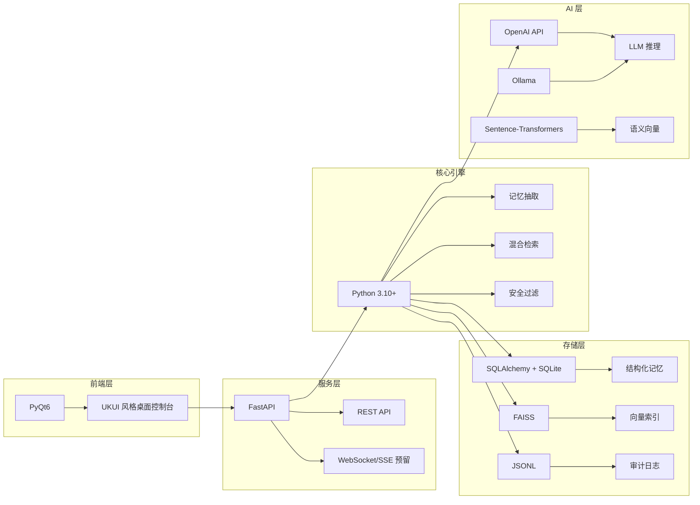
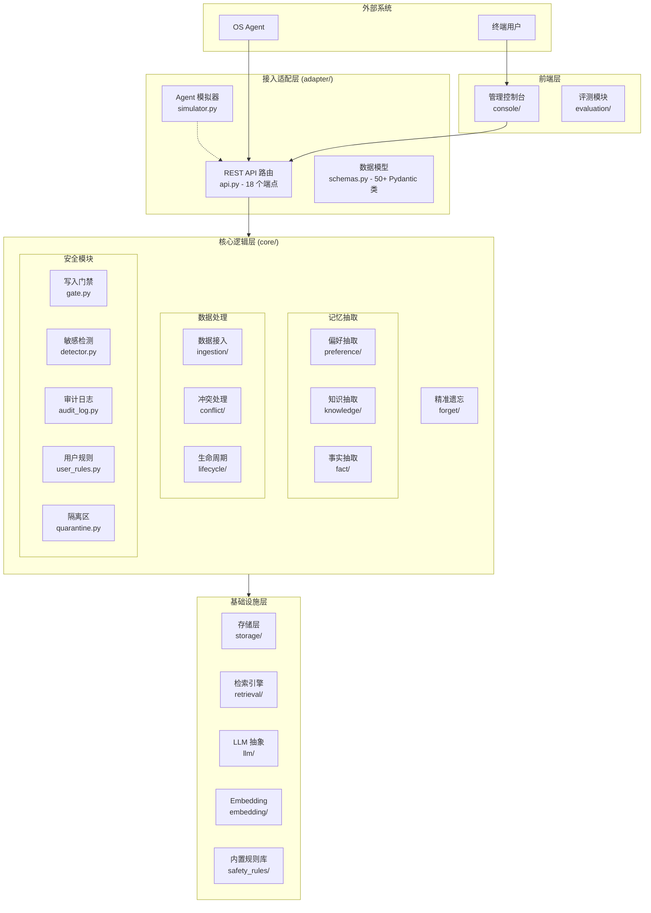
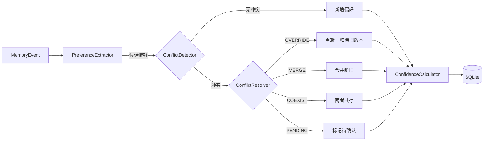
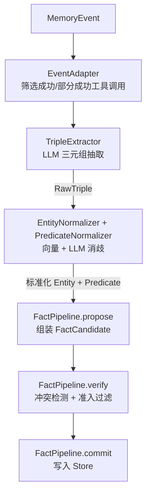
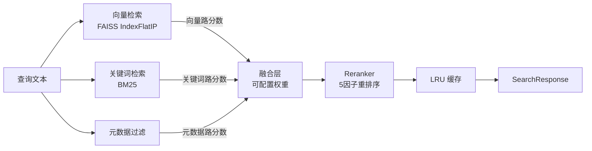
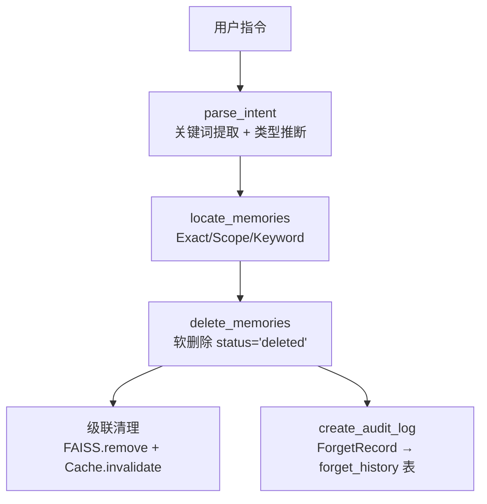
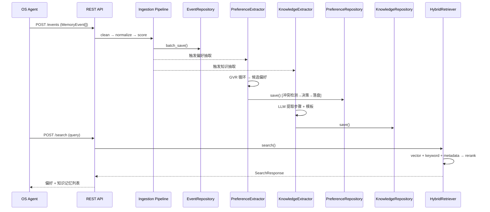
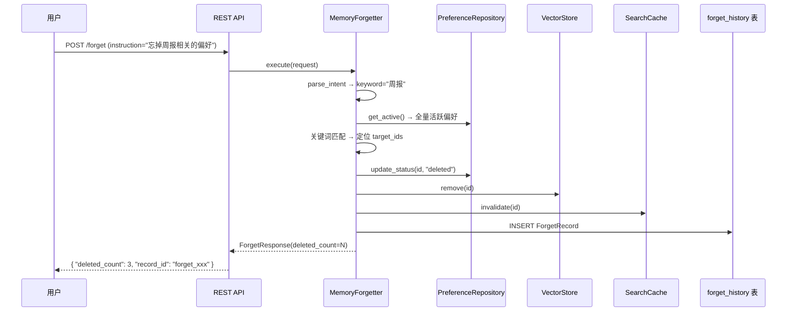
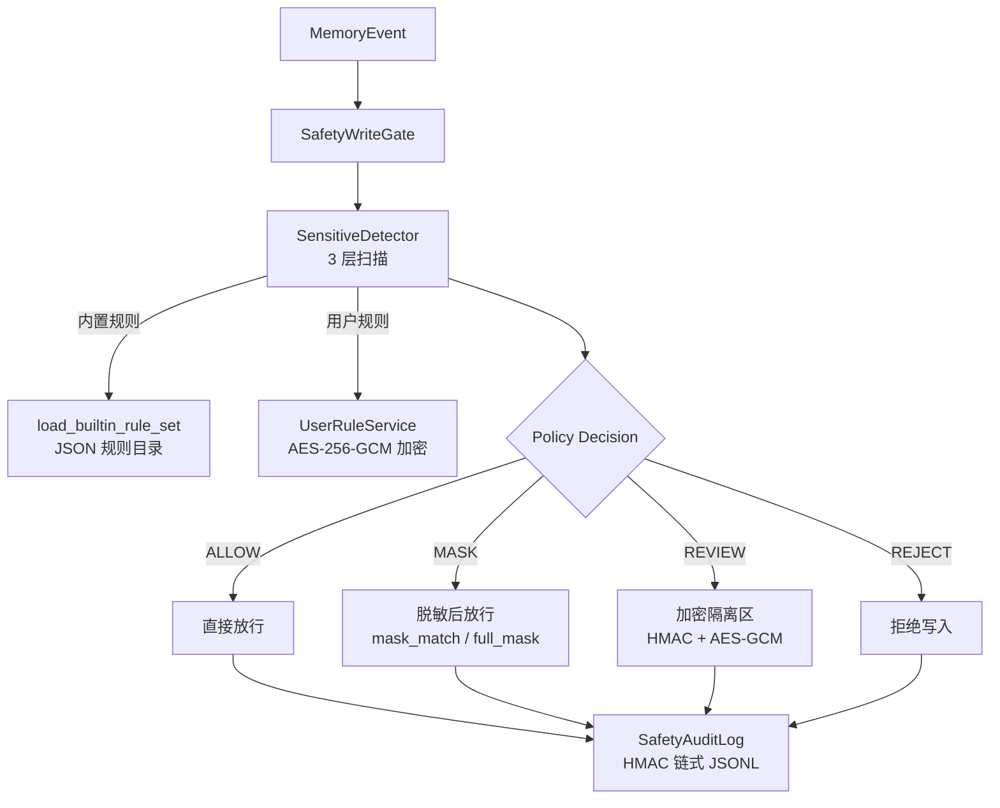
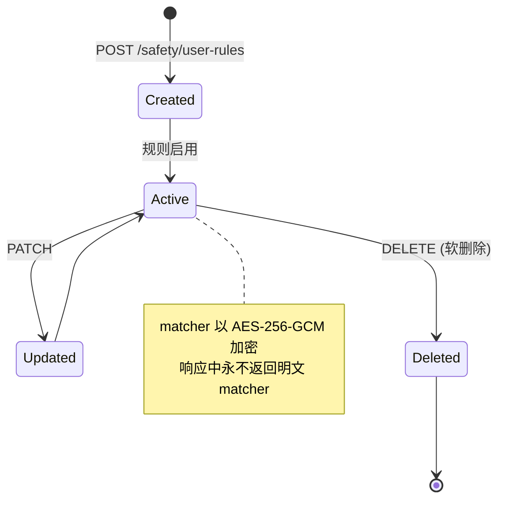

# 麒麟记忆中枢 (Kylin-MemoryHub) — 阶段性技术总结

> **分支**: `dev_improve` | **版本**: v0.2.0 | **日期**: 2026-07-31

---

## 目录

1. [项目概述](#1-项目概述)
2. [技术栈](#2-技术栈)
3. [分层架构](#3-分层架构)
4. [文件树与功能对应](#4-文件树与功能对应)
5. [核心模块详解](#5-核心模块详解)
6. [核心数据结构](#6-核心数据结构)
7. [API 接口设计](#7-api-接口设计)
8. [数据流转通道](#8-数据流转通道)
9. [安全机制](#9-安全机制)
10. [评测体系](#10-评测体系)

---

## 1. 项目概述

Kylin-MemoryHub 是一个面向麒麟操作系统 OS Agent 的**可插拔本地记忆中枢**。系统接收来自 OS Agent 的多源事件数据（用户对话、工具调用结果、反馈），经过清洗、标准化、质量评分后，提取偏好记忆与知识记忆并持久化存储，同时提供混合检索、冲突解决、精准遗忘、敏感信息过滤等全生命周期管理能力。

### 核心能力

| 能力 | 说明 |
|------|------|
| **多源事件接入** | 统一的 `MemoryEvent` 模型，兼容用户行为、工具调用、反馈等多来源 |
| **记忆抽取** | 偏好记忆（LLM + 规则）、知识记忆（LLM + LCS 工作流挖掘）、事实记忆（三元组抽取） |
| **混合检索** | BM25 关键词 + FAISS 向量 + 元数据过滤，融合重排序 |
| **冲突管理** | 自动冲突检测（语义 + 规则）→ 决策矩阵（OVERRIDE/MERGE/COEXIST/PENDING） |
| **精准遗忘** | 自然语言驱动 + 关键词匹配 + scope 定位，软删除 + 向量索引清理 + 审计日志 |
| **安全过滤** | 多层敏感信息检测 + 用户自定义规则 + AES-256-GCM 加密 + HMAC 审计链 |
| **生命周期管理** | SHORT → MID → LONG 记忆升级/降级/过期，基于健康度的被动遗忘 |
| **管理控制台** | PyQt6 桌面前端，UKUI 风格，支持 Mock/实时双模式 |

---

## 2. 技术栈



| 层次 | 技术选型 | 说明 |
|------|----------|------|
| **语言** | Python 3.10+ | `from __future__ import annotations`，泛型语法 |
| **Web 框架** | FastAPI + Uvicorn | 异步 REST API，自动 OpenAPI 文档 |
| **数据校验** | Pydantic v2 | 全量请求/响应模型校验，`extra="forbid"` |
| **ORM** | SQLAlchemy 2.0 | Declarative Base，Session 管理 |
| **数据库** | SQLite | 本地单文件部署，WAL 模式预留 |
| **向量引擎** | FAISS | IndexFlatIP 内积索引，支持磁盘持久化 |
| **关键词检索** | BM25 (rank_bm25) | 纯 Python 实现，增量重建 |
| **LLM 客户端** | OpenAI SDK / Ollama API | 双后端支持（云端 + 本地） |
| **Embedding** | Sentence-Transformers / 麒麟 SDK | 语义向量生成，Mock 回退 |
| **前端** | PyQt6 | 桌面原生控制台，无边框 UKUI 风格 |
| **加密** | AES-256-GCM + HMAC-SHA256 | 敏感规则加密 + 审计防篡改 |
| **配置** | YAML + 环境变量 | dataclass 强类型配置 |

---

## 3. 分层架构



### 分层职责

| 层 | 职责 | 关键约束 |
|----|------|----------|
| **接入适配层** | HTTP 请求校验、路由分发、依赖注入 | 所有输入经 Pydantic 校验 |
| **核心逻辑层** | 记忆抽取、冲突解决、遗忘执行、安全决策 | 无 HTTP 依赖，可单测 |
| **基础设施层** | 数据持久化、向量索引、LLM 调用 | 通过接口抽象，可替换 |
| **前端层** | 可视化管理、评测报告 | 通过 REST API 与后端通信 |

---

## 4. 文件树与功能对应

```
XA202612-2/
│
├── memoryhub/                          # ⭐ 核心 Python 包
│   ├── app.py                          #   FastAPI 应用入口，组装所有模块
│   ├── config.py                       #   全局配置（dataclass），YAML + 环境变量
│   │
│   ├── adapter/                        # ── 接入适配层 ──
│   │   ├── api.py                      #   18 个 REST 端点（记忆 CRUD/检索/遗忘/安全规则/评测）
│   │   ├── schemas.py                  #   50+ Pydantic 数据模型定义
│   │   ├── user_rule_schemas.py        #   用户自定义敏感规则 DTO
│   │   └── simulator.py                #   OS Agent 模拟器（集成测试用）
│   │
│   ├── core/                           # ── 核心逻辑层 ──
│   │   ├── fact/                       #   事实记忆子系统
│   │   │   ├── models.py               #     Entity / PredicateDef / Fact / FactCandidate
│   │   │   ├── extractor.py            #     LLM 三元组抽取 (DeepSeek/OpenAI)
│   │   │   ├── normalizer.py           #     实体 + 谓词向量消歧归一化
│   │   │   ├── pipeline.py             #     事实记忆管线 (Propose → Verify → Commit)
│   │   │   ├── admission.py            #     事实准入策略（偏好/假设/临时过滤器）
│   │   │   ├── conflict.py             #     事实冲突检测 (Contradiction/Supersede/Refine)
│   │   │   ├── store.py                #     SQLite 事实库 (实体/谓词/事实 CRUD)
│   │   │   ├── embedding_index.py      #     字符 n-gram + Sentence-Transformer 混合索引
│   │   │   ├── event_adapter.py        #     MemoryEvent → ToolCallResult 适配
│   │   │   ├── prompts.py              #     LLM Prompt 模板（抽取/消歧/对齐）
│   │   │   └── predicate_ontology.json #     种子谓词本体（~85 个谓词定义）
│   │   │
│   │   ├── preference/                 #   偏好记忆子系统
│   │   │   ├── __init__.py             #     PreferenceManager 集成入口
│   │   │   ├── extractor.py            #     偏好抽取（LLM GVR 循环 + 规则兜底）
│   │   │   ├── confidence.py           #     置信度计算（时间衰减 + 来源权重 + 证据量）
│   │   │   └── updater.py              #     偏好更新 + 冲突检测 + 版本管理
│   │   │
│   │   ├── knowledge/                  #   知识记忆子系统
│   │   │   ├── extractor.py            #     知识抽取（LLM 目标概括 + 步骤提取）
│   │   │   ├── template_builder.py     #     模板构建（LLM 增强 + 合并）
│   │   │   ├── workflow_miner.py       #     工作流挖掘（LCS 最长公共子序列）
│   │   │   └── _event_utils.py         #     事件处理共享工具
│   │   │
│   │   ├── ingestion/                  #   数据接入管线
│   │   │   ├── cleaner.py              #     数据清洗（去重/字段校验/空格规范化）
│   │   │   ├── normalizer.py           #     数据标准化（来源映射 → MemoryEvent）
│   │   │   └── quality.py              #     质量评分（完整度/有效性/一致性/新鲜度）
│   │   │
│   │   ├── conflict/                   #   通用冲突处理
│   │   │   ├── detector.py             #     冲突检测（scope 重叠 + 语义矛盾）
│   │   │   └── resolver.py             #     冲突解决（决策矩阵 + 自动/手动）
│   │   │
│   │   ├── forget/                     #   精准遗忘子系统
│   │   │   ├── forgetter.py            #     遗忘执行器（定位→删除→向量清理→审计）
│   │   │   ├── auto_forget.py          #     自动遗忘引擎（健康度扫描→归档/降级）
│   │   │   └── health.py               #     健康度计算器（指数衰减 + 访问频率 + 稳定性）
│   │   │
│   │   ├── lifecycle/                  #   生命周期管理
│   │   │   └── manager.py              #     SHORT→MID→LONG 升级/降级/过期
│   │   │
│   │   └── safety/                     #   安全子系统
│   │       ├── __init__.py             #     安全模块统一导出
│   │       ├── gate.py                 #     写入门禁（策略决策→ALLOW/MASK/REVIEW/REJECT）
│   │       ├── detector.py             #     敏感检测器（正则+DAG+结构化扫描，3154行）
│   │       ├── audit_log.py            #     HMAC 链式审计日志（分段+轮转+校验）
│   │       ├── user_rules.py           #     用户自定义规则（AES-256-GCM 加密存储）
│   │       ├── quarantine.py           #     REVIEW 隔离区（加密密文落盘）
│   │       ├── forget.py               #     遗忘兼容包装
│   │       └── rules.py                #     内置规则重新导出
│   │
│   ├── storage/                        # ── 存储层 ──
│   │   ├── database.py                 #   Database + 5 个 Repository（Event/Preference/Knowledge/Conflict/Forget）
│   │   ├── models.py                   #   SQLAlchemy ORM 模型（6 张表）
│   │   ├── vector_store.py             #   FAISS 索引管理（增/删/查/重建）
│   │   └── evidence_store.py           #   证据链文件存储
│   │
│   ├── retrieval/                      # ── 检索引擎 ──
│   │   ├── hybrid.py                   #   混合检索入口（向量+关键词+元数据融合）
│   │   ├── vector_search.py            #   FAISS 向量检索
│   │   ├── keyword_search.py           #   BM25 关键词检索
│   │   ├── reranker.py                 #   重排序（5因子加权：原始分+相关性+场景+新鲜度+健康度）
│   │   └── cache.py                    #   LRU 检索缓存
│   │
│   ├── llm/                            # ── LLM 抽象层 ──
│   │   ├── base.py                     #   BaseLLMClient 抽象接口
│   │   ├── openai_client.py            #   OpenAI 兼容 API 客户端
│   │   └── ollama_client.py            #   Ollama 本地推理客户端
│   │
│   ├── embedding/                      # ── Embedding 抽象层 ──
│   │   ├── base.py                     #   BaseEmbeddingClient 抽象接口
│   │   ├── kylin_client.py             #   麒麟 SDK 封装（ctypes → .so → DBus）
│   │   ├── mock_client.py              #   Mock 实现（SHA256 确定性随机向量）
│   │   └── __init__.py                 #   工厂函数 create_embedding_client()
│   │
│   └── safety_rules/                   # ── 内置安全规则库 ──
│       ├── __init__.py                 #   统一导出
│       ├── models.py                   #   规则集/RuleSnapshot 数据结构
│       ├── loader.py                   #   规则加载器（JSON 目录 → 编译 → 校验）
│       ├── components.py               #   组件注册表（Masker/Validator 插件）
│       ├── paths.py                    #   JSON 路径编译（支持通配符、数组切片）
│       ├── regex_safety.py             #   正则安全校验（防 ReDoS）
│       ├── versions.py                 #   语义化版本管理
│       ├── errors.py                   #   错误类型定义
│       └── data/                       #   内置规则 JSON 数据
│
├── console/                            # 🖥️ 管理控制台前端
│   ├── main.py                         #   应用入口
│   ├── main_window.py                  #   UKUI 风格主窗口（无边框/毛玻璃/拖拽/缩放）
│   ├── api_client.py                   #   MemoryHub REST API 客户端
│   ├── mock_data.py                    #   Mock 数据控制器（离线演示用）
│   ├── models.py                       #   前端数据模型
│   ├── pages/                          #   7 个功能页面
│   │   ├── base.py                     #     页面基类
│   │   ├── dashboard.py                #     仪表盘（统计卡片）
│   │   ├── preferences.py              #     偏好管理（表格+版本链+证据）
│   │   ├── knowledge.py                #     知识管理
│   │   ├── conflicts.py                #     冲突处理
│   │   ├── search_test.py              #     检索测试
│   │   ├── forget.py                   #     遗忘管理
│   │   └── evaluation.py               #     评测报告
│   └── widgets/                        #   可复用组件
│       ├── sidebar.py                  #     侧边栏导航
│       └── stat_card.py                #     统计卡片
│
├── evaluation/                         # 📊 评测模块
│   ├── run_retrieval_eval.py           #   检索评测 v2 驱动（消融实验：5 组权重 × 4 难度）
│   └── metrics/                        #   评测指标
│       ├── retrieval_eval.py           #     检索评测 (Recall@K/NDCG@K/MRR/延迟)
│       ├── preference_eval.py          #     偏好提取评测
│       ├── conflict_eval.py            #     冲突处理评测
│       └── latency_benchmark.py        #     性能基准测试
│
├── tests/                              # 🧪 测试
│   ├── test_fact/                      #   8 个事实模块单元测试
│   ├── test_knowledge/                 #   知识模块集成测试
│   └── test_search_integration.py      #   检索集成测试
│
├── docs/                               # 📖 文档
│   ├── TECHNICAL_SUMMARY.md            #   ⬅ 本文档
│   ├── ARCHITECTURE.md                 #   架构可视化
│   ├── INTERFACE.md                    #   数据契约与接口规范
│   ├── CONFIGURATION.md                #   配置指南
│   ├── SAFETY_MODULE_TECHNICAL.md      #   安全模块技术文档
│   └── forget_module_v1.md             #   遗忘模块设计文档
│
├── config.example.yaml                 # 配置文件模板
├── pyproject.toml                      # Python 项目配置
└── requirements.txt                    # 依赖清单
```

---

## 5. 核心模块详解

### 5.1 数据接入管线 (Ingestion Pipeline)

```
原始数据 → DataCleaner → EventNormalizer → QualityScorer → MemoryEvent
```

| 组件 | 策略 | 说明 |
|------|------|------|
| **DataCleaner** | 字段校验 + 去重 + 空格规范化 | `validate_event()` 校验 event_id/event_type/source_type 必填；`deduplicate()` 基于 event_id 去重 |
| **EventNormalizer** | 来源字段映射 | `_TYPE_MAP`: tool → TOOL_RESULT, chat → USER_BEHAVIOR, feedback → USER_BEHAVIOR；`normalize_tool_result()` 从工具输出构造标准事件 |
| **QualityScorer** | 四维加权评分 | 完整性 (30%) + 有效性 (30%) + 一致性 (20%) + 新鲜度 (20%)，阈值 0.2 以下拒绝入库 |

### 5.2 偏好记忆 (Preference Memory)

| 组件 | 策略 | 说明 |
|------|------|------|
| **PreferenceExtractor** | GVR 循环 (Generate-Validate-Retry，最多 3 轮) + 规则兜底 | LLM 提取隐式偏好 → 校验长度/禁用词 → 不通过则反馈修正；`_classify_type()` 按关键词映射 OUTPUT_STYLE/TOOL_PREFERENCE/WORKFLOW_PREFERENCE/SAFETY_PREFERENCE |
| **ConfidenceCalculator** | 多因子加权：时间衰减 × 来源权重 × 证据量 | 时间衰减: `0.9^(days/14)`；权重: USER_BEHAVIOR=0.8, MANUAL_CONFIG=1.0, TOOL_RESULT=0.6, 未知=0.4；证据量: `min(1.0, count/3)` |
| **PreferenceUpdater** | 冲突检测 → 决策矩阵 → 版本管理 | 冲突检测三重判断：scope 重叠 + type 相同 + 语义矛盾；决策矩阵: OVERRIDE/MERGE/COEXIST/PENDING；版本链: parent_id 链表 |



### 5.3 知识记忆 (Knowledge Memory)

| 组件 | 策略 | 说明 |
|------|------|------|
| **KnowledgeExtractor** | LLM 目标概括 + 步骤提取 | `_llm_summarize_goal()` 概括任务目标；`_llm_extract_steps()` JSON Schema 约束结构化提取；`_coerce_event()` 兼容 dict/MemoryEvent 输入 |
| **TemplateBuilder** | LLM 模板增强 + 步骤合并 | `_llm_enhance_template()` 生成可复用模板；`_llm_merge_steps()` 合并跨轮次相似步骤 |
| **WorkflowMiner** | LCS 最长公共子序列 | 跨会话挖掘重复出现的工具调用序列；LLM 辅助抽象共性模式 |

### 5.4 事实记忆 (Fact Memory) — 三元组管线



| 组件 | 策略 | 说明 |
|------|------|------|
| **TripleExtractor** | LLM few-shot（DeepSeek/OpenAI） | 从工具调用结果文本中抽取 (Subject, Predicate, Object) 三元组 |
| **EntityNormalizer** | 字符 n-gram 向量 + LLM 消歧 | `_char_ngram_vector()` 256 维向量 → FAISS 检索 top-50 → LLM 判断匹配；LLM 别名生成（仅 Organization/Location） |
| **PredicateNormalizer** | 谓词本体 + 向量匹配 | `predicate_ontology.json` 种子本体（~85 个谓词）；gap < 0.12 阈值确认为已知谓词 |
| **FactAdmissionPolicy** | 模式匹配过滤器 | 偏好模式（"喜欢"/"prefer"）、假设模式（"可能"/"maybe"）、临时模式（"当前"/"正在"） |
| **ConflictDetector** | 同 subject+predicate 去重 + 语义冲突 | Contradiction: 同一谓词不同值；Supersede: 新数据替代旧数据；Refine: 新数据补充旧数据 |
| **FactStore** | SQLite + JSON 字段 | `entities`/`predicates`/`facts` 三表；`find_entity_by_name()` 别名搜索 O(n) 遍历 + JSON 解析 |

### 5.5 混合检索引擎



| 组件 | 策略 | 说明 |
|------|------|------|
| **VectorSearcher** | FAISS IndexFlatIP + 向量归一化 | 内积相似度映射到 [0,1]：`(score+1)/2`；过滤已删除 ID 后再取 top_k |
| **KeywordSearcher** | BM25（rank_bm25） | 内存索引，增量操作触发全量重建（标记"数据量小可接受"） |
| **HybridRetriever** | 加权融合 + 类型分组 | 权重: vector=0.6, keyword=0.3, metadata=0.1（可配置）；结果分 preferences/knowledge 两类返回 |
| **Reranker** | 5 因子加权 | `final = 0.5×原始分 + 0.2×相关性 + 0.1×场景 + 0.1×新鲜度 + 0.1×健康度`；新鲜度: 指数衰减 `0.5^(days/30)`；健康度: 被动遗忘因子 |
| **SearchCache** | LRU + TTL | 默认 max_size=1000, TTL=300s |

### 5.6 精准遗忘

| 组件 | 策略 | 说明 |
|------|------|------|
| **MemoryForgetter** | 三模式定位 + 级联删除 | **Exact**: 直接 ID 删除；**Scope**: Repository 按 scene/task_type 查询；**Keyword**: 关键词匹配 text → 定位 ID |
| **AutoForgetEngine** | 健康度周期扫描 | 健康度 < 0.2 → 归档；< 0.4 → 降级；< 0.6 → 待审查 |
| **HealthCalculator** | 时间衰减 × 访问频率 × 稳定性 | `time_decay = exp(-days / (stability × (1 + access_count/10)))`；`frequency = min(1.0, hits/5)`；综合: `0.6×decay + 0.4×freq` |



### 5.7 生命周期管理

| 级别 | 条件 | 说明 |
|------|------|------|
| **SHORT** | `quality.score < 0.5` | 低质量/单次事件，短期保留 |
| **MID** | `0.5 ≤ score < 0.8` | 中等质量/有重复，中期保留 |
| **LONG** | `score ≥ 0.8` | 高质量/用户确认，长期保留 |
| **升级** | `access_count ≥ 5 ∧ confidence ≥ 0.5 ∧ stability ≥ 0.6` | SHORT→MID→LONG |
| **过期** | `health < 0.2` | 健康度过低直接归档 |

---

## 6. 核心数据结构

### 6.1 统一事件模型

```python
class MemoryEvent(BaseModel):
    event_id: str                           # 全局唯一 ID
    source_type: SourceType                 # TOOL_RESULT | USER_BEHAVIOR | MANUAL_CONFIG
    event_type: str                         # 事件类型（如 "file_search"）
    user_id: str                            # 用户标识
    session_id: str                         # 会话 ID
    turn_id: str                            # 同轮 Agent 调用关联 ID
    scene: str                              # 场景（如 "document"）
    task_type: str                          # 任务类型（如 "report"）
    occurred_at: str                        # 发生时间 (ISO 8601)
    text: str                               # 文本内容
    payload: dict[str, Any]                 # 来源特有字段
    tool_calls: list[ToolCallResult]        # 工具调用轨迹
    schema_version: Literal["1.0", "1.1"]   # Schema 版本
    source_hash: str                        # 64 位 hex 去重指纹
```

### 6.2 偏好记忆 vs 知识记忆

| 字段 | PreferenceMemory | KnowledgeMemory |
|------|-----------------|-----------------|
| `memory_id` | ✅ | ✅ |
| `user_id` | ✅ | ✅ |
| **类型字段** | `preference_type` (OUTPUT_STYLE/TOOL_PREFERENCE/...) | `knowledge_type` (WORKFLOW/FAQ/...) |
| **内容字段** | `text` | `name` + `content` + `steps` + `tools` + `template_body` |
| **置信度** | `confidence` (float) | `confidence` + `success_count` + `total_count` |
| **scope** | `SceneScope` (scene/task_type/app) | `SceneScope` |
| **版本** | `version` + `parent_id` | `version` + `parent_id` |
| **健康度** | `health_score` + `stability` + `last_accessed_at` + `access_count_30d` | 同左 |
| **状态** | `status` (active/archived/pending/deleted) | 同左 |
| **级别** | `level` (short/mid/long) | 同左 |

### 6.3 其他关键模型

```python
# 检索
class SearchRequest(BaseModel):
    query: str; context: SceneScope; top_k: int = 5
    memory_types: list[str] = ["preference", "knowledge"]
    min_confidence: float = 0.0

class SearchResponse(BaseModel):
    preferences: list[PreferenceMemory]
    knowledge: list[KnowledgeMemory]
    latency_ms: float

# 遗忘
class ForgetRequest(BaseModel):
    instruction: str                    # 自然语言指令
    target_memory_ids: list[str]        # 精确 ID（可选）
    target_scope: SceneScope            # 范围删除（可选）
    cascade: bool = True                # 级联删除

class ForgetResponse(BaseModel):
    record_id: str; deleted_count: int; deleted_ids: list[str]

# 冲突
class ConflictRecord(BaseModel):
    conflict_id: str; old_memory_id: str; new_memory_id: str
    memory_type: str; old_content: str; new_content: str
    conflict_field: str
    decision: ConflictDecision          # OVERRIDE | MERGE | COEXIST | PENDING
    reason: str
```

---

## 7. API 接口设计

**Base URL**: `http://localhost:8000/api/memory`

### 7.1 端点全览

| 方法 | 路径 | 功能 | 状态 |
|------|------|------|------|
| `POST` | `/events` | 写入多源事件 | ✅ 实现 |
| `POST` | `/search` | 混合检索偏好与知识 | ✅ 实现 |
| `POST` | `/context` | 获取可注入 prompt 的记忆上下文 | ✅ 实现 |
| `GET` | `/preferences` | 列出偏好记忆（支持 scene/status 过滤） | ✅ 实现 |
| `GET` | `/preferences/{id}` | 获取单条偏好详情 | ✅ 实现 |
| `GET` | `/preferences/{id}/versions` | 获取偏好版本历史链 | ✅ 实现 |
| `GET` | `/knowledge` | 列出知识记忆 | ✅ 实现 |
| `GET` | `/knowledge/{id}` | 获取单条知识详情 | ✅ 实现 |
| `GET` | `/conflicts` | 列出冲突记录 | ✅ 实现 |
| `POST` | `/conflicts/{id}/resolve` | 手动解决冲突 | ✅ 实现 |
| `POST` | `/feedback` | 提交用户反馈 | ✅ 实现 |
| `POST` | `/forget` | 自然语言精准遗忘 | ✅ 实现 |
| `GET` | `/forget/history` | 遗忘操作历史 | ✅ 实现 |
| `POST` | `/evaluate/{task}` | 运行评测 | ✅ 实现 |
| `GET` | `/evaluate/reports` | 评测报告列表 | ✅ 实现 |
| `POST` | `/safety/user-rules` | 创建用户敏感规则 | ✅ 实现 |
| `GET` | `/safety/user-rules` | 列出用户规则 | ✅ 实现 |
| `GET` | `/safety/user-rules/{id}` | 获取单条规则 | ✅ 实现 |
| `PATCH` | `/safety/user-rules/{id}` | 更新规则 | ✅ 实现 |
| `DELETE` | `/safety/user-rules/{id}` | 删除规则 | ✅ 实现 |

### 7.2 统一错误响应

```json
// 503 Service Unavailable
{ "detail": "retrieval service not initialized" }

// 404 Not Found
{ "detail": "preference abc123 not found" }

// 422 Validation Error (user-rules)
{ "detail": { "code": "user_rule.invalid_matcher" } }

// 500 Internal Error
{ "detail": "internal retrieval error" }
```

安全相关接口使用 HMAC 用户身份认证（`X-MemoryHub-User` Header），错误响应仅返回稳定错误码，不泄露内部异常细节。

---

## 8. 数据流转通道

### 8.1 主数据流：事件写入 → 记忆抽取 → 检索



### 8.2 遗忘数据流



### 8.3 安全写入门禁



---

## 9. 安全机制

### 9.1 多层检测架构

```
Layer 1: 正则匹配 → 内置规则库 (手机/身份证/银行卡/API Key...)
Layer 2: DAG 路径扫描 → JSON 结构化数据深度遍历
Layer 3: 用户自定义规则 → 每个用户独立规则集，AES-256-GCM 加密
```

### 9.2 安全策略决策

| 策略 | 行为 | 适用场景 |
|------|------|----------|
| **ALLOW** | 直接放行 | 无敏感信息检出 |
| **MASK** | `mask_match`: 遮盖命中片段；`full_mask`: 全值替换 | 低敏感度，可脱敏后存储 |
| **REVIEW** | 原数据加密存入隔离区，不进入正常记忆 | 疑似敏感，需人工审查 |
| **REJECT** | 拒绝写入 | 明确敏感数据 |

### 9.3 安全基础设施

| 组件 | 技术 | 说明 |
|------|------|------|
| **审计日志** | HMAC-SHA256 哈希链 JSONL | 每条记录含前一条 HMAC，防篡改/防删除；支持分段轮转、过期清理、完整性校验 |
| **规则加密** | AES-256-GCM | 用户自定义规则的 matcher 字段加密存储，只写不读 |
| **隔离区** | AES-GCM + HMAC | REVIEW 事件以密文落盘，支持认证查找和过期清理 |
| **正则安全** | ReDoS 检测 | `validate_regex_safety()` 对用户输入正则做安全性校验（高级正则功能可配置关闭） |
| **身份认证** | HMAC 恒定时间比较 | `hmac.compare_digest()` 防时序攻击 |

### 9.4 用户自定义规则生命周期



---

## 10. 评测体系

### 10.1 评测维度

| 评测任务 | 指标 | 驱动脚本 |
|----------|------|----------|
| **检索评测 v2** | Recall@10, NDCG@10, MRR, P50/P95 延迟 | `evaluation/run_retrieval_eval.py` |
| **偏好提取评测** | 准确率, 召回率, F1 | `evaluation/metrics/preference_eval.py` |
| **冲突处理评测** | 决策准确率 | `evaluation/metrics/conflict_eval.py` |
| **性能基准** | QPS, P50/P95/P99 延迟 | `evaluation/metrics/latency_benchmark.py` |

### 10.2 检索消融实验设计

检索评测支持 **5 组消融实验 × 4 个难度分层**，每组不同的向量/关键词/元数据权重：

| 组 | 向量权重 | 关键词权重 | 元数据权重 | 说明 |
|----|----------|------------|------------|------|
| A | 0.0 | 1.0 | 0.0 | 纯 BM25 |
| B | 1.0 | 0.0 | 0.0 | 纯 FAISS |
| C | 0.6 | 0.3 | 0.1 | Hybrid 默认 |
| D | 0.45 | 0.45 | 0.1 | Hybrid 均衡 |
| E | 0.8 | 0.1 | 0.1 | Hybrid 重向量 |

难度分层：`exact_match` / `semantic` / `distractor` / `cross_domain`

---

## 附录 A: 数据库表结构

| 表名 | ORM 模型 | 主要字段 | 用途 |
|------|----------|----------|------|
| `events` | `EventRow` | event_id, source_type, event_type, user_id, session_id, turn_id, scene, task_type, text, payload, tool_calls, source_hash, quality | 原始事件归档 |
| `preferences` | `PreferenceRow` | memory_id, user_id, preference_type, text, confidence, status, level, version, parent_id, health_score, stability, last_accessed_at, access_count_30d | 偏好记忆主表 |
| `knowledge` | `KnowledgeRow` | memory_id, user_id, knowledge_type, name, content, steps, tools, template_body, confidence, success_count, total_count, status, level, health_score | 知识记忆主表 |
| `conflicts` | `ConflictRow` | conflict_id, old_memory_id, new_memory_id, memory_type, old_content, new_content, decision, reason | 冲突审计 |
| `forget_history` | `ForgetRow` | record_id, user_id, instruction, target_memory_ids, deleted_count | 遗忘审计 |
| `entities` | *(SQLite 直接操作)* | entity_id, canonical_name, entity_type, aliases (JSON) | 事实模块实体库 |
| `predicates` | *(SQLite 直接操作)* | predicate_id, canonical_name, aliases (JSON), domain, range, single_value | 事实模块谓词本体 |
| `facts` | *(SQLite 直接操作)* | fact_id, subject_id, predicate_id, object_id, object_value, evidence, created_at | 事实三元组库 |

## 附录 B: 配置项速览

```yaml
# config.example.yaml
storage:
  db_path: "data/memoryhub.db"
  vector_index_path: "data/vector_index"
  cache_max_size: 1000

retrieval:
  default_top_k: 5
  vector_weight: 0.6
  keyword_weight: 0.3
  metadata_weight: 0.1
  cache_ttl_seconds: 300

llm:
  provider: "openai"        # openai | ollama
  model: "qwen2:1.5b"

embedding:
  provider: "mock"          # kylin | mock
  dimension: 1024

safety:
  auto_mask: true
  user_rules:
    enabled: true
    encryption_key_env: "MEMORYHUB_USER_RULE_KEY"
    max_rules_per_user: 100
    allow_advanced_regex: false
  audit:
    enabled: true
    hmac_key_env: "MEMORYHUB_AUDIT_HMAC_KEY"
    retention_days: 180
  quarantine:
    enabled: true
    encryption_key_env: "MEMORYHUB_QUARANTINE_KEY"
```

---

> **项目地址**: `https://github.com/pyzw618/XA202612-2` | **分支**: `dev_improve`
