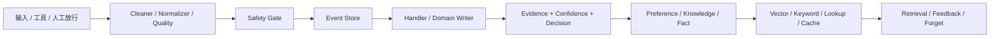

# main → remem 重构总结与两周实施路线

> 对比范围：`main...dev-remem`（当前 remem 分支）
>
> 日期：2026-08-15
>
> 项目阶段：开发中项目。允许主动删除重复内部路径、进行 SQLite schema 迁移并新增 API v2；不需要为旧实现长期维持双写兼容。

## 1. 已完成重构总结

remem 已将原本分散的 Fact、Preference、Knowledge 处理逻辑收敛为“领域模型保留、处理链路统一”的结构。

| 范围 | remem 已完成改动 |
|---|---|
| 核心处理 | 新增 `MemoryCandidate`、`MemoryDecision`、`BaseMemoryHandler`，形成 `extract → evidence → confidence → decision → apply` 模板 |
| 证据 | Evidence 去重、排序、数量上限、摘要统一；重复 Fact 来源写回保留 Fact |
| 版本 | Preference 支持 parent/root/version；Knowledge 区分证据增强和语义后继；相似输入优先补证据 |
| 置信度 | 统一 `source + quality + support + freshness` 四因子，最终范围限制为 `[0, 0.95]` |
| Fact | LLM 调用优先走应用级客户端；冲突 action 白名单；event 时间优先、提交时间回退可审计 |
| 冲突 | 协调器改用领域 Updater；通用 Resolver 补齐 evidence 与版本关系 |
| 数据接入 | 来源类型严格化；工具 event/call/hash 稳定；partial/retry/超时进入质量门控 |
| 检索与遗忘 | Rerank 纳入 confidence/freshness/health；遗忘状态通过写入服务同步索引与缓存 |
| 安全 | Memory 和 Fact 写入开始接入 Safety Gate；人工放行保留 review 标记；事件携带 audit 关联 |



## 2. 两周总目标

总工期为 **10 个工作日：2026-08-17 至 2026-08-28**。

本期必须交付：

```text
单一生产写入边界
+ 统一证据、版本、审计数据
+ 可靠 Projection Outbox
+ lineage/evidence/audit/projection 管理 API
+ 迁移脚本和端到端测试
```

本期不做：完整 UI 重做、训练式置信度模型、存储引擎替换、跨数据库分布式事务。

## 3. 目标数据模型

本期直接新增以下 SQLite 表：

```text
memory_lineage
  lineage_id, memory_id, memory_type, parent_memory_id, root_memory_id
  semantic_version, evidence_revision, transition_action, created_at

memory_evidence
  evidence_id, memory_id, memory_type, event_id, source_hash
  source_type, excerpt, occurred_at, quality_score, safety_audit_id
  unique(memory_id, event_id, source_hash)

memory_projection_outbox
  outbox_id, memory_id, memory_type, operation, payload_hash
  status, attempts, next_retry_at, error_code, created_at, updated_at
```

新写入规则：

- `memory_lineage` 是版本关系权威来源；
- `memory_evidence` 是证据权威来源；
- `memory_projection_outbox` 是索引与缓存投影权威来源；
- 旧 JSON evidence、Fact evidence、旧 parent/root/version 仅用于迁移和短期读取兼容。

## 4. 每日实施安排

| 日期 | 工作包 | 主要交付 | 验收 |
|---|---|---|---|
| 08-17 | 架构冻结 | Decision/Receipt/Provenance DTO；新表与迁移 ADR | schema 和基线测试确认 |
| 08-18 | 统一数据契约 | lineage/evidence repository、统一 writer receipt | 三类记忆可写统一证据/版本关系 |
| 08-19 | Preference/Knowledge | reinforce/revise/supersede/coexist 收口；删除旁路 | 相似输入不覆盖、版本可查 |
| 08-20 | Fact/安全 | Fact approved commit、重复 Fact evidence、Safety provenance | Fact 冲突和审计可追溯 |
| 08-21 | Outbox | 业务写入、evidence、lineage、outbox 同事务；worker/replay | 索引失败不重复业务写入 |
| 08-24 | 接入与迁移 | Event provenance、历史 evidence/lineage 迁移 | 新旧数据统一读取 |
| 08-25 | API v2 | lineage/evidence/audit/projection 查询和 replay | 管理端可定位来源与投影 |
| 08-26 | 检索/遗忘 | 使用新 lineage/evidence/outbox；反馈产生标准动作 | 生命周期不破坏审计 |
| 08-27 | 全链路切换 | ingestion、retry、release、handler 使用新 writer | 无生产写入旁路 |
| 08-28 | 演练收尾 | 全量回归、dry-run、故障注入、文档 | 发布候选与回滚说明 |

## 5. 统一决策与写入实现

内部统一使用：

```text
new / reinforce / revise / supersede / coexist / duplicate / review / reject
```

| 动作 | Preference | Knowledge | Fact |
|---|---|---|---|
| reinforce | 同 target/value 增加证据 | 同语义流程增加轨迹 | 相同 S/P/O 增加来源 |
| revise | 同 target 的补充表达 | 兼容流程演进 | 通常不使用 |
| supersede | 同 target 不同 value | 不兼容流程替代 | 单值谓词替换 |
| coexist | 不同 scope/target | 不同任务/作用域 | 多值谓词 |
| review | 隐式冲突 | 歧义流程 | 无法裁决的单值冲突 |

唯一合法生产路径：

```text
Approved Event / ApprovedWrite
→ Domain Writer
→ DB transaction（memory + lineage + evidence + outbox）
→ asynchronous projection
```

实施要求：

1. 将裸 `repo.save()` 与 `FactStore.insert_fact()` 移入私有 persistence 层；
2. Fact 拆为 `propose()`、`commit_approved()`、`commit_unsafe_for_test()`；
3. Safety audit/review/action 写入 provenance；
4. 每次状态迁移生成 `MemoryWriteReceipt`；
5. worker 从 outbox 同步 vector、keyword、lookup、cache；
6. worker 失败使用稳定错误码、指数退避与 replay；
7. 旧 `pending_index`、临时补偿任务转换为 outbox adapter 后删除。

## 6. 数据迁移与接口

迁移流程：

```text
创建新表
→ dry-run 统计旧 JSON evidence、Fact evidence、版本关系
→ 批量迁移并写 checkpoint
→ 校验 user scope、count、hash
→ 切换新写入
→ 一个开发迭代后删除旧写兼容路径
```

迁移脚本必须具备：幂等、checkpoint、dry-run、校验报告、rollback SQL。

新开发直接使用 API v2，旧 API 保持读取兼容：

```text
GET  /api/memory/v2/memories/{memory_id}/lineage
GET  /api/memory/v2/memories/{memory_id}/evidence
GET  /api/memory/v2/memories/{memory_id}/audit
GET  /api/memory/v2/projections?status=pending|failed
POST /api/memory/v2/projections/replay
GET  /api/memory/v2/search?include_provenance=true
```

所有查询必须按 user scope 隔离；evidence/audit 只返回脱敏 excerpt 与关联 ID；API 不返回 quarantine 原文。

## 7. 银河麒麟 OS Agent 与国产 Embedding SDK 专项路线

### 当前项目已经体现的内容

项目已经具备面向银河麒麟桌面操作系统的 Embedding 接入基础：

- `memoryhub/embedding/kylin_client.py` 实现 `KylinEmbeddingClient`；
- 通过 `ctypes` 加载 `libkylin-coreai-embedding.so`；
- 使用银河麒麟 Embedding C SDK 的会话、模型初始化与单条/批量向量调用；
- production 配置门禁要求：
  ```text
  embedding.provider = kylin
  vector_engine.provider = milvus
  embedding.dimension = 768
  runtime.allow_fallback = false
  ```
- 开发/CI 可用 `kylin_mock` 与 `milvus_mock`，但 production 禁止 mock、faiss 和 fallback；
- `validate_production_gate()` 与 `validate_production_runtime()` 已检查 provider、维度、SDK 可用性与向量引擎能力。

因此不需要另起一套 Embedding 架构；应将国产 SDK 作为 production 的唯一向量生成契约。

### 两周内的 SDK 专项交付

| 时间 | 专项内容 | 交付物 |
|---|---|---|
| 08-17 | 明确目标银河麒麟版本、CPU 架构、SDK `.so` 路径、DBus 服务名、模型名和 768 维契约 | `docs/KYLIN_EMBEDDING_RUNTIME_CONTRACT.md` |
| 08-17 | 增加部署前检查：动态库、依赖、DBus、模型、维度、Milvus app_id | `scripts/check_kylin_embedding_runtime.py` |
| 08-18 | 增加 SDK load、session init、model init、timeout、dimension mismatch 指标 | 健康检查与稳定错误码 |
| 08-21 | Outbox worker 强制使用同一 `BaseEmbeddingClient` 和 embedding profile | projection contract test |
| 08-24 | 在真实银河麒麟环境执行 smoke test；CI 保持 `kylin_mock` | 真实设备验收报告 |
| 08-27 | 演练模型/维度升级：旧索引不可混用，执行重嵌入与回滚 | embedding migration runbook |

模型名、SDK 版本或向量维度任一变化，都生成新的：

```text
embedding_profile_id = sha256(provider + sdk_version + model_name + dimension + metric)
```

profile 写入 outbox、collection metadata、检索响应和健康检查。profile 变化后必须新建 collection/namespace、全量重嵌入、切换读取、保留旧 collection 至回滚窗口结束。

## 8. 两周完成定义

到 **2026-08-28** 必须满足：

- 所有生产写入使用单一 Domain Writer；
- 不存在业务代码直接 `repo.save()` 或 `FactStore.insert_fact()` 的旁路；
- 新写入 evidence、lineage、audit、outbox 都可查询；
- 索引故障可通过 outbox 恢复；
- lineage/evidence/audit/projection 管理接口可用；
- 真实银河麒麟环境完成 SDK、DBus、模型、768 维和检索 smoke test；
- 回归、迁移演练、故障注入和跨用户隔离测试通过。

时间不足时按如下顺序降级：

1. 保留新表和新写入，不强制一次性迁移全部历史数据；
2. 先交付 v2 只读接口；
3. outbox 先覆盖 Preference/Knowledge，再覆盖 Fact；
4. UI 不做大改，先用 API 与脚本验证；
5. 不降级安全写入收口、版本/evidence 一致性、跨用户隔离和真实 SDK 验收。
