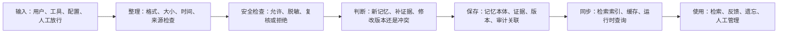

# remem 重构说明：我们为什么这样改，以及最终会变成什么样

> 面向对象：产品、测试、运营、项目管理、前端、刚加入项目的开发同学，以及不需要深入阅读全部后端代码的协作者。
>
> 配套技术路线图：`docs/MAIN_TO_REMEM_REFACTOR_ROADMAP.md`

## 1. 这次重构在做什么？

这次重构不是为了“把代码写得更漂亮”，而是为了让系统能够说清楚：

```text
这条信息从哪里来？
为什么会被记住？
它是在补充旧记忆，还是替换旧记忆？
如果检索不到，问题卡在哪一步？
如果用户要求遗忘，相关内容是否真的都被移除了？
```

改完后，系统会从“多个模块各自保存一些内容”，逐步变成“每条记忆都有来源、证据、版本、审计记录和索引状态”的系统。

## 2. 为什么需要改？

可以把当前系统想象成一个正在快速成长的资料室：有偏好柜、知识柜、事实柜，也有检索、遗忘、安全检查和工具接入。

这些部分各自已经能工作，但过去处理新信息时不总是使用同一套标准：有时直接新增，有时直接覆盖，有时合并，有时只记录冲突。

于是可能出现：

1. 相似信息直接覆盖旧信息；
2. 同一信息从正常接入、重试、演示流程或人工放行进入时，结果不同；
3. 数据库保存成功，但检索索引没有同步；
4. 安全检查能力存在，但部分写入路径可能绕开统一边界。

这次重构就是把这些“各自能跑、但不容易整体解释”的地方收拢起来。

## 3. 改造后，一条信息怎样流转？



简单说就是：先确认输入合格，再确认安全，再判断和旧信息的关系，最后保存并让检索系统同步；以后可以顺着每一步追溯。

## 4. 三类记忆会如何变化？

| 类型 | 简单理解 | 例子 |
|---|---|---|
| Preference | 用户希望系统怎样做 | “周报默认使用 Markdown” |
| Knowledge | 可重复使用的方法、流程、案例 | “先收集数据，再整理，再输出” |
| Fact | 明确的客观关系或信息 | “项目 A 的负责人是张三” |

### 对相似信息：先补证据，不急着覆盖

例如：

```text
已有：我喜欢 A
新来：我喜欢 A，但还有一些额外背景
```

如果用户对 A 的偏好没有变，系统应当：

```text
保留“我喜欢 A”
+ 把新输入记录为补充证据
+ 更新可信度
```

而不是把旧内容替换成一整句新内容。

### 对真正变化：保留版本关系

例如：

```text
旧：默认使用 Markdown
新：默认使用 HTML
```

系统会保留：

```text
Markdown：旧版本，归档
HTML：新版本，当前有效
二者之间：有替换关系
```

### 对重复事实：保留一条，增加来源

```text
来源 1：项目 A 的负责人是张三
来源 2：工具结果也表明项目 A 的负责人是张三
```

结果应当是：

```text
保留一条事实
+ 保存两个独立来源
```

## 5. “证据”“版本”“置信度”是什么意思？

- **证据**：为什么相信这条记忆，来自哪次输入或工具结果；
- **版本**：内容是否真的改变，旧内容和新内容是什么关系；
- **置信度**：系统是否适合把它作为长期记忆的综合判断。

置信度主要看：

```text
来源是否可靠
输入和抽取质量是否足够好
是否有独立证据支持
信息是否仍然新鲜有效
```

它不是“绝对真理”，系统会把数值限制在安全范围内，不把未人工确认的信息标成 100% 确定。

## 6. 为什么要增加版本、证据、投影任务三本账？

可以把它们理解为三本辅助账本：

1. **版本账本**：这条记忆之前是什么、谁替换了谁、当前有效的是哪一版；
2. **证据账本**：它来自哪些输入，哪些是重复，哪些来自用户或工具；
3. **投影任务账本**：数据库保存后，向量检索、关键词检索和缓存是否同步完成，失败后怎样补上。

保存记忆和让搜索找到它，是两件事。投影任务账本负责确保第二件事最终也能完成。

## 7. 安全会有什么变化？

任何保存内容、建立索引或长期保留信息的动作，都要经过同一套安全检查：

| 结果 | 含义 |
|---|---|
| allow | 可以正常写入 |
| mask | 脱敏后写入 |
| review | 先隔离，等待人工确认 |
| reject | 不写入长期系统 |

如果某条内容需要人工放行，系统会记录它为什么进入复核、何时放行，以及放行后最终进入哪些记忆。

## 8. 为什么特别强调银河麒麟 Embedding SDK？

本项目未来服务于银河麒麟桌面操作系统的 OS Agent，不是普通云端记忆服务。

系统判断“哪些内容相似”时，最终需要调用银河麒麟系统提供的国产 Embedding SDK：

```text
输入一句话
→ 银河麒麟 Embedding SDK 把它转成向量
→ 系统用向量找到相似记忆
→ 再结合证据、版本和安全规则决定如何使用
```

项目已经具备真实 SDK 对接基础：

- 可以加载银河麒麟 Embedding SDK 动态库；
- 可以连接系统后端服务并初始化模型；
- 生产环境要求真实 SDK、真实 Milvus 向量引擎和固定 768 维向量；
- 开发和自动测试可以使用模拟 SDK，但模拟结果不能代替真实银河麒麟设备验收。

这轮两周重构还会补上：

1. 明确目标银河麒麟版本、动态库路径、模型名称和向量维度；
2. 部署前检查 SDK、系统服务、模型和向量引擎是否可用；
3. 记录 SDK 加载、模型初始化、超时和维度不匹配；
4. 确保写入、索引和检索使用同一个 Embedding 模型配置；
5. 模型升级时不混用新旧向量，而是重建索引并保留回滚能力。

## 9. 两周内会做什么？

集中重构安排在 **2026-08-17 到 2026-08-28** 的 10 个工作日内：

- 前四天：统一写入、安全、相似信息处理、版本和证据；
- 中间两天：让检索同步变得可靠，失败后可重放；
- 最后四天：提供版本链、证据、安全审计、索引状态查询，运行迁移和故障演练。

## 10. 对不同角色意味着什么？

### 产品和运营

可以解释系统为什么记住一条内容、为什么没有覆盖、为什么进入复核、为什么不再检索某条记忆。

### 测试

不再只验证“有没有写进去”，还可以验证证据是否重复、版本是否正确、安全审计是否存在、索引是否同步、遗忘后是否真的查不到。

### 前端

后续会有记忆版本链、证据列表、安全审计摘要、索引同步状态、待复核和失败投影任务等稳定数据。

### 后端

以后不应该直接把内容写进 repository。正确思路是：

```text
输入
→ 安全检查
→ 统一决策
→ 领域写入
→ 证据、版本、投影任务
```

## 11. 最终希望达到的体验

```text
一条信息来了：先判断是否安全、是否合格；
如果和旧记忆相同：补证据；
如果只是补充：形成合理演进；
如果确实冲突：保留版本关系；
如果需要人工确认：进入复核并留下记录；
如果已经保存：确保检索系统最终同步；
如果用户要求遗忘：数据库、索引和缓存一起更新；
如果有人追问“为什么”：可以顺着来源、证据、版本、审计一路查回去。
```

> **让记忆系统不仅能“记住”，还能够“说清楚自己为什么这样记住”。**
