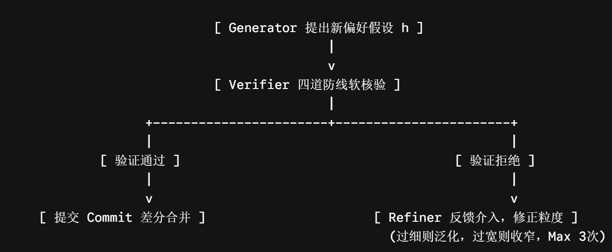

- 基于 GP-PREFINE 建模框架（融合言语行为“行事-成事”双轨差分纠偏模型、Schema-Agnostic 隐式偏好抽象、4 维软核验、3次黄金收敛以及物理 Revert 回滚），我们对原有技术路线文档进行整改优化，产出以下的可执行技术实现路线说明书。

#  GP-PREFINE 三轨闭环偏好记忆系统：可执行技术实现路线

目标定位实现一个以工具调用结果为核心反馈、联合用户动作与手动配置的“行事-成事”闭环偏好记忆系统，要求：  
- 三重言语行为建模：精准区分字面指事（Locutionary）、意图行事（Illocutionary）与客观成事（Perlocutionary）特征。  
- 被迫妥协隔离：前置识别并拦截由于接口无供（DATA_EMPTY）导致的用户临时妥协选择，阻断偏好污染。  
- 无 Schema 记忆（Schema-Agnostic）：将提取到的偏好统一抽象为可跨领域复用的自然语言高层约束，在运行期动态投影落地。  
- 物理 Revert 回滚：监控言语偏差梯度，当系统因噪声级联出错时，实现版本树的干净物理回退。 

## 1. 多源事件标准化与预处理 (Ingestion)
   1.三重言语行为语义映射多源数据进入系统后，统一标准化为 MemoryEvent。GP-PREFINE 对 MemoryEvent 赋予明确的语言哲学三轨映射语义： 
   - 字面指事 (Locutionary, $L_t$)：通过 event.content.text 记录用户在当前会话输入的字面 Query 及 Dialogue 上下文。  
   - 意图行事 (Illocutionary, $I_t$)：通过 event.content.tool_name 和 event.content.input 记录系统当前的工具调用预测及填充参数（即候选 $a_t$）。  
   - 客观成事 (Perlocutionary, $P_t$)：由执行状态 event.content.status、实际返回数据 event.content.output 以及用户在工具执行后的下一个动作 event.metadata.user_next_action（如：纠正 OVERRIDE、确认 CONFIRM、折中妥协 COMPROMISE）联合表征。

   2.预处理实现点与核心算法在 memoryhub/core/ingestion/ 目录下实现以下组件：
   
   A. DataCleaner.clean()：字段规范、去重与被迫妥协噪声前置识别   
   - 基础清洗与校验：校验必填字段，缺失则标记 quality_score = 0.0。  
   - 被迫妥协（Compromise）前置识别算法：  
  触发条件：$$\text{event.content.status} \in \{\text{DATA\_EMPTY}, \text{API\_FAIL}\}$$  且其关联的下一个用户动作（在 user_behavior 事件或次轮交互中被捕获）满足：$$\text{event.metadata.user\_next\_action} == \text{COMPROMISE}$$  处理机制：在 metadata 中写入 is_compromised_compromise = True 特征标识。该标识将在质量评估阶段和写入阶段作为“一票否决”因子，阻断其流向长期偏好提炼池，防止其被误判为用户的长期主动偏好。  
   - 行事指纹去重算法：过滤时间、地点、日期等非偏好类临时时空变量（如：date、time、location 等）。  计算去重特征指纹：$$\text{signature} = \text{sha256}(\text{user\_id} + \text{task\_type} + \text{sorted}(\text{preference\_slots}))$$  在 60s 的窗口内，若存在相同 signature，则将证据链进行归一化合并，不重复生成新事件。
  

   B. DataNormalizer.normalize()：时空特征清洗与候选偏好特征映射
   - 行为清洗策略：维护 CONTEXT_BLACKLIST（如 departure_date, pickup_time 等临时变量），进行硬剔除。  
   - 白名单参数归拢：根据当前 tool_name 匹配标准偏好字典（如 GetFlights $\to$ flight_class，GetRestaurants $\to$ price_range），抽取出偏好键值对并登记在 metadata.candidate_features 中，供后续提取器直接使用。

   C. QualityScorer.score()：融合客观成事成效偏差的综合质量评分
   - 计算公式（Sigmoid 归一化）：
   $$\text{QualityScore} = \sigma(\alpha \cdot (\text{RawScore} - \beta)) - \text{Penalty}$$  
   $$\sigma(x) = \frac{1}{1 + e^{-x}}$$  
   其中，默认控制参数为：$\alpha = 5.0$, $\beta = 0.5$。  
   $$\text{RawScore} = w_1 \cdot C + w_2 \cdot S_{rel} + w_3 \cdot E_s + w_4 \cdot F_s$$  
   $C$（完整度）：核心字段存在比例。
   $S_{rel}$（来源信度）：按 MANUAL_CONFIG(1.0) > USER_FEEDBACK(0.9) > TOOL_CALL(0.6) > USER_BEHAVIOR(0.4) 加权。  
   $E_s$（成事执行成功度）：SUCCESS 为 $1.0$，DATA_EMPTY 或 API_FAIL 降级为 $0.3$/$0.1$。  
   $F_s$（反馈强度）：用户做出 CONFIRM 动作为 $1.0$，出现 OVERRIDE 则暴跌至 $0.1$。  
   成事惩罚项（Penalty）：
   若 is_compromised_compromise == True，则强制扣减 $0.4$ 分。  若 user_next_action == 'OVERRIDE'，说明行事预测产生了严重的用户抵触，扣减 $0.3$ 分。  
   - 准入防御策略（should_enter_long_term）：
   若 $\text{QualityScore} \ge 0.6$ 且 $\text{is\_compromised\_compromise} \neq \text{True}$，允许沉淀为长期偏好抽取证据。  
   否则，仅写入短期记忆或执行噪声隔离。

## 2. 偏好提取与隐式偏好生成 (Preference Extractor)
   1.规则（显式）偏好提取在 extractor.py 的 _rule_extract 中实现硬匹配拦截：硬约束 $\mathcal{C}_{\text{hard}}$ 标记：若用户显式通过配置或反馈表达 “不要”、“别记录” 等敏感动作，或者输入“不过敏”、“不能吃”等强命令，一律提取并标记为 $\mathcal{C}_{\text{hard}}$（对应 PreferenceType.SAFETY_PREF），其初始置信度直接设为 $1.0$。  
   规则模板：通过 re.search 正则提取样式和格式约束，并自动转换为标准 PreferenceMemory。  

   2 隐式偏好抽取（LLM + GVR 自适应修正闭环）
   在 _llm_extract 中，GP-PREFINE 放弃了原有的 Schema-Specific（绑定具体接口字段）的落后设计，重构为 Schema-Agnostic（无 Schema 依赖）的高层自然语言假设生成：
   

   3次黄金自适应迭代算法伪代码：
   def _llm_extract(self, event: MemoryEvent) -> list[PreferenceMemory]:
    #行为清洗：过滤黑名单参数
    clean_content = {k: v for k, v in event.content.items() if k not in CONTEXT_BLACKLIST}[cite: 1, 2]
    
    current_draft = ""
    last_feedback = ""
    loop_count = 0
    
    while loop_count < 3:  # 严格限制最多 3 次黄金循环，保障低延迟
        loop_count += 1
        # Generator 结合历史、清洗后的证据与上轮 feedback 生成高层抽象
        h_pref = self.generator.propose(clean_content, current_draft, last_feedback)[cite: 1]

        #Verifier 进行软核验
        is_valid, feedback = self.verifier.verify(h_pref)
        
        if is_valid:
            # 提炼成功：封装为 Schema-Agnostic 文字形式，供测试期动态 Grounding
            return [PreferenceMemory(
                user_id=event.user_id,
                content=h_pref,  # 例: "用户表现出强烈的低成本、高性价比出行偏好"
                confidence=0.75
            )]
        else:
            # 记录反馈，调整抽象粒度再次重试
            current_draft = h_pref
            last_feedback = feedback
            
    return []

## 3. 偏好验证与置信度计算 (Verifier & Confidence)
   1. 偏好验证器四道防线规范PreferenceValidator 对 Generator 生成的软假设 $h$ 进行多维度防御审查：  
   - 证据支持 (Evidence Support)：检查支撑该偏好的历史元组中，客观执行成功（SUCCESS）的样本数是否 $\ge 2$。
   - 抽象质量 (Abstraction Quality)：检查 $h$ 是否避免直接复述具体 API 槽位键值（如：禁止出现 price_range=cheap 字眼）。  
   - 可执行性 (Actionability)：评估该通用自然语言表达是否能向后投影、有效收窄工具调用的槽位搜索空间。  
   - 时间一致性 (Temporal Consistency)：审查最近 7 天内，用户对该推荐参数的纠错覆盖频率是否低于阈值。

   2.贝叶斯证据纠偏置信度模型在 confidence.py 中，置信度模型进行如下整改，引入言语行为偏差梯度（Speech Act Bias, $\epsilon_t$）惩罚消减项：
   - 偏差值计算: 当新事件发生时，计算当前的成事成效偏差 $\epsilon_t$：$$\epsilon_t = \mathbf{Loss}_{\text{status}}(R_t, u_{t+1}) + \mathbf{Loss}_{\text{semantic}}(a_t, u_{t+1})$$  若工具返回 USER_REJECT 或 API_FAIL，且用户在次轮动作进行了参数强制覆写（OVERRIDE），偏差值拉满：$\epsilon_t \ge 0.8$。  
   - 贝叶斯增量公式  $$\text{Logit}(C_{\text{new}}) = \text{Logit}(C_{\text{old}}) + \log(1 + S_{\text{sum}}) - \lambda \cdot \epsilon_t$$  $\text{Logit}(p) = \log(\frac{p}{1-p})$，新置信度 $C_{\text{final}} = \text{sigmoid}(\text{Logit}(C_{\text{new}}))$。  $S_{\text{sum}}$（正向支持累积）：$\sum w_e$，证据累积遵循对数边际效应递减。  $\lambda \cdot \epsilon_t$（反向惩罚梯度）：$\lambda$ 为惩罚系数（默认 $2.0$），当用户高频覆写纠错时，高偏差 $\epsilon_t$ 会迅速将 Logit 压低，实现置信度断崖式下跌，防止错误偏好野蛮生长。

## 4. 差分式偏好版本管理与物理回滚 (Updater)
   1.版本演化模型设计 差分 Commit 链：新产生同主键但不同内容的偏好时，旧偏好状态标记为 ARCHIVED，新偏好 version = old.version + 1，且设置 parent_id = old_id，从而维持清晰的单向 Git-like 演化链条。

   2.时序一致性崩溃触发的物理 Revert 回退（Rollback）
   当 LLM 产生噪声或用户近期行为突变时，往往会在填充参数时遭到用户的连续覆写[cite: 1]。在 PreferenceUpdater.update() 中实现防级联出错的物理回滚算法[cite: 1]：
   def update(self, old_id: str, new_preference: PreferenceMemory) -> str:
    old_pref = self.db.get(old_id)[cite: 2]
    
    # 1. 统计近期 (7天内) 产生的纠偏元组比例
    recent_evidences = [e for e in old_pref.evidences if (datetime.now() - e.timestamp).days <= 7]
    overrides_count = sum(1 for e in recent_evidences if "OVERRIDE" in e.content)
    
    # 2. 判断时序一致性是否彻底崩溃（触发阈值：高频覆写覆盖率 >= 70%）[cite: 1]
    if len(recent_evidences) >= 3 and (overrides_count / len(recent_evidences)) >= 0.7:
        # 时序一致性崩溃，触发物理 Revert 回退！[cite: 1]
        if old_pref.parent_id:
            # 将受污染的当前活跃版本归档剪枝
            self.db.update_status(old_id, MemoryStatus.ARCHIVED)
            # 物理重新激活上一个干净稳定的 Parent Commit 节点[cite: 1, 2]
            self.db.update_status(old_pref.parent_id, MemoryStatus.ACTIVE)
            return old_pref.parent_id
        else:
            # 无历史版本，直接将该偏好置为 DELETED 彻底删除，阻断级联错误[cite: 1]
            self.db.update_status(old_id, MemoryStatus.DELETED)
            return ""
            
    # 3. 正常升级版本链
    new_preference.version = old_pref.version + 1[cite: 2]
    new_preference.parent_id = old_id[cite: 2]
    self.db.update_status(old_id, MemoryStatus.ARCHIVED)[cite: 2]
    self.db.save(new_preference)
    return new_preference.memory_id

## 5. 双轨协同决策与冲突消解 (Dual-Track Resolver)
   1.双轨制协同架构 (Dual-Track Representation)系统偏好统一表征为硬、软双轨结构： 
   $$P_t = \langle \mathcal{C}_{\text{hard}}, \mathcal{H}_{\text{soft}}^{(t)} \rangle$$
   $\mathcal{C}_{\text{hard}}$（硬约束轨）：由显式提取、用户直接配置产生[cite: 1, 2]。在 ConflictResolver 中具备一票否决权（Veto Power），完全隔离于 LLM 推理和演进。任何软偏好一旦被硬约束拦截，直接被系统滤除，实现工业级合规防御。
   $\mathcal{H}_{\text{soft}}^{(t)}$（软偏好轨）：通过 GVR 循环生成的概率性、无 Schema 长期偏好 Hypothesis[cite: 1]。

   2.冲突检测与消解决策消解规则：若新偏好触犯 $\mathcal{C}_{\text{hard}}$ $\to$ 直接否决（REJECT）。若同场景下新、旧软偏好内容产生冲突 $\to$ 统计置信度 $C$；新偏好置信度显著领先（来自显式指令反馈）则 OVERRIDE 并将旧节点归档；置信度相近且不冲突则 MERGE 融合证据链。

## 6. 量化评估与闭环优化
   在原有的 Precision、Recall、F1 指标基础上[cite: 2]，重点新增以下闭环特征评测：
   妥协噪声过滤率 (Compromise Filter Rate)：测试集通过 DATA_EMPTY 强制制造一次性被迫妥协事件[cite: 1]，检验 Ingestion 流水线对此噪声的拦截阻断率（标准指标：$\ge 95\%$）。
   回滚成功率 (Rollback Success Rate)：评估高频参数纠错发生后，系统将记忆物理回退至 Parent 稳定 Commit 的准确率。
   跨 Schema 泛化准确率 (Transfer Accuracy)：评测当测试集切换到 Dynamic Schema 时[cite: 1]，Schema-Agnostic 偏好通过 LLM 重新投影到新 API 字段的准确率。