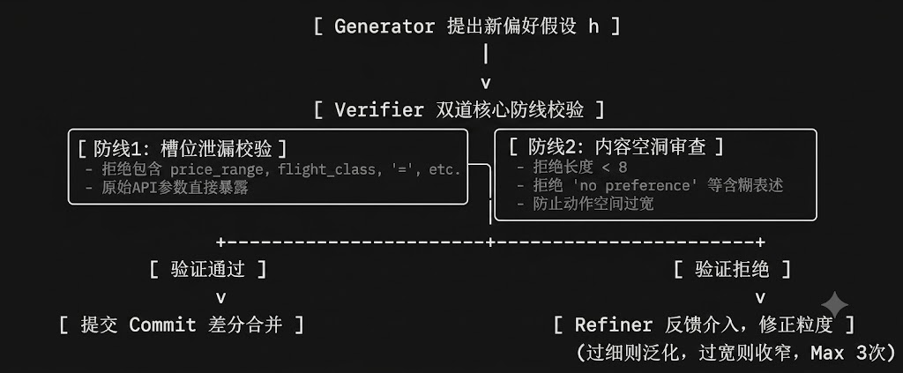

- 基于 GP-PREFINE 建模框架（融合言语行为“行事-成事”双轨差分纠偏模型、Schema-Agnostic 隐式偏好抽象、2维校验防线、3次黄金收敛以及物理 Revert 回滚），产出以下的可执行技术实现路线说明书。

#  GP-PREFINE 闭环偏好记忆系统：可执行技术实现路线

目标定位实现一个以工具调用结果为核心反馈、联合用户动作与手动配置的闭环偏好记忆系统，要求：  
- 三重言语行为建模：精准区分字面指事（Locutionary）、意图行事（Illocutionary）与客观成事（Perlocutionary）特征。  
- 被迫妥协隔离：前置识别并拦截由于接口无供（DATA_EMPTY）导致的用户临时妥协选择，阻断偏好污染。  
- 无 Schema 记忆（Schema-Agnostic）：将提取到的偏好统一抽象为可跨领域复用的自然语言高层约束，在运行期动态投影落地。  
- 物理 Revert 回滚：监控言语偏差梯度，当系统因噪声级联出错时，实现版本树的干净物理回退。 

## 1. 偏好提取与隐式偏好生成 (Preference Extractor)
   1.规则（显式）偏好提取在 extractor.py 的 _rule_extract 中实现硬匹配拦截：
   - 硬性隐私/安全过滤门：若用户显式在文本中提及 "不要记住", "别记录", "隐私", "安全", "禁止" 等安全敏感高频词，系统将一律提取并拦截生成硬约束。此类偏好强制赋予 PreferenceType.SAFETY_PREF 类别，将其作用域拓扑覆盖范围锁死为全局广义域 SceneScope(scene="*", task_type="*")，且初始置信度直接设为最高饱和值 1.0。  
   - 样式格式约束硬规则匹配：通过正则匹配机制 r"(以后|默认|每次).*用\s*(markdown|html|json|xml|csv)" 捕捉显式配置与主动反馈。提取出的目标格式将自动转换为标准的无模式依赖自然语言描述 content="偏好使用 {target_format} 格式进行数据输出。"，并赋予 0.95 的高初始置信度值。  

   2 隐式偏好抽取（LLM + GVR 自适应修正闭环）
   在 _llm_extract 阶段，丢弃原有绑定具体接口字段（Schema-Specific）的设计，重构为面向高层自然语言假设生成的无模式依赖（Schema-Agnostic）架构：
   - 时空噪声前置清洗策略：在将负载投递至生成模型前，强制维护一个特定的临时上下文时空变量硬剔除黑名单（包含 {"date", "time", "timestamp", "location", "departure_date", "pickup_time"}），从而对单次临时性的动作背景实施严格剥离。  
   - Prompt 动态自愈合与平滑扩展机制：在发送给大模型的用户提示词中，禁止硬编码偏好枚举范围。系统统一采用 ", ".join([e.value for e in PreferenceType]) 机制对当下的合法模型约束边界实施动态注入。输出的 JSON 数据格式必须严格符合以下边界契约：
   
   {
  "implicit_pref": "Single sentence high-level preference description",
  "preference_type": "output_style|tool_preference|workflow_preference|... (动态扩展)"
}

   - 3次黄金自适应迭代算法流程:
  

  系统在运行期执行严密的生成-验证-细化（GVR, Generate-Verify-Refine）循环自校核逻辑，限制最大重试循环计数上限 loop_count < 3，在维护极低延迟的同时确保提炼质量：  
  校验防线 1：过拟合与细节泄漏检测（Slot-Value Leakage）：审查模型输出的自然语言段落，若存在 price_range、car_type、flight_class 或 "=" 等原始 API 参数槽位键值符号，则直接执行一票否决。  
  校验防线 2：内容空洞化审查（Lack of Abstraction）：若提炼结果文本字符长度过短（< 8）或包含 "no preference" 等含糊表述，判定其丧失了对动作空间的选择收窄能力，予以直接拒绝。  
  反馈迭代与状态留存：核验未通过时，将当前生成的粗稿 draft_content 与具体的失败反馈 verifier_feedback 作为追加上下文再次泵入 LLM，自适应调整抽象粒度重新提炼。  
  

## 2. 偏好验证与置信度计算 (Confidence)
1. 贝叶斯证据增量与言语成事偏差梯度惩罚模型
   在 ConfidenceCalculator 中，偏好置信度并非基于粗暴的线性累加，而是融合了来源固有权重、时间半衰期衰减以及行事与客观成事效能偏差的非线性综合模型。  新事件发生并触发置信度重算时，引入成事偏差梯度惩罚项：  
   - 一元偏差梯度度量：读取标准化修正后的上下文，提取由事件层透传的统一状态字段 status = new_event.metadata.get("status") 与统一用户动作字段 user_action = new_event.metadata.get("user_action")。  
   - 极性消减计算：若工具返回执行成效状态 status 属于 ["USER_REJECT", "API_FAIL"]，偏差分量加算 $0.3$。  若用户做出的直接动作表现为 user_action == "OVERRIDE"，表明系统当前的习惯预测产生了严重的抵触行为，偏差分量加算 $0.8$（严重偏差）。  
   - 证据权值挂载：该证据链节点的实际信任权重被削减为 $\max(0.1, 1.0 - \text{Bias})$。当产生严重偏差时，证据链将自动追加 " | OVERRIDE_ERROR" 特征尾缀，为后端的物理回滚提供强力的审计日志证据。  

2. 置信度演化衰减算法
   - 证据数量因子（边际收益递减）：通过数量统计计算公式 $f_{\text{count}} = \ln(1 + \text{evidence\_count})$ 表征，通过对数函数实现边际收益递减效应，防止证据堆叠导致的置信度无序溢出。  
   - 来源主导信度因子：依据最可信的证据源决定评分基准。
    来源类型	     |   权重	 |    说明
 "explicit_feedback": 1.0,     # 用户显式反馈
        "manual_config": 0.95,        # 手动配置
        "repeated_behavior": 0.8,     # 重复行为
        "tool_result": 0.6,           # 工具调用结果
        "single_behavior": 0.4,       # 单次行为

   - 时间衰减因子：
  14天对数时间衰减半衰期模型：$$\text{decay} = e^{-\frac{\Delta \text{days}}{14.0}}$$
在计算时，系统强制使用 datetime.now(timezone.utc) 机制对证据进行统一的时区对齐擦除与安全防御，彻底规避因底层环境时区不一致引发的时间差逆向逻辑死锁风险。  
   - 一致性因子：
  统计证据链中 “成功且未被覆盖” 的证据比例，若历史成效多为正向(SUCCESS)则提供增益，频繁被纠偏则施加高惩罚，根据成功率将一致性因子映射到 [0.5, 1.2]区间

1. 平滑转换映射：最终各项增益结合基础衰减度后，系统通过 Sigmoid 平滑函数的贝叶斯变体进行归一化映射，并强制扣减因历史证据堆叠而累积的覆写与妥协负惩罚Penalty：

基础衰减强度：  RawScore=fsource × ftime ×fconsistency ×(1.0+0.15×fcount )

$$\text{Confidence} = \max\left(0.0, \min\left(1.0, \frac{1}{1 + e^{-3.0 \cdot (\text{RawScore} - 0.5)}} - \text{Penalty}\right)\right)$$

Penalty：其中对历史存在 OVERRIDE 缺陷的个案单次强制扣减 $0.25 \times w_e$，对历史存在 COMPROMISE 缺陷的个案单次强制扣减 $0.1 \times w_e$。  

## 3. 差分式偏好版本管理与物理回滚 (Updater)

   1. 差分版本演化树设计
   在 PreferenceUpdater 中，版本演化抛弃了一次性直接覆盖更新的粗暴手段，重构为清晰的单向 Git-like 链条：  
   - 主动归档机制：当新提炼的偏好与底层模拟持久化存储层（_mock_db）中现存的活跃偏好产生唯一性主键冲突时（即 user_id, preference_type, 作用域三元组 SceneScope 完全重合），原有的旧偏好不会被抹除，其状态字段会被标记为 MemoryStatus.ARCHIVED。  
   - 有向 Commit 树升级：新生成的偏好内存节点的版本号自动在父节点基础上完成自增累加（version = old_pref.version + 1），并通过 parent_id 字段强挂载旧偏好的唯一识别符。为了防止偏好数据无限膨胀导致上下文溢出，系统执行证据链条阶段性交割，新节点将自动融合继承父节点的证据链，且强制滚动截断、仅保留最近 15 条最为紧凑的证据元组。 
   
   2. 时序一致性崩溃触发的物理 Revert 回退
   当系统受到噪声级联污染、LLM 持续产生偏好幻觉或用户短期需求发生剧烈逆转时，系统填充的参数会遭遇用户在短期运行内的连续物理反向覆写。
在执行偏好状态升级 update 时，系统前置激活防级联出错的物理回退算法：  
- 崩溃临界判定条件：
  1.系统自动盘点并筛选该偏好所挂载的证据链，过滤出所有发生在最近 7 天之内的时效性交互元组；  
  2.如果这批 7 天内的交互样本数量达到触发阈值（$\ge 3$ 条）；  
  3.且这批样本中包含有显式行为纠错覆写标记（"OVERRIDE" \in \text{evidence.content}）的比例暴涨达到临界高线 $\ge 70\%$。  
  
  - 物理 Revert 动态归档与剪枝机制：
   上溯激活：一旦判定“时序一致性彻底崩溃”，系统立刻下达物理 Revert 回退指令，放弃本次及当前受污染的活跃版本演化，顺着 parent_id 指针向根部溯源寻找最近一个干净、稳定的 Parent 节点，将其状态强制反转重置为 MemoryStatus.ACTIVE，并使用 datetime.now(timezone.utc) 重置其活跃更新时间戳。  
   
   熔断擦除：若该节点不存在任何父版本（属于初始偏好建立阶段即遭强噪音严重污染），说明该偏好不具备时序稳定性，系统将该偏好直接置为 MemoryStatus.DELETED（彻底删除）。这能直接从物理存储层完全切断由于预测错误引发的自发执行放大效应。

## 4. 双轨协同决策与冲突消解 (Dual-Track Resolver)
   1. 双轨制协同架构 (Dual-Track Representation)
   系统偏好统一表征为硬、软双轨结构：$$P_t = \langle \mathcal{C}_{\text{hard}}, \mathcal{H}_{\text{soft}}^{(t)} \rangle$$
   $\mathcal{C}_{\text{hard}}$（硬约束轨）：由抽取器规则显式提取（如 SAFETY_PREF、FORMAT_PREF）或用户直接配置产生。在 ConflictResolver 中具备一票否决权（Veto Power），完全隔离于 LLM 推理和演进。任何软偏好一旦被硬约束拦截，直接被系统滤除，实现工业级合规防御。  
   $\mathcal{H}_{\text{soft}}^{(t)}$（软偏好轨）：通过 GVR 循环生成的概率性、无 Schema 长期偏好 Hypothesis。  

   2. 冲突检测与消解决策
   消解规则：若新偏好触犯 $\mathcal{C}_{\text{hard}}$ $\to$ 直接否决（REJECT）。若同场景下新、旧软偏好内容产生冲突 $\to$ 统计置信度 $C$；新偏好置信度显著领先（来自显式指令反馈）则 OVERRIDE 并将旧节点归档；置信度相近且不冲突则 MERGE 融合证据链。

## 6. 量化评估与闭环优化
   在原有的 Precision、Recall、F1 指标基础上，重点新增以下闭环特征评测：
   - 妥协噪声过滤率 (Compromise Filter Rate)：测试集通过状态 DATA_EMPTY 强制制造一次性被迫妥协事件，检验抽取流水线对此噪声的前置拦截阻断率（标准指标：$\ge 95\%$）。  
   - 回滚成功率 (Rollback Success Rate)：评估高频参数纠错发生后（7天内覆写率 $\ge 70\%$），系统将记忆物理回退至 Parent 稳定 Commit 节点的准确率。
   - 跨 Schema 泛化准确率 (Transfer Accuracy)：评测当测试集切换到 Dynamic Schema 时，Schema-Agnostic 自然语言偏好通过 LLM 重新投影到新 API 字段的准确率。  