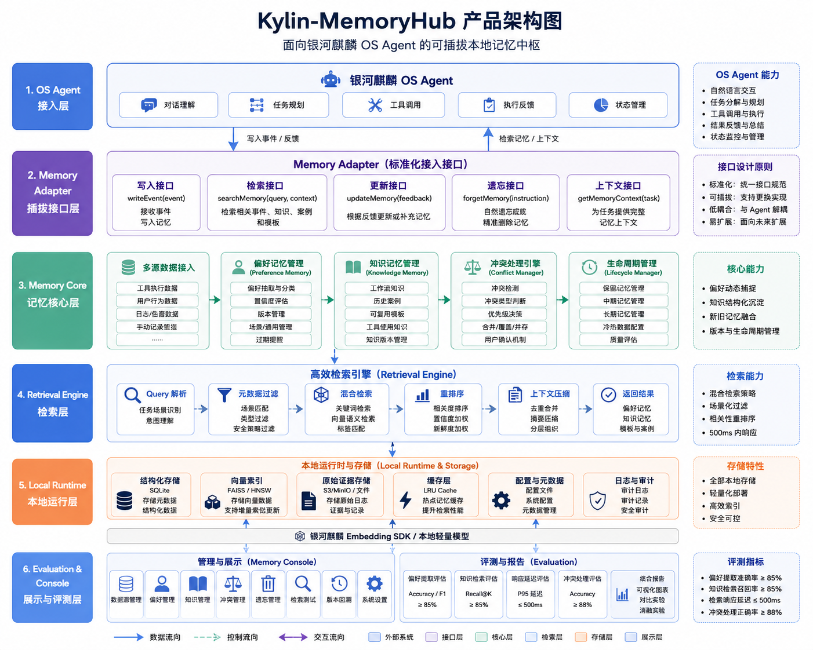

明白。现在我们重新从**产品实现**角度梳理一遍，不再把它说成“做一个 Spring Boot 后端系统”，而是把它定义成一个真正可以被 **麒麟 OS Agent 调用的本地记忆产品模块**。

核心定位应该是：

> **做一个运行在银河麒麟 OS 端侧的可插拔记忆中枢，为 OS Agent 提供偏好记忆、知识记忆、检索复用、冲突处理、安全过滤和精准遗忘能力。**

比赛文件要求的重点包括多源数据整合、偏好动态捕捉、知识结构化整合、端侧部署、调用银河麒麟 embedding SDK、检索延迟 ≤500ms、敏感信息过滤、自然语言遗忘、短中期记忆流转和量化评测。也就是说，产品不是一个普通 Web 系统，而是 OS Agent 的 **Memory Runtime / Memory Plugin / Local Memory Service**。

------

# 一、产品最终要做成什么？

可以把这个作品命名为：

> **Kylin-MemoryHub：面向麒麟 OS Agent 的可插拔本地记忆中枢**

它的产品形态不是独立聊天机器人，而是一个被 OS Agent 调用的底层能力模块。

整体关系如下：

```text
银河麒麟 OS
   ↓
OS Agent
   ↓
Memory Adapter 记忆适配接口
   ↓
Kylin-MemoryHub 记忆中枢
   ├── 多源数据接入
   ├── 偏好记忆管理
   ├── 知识记忆管理
   ├── 冲突处理
   ├── 高效检索
   ├── 敏感过滤
   ├── 精准遗忘
   └── 评测与管理
```

一句话概括：

> **OS Agent 负责理解用户、规划任务、调用工具；我们做的记忆模块负责记住历史、沉淀经验、检索相关上下文，并在任务执行过程中持续更新。**

------

# 二、产品边界：我们做什么，不做什么？

这个边界一定要清楚，否则很容易跑偏。

## 我们要做的

| 模块     | 说明                                             |
| -------- | ------------------------------------------------ |
| 记忆写入 | 接收 OS Agent 的工具调用结果、用户行为、手动配置 |
| 偏好抽取 | 自动发现用户操作习惯、输出风格、安全策略         |
| 知识沉淀 | 把历史任务、工作流程、案例、模板结构化保存       |
| 记忆检索 | 在 OS Agent 执行任务前，返回相关偏好和知识       |
| 冲突处理 | 处理新旧偏好、新旧知识之间的不一致               |
| 版本管理 | 支持偏好和知识的更新、回溯、版本记录             |
| 精准遗忘 | 用户通过自然语言要求删除某类记忆                 |
| 安全过滤 | 识别 API Key、账号、隐私信息等敏感内容           |
| 本地部署 | 在银河麒麟系统上端侧运行                         |
| 量化评测 | 验证准确率、召回率、响应延迟、冲突处理正确率     |

## 我们不做的

| 不做什么                  | 原因                                               |
| ------------------------- | -------------------------------------------------- |
| 不重新做完整 OS Agent     | 赛题重点是记忆模块优化，不是 Agent 主体            |
| 不做云端大模型记忆平台    | 题目强调端侧部署和本地轻量化                       |
| 不把 Web 后端作为核心产品 | Web 只能作为演示和管理界面                         |
| 不只做普通 RAG            | 题目要求偏好、知识、版本、冲突、遗忘等完整记忆能力 |
| 不只做对话摘要            | 记忆需要结构化、可检索、可更新、可评测             |

------

# 三、产品使用场景怎么设计？

为了比赛演示，建议选一个最容易讲清楚的场景：

> **OS Agent 办公助手：记住用户的文档处理习惯，并复用历史工作流。**

例如用户第一次说：

```text
帮我整理这周项目进展，生成一份周报。
```

OS Agent 执行任务：

```text
1. 调用日历工具；
2. 检索项目文件；
3. 读取相关文档；
4. 生成周报；
5. 用户反馈：以后周报都用 Markdown，分成本周进展、问题风险、下周计划三部分。
```

这时记忆模块需要自动沉淀：

```text
偏好记忆：
- 用户喜欢 Markdown 输出；
- 用户希望周报采用三段式结构；
- 用户倾向于先总结进展，再列风险，再写计划。

知识记忆：
- 周报生成流程；
- 相关工具调用链；
- 历史周报案例；
- 可复用周报模板。
```

第二次用户说：

```text
按上次的方式生成这周周报。
```

OS Agent 调用记忆模块：

```text
searchMemory("项目周报", 当前场景)
```

记忆模块返回：

```text
1. 周报输出格式：Markdown；
2. 周报结构：本周进展 / 问题风险 / 下周计划；
3. 历史工具链：日历 → 文件检索 → 文档读取 → 报告生成；
4. 可复用模板：项目周报模板 v2。
```

然后 OS Agent 根据这些记忆自动完成任务。

这个场景能完整展示：

1. 偏好捕捉；
2. 知识沉淀；
3. 检索复用；
4. 版本更新；
5. 冲突处理；
6. 精准遗忘；
7. 安全过滤；
8. 端侧响应延迟。

非常适合比赛答辩。

------

# 四、产品整体架构

建议把产品分成 6 层。

```text
┌──────────────────────────────────────┐
│  第 1 层：OS Agent 接入层              │
│  对话理解 / 工具调用 / 用户反馈 / 任务状态 │
└──────────────────┬───────────────────┘
                   ↓
┌──────────────────────────────────────┐
│  第 2 层：Memory Adapter 插拔接口层     │
│  write / search / update / forget     │
└──────────────────┬───────────────────┘
                   ↓
┌──────────────────────────────────────┐
│  第 3 层：Memory Core 记忆核心层        │
│  偏好抽取 / 知识整合 / 冲突处理 / 版本管理 │
└──────────────────┬───────────────────┘
                   ↓
┌──────────────────────────────────────┐
│  第 4 层：Retrieval Engine 检索层       │
│  向量检索 / 关键词检索 / 元数据过滤 / 重排 │
└──────────────────┬───────────────────┘
                   ↓
┌──────────────────────────────────────┐
│  第 5 层：Local Runtime 本地运行层      │
│  SQLite / 向量索引 / Kylin Embedding SDK │
└──────────────────┬───────────────────┘
                   ↓
┌──────────────────────────────────────┐
│  第 6 层：Evaluation & Console 展示层   │
│  指标评测 / 记忆管理 / 冲突展示 / 演示界面 │
└──────────────────────────────────────┘
```

其中真正的核心是：

```text
Memory Adapter + Memory Core + Retrieval Engine + Local Runtime
```

展示界面只是辅助，不是产品本体。

------

# 五、每个产品模块具体做什么？

------

## 1. Memory Adapter：OS Agent 接入适配层

这个模块负责让 OS Agent 能够标准化调用记忆系统。

它需要提供几个核心接口：

```text
writeEvent(event)
searchMemory(query, context)
updateMemory(feedback)
forgetMemory(instruction)
getMemoryContext(task)
```

例如 OS Agent 在调用工具后，把工具执行结果写入记忆系统：

```json
{
  "event_type": "tool_call",
  "user_id": "u001",
  "task_id": "task_20260708_001",
  "tool_name": "file_search",
  "input": "查找项目周报相关文件",
  "output": "找到 3 个相关文档",
  "status": "success",
  "timestamp": "2026-07-08 10:30:00"
}
```

Memory Adapter 的价值是：

1. 屏蔽底层记忆实现；
2. 让 OS Agent 只通过标准接口调用；
3. 支持未来替换存储、替换 embedding、替换检索引擎；
4. 体现“可插拔”。

这部分在答辩中要重点强调。

------

## 2. Multi-source Ingestion：多源数据接入模块

比赛明确要求支持工具执行结果、用户行为数据、手动配置信息等统一接入。

产品实现中可以设计 4 类输入源：

| 数据源       | 例子                             | 作用                   |
| ------------ | -------------------------------- | ---------------------- |
| 工具调用结果 | 文件检索、命令执行、文档生成结果 | 提取工具偏好和任务流程 |
| 用户行为数据 | 用户修改、拒绝、重复选择         | 提取隐式偏好           |
| 用户显式反馈 | “以后都用 Markdown”              | 提取高置信度偏好       |
| 手动配置     | 安全策略、输出风格、禁用目录     | 作为最高优先级记忆     |

这个模块的产品功能包括：

1. 日志导入；
2. 实时事件写入；
3. 数据清洗；
4. 数据标准化；
5. 数据质量评分；
6. 敏感信息预检测；
7. 证据链绑定。

标准化之后，所有输入都变成统一的 `MemoryEvent`。

------

## 3. Preference Memory：偏好记忆模块

这是产品最核心的功能之一。

它负责从多源数据中提取用户偏好。

偏好可以分为 5 类：

| 偏好类型     | 示例                                       |
| ------------ | ------------------------------------------ |
| 输出风格偏好 | 喜欢 Markdown、喜欢表格、喜欢详细分析      |
| 工具选择偏好 | 文件任务优先用本地检索，代码任务优先用终端 |
| 操作流程偏好 | 生成报告前先列提纲，再生成正文             |
| 场景偏好     | 写论文要正式，写代码要直接                 |
| 安全策略偏好 | 不读取某些目录，不保存某类信息             |

每条偏好不能只是文本，而要设计成结构化对象：

```json
{
  "preference_id": "pref_001",
  "user_id": "u001",
  "type": "output_style",
  "content": "项目周报默认使用 Markdown 格式",
  "scope": "office.weekly_report",
  "confidence": 0.92,
  "source": ["explicit_feedback", "tool_result"],
  "version": 2,
  "status": "active",
  "evidence_ids": ["ev_001", "ev_002"]
}
```

产品上需要支持：

1. 偏好自动抽取；
2. 偏好确认；
3. 偏好更新；
4. 偏好版本回溯；
5. 偏好按场景生效；
6. 偏好冲突提示；
7. 偏好删除或遗忘。

偏好抽取准确率是比赛明确的性能指标，要求达到 **≥85%**。

------

## 4. Knowledge Memory：知识记忆模块

这个模块负责沉淀“可复用经验”。

它不是记用户喜欢什么，而是记：

> 某类任务应该怎么做，以前怎么做过，哪些流程和模板可以复用。

建议分成 3 类知识：

| 知识类型   | 示例                           |
| ---------- | ------------------------------ |
| 工作流知识 | 周报生成流程、会议纪要整理流程 |
| 历史案例   | 上次项目周报生成任务           |
| 可复用模板 | 周报模板、邮件模板、汇报模板   |

结构可以这样设计：

```json
{
  "knowledge_id": "know_001",
  "type": "workflow",
  "name": "项目周报生成流程",
  "steps": [
    "读取本周日历",
    "检索项目文件",
    "提取完成事项",
    "整理风险问题",
    "生成 Markdown 周报"
  ],
  "tools": ["calendar", "file_search", "doc_reader", "report_writer"],
  "scope": "office.weekly_report",
  "version": 3,
  "confidence": 0.88,
  "evidence_ids": ["task_001", "task_005"]
}
```

产品功能包括：

1. 自动沉淀历史任务流程；
2. 保存可复用模板；
3. 绑定工具调用链；
4. 记录任务成功率；
5. 支持相似任务检索；
6. 支持新旧知识融合；
7. 支持知识版本管理。

比赛要求知识检索召回率 ≥85%，所以知识记忆不能只是存数据库，还必须能被有效检索出来。

------

## 5. Conflict Manager：冲突处理模块

这是产品技术含量比较高的地方。

用户偏好和知识会不断变化，所以一定会出现冲突。

例如：

```text
旧偏好：项目周报默认用 Markdown。
新偏好：以后项目周报改成 Word。
```

或者：

```text
旧知识：周报包含 3 个部分。
新知识：周报包含 5 个部分。
```

冲突处理模块需要判断：

1. 是否冲突；
2. 冲突发生在哪个字段；
3. 新旧记忆哪个优先；
4. 是否可以按场景并存；
5. 是否需要用户确认；
6. 是否生成新版本。

产品上可以设计 4 种处理结果：

| 处理结果 | 说明                       |
| -------- | -------------------------- |
| 覆盖     | 新偏好明确，覆盖旧偏好     |
| 合并     | 两条知识互补，合并成新版本 |
| 并存     | 不同场景下同时保留         |
| 待确认   | 冲突严重，需要用户确认     |

例如：

```json
{
  "conflict_id": "conf_001",
  "old_memory": "项目周报默认使用 Markdown",
  "new_memory": "项目周报默认使用 Word",
  "conflict_type": "preference_update",
  "decision": "override",
  "reason": "用户显式表达新偏好，且场景一致",
  "new_version": 3
}
```

比赛指标中要求知识冲突处理正确率 ≥88%，所以这个模块必须有评测数据。

------

## 6. Retrieval Engine：高效检索模块

这是 OS Agent 真正调用记忆的地方。

当用户发起任务时，OS Agent 会向记忆模块请求相关上下文：

```text
用户：按上次的方式生成周报。
```

Memory Retrieval 需要返回：

```text
1. 用户关于周报的输出偏好；
2. 周报生成流程；
3. 上次周报案例；
4. 可复用模板；
5. 安全策略限制。
```

建议采用混合检索：

```text
元数据过滤
   ↓
关键词检索
   ↓
向量语义检索
   ↓
轻量重排序
   ↓
上下文压缩
   ↓
返回 OS Agent
```

不同记忆类型采用不同策略：

| 记忆类型 | 检索策略              |
| -------- | --------------------- |
| 偏好记忆 | 场景匹配 + 置信度排序 |
| 知识记忆 | 向量召回 + 标签匹配   |
| 历史案例 | 相似任务检索          |
| 模板     | 任务类型匹配          |
| 安全策略 | 强制优先检索          |

端侧部署推荐：

```text
SQLite：结构化元数据
FAISS / HNSW：本地向量索引
Kylin Embedding SDK：本地向量化
LRU Cache：热点记忆缓存
JSONL：原始证据记录
```

比赛明确要求检索响应延迟 ≤500ms，所以必须做性能优化和测试报告。

------

## 7. Safety & Forget：安全过滤与精准遗忘模块

这个模块负责解决数据安全和用户可控性问题。

产品上有两个核心功能。

### A. 敏感信息识别与过滤

在记忆写入前，系统需要识别：

```text
API Key
密码
身份证号
手机号
邮箱
本地敏感路径
公司内部文件
安全策略
隐私内容
```

处理方式包括：

| 处理方式 | 场景             |
| -------- | ---------------- |
| 拒绝入库 | 明显敏感内容     |
| 脱敏入库 | 可保留部分信息   |
| 权限标记 | 仅特定场景可检索 |
| 用户确认 | 不确定是否应保存 |

### B. 自然语言精准遗忘

用户可能会说：

```text
忘掉我关于周报格式的偏好。
不要再记住我的 API Key。
删除所有和项目 A 有关的历史记忆。
```

系统要把自然语言转换为结构化操作：

```json
{
  "operation": "forget",
  "target": "preference_memory",
  "condition": {
    "topic": "weekly_report_format"
  },
  "scope": "all_versions"
}
```

精准遗忘不能只删数据库，还要处理：

1. 结构化表；
2. 向量索引；
3. 检索缓存；
4. 历史摘要；
5. 证据记录；
6. 审计日志。

这是产品完整性的体现。

------

## 8. Memory Lifecycle：短期、中期、长期记忆流转

比赛要求说明与短期记忆、中期记忆的数据流转机制。

产品中可以这样设计：

| 记忆层级 | 内容                                 | 生命周期   |
| -------- | ------------------------------------ | ---------- |
| 短期记忆 | 当前会话、当前任务状态、临时工具结果 | 当前任务内 |
| 中期记忆 | 最近任务摘要、候选偏好、近期案例     | 几天到几周 |
| 长期记忆 | 稳定偏好、流程知识、历史模板         | 长期保存   |

流转过程：

```text
当前任务执行
   ↓
短期记忆记录工具调用和用户反馈
   ↓
任务结束后生成任务摘要
   ↓
进入中期记忆
   ↓
多次出现 / 用户确认 / 高置信度
   ↓
沉淀为长期偏好或长期知识
   ↓
后续任务检索复用
```

这个机制非常重要，因为它可以说明你的系统不是“什么都永久记住”，而是有记忆生命周期。

------

# 六、产品的核心使用流程

从产品实现角度，最重要的是把流程闭环讲清楚。

## 流程 1：记忆写入流程

```text
OS Agent 工具调用完成
   ↓
Memory Adapter 接收事件
   ↓
数据清洗与标准化
   ↓
敏感信息检测
   ↓
生成 MemoryEvent
   ↓
进入短期 / 中期记忆池
   ↓
触发偏好抽取或知识沉淀
```

------

## 流程 2：偏好沉淀流程

```text
用户行为 / 显式反馈 / 工具结果
   ↓
候选偏好抽取
   ↓
偏好类型分类
   ↓
场景 scope 判断
   ↓
置信度计算
   ↓
与旧偏好比对
   ↓
新增 / 更新 / 合并 / 待确认
   ↓
写入偏好记忆库
```

------

## 流程 3：知识沉淀流程

```text
任务执行轨迹
   ↓
提取任务目标、步骤、工具链、结果
   ↓
形成候选工作流知识
   ↓
检索相似历史知识
   ↓
冲突检测与合并
   ↓
生成知识版本
   ↓
写入知识记忆库和向量索引
```

------

## 流程 4：记忆检索流程

```text
用户发起新任务
   ↓
OS Agent 构造记忆检索请求
   ↓
记忆模块识别任务场景
   ↓
检索偏好、知识、案例、模板、安全策略
   ↓
重排序和压缩
   ↓
返回可用记忆上下文
   ↓
OS Agent 继续规划和执行任务
```

------

## 流程 5：精准遗忘流程

```text
用户自然语言遗忘指令
   ↓
遗忘意图解析
   ↓
定位相关记忆
   ↓
确认遗忘范围
   ↓
删除结构化数据
   ↓
删除向量索引
   ↓
清除缓存
   ↓
记录审计日志
   ↓
返回遗忘结果
```

------

# 七、产品原型应该怎么做？

我建议按“核心服务 + 演示平台 + 评测工具”三部分实现。

------

## 1. 核心服务：Local Memory Service

这是最重要的部分。

它运行在麒麟 OS 上，提供本地接口：

```text
POST /memory/event/write
POST /memory/search
POST /memory/preference/extract
POST /memory/knowledge/consolidate
POST /memory/forget
GET  /memory/version/{id}
GET  /memory/evidence/{id}
```

这个服务可以用：

```text
Python FastAPI
Go
Java
C++ / Rust
```

如果为了比赛周期，建议：

```text
Python FastAPI 或 Java Spring Boot 均可
```

但是答辩时不要说“我们做了一个后端”，而要说：

> 我们将记忆核心封装为本地 Memory Service，OS Agent 可通过标准接口调用；Web 服务只是本地服务的一种实现方式。

------

## 2. 演示平台：Memory Console

为了答辩，建议做一个简单管理界面。

页面包括：

| 页面         | 展示内容                         |
| ------------ | -------------------------------- |
| 数据源页面   | 工具调用日志、用户行为、手动配置 |
| 偏好记忆页面 | 抽取出的偏好、置信度、版本       |
| 知识记忆页面 | 工作流、案例、模板               |
| 冲突处理页面 | 新旧记忆对比、处理结果           |
| 检索测试页面 | 输入任务，展示召回结果           |
| 精准遗忘页面 | 输入自然语言，展示删除结果       |
| 评测报告页面 | 准确率、召回率、延迟、冲突正确率 |

这个 Console 是为了让评委直观看到系统能力。

------

## 3. 评测工具：Evaluation Runtime

比赛必须有量化测试报告。文件要求提交技术方案和测试结果，并包含测试数据集说明、对比实验设计、量化指标分析等内容。

建议做 4 类评测：

| 评测任务 | 指标                               |
| -------- | ---------------------------------- |
| 偏好提取 | Accuracy / Precision / Recall / F1 |
| 知识检索 | Recall@K / MRR / NDCG              |
| 响应延迟 | P50 / P95 / P99                    |
| 冲突处理 | Accuracy                           |

还要做消融实验：

| 对比方案     | 目的              |
| ------------ | ----------------- |
| 只用向量检索 | 证明混合检索更好  |
| 不做场景过滤 | 证明 scope 有价值 |
| 不做冲突处理 | 证明冲突机制有效  |
| 不做缓存     | 证明性能优化有效  |
| 不做质量评分 | 证明数据治理有效  |

------

# 八、开发阶段怎么安排？

可以分成 5 个阶段。

------

## 阶段 1：MVP 骨架

目标：先让系统跑起来。

完成内容：

1. 定义 MemoryEvent 数据结构；
2. 定义 PreferenceMemory 数据结构；
3. 定义 KnowledgeMemory 数据结构；
4. 实现本地 SQLite 存储；
5. 实现基础写入接口；
6. 实现基础检索接口；
7. 准备一批模拟工具调用数据。

这个阶段的结果：

```text
OS Agent 模拟器可以把工具调用结果写入 Memory Service；
用户输入 query 后，可以检索相关记忆。
```

------

## 阶段 2：偏好与知识抽取

目标：让记忆不只是存储，而能自动生成。

完成内容：

1. 从工具调用和用户反馈中抽取候选偏好；
2. 从任务轨迹中抽取工作流知识；
3. 给偏好和知识加置信度；
4. 保存证据链；
5. 支持版本更新。

这个阶段的结果：

```text
用户多次修改输出格式后，系统能自动发现用户偏好；
任务完成后，系统能沉淀出流程知识。
```

------

## 阶段 3：检索优化与冲突处理

目标：让系统有技术亮点。

完成内容：

1. 接入 embedding；
2. 建立向量索引；
3. 实现关键词 + 向量 + 元数据混合检索；
4. 实现新旧记忆冲突检测；
5. 实现覆盖、合并、并存、待确认机制；
6. 做响应延迟测试。

这个阶段的结果：

```text
相似任务可以召回历史流程；
新旧偏好冲突时，系统能自动处理或提示确认；
检索响应时间可以控制在 500ms 内。
```

------

## 阶段 4：安全过滤与精准遗忘

目标：补齐产品闭环。

完成内容：

1. 敏感信息识别；
2. 入库前脱敏；
3. 自然语言遗忘指令解析；
4. 删除结构化记忆；
5. 删除向量索引；
6. 清理缓存；
7. 生成遗忘审计记录。

这个阶段的结果：

```text
用户说“忘掉我的周报格式偏好”，系统能定位并删除相关记忆；
用户输入 API Key，系统不会直接持久化敏感信息。
```

------

## 阶段 5：麒麟适配、演示和评测

目标：形成比赛提交作品。

完成内容：

1. 在银河麒麟桌面系统上部署；
2. 接入或模拟银河麒麟 embedding SDK；
3. 做功能测试报告；
4. 做性能测试报告；
5. 做演示视频；
6. 写技术文档和用户手册；
7. 准备 PPT；
8. 整理源码和注释。

比赛要求提交项目报告 PPT、技术方案及测试结果文档、源代码及规范，并要求提供效果演示报告、技术文档、用户手册、真实应用案例和麒麟系统适配测试报告。

------

# 九、建议的技术选型

从产品实现角度，我建议这样选。

## 推荐版本：比赛落地版

```text
核心语言：Python / Java
服务接口：FastAPI / Spring Boot
本地数据库：SQLite
向量索引：FAISS / HNSWLib
Embedding：银河麒麟 embedding SDK / 本地轻量 embedding 模型
前端展示：Vue / React
评测脚本：Python
部署环境：银河麒麟桌面 OS
```

如果你用 Spring Boot，不要把它作为“业务后端”来讲，而是讲成：

> 本地 Memory Service 的服务封装层。

------

## 更贴近产品版

```text
核心模块：C++ / Rust / Go
存储：SQLite + 本地向量索引
通信：D-Bus / Unix Domain Socket / gRPC
接入形态：OS Agent Plugin / SDK
展示：独立 Console
```

这个版本更像真正 OS 原生能力，但开发难度更高。比赛周期有限的话，不建议一开始就做这么重。

------

# 十、最终作品应该展示什么？

答辩演示建议设计成一个完整闭环。

## 演示 1：多源数据进入

展示：

```text
工具调用日志
用户反馈
手动配置
行为记录
```

系统将它们统一转成 MemoryEvent。

------

## 演示 2：偏好自动抽取

输入：

```text
用户多次要求周报使用 Markdown。
```

输出：

```text
偏好：项目周报默认使用 Markdown
置信度：0.91
场景：office.weekly_report
证据：3 条用户行为 + 1 条显式反馈
```

------

## 演示 3：知识沉淀

输入：

```text
一次完整周报生成任务轨迹。
```

输出：

```text
知识：项目周报生成流程
步骤：读取日历 → 检索文件 → 提取进展 → 整理风险 → 生成报告
工具链：calendar / file_search / doc_reader / report_writer
```

------

## 演示 4：检索复用

用户输入：

```text
按上次的方式生成周报。
```

系统返回：

```text
偏好：Markdown
模板：三段式周报模板
流程：上次周报生成流程
案例：最近一次周报任务
```

------

## 演示 5：冲突处理

用户输入：

```text
以后周报不要 Markdown，改成 Word。
```

系统展示：

```text
检测到冲突：
旧偏好：Markdown
新偏好：Word
处理方式：用户显式更新，生成新版本，旧版本归档
```

------

## 演示 6：精准遗忘

用户输入：

```text
忘掉我关于周报格式的偏好。
```

系统展示：

```text
已删除：
- 偏好记忆 pref_001
- 向量索引记录
- 缓存记录
- 相关检索入口

保留：
- 遗忘审计日志
```

------

## 演示 7：性能评测

展示：

```text
偏好提取准确率：≥85%
知识检索召回率：≥85%
检索响应时间：≤500ms
知识冲突处理正确率：≥88%
```

这些正好对应比赛评选指标。

------

# 十一、项目目录可以这样设计

如果你后续真的要开发，可以采用下面这种结构：

```text
kylin-memoryhub/
├── memory-core/
│   ├── ingestion/
│   ├── preference/
│   ├── knowledge/
│   ├── conflict/
│   ├── retrieval/
│   ├── safety/
│   └── lifecycle/
│
├── memory-store/
│   ├── sqlite/
│   ├── vector-index/
│   └── evidence-store/
│
├── memory-adapter/
│   ├── agent-api/
│   ├── sdk/
│   └── os-agent-simulator/
│
├── memory-service/
│   ├── api/
│   ├── config/
│   └── runtime/
│
├── memory-console/
│   ├── preference-ui/
│   ├── knowledge-ui/
│   ├── retrieval-ui/
│   └── evaluation-ui/
│
├── evaluation/
│   ├── datasets/
│   ├── metrics/
│   ├── benchmark/
│   └── reports/
│
├── deploy/
│   ├── kylin/
│   ├── scripts/
│   └── docs/
│
└── docs/
    ├── architecture.md
    ├── user_manual.md
    ├── technical_report.md
    └── test_report.md
```

这个目录能体现它不是一个普通后端项目，而是一个完整的记忆系统工程。

------

# 十二、最终可以总结成一句比赛方案

建议你后面汇报时这样说：

> 本作品面向银河麒麟 OS Agent 设计并实现了一个可插拔的本地记忆中枢。系统通过标准 Memory Adapter 接入 OS Agent，在端侧完成工具调用结果、用户行为和手动配置等多源数据的统一接入，进一步实现偏好动态捕捉、知识结构化沉淀、新旧记忆冲突融合、高效检索复用、敏感信息过滤和自然语言精准遗忘。系统底层结合本地结构化存储、向量索引和银河麒麟 embedding SDK，保证记忆检索在 500ms 内完成，并通过标准化数据集评测偏好提取准确率、知识检索召回率和冲突处理正确率。

这个表述就非常贴合产品实现，也贴合赛题要求。

------

# 十三、我建议你当前第一步做什么？

不要急着写后端，也不要急着做页面。

第一步应该先做这三个东西：

1. **定义产品架构图**
   明确 OS Agent、Memory Adapter、Memory Core、Local Runtime、Console 的关系。
2. **定义核心数据结构**
   包括 MemoryEvent、PreferenceMemory、KnowledgeMemory、MemoryVersion、MemoryEvidence、MemoryConflict。
3. **设计一个完整演示场景**
   用“项目周报生成”或者“办公文档处理”场景，完整覆盖写入、抽取、检索、冲突、遗忘、评测。

#### 只要这三件事定下来，后面开发路线就清楚了。

