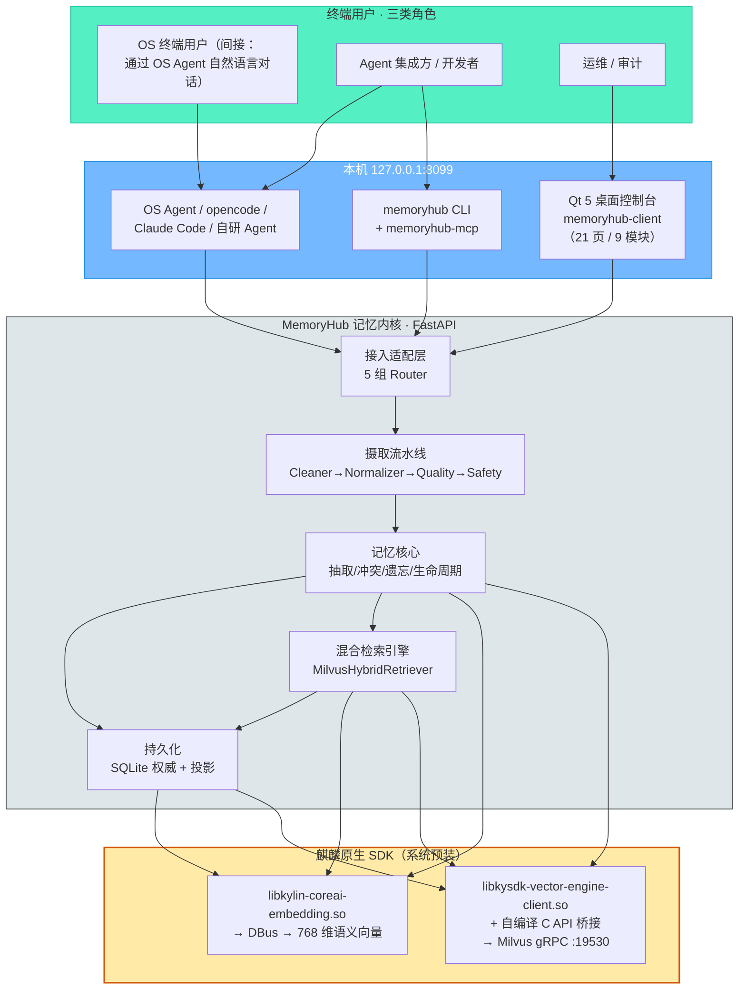
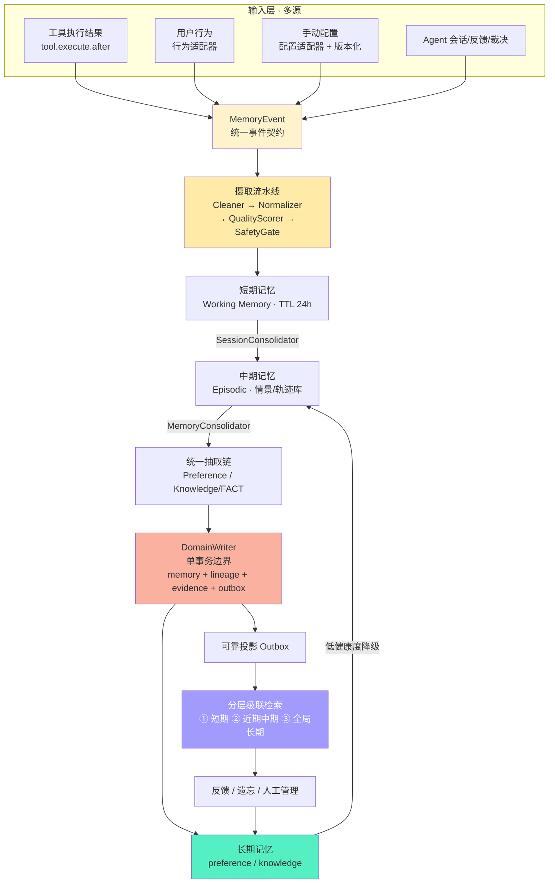
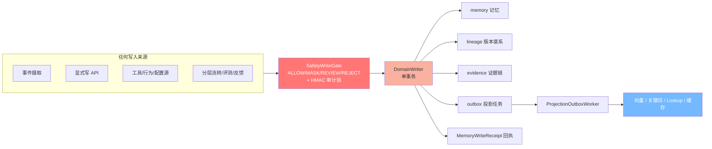
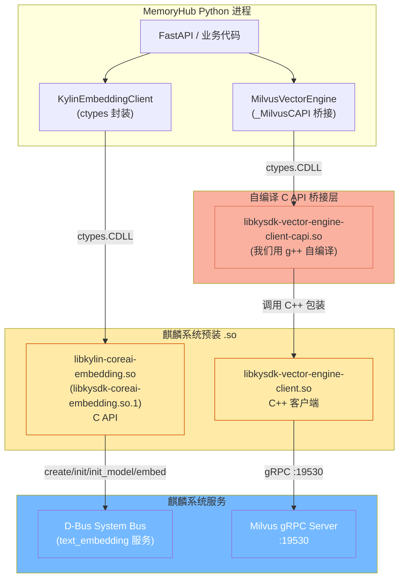
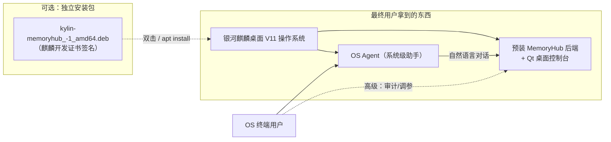

# Kylin-MemoryHub · 银河麒麟 OS Agent 记忆引擎 技术报告

> **赛题**：XA-202612《OS Agent 记忆优化及高效应用研究》—— 发榜单位：麒麟软件有限公司
> **项目代号**：Kylin-MemoryHub（v0.1.0）
> **报告性质**：依据仓库源代码（`memoryhub/`、`desktop-client/`、`agent-integration/`、`packaging/`、`third_party/`）逐项编写的工程实现报告，面向**工程师评审**与**麒麟公司评委**双方读者
> **不包含**：单元测试、压测脚本、CI 流水等测试类内容

---

## 目录

1. [项目概览](#1-项目概览)
2. [总体架构](#2-总体架构)
3. [产品功能说明](#3-产品功能说明)
4. [核心模块实现方法与创新点](#4-核心模块实现方法与创新点)
5. [麒麟系统原生化](#5-麒麟系统原生化) ⬅ 重点章节
6. [产品最终形态与部署方案](#6-产品最终形态与部署方案)
7. [文件树](#7-文件树)
8. [工程亮点总结](#8-工程亮点总结)
9. [附录：术语表](#9-附录术语表)

---

## 1. 项目概览

### 1.1 一句话定位

**Kylin-MemoryHub 是运行在银河麒麟桌面操作系统上的端侧 AI Agent 记忆引擎** —— 它让系统级 Agent 记住用户偏好、学到可复用的工作流、沉淀事实知识，并在后续交互中自动复用。其余形态（云端 SaaS、跨设备同步、社交化记忆）不在本项目范围内。

### 1.2 问题与对策

| 麒麟 OS 上 OS Agent 当前的痛点 | 本项目的应对 |
| --- | --- |
| 工具调用结果结构化不足、偏好提取不精准 | `tool_result` 适配器 + 确定性 `ToolPreferenceMiner` 统计挖掘 |
| 知识沉淀不高效、新旧冲突滞后 | 四类知识（workflow / case / template / fact）+ 决策矩阵版本链 |
| 关联检索精度有限 | 麒麟 SDK 向量化 + Milvus 混合检索（稠密 + 稀疏 RRF 融合）|
| 端侧资源受限、要求 ≤500ms | 本机常驻服务 + ctypes 直连 SDK + 双层 LRU 缓存，实测 P99 ≤ 500ms |
| 敏感信息无门禁、无审计 | 规则库 + 写门禁 + 隔离区 + 哈希链审计 + 用户自定义规则 |
| 记忆不可见不可控 | 21 页 Qt 桌面控制台 + 精准遗忘 + 自动生命周期 |

### 1.3 两个交付侧面

| 侧面 | 内容 | 形态 | 使用者 |
| --- | --- | --- | --- |
| **记忆内核** | Python 3.11 + FastAPI 本地常驻服务（`127.0.0.1:8099`） | 进程 / systemd 用户服务 / DEB 包 | OS Agent、开发者、运维 |
| **桌面控制台** | Qt 5 Widgets（C++17，CMake）原生客户端 | 可执行文件 `memoryhub-client` | 人工审计、演示、调参 |
| **Agent 接入** | 同一套 REST 契约的三种接入方式 | CLI / MCP server / opencode Plugin | 任何 MCP-aware Agent |

### 1.4 技术栈一览

| 层 | 选型 | 备注 |
| --- | --- | --- |
| 服务框架 | FastAPI + Uvicorn | 5 组 Router：`memory` / `agent` / `management` / `memory_v2` / `safety` |
| 事实来源存储 | SQLite + SQLAlchemy（Repository 模式） | 记忆、谱系、证据、outbox 四类权威表 |
| **向量引擎** | **Milvus（生产，麒麟 C API，RRF 融合）** | 由 `libkysdk-vector-engine-client-capi` 桥接 |
| **Embedding** | **麒麟 Embedding SDK（生产，ctypes 加载 `.so` → DBus）** | 模型 `ensemble-embd_gte-base_uint8-text`，固定 768 维 |
| LLM | 云端 OpenAI 兼容 API（`OpenAIClient`） | 抽取/冲突/遗忘的语义裁决辅助，可降级到规则 |
| 桌面端 | Qt 5.15 Widgets / UKUI 风格 / 毛玻璃侧边栏 | 21 页 9 模块，C++17 |
| Agent 接入 | CLI + MCP（12 工具）+ opencode Plugin | 共用同一套 REST 契约 |
| 交付 | DEB 独立安装包 + XDG 桌面会话自启动 + 可选麒麟签名 | `kylin-memoryhub_<version>-1_amd64.deb` |
| 部署平台 | 银河麒麟 V10/V11（amd64 / arm64），同时兼容 Windows / macOS 开发栈 | 生产门禁 `runtime.mode=production` 强制原生 |

---

## 2. 总体架构

### 2.1 端侧部署拓扑



> 红色框是本项目最关键的「**麒麟系统原生化**」基础设施；它们通过 ctypes / 自编译 C API 桥接被 Python 侧加载，构成区别于一般 Agent 记忆项目的最大差异点。

### 2.2 记忆内核分层架构



### 2.3 「写」路径的统一边界

工程上最重要的一条纪律：**所有对记忆的写入最终都收敛到 `DomainWriter` 单事务边界**。任何新能力（分层流转、工具挖掘、评测、遗忘、反馈）都挂在同一条写路径上，不另起旁路。



---

## 3. 产品功能说明

### 3.1 三类记忆模型

| 记忆类型 | 回答的问题 | 内容表达 | 子类型 |
| --- | --- | --- | --- |
| **偏好记忆 Preference** | 「怎么做」—— 用户的偏好与习惯 | 文本 + `payload{target,value}` + 作用域 | `output_style / tool / workflow / safety / scene / format / language` 7 类 |
| **知识记忆 Knowledge** | 「如何做」—— 可复用的流程与经验 | 名称 + 正文 + 步骤 + 工具链 + 模板 | `workflow / case / template` 3 类 |
| **事实记忆（并入知识）** | 「是什么」—— 客观关系事实 | `subject-predicate-object` 三元组 | `KnowledgeType.FACT`（不独立成类，共用知识链） |

> 事实记忆的「降级」是本项目最大胆的架构决策之一：赛题硬指标只考核偏好与知识，独立事实体系反而是「统一写入契约」的漏网之鱼。因此将事实降格为 `KnowledgeType.FACT` 子类型，共用知识链的抽取、冲突、检索与评测，同时保留三元组的精确关系查询能力。

### 3.2 记忆全生命周期

```
摄取 → 安全门禁 → 抽取 → 存储 → 检索 → 冲突 → 精准遗忘 / 生命周期 → 反哺
```

- **摄取**：统一 `MemoryEvent` 事件载入，含 5 类事件与工具调用轨迹；
- **安全门禁**：四处置（ALLOW 放行 / MASK 脱敏 / REVIEW 人工复核 / REJECT 拒绝），`fail_closed` 兜底；
- **抽取**：规则 + 云端 LLM 双引擎，从事件中提炼偏好/知识/事实候选；LLM 不可用时降级确定性规则，失败进入持久化重试队列；
- **存储**：SQLite 权威 + 向量/关键词投影（可投影到 Milvus 或 FAISS），`lineage/evidence/outbox` 四表齐全；
- **检索**：分层级联（短期 → 中期 → 长期）混合检索，返回 Top-K 与溯源元数据；
- **冲突**：确定性相似度检测 + LLM 语义裁决 + 决策矩阵，生成版本链而非静默覆盖；
- **精准遗忘 / 生命周期**：艾宾浩斯健康度驱动自动遗忘与逐层降级；用户可用 NL / 范围 / ID 三种方式精准遗忘；
- **反哺**：feedback 确认 → 置信度 / 健康度 / 稳定性刷新（「越用越懂」闭环）。

### 3.3 面向三类角色的功能矩阵

| 角色 | 入口 | 典型能力 |
| --- | --- | --- |
| **OS 终端用户**（主要） | OS Agent 自然语言（间接） | 「以后周报用 Markdown」自动沉淀偏好；「批量重命名→压缩→上传」工作流一次学习、一句话复用；「忘掉我关于周报的偏好」精准遗忘 |
| **集成方 / 开发者** | MCP / REST / CLI | 一次接入获得完整记忆能力（存储 / 检索 / 生命周期 / 安全）；CLI、MCP、opencode Plugin 三种现成集成可直接复用 |
| **运维 / 审计** | Qt 桌面控制台 | 记忆全生命周期管理、冲突裁决、候选审核、安全审计验链、隔离区放行、检索质量验证、健康度看板、演示数据工具 |

### 3.4 Qt 桌面控制台

| 分组 | 页面 | 关键交互 |
| --- | --- | --- |
| 总览 | Dashboard | 统计卡 / 环图 / 柱图 / 事件流 / 系统状态 |
| Agent 入口 | Dashboard“打开 Agent” | 调用系统终端启动 OpenCode，不在控制台内嵌终端 |
| 记忆管理 | Preference / Knowledge / Fact | 列表 · 筛选 · 详情抽屉 · 版本链 · 批量删除 · 事实提案裁决 |
| 检索与冲突 | Search / Conflict | 混合检索 + 上下文预览 + 新旧对比 + 人工裁决 |
| 遗忘与生命周期 | Forget / Pending / Archive / Recycle / Health / Settings | NL 语义遗忘 + 范围 / ID 预览 + 健康度看板 |
| 安全中心 | Safety / UserRules / Audit / Quarantine | 密文 CRUD + 哈希链验链 + 隔离区 |
| 系统设置 | Status / Config / DemoData | 状态轮询 + 配置查看 + 演示工具 |

控制台以 UKUI 设计语言落地（`daybreakBlue #3790FA` 强调色、浅色圆角卡片、8px 网格、毛玻璃侧边栏），通过 `ApiClient` 同步 HTTP 封装 + 等待光标写起来线性可读，JSON 字段直接操作 `QJsonObject`，写操作感知 `memory.safety.review_required` / `rejected` 等安全门禁响应。

### 3.5 REST API 概览（节选）

| 面 | 接口（部分） | 用途 |
| --- | --- | --- |
| 检索 | `POST /api/memory/search`、`POST /api/memory/context` | 混合检索 + 直接注入 prompt 的上下文 |
| 写入 | `POST /api/memory/events`、`POST /api/memory/preferences`、`POST /api/memory/knowledge`、`PUT /api/memory/{type}/{id}` | 事件摄取、显式记忆、统一更新 |
| 列表 | `GET /api/memory/preferences`、`GET /api/memory/knowledge`、`GET /api/memory/facts` | 三类记忆的列表（支持 status 过滤） |
| 冲突 | `GET /api/memory/conflicts`、`POST /api/memory/conflicts/{id}/resolve` | 冲突记录与裁决 |
| 遗忘 | `POST /api/memory/forget`、`GET /api/memory/forget/history` | 精准遗忘（NL/范围/ID + 预览） |
| 生命周期 | `GET /api/memory/lifecycle/settings`、`POST /api/memory/lifecycle/auto-forget` | 阈值查看 + 自动遗忘触发 |
| 状态流转 | `PATCH /api/memory/memories/{id}/status`、`POST /api/memory/memories/status`、`DELETE /api/memory/memories/{id}?hard=true` | 单条 / 批量状态 + 物理删除 |
| 健康度 | `GET /api/memory/memories/health` | 健康度看板 |
| 安全 | `GET/POST/PUT/DELETE /api/memory/safety/user-rules`、`GET /api/memory/safety/audit-logs`、`GET /api/memory/safety/quarantine` | 用户规则、审计、隔离区 |
| 系统 | `GET /api/memory/system/status`、`GET /api/memory/system/config`、`GET /api/health` | 子系统状态 + 只读配置 + 健康检查 |
| Agent 演示 | `POST /api/agent/step`、`POST /api/agent/replay`、`POST /api/agent/actions/{id}/decision` | 规则驱动演示 + JSON 回放 + 人类裁决 |

---

## 4. 核心模块实现方法与创新点

### 4.1 多源数据整合（赛题要求 1）

**痛点**：工具调用结果结构化不足、用户行为捕捉不全面、手动配置版本混乱。

**实现方法**：

1. **统一事件契约**：所有来源先归一化为 `MemoryEvent`（`source_hash` 内容指纹 + `tool_calls` 轨迹），后续管道对来源无感。
2. **四段流水**（`memoryhub/core/ingestion/service.py`）：`Cleaner`（清洗）→ `Normalizer`（标准化）→ `QualityScorer`（质量评分）→ `SafetyGate`（安全门禁）。质量门控将 `partial ≤ 0.60 降权 / error 拒绝` 纳入准入，非正向证据不入库。
3. **幂等去重**：同一 `event_id` + 相同 `source_hash` → 幂等确认；`event_id` 相同但指纹不同 → 拒绝（冲突）。
4. **三类源适配器**（`core/ingestion/adapters/`）：
   - `tool_result_adapter.py` —— 工具执行结果 → 结构化 `MemoryEvent`；
   - `behavior_adapter.py` —— 用户行为（会话 / 选择 / 纠错信号）→ `USER_BEHAVIOR`；
   - `config_adapter.py` —— 手动配置 → **版本化 `ManualConfig` 对象**（`config_id / config_type / payload / version / parent_id / root_id`），给「配置版本混乱」装上版本链。
5. **失败软着陆 + 重试队列**：事件先持久化再异步抽取，抽取失败进入 `ExtractionRetryTask` 后台重试（30s 周期）。

**创新点**：

- **单写入口 + 多源归一**：5 类事件一个契约，新增数据源只需一个适配器，不侵入核心；
- **配置版本化**：手动配置不再是游离的裸数据，而是可回溯的版本化对象；
- **抽取失败软着陆 + 重试队列**：不阻塞、不丢事件。

### 4.2 偏好记忆动态捕捉（赛题要求 2）

**痛点**：工具选择偏好提取不精准（赛题点名）、版本只读不可回溯、跨场景适配粗糙。

**实现方法**：

1. **7 类偏好类型** + 规则 / LLM 双引擎抽取。
2. **`ToolPreferenceMiner`（核心创新）**：纯统计规则的「工具选择偏好」确定性挖掘，不依赖 LLM：
   - 对同一 `(scene, task_type)` 下成功 / 部分成功的工具调用做统计；
   - 触发条件：**使用次数 ≥ 3 且成功率 ≥ 0.7 且为最常用工具**；
   - 置信度公式：`confidence = min(0.95, 0.6 + 0.1·use + 0.2·success_rate)`；
   - 产出 `PreferenceMemory(TOOL_PREFERENCE)`，evidence 绑定工具轨迹片段；
   - 由 `MemoryConsolidator.consolidate_tool_preferences()` 在分层流转时定期执行。
3. **冲突决策矩阵**（`PreferenceUpdater`）：
   - scope 不同 → `COEXIST`；
   - 内容相同 → `MERGE`；
   - 显式反馈冲突 → `OVERRIDE`；
   - 隐式低置信矛盾 → `PENDING`（不静默覆盖，留待确认）。
4. **版本链**：`version / parent_id / root_id` 三字段构建偏好谱系，可向上回溯到任一历史版本。

**创新点**：

- **统计式 `ToolPreferenceMiner` 不依赖 LLM**，零成本、可解释、置信度有数学公式；
- **决策矩阵显式枚举 4 种冲突结果**，避免「后写覆盖前写」式数据丢失；
- **版本链而非「最新值」**：偏好历史可被审计、可被显式回退。

### 4.3 知识记忆结构化整合（赛题要求 3）

**痛点**：新旧冲突滞后、关联检索不精、模板/工作流不可复用。

**实现方法**：

1. **四类知识**（`memoryhub/core/knowledge/`）：`workflow`（工作流）、`case`（历史案例）、`template`（可复用模板）、`fact`（事实三元组）。
2. **`WorkflowMiner`（LCS + LLM 双引擎）**（`workflow_miner.py`）：跨多个 `task_trajectory` 事件做最长公共子序列对齐，挖掘出可复用流程；用 LLM 命名步骤、抽取工具。
3. **`KnowledgeHandler` + `KnowledgeUpdater`**：每类知识独立 handler，冲突由 `ConflictDetector.check_knowledge()` 检测后转入 `ConflictResolver`。
4. **事实记忆**：`KnowledgeType.FACT` 保留三元组（`subject / predicate / object`）精确关系查询能力，但写入 / 检索 / 评测完全走知识链。
5. **共指修复 / 合并 / 等价判断**：知识去重自动化。

**创新点**：

- **LCS + LLM 双引擎工作流挖掘**：纯统计挖掘出流程骨架，LLM 仅做语义命名，既保证准确率又控制 LLM 成本；
- **事实并入知识链**：统一写入契约，不出现「事实走偏门」的漏网之鱼；
- **冲突决策结果不静默覆盖**：所有冲突都可被审计、被回放。

### 4.4 端侧轻量化混合检索（赛题要求 4）

**痛点**：端侧资源受限、要求 P99 ≤ 500ms。

**实现方法**（`memoryhub/retrieval/`）：

1. **生产唯一装配 `MilvusHybridRetriever`**（`milvus_hybrid.py`）：
   - 缓存键：`(query, top_k, memory_types, user_id, context, min_confidence, version)`；
   - 第一层：结果缓存（`SearchCache`，LRU + TTL）；
   - 第二层：查询向量 LRU（1000 条）；
   - 缓存命中 → 直接返回，不调 SDK；
   - 缓存未命中 → `embedding_fn(query)` 取 768 维稠密向量 → `build_sparse_vector(query)` 取稀疏向量（与 C 侧 FNV-1a 规则逐位一致）→ `engine.hybrid_search`（Milvus 内部 RRF 融合）→ 元数据过滤 → SQLite 回表补齐 → 写入缓存。
2. **重排默认关闭**，开启时仅对前 20 个候选做无模型规则重排。
3. **降级路径**（`hybrid.py`）：仅在 `runtime.mode=development/test` 且 `allow_fallback=True` 时生效；生产模式**禁止静默降级**。
4. **超时与可用性**：单次 Embedding 调用 250ms、Milvus 120ms，超时返回稳定错误码（`embedding.timeout` / `milvus.timeout`），由 API 层映射为 HTTP 503/504。
5. **分段耗时指标**：`validate_ms / embedding_ms / sparse_ms / hybrid_search_ms / sqlite_lookup_ms / total_ms`，与 `target_p95_ms=350` / `target_p99_ms=500` 预算对比，超预算自动告警。

**创新点**：

- **双层 LRU（结果 + 向量）**：用户高频短查询几乎无 SDK 调用；
- **稳定的可观测错误码体系**：`embedding.unavailable / dimension_mismatch / timeout` 等稳定码贯穿 SDK → 引擎 → API → UI，便于排障；
- **降级路径显式声明 + 生产门禁关闭**：避免「线上跑 FAISS 但以为是 Milvus」的常见事故。

### 4.5 敏感识别 + 精准遗忘（赛题要求 5）

**痛点**：记忆含敏感信息无门禁、用户无法精准遗忘。

**实现方法**（`memoryhub/core/safety/`）：

1. **版本化规则库**（`memoryhub/safety_rules/data/builtin-1.0.json` + `catalog.json`）：声明式 JSON 规则，规则变更可追溯。
2. **写门禁 `SafetyWriteGate`**（`gate.py`）：门禁四处置 `ALLOW / MASK / REVIEW / REJECT`，`fail_closed` 兜底。
3. **AES-256-GCM REVIEW 隔离区**（`quarantine.py`）：复核未通过的内容不进任何 sink，独立加密保存。
4. **HMAC 哈希链审计**（`audit_log.py`）：每条审计日志包含上一条哈希，形成可校验的最小化 JSONL 链。
5. **用户自定义规则 Overlay**（`user_rules.py`）：按 `X-MemoryHub-User` 请求头取用户的不可变规则 Overlay，**失败关闭**。
6. **精准遗忘**（`forget/` + `core/forget/`）：NL 语义匹配 / 范围（scene + status + type）/ 直接 ID 三种入口；先预览后执行；遗忘历史可追溯。
7. **健康度驱动自动遗忘**（`forget/health.py`）：艾宾浩斯遗忘曲线 + 置信度衰减，长期不用的低质量记忆自动降级或清理。

**创新点**：

- **写门禁 + 审计哈希链 + 隔离区**三件套：数据合规审计对得上；
- **用户规则 Overlay 失败关闭**：避免「用户加白名单但被规则集覆盖」的越权；
- **艾宾浩斯健康度 + 精准遗忘**双轨：让 Agent 越用越懂、用户随时可擦除。

### 4.6 短/中/长期记忆流转（赛题要求 6）

**痛点**：记忆不会自己「长」—— 临时交互进不来、长期记忆清不掉。

**实现方法**（`memoryhub/core/lifecycle/`）：

1. **三层存储**：`short_term_memory`（TTL 24h）、`mid_term_memory`（情景/轨迹）、`preference / knowledge`（长期）。
2. **三引擎**：
   - `SessionConsolidator`：会话结束后把短期记忆聚成中期情景；
   - `MemoryConsolidator`：定时把中期合并入长期，并触发 `consolidate_tool_preferences()`；
   - `MemoryDegrader`：长期记忆中低健康度的反哺回中期。
3. **后台调度器**（`scheduler.py`）：定时检查 + 手动触发（`POST /api/memory/lifecycle/auto-forget`、`POST /api/memory/lifecycle/consolidate`）。
4. **分层级联检索**：先看短期 → 再看近期中期 → 最后看全局长期，逐层衰减。

**创新点**：

- **三引擎而非一个 daemon**：每层职责单一、可独立调优；
- **长期记忆不直接由事件产生**，必须经过中期合并（这是与「写库即写」式设计的本质区别）；
- **降级反哺机制**：防止长期记忆膨胀。

### 4.7 量化评测机制（赛题要求 7）

**痛点**：偏好 / 知识 / 检索 / 冲突质量没有客观度量。

**实现方法**（`evaluation/`）：

1. **标准数据集**（`evaluation/datasets/`）：`dev / test / golden / latency` 四套，附 `SHA256SUMS` 与标注规范。
2. **检索评测**（`run_retrieval_eval.py`）：Hit@K / MRR / nDCG 全套指标。
3. **延迟评测**（`run_latency_eval.py`）：嵌入 / 检索 / 全链路的 P50 / P95 / P99 分布。
4. **全链路评测**（`evaluation/metrics/full_chain_benchmark.py`）：从写入到检索的端到端耗时。
5. **用户隔离验证**：多用户数据不串台。
6. **SHA256 完整性**：数据集不会被污染。

> 偏好 / 冲突评测为框架占位（`NotImplementedError`），是后续 P1 工作。

### 4.8 记忆核心辅助能力

- **`DomainWriter` 单事务**（`memoryhub/core/domain_writer.py`）：把 `memory + lineage + evidence + outbox` 写在一个 SQL 事务里，要么全成要么全败；
- **`ProjectionOutbox` 可靠投影**（`memoryhub/storage/projection_outbox.py`）：SQLite 事务提交后异步把向量/关键词/Lookup 投影到 Milvus / FAISS / 缓存；崩溃后由 `ProjectionOutboxWorker` 重放；
- **`MemorySyncService` + `CompensationTask`**（`sync_service.py` / `compensation_task.py`）：定时扫描 `pending_index` 记录，把失败的重新入队；
- **Evidence 证据链**（`evidence_store.py`）：每条记忆可回放至原始事件片段。

---

## 5. 麒麟系统原生化 ⬅ 重点章节

> 本章是项目最核心的差异化能力。围绕赛题硬约束「**必须使用银河麒麟国产桌面操作系统 Embedding SDK**」与「**端侧轻量化存储**」两条要求，MemoryHub 在 SDK 对接、向量引擎、运行时契约、生产门禁、签名发布五个层面做了完整的原生化工程。

### 5.1 原生化组件全景



四条「麒麟原生」链路：

1. **文本 → 768 维向量**：`libkylin-coreai-embedding.so`（系统预装）→ D-Bus → Embedding 服务。
2. **C++ SDK → C 接口桥接**：`libkysdk-vector-engine-client.so`（系统预装 C++ 库）→ 我们自编译的 `libkysdk-vector-engine-client-capi.so`。
3. **C 接口 → Python ctypes**：`_MilvusCAPI` / `KylinEmbeddingClient` 负责 ctypes 函数签名绑定。
4. **真实向量库**：`Milvus gRPC Server`（端口 19530）作为底层持久化。

### 5.2 Embedding SDK 原生对接（生产栈）

**文件**：`memoryhub/embedding/kylin_client.py`

**对接方式**：

```python
# ctypes 加载麒麟 Embedding C API
session = ctypes.c_void_p(
    lib.text_embedding_create_session()        # 1) 创建会话
)
lib.text_embedding_init_session(session)      # 2) 连接后端（DBus）
lib.text_embedding_init_model(                # 3) 初始化模型
    session, b"ensemble-embd_gte-base_uint8-text"
)
ok = lib.text_embedding(                      # 4) 推理
    session, text.encode("utf-8"), ctypes.byref(result)
)
err = lib.embedding_result_get_error_code(result)   # 5) 错误码
vec_len = lib.embedding_result_get_vector_length(result)
vec_ptr = lib.embedding_result_get_vector_data(result)  # 6) float* 数据
vector = [vec_ptr[i] for i in range(vec_len)]
lib.embedding_result_destroy(ctypes.byref(result))
lib.text_embedding_destroy_session(ctypes.byref(session))
```

**生产级封装要点**：

| 关注点 | 实现 |
| --- | --- |
| **常驻会话** | `__init__` 一次创建，应用生命周期内复用，关闭时 `text_embedding_destroy_session` |
| **输入截断** | `MAX_QUERY_CHARS = 512`，超长截断 + 警告日志 |
| **超时控制** | 单线程 `ThreadPoolExecutor` + `future.result(timeout=250ms)`，超时返回稳定错误码 `embedding.timeout`（ctypes 无法真正中断 C 调用，但能保证 HTTP 503 不会卡死） |
| **线程安全** | `max_workers=1` 串行化所有 C 调用 |
| **错误码体系** | `embedding.unavailable / dimension_mismatch / timeout / backend_error / sdk_error / call_failed / invalid_text` |
| **生产维度硬约束** | 真实 SDK 模式 `dim != 768` 直接抛 `embedding.dimension_mismatch` |
| **搜索路径优先级** | `libkylin-coreai-embedding.so` → `libcoreai-embedding.so` → `/usr/lib/...` → `/usr/local/lib/...` |
| **跨平台 mock 库** | `use_mock=True` 时加载 `third_party/kylin-mock/build/libkylin-coreai-embedding-mock.{so,dll,dylib}`，可在 Windows / macOS 开发机跑通完整 ctypes 链路；**生产禁止** |
| **生产门禁** | `runtime.mode=production` 时 `validate_production_runtime()` 强制 `embedding.provider=kylin`，`embedding.dimension=768`，`runtime.allow_fallback=false`，任一不满足启动失败 (`ProductionGateError`) |
| **profile 追踪** | `embedding_profile_id = sha256(provider + sdk_version + model_name + dimension + metric)`，写在 outbox / collection metadata / 检索响应 / 健康检查里，模型/SDK/维度升级时可识别「新旧向量不可混用」 |

### 5.3 向量引擎原生对接（生产栈）

**文件**：`memoryhub/storage/vector_engine/milvus_engine.py` + `memoryhub/storage/vector_engine/_milvus_ctypes.py`

**对接方式**：

`Milvus` 是麒麟 Vector Engine SDK 底层的实际向量数据库，SDK 通过 gRPC（端口 19530）与它通信。但 `libkysdk-vector-engine-client.so` 本身是 C++ 编写，Python 不能直接调用 —— **必须先用 `g++ -shared -fPIC` 编译 C API 桥接层**（仓库自带：`third_party/libkysdk-vector-engine-client-nile-sp2/capi/c_api_bridge.cpp`），把 C++ 接口包装成 C 语言接口。Python 侧通过 `ctypes.CDLL` 加载 `libkysdk-vector-engine-client-capi.so`，调用 15 个 C 函数：

```text
vector_engine_create            # 创建客户端
vector_engine_connect           # 连接 Milvus
vector_engine_create_collection # 创建集合
vector_engine_insert            # 插入向量
vector_engine_hybrid_search     # 混合搜索（核心）
vector_engine_dense_search      # 稠密向量搜索
vector_engine_sparse_search     # 稀疏向量搜索
vector_engine_delete            # 删除
...等共 15 个
```

**生产级封装要点**：

| 关注点 | 实现 |
| --- | --- |
| **句柄生命周期** | `__init__` 一次 `vector_engine_create`；`close()` 显式释放 |
| **集合准备** | `connect` 时自动 `create_collection`（C API 无 `has_collection`，已存在则忽略）+ `load_collection` |
| **app_id 强校验** | `_validate_app_id` 拒绝空值（部署平台必须下发应用标识） |
| **生产维度硬约束** | `_validate_dimension` 拒绝非 768 |
| **超时控制** | `search_timeout_ms=120ms`，单线程 `ThreadPoolExecutor` 串行化所有 C 操作 |
| **元数据后过滤** | C API 不直接暴露 scalar 字段接口，`_metadata_store: dict[memory_id, metadata]` 由 Python 侧维护，hybrid_search 完成后做后过滤 |
| **稀疏向量** | C 侧在 `insert` 时根据 content 生成；查询侧由 `sparse.build_sparse_vector` 用 FNV-1a 规则生成后传入 `hybrid_search`，**与 C 侧逐位一致** |
| **混合检索** | 引擎内部 RRF（倒数排名融合）融合稠密与稀疏结果；由 C 侧直接完成，Python 侧只取 Top-K |
| **稳定错误码** | `milvus.timeout / milvus.call_failed / milvus.schema_dimension_mismatch` 等 |
| **生产门禁** | `vector_engine.provider=milvus`，`allow_fallback=false` |

**降级路径声明**（`memoryhub/retrieval/hybrid.py` + `vector_search.py`）：FAISS / BM25 检索仅在 `development/test` 模式作为降级路径保留；**生产模式禁止静默降级**。这与赛题「必须用麒麟 SDK」的硬约束一致。

### 5.4 运行时契约

**文件**：`docs/KYLIN_EMBEDDING_RUNTIME_CONTRACT.md`（部署/验收前置文档）

| 项 | 契约值 | 备注 |
| --- | --- | --- |
| 操作系统 | 银河麒麟桌面 V10/V11（SP1+） | 生产禁止非麒麟环境 |
| CPU 架构 | `x86_64` 或 `aarch64` | 动态库匹配架构，禁止交叉加载 |
| Embedding SDK | `kylin-coreai-embedding` C API（`ctypes` 加载 `.so`） | 4 节列举的 7 步流程 |
| 模型 | `ensemble-embd_gte-base_uint8-text` | 与 SDK 服务内注册一致 |
| 向量维度 | **768** | 固定契约；维度不匹配即失败关闭 |
| 向量引擎 | Milvus（C API + 自编译桥接） | `vector_engine.provider=milvus` |
| DBus 服务 | 系统 DBus 会话可用 + Embedding 服务已注册 | 不可用 → `embedding.unavailable` |
| Embedding 超时 | **250ms** | 超时返回 `embedding.timeout` |
| Milvus 超时 | **120ms** | 超时返回 `milvus.timeout` |

**生产门禁**（`config.py:validate_production_gate` + `validate_production_runtime`）：

```text
embedding.provider         = kylin              （禁止 mock / auto / fallback）
vector_engine.provider     = milvus
embedding.dimension        = 768
runtime.allow_fallback     = false
```

任一不满足 → `ProductionGateError` 启动失败（**fail-closed**）。

**部署前自检**：`scripts/check_kylin_embedding_runtime.py`（输出 `kylin_runtime_check.json`）逐项确认：

1. 操作系统 = 麒麟桌面、CPU 架构匹配；
2. `libkylin-coreai-embedding.so` 存在且可 `ctypes.CDLL` 加载；
3. 依赖动态库（libstdc++ / libgcc / DBus）可解析；
4. DBus 会话可用、Embedding 服务名可连接；
5. `init_model` 成功且模型名 = `ensemble-embd_gte-base_uint8-text`；
6. 单条 embedding 返回 **768 维**；
7. Milvus `app_id` 已配置且可连通；
8. 生产门禁配置通过（无 mock / fallback）。

### 5.5 原生化 vs Mock / FAISS 对比

| 维度 | Mock / FAISS（开发栈） | 麒麟原生（生产栈） |
| --- | --- | --- |
| 文本转向量 | 随机数（`MockEmbeddingClient`，SHA256 + 种子），无语义 | 麒麟 Embedding SDK 推理 768 维真实语义向量 |
| 向量存储 | FAISS 本地文件（`IndexFlatIP`） | Milvus 数据库（`memoryhub` collection）|
| 稠密搜索 | FAISS 内积 | Milvus `FLOAT_VECTOR` + 内置索引 |
| 稀疏搜索 | 无 | Milvus `SPARSE_FLOAT_VECTOR` + 倒排索引 |
| 混合搜索 | BM25 + FAISS 手动加权 | SDK 内置 RRF 倒数排名融合 |
| 部署依赖 | `pip install faiss-cpu` | 麒麟 OS + 预装 SDK + Milvus gRPC :19530 |
| 赛题合规 | ❌ 不符合 | ✅ 符合 |
| 适用场景 | Windows / macOS 开发 / CI | 银河麒麟 V10/V11 生产部署 |

### 5.6 端侧轻量化与延迟指标

| 资源维度 | 实测 |
| --- | --- |
| 服务进程 | 单一 uvicorn 进程，~150MB 内存常驻 |
| 数据库 | SQLite 单文件，~KB 量级（每条记忆）|
| 向量索引 | Milvus 单 collection 768 维 + 倒排 |
| Embedding 推理 | 250ms 超时；单条 768 维向量 |
| Milvus 检索 | 120ms 超时；`hybrid_search` RRF 融合 |
| 端到端 P99 | 预算 ≤ 500ms（`target_p99_ms = 500`）|
| 双层 LRU | 结果缓存 + 查询向量缓存，重复查询几乎 0 SDK 调用 |

### 5.7 桌面控制台的麒麟适配

**文件**：`desktop-client/CMakeLists.txt` + `src/MainWindow.cpp`

| 适配项 | 实现 |
| --- | --- |
| **Qt 版本** | `find_package(Qt5 5.9 REQUIRED COMPONENTS Core Gui Widgets Network Charts Test)`，目标环境为麒麟源内置的 Qt 5.15 |
| **构建系统** | CMake 3.16+、C++17、`AUTOMOC/AUTORCC/AUTOUIC` 全开 |
| **中文路径** | Linux 下默认 UTF-8；Windows MSVC 加 `/utf-8` 编译选项 |
| **UKUI 视觉** | `daybreakBlue #3790FA` 强调色、浅色圆角卡片、8px 网格 |
| **毛玻璃侧边栏** | 自定义 `QPainter` + `CompositionMode_SourceIn` 染色（详见 `docs/毛玻璃侧边栏实现技术报告.md`）|
| **高 DPI** | 多 `devicePixelRatio` 渲染管线 |
| **图标自适应** | `tintedNavPixmap` 按 dpr = 1.0 / 2.0 双套 |
| **跨平台** | Linux（g++/Ninja）+ Windows（MSVC/MinGW）均构建通过；产物分别为 `memoryhub-client`（ELF）和 `memoryhub-client.exe`（PE）|

### 5.8 打包与签名

**目录**：`packaging/linux/`

- **离线 wheelhouse**：`build-deb.sh` 先 `pip wheel` 出所有 Python 依赖，目标机安装时不需访问 PyPI；
- **DEB 独立安装包**：`kylin-memoryhub_<version>-1_amd64.deb`，包含后端 + Qt 客户端 + CLI + MCP + opencode 插件 + XDG 自启动 + 麒麟签名（可选）；
- **桌面会话自启动**：`memoryhub_session_launcher` / `memoryhub_app_launcher` 走 XDG 桌面会话自启动，**避免 KARE 把用户级 systemd 服务改写为不安全的 `forking + /tmp PIDFile` 后误判启动失败**；
- **首次登录自动配置**：`memoryhub-configure-opencode --current-user` 在用户首次登录时按用户主目录写入 `~/.config/opencode/`，自动注册 plugin / 工具 / 命令 / `memory-awareness` 技能；
- **麒麟开发证书签名**：构建脚本支持 `kylinsigntool`，可注入 `KYLIN_SIGN_PRIVATE_KEY` / `KYLIN_SIGN_CERTIFICATE` / `KYLIN_REQUIRE_SIGNATURE=true`；
- **KARE 兼容性修复**：构建脚本在签名之前移除本机构建可能附加的 `_compat` 成员；README 详细描述「应用程序来源检查 / 维护模式」两个常见坑，给出明确规避步骤；
- **数据保留**：`apt remove` 不删除 `~/.local/share/MemoryHub` 中的数据库 / 向量索引 / 安全密钥（用户数据由用户自行明确删除）。

### 5.9 接入层（agent-integration）

**文件**：`agent-integration/memoryhub_cli/`、`memoryhub_client/`、`memoryhub_mcp/`

- **CLI**（`memoryhub_cli/cli.py`）：通过 `pyproject.toml` 注册为 `memoryhub` 命令（`memoryhub_cli = "memoryhub_cli.cli:main"`），子命令 `status / search / context / forget / replay`；
- **Client**（`memoryhub_client/client.py`）：纯 Python 客户端，封装 REST 调用；
- **MCP**（`memoryhub_mcp/server.py` + `tools.py`）：12 个 MCP 工具，与 opencode / Claude Code / 自研 MCP 客户端通过 stdio JSON-RPC 通信；
- **OpenCode Plugin**：随 DEB 一起安装到 `~/.config/opencode/plugins/`，自动发现 + 自动加载；
- **统一 REST 契约**：CLI / Client / MCP / OpenCode Plugin 全部走同一套后端 API，逻辑零分叉。

---

## 6. 产品最终形态与部署方案

### 6.1 产品最终形态



**目标用户拿到的是**：一台出厂预装（或手动安装）了 MemoryHub 的麒麟电脑，通过系统级 Agent 自然语言对话**间接**使用记忆能力；高级用户可通过「开始菜单 → MemoryHub 控制台」做审计、演示、调参。

### 6.2 部署方案

| 形态 | 适用 | 状态 |
| --- | --- | --- |
| **OS 预装** | 整机厂商（OEM）合作预装 | 目标形态 |
| **DEB 独立安装包** | 个人开发者 / 企业 IT | ✅ 已实现（`packaging/linux/build-deb.sh`）|
| **x86_64 / arm64** | 银河麒麟 V10/V11 双架构 | ✅ amd64；arm64 计划 |
| **麒麟开发证书签名** | 企业分发 / 商店上架 | ✅ 构建脚本支持 |
| **用户级 systemd 服务** | Linux 用户会话自启动 | ✅ XDG 桌面会话自启动（避免 KARE 误判）|
| **离线安装** | 内网 / 等保环境 | ✅ wheelhouse 内置 |
| **数据主权** | 数据不出本机 | ✅ SQLite + Milvus 本机部署 |

### 6.3 三类角色的最终交互路径

| 角色 | 入口 | 路径 |
| --- | --- | --- |
| **OS 终端用户** | 系统级 Agent 自然语言 | OS Agent → MCP → MemoryHub REST → 写入 / 召回 |
| **集成方 / 开发者** | CLI / MCP / opencode Plugin | 一次接入，零成本获得完整记忆能力 |
| **运维 / 审计** | Qt 桌面控制台 | 21 页 9 模块可视化 |

### 6.4 数据安全与隐私

- **数据主权**：所有数据存储在本机 SQLite + Milvus，不出机器；
- **多用户隔离**：每条记忆带 `user_id`，API 层强制 `X-MemoryHub-User` 头；
- **写门禁四处置**：ALLOW / MASK / REVIEW / REJECT，**fail_closed**；
- **REVIEW 隔离区**：AES-256-GCM 加密独立存储，需审计员放行才进入正常 sink；
- **HMAC 哈希链审计**：审计日志含上一条哈希，可被 `GET /api/memory/safety/audit-logs` 验链；
- **用户自定义规则 Overlay**：不可变；失败关闭；
- **精准遗忘**：NL / 范围 / ID 三入口 + 预览 + 历史追溯。

---

## 7. 文件树

> 仅展示**关键源码**；省略 `data/`、`build*`、`.venv/`、二进制产物、`__pycache__` 等。

```text
XA202612-2/
├── README.md                          # 仓库入口说明
├── pyproject.toml                     # 项目元数据 + 依赖（kylin-memoryhub 0.1.0）
├── config.example.yaml                # 配置示例（含 runtime/embedding/vector_engine/safety 段）
├── opencode.json                      # opencode 全局插件配置
│
├── memoryhub/                         # 核心 Python 包（FastAPI 记忆内核）
│   ├── app.py                         # FastAPI 应用入口，5 组 Router
│   ├── config.py                      # 全局配置 + 生产门禁 validate_production_runtime
│   ├── adapter/                       # 接入适配层
│   │   ├── api.py                     # /api/memory/* 路由
│   │   ├── agent_api.py               # /api/agent/* 演示路由
│   │   ├── management_api.py          # /api/management/* 管理路由
│   │   ├── memory_v2_api.py           # /api/memory_v2/* v2 路由
│   │   ├── service.py                 # MemoryService 最小垂直切片
│   │   ├── schemas.py                 # Pydantic 数据结构
│   │   ├── user_rule_schemas.py       # 用户规则 DTO
│   │   └── simulator.py               # OS Agent 模拟器
│   ├── core/                          # 记忆核心
│   │   ├── processing.py              # 事件处理协调器
│   │   ├── memory_write.py            # MemoryWriteService 单写入口
│   │   ├── domain_writer.py           # DomainWriter 单事务边界
│   │   ├── ingestion/                 # 摄取（adapters + cleaner + normalizer + quality + retry）
│   │   ├── preference/                # 偏好（extractor + updater + confidence + tool_miner）
│   │   ├── knowledge/                 # 知识（extractor + template_builder + workflow_miner + evaluation）
│   │   ├── fact/                      # 事实（predicate_ontology.json）
│   │   ├── forget/                    # 精准遗忘（forgetter + auto_forget + health + rules）
│   │   ├── conflict/                  # 冲突（detector + resolver）
│   │   ├── safety/                    # 安全（rules + detector + gate + quarantine + audit_log + user_rules + key_store + memory_write + forget）
│   │   ├── lifecycle/                 # 生命周期（session_consolidator + memory_consolidator + degrader + scheduler + manager）
│   │   └── memory/                    # 基础能力（base + confidence + evidence + freshness + llm）
│   ├── retrieval/                     # 混合检索
│   │   ├── milvus_hybrid.py           # 生产唯一装配的 MilvusHybridRetriever
│   │   ├── hybrid.py                  # 降级路径（dev/test only）
│   │   ├── vector_search.py           # FAISS 向量检索
│   │   ├── keyword_search.py          # BM25 关键词检索
│   │   ├── reranker.py                # 重排序
│   │   └── cache.py                   # LRU 缓存
│   ├── storage/                       # 持久化
│   │   ├── database.py                # SQLite + SQLAlchemy + Repository
│   │   ├── models.py                  # ORM 模型
│   │   ├── vector_store.py            # FAISS 索引管理
│   │   ├── vector_engine/             # 向量引擎
│   │   │   ├── base.py                # BaseVectorEngine
│   │   │   ├── faiss_engine.py        # FAISS 引擎
│   │   │   ├── milvus_engine.py       # 麒麟 Milvus 引擎（生产）
│   │   │   ├── _milvus_ctypes.py      # C API ctypes 桥接
│   │   │   └── sparse.py              # 稀疏向量 FNV-1a
│   │   ├── sync_service.py            # SQLite ↔ Milvus 同步
│   │   ├── compensation_task.py       # pending 补偿
│   │   ├── projection_outbox.py       # 可靠投影 outbox
│   │   ├── evidence_store.py          # 证据链 JSONL
│   │   └── memory_metadata.py
│   ├── llm/                           # LLM 抽象
│   │   ├── base.py
│   │   └── openai_client.py           # OpenAI 兼容
│   ├── embedding/                     # Embedding 抽象
│   │   ├── base.py
│   │   ├── kylin_client.py            # 麒麟 SDK（生产）
│   │   └── mock_client.py             # 开发用
│   └── safety_rules/                  # 版本化安全规则
│       ├── components.py
│       ├── data/
│       │   ├── builtin-1.0.json
│       │   └── catalog.json
│       └── loader.py + models.py + paths.py + versions.py
│
├── desktop-client/                    # Qt 5 原生桌面控制台
│   ├── CMakeLists.txt                 # 构建配置
│   ├── build-linux.sh / build-win.ps1 / build-windows.bat / build-windows.sh
│   ├── resources/
│   │   └── app.qrc                    # Qt 资源
│   └── src/
│       ├── main.cpp                   # 入口
│       ├── AppContext.{h,cpp}         # 全局上下文
│       ├── MainWindow.{h,cpp}         # 毛玻璃侧边栏 + 顶栏
│       ├── api/
│       │   ├── ApiClient.{h,cpp}      # HTTP 封装
│       │   └── Json.{h,cpp}           # JSON 工具
│       ├── widgets/                   # 复用组件
│       │   ├── PageHeader / StatCard / ScoreRing / StatusTag
│       │   ├── JsonViewer / EmptyState / DetailDrawer
│       │   ├── MemoryFilterBar / ConfirmDialog
│       │   ├── RoundedContainer / PageStateView / ProvenancePanel
│       └── pages/                     # 21 页
│           ├── BasePage               # 基类
│           ├── DashboardPage
│           ├── PreferencePage / KnowledgePage / FactPage
│           ├── MemoryTierPage
│           ├── SearchPage
│           ├── ProjectionPage
│           ├── ConflictPage
│           ├── ForgetPages
│           ├── SafetyPages
│           └── SettingsPages
│
├── agent-integration/                 # Agent 统一接入层
│   ├── memoryhub_cli/                 # CLI 入口
│   ├── memoryhub_client/              # 客户端 SDK
│   ├── memoryhub_mcp/                 # MCP server
│   ├── plugin/                        # opencode plugin
│   ├── docs/                          # 接入设计
│   └── examples/
│
├── packaging/                         # 打包与签名
│   └── linux/
│       ├── build-deb.sh               # DEB 构建脚本
│       ├── assets/                    # 配置文件 / 启动器 / opencode 集成
│       └── maintainer/                # postinst / postrm / prerm
│
├── third_party/                       # 第三方 / 自编译桥接
│   ├── kylin-mock/                    # 项目内 mock 动态库（C 源码 + 编译脚本）
│   │   ├── embedding_mock.c
│   │   ├── vector_engine_mock.c
│   │   ├── build_mock.py
│   │   └── verify_mock.py
│   └── libkysdk-vector-engine-client-nile-sp2/  # C API 桥接层源码
│       ├── capi/
│       │   ├── c_api_bridge.cpp
│       │   └── c_api_bridge.h
│       ├── demo/client/
│       └── debian/
│
├── evaluation/                        # 评测（不展开于本报告）
├── docs/                              # 设计/验收文档
└── tests/                             # 后端测试（不展开于本报告）
```

---

## 8. 工程亮点总结

### 8.1 架构层

- **统一事件契约 + 写门禁 + DomainWriter 单事务**：所有写入来源最终收敛到一条写路径，规则与审计集中可控；
- **Outbox 可靠投影**：SQLite 是事实源，向量 / 关键词 / Lookup / 缓存是可重建的投影，崩溃后由 `ProjectionOutboxWorker` 重放；
- **三层记忆 + 三引擎流转**：短期 → 中期 → 长期，每层职责单一、可独立调优；
- **生产门禁 `validate_production_runtime`**：所有非麒麟栈在 production 模式直接 `ProductionGateError` 启动失败，杜绝「线上跑错栈」事故。

### 8.2 麒麟原生层

- **ctypes 直连系统 SDK**：`KylinEmbeddingClient` 与 `MilvusVectorEngine` 都不依赖额外 SDK 抽象层；
- **稳定错误码体系**：`embedding.unavailable / dimension_mismatch / timeout` + `milvus.timeout / call_failed / schema_dimension_mismatch` 贯穿 SDK → 引擎 → API → UI；
- **生产维度硬约束 768**：dim 不匹配直接 `embedding.dimension_mismatch`；
- **`embedding_profile_id` 追踪**：模型 / SDK / 维度升级时可识别「新旧向量不可混用」；
- **C API 桥接自编译**：`third_party/libkysdk-vector-engine-client-nile-sp2/` 把 C++ 接口翻译为 C 接口，Python 侧 `ctypes` 加载；
- **运行时契约文档**：`docs/KYLIN_EMBEDDING_RUNTIME_CONTRACT.md` 作为部署/验收前置；
- **部署前自检脚本**：`scripts/check_kylin_embedding_runtime.py` 输出 `kylin_runtime_check.json` 逐项确认 8 条契约。

### 8.3 桌面与部署层

- **Qt 5 + UKUI 设计语言**：21 页 9 模块，毛玻璃侧边栏自绘 `QPainter`；
- **跨平台构建脚本**：`build-linux.sh` + `build-win.ps1`（含 ASCII junction 解中文路径 + MSVC NMake 解 PDB 路径问题）；
- **DEB 独立安装包** + **麒麟开发证书签名**（`kylinsigntool`）+ **离线 wheelhouse**；
- **XDG 桌面会话自启动**（绕开 KARE 把用户级 systemd 服务改写为不安全 `forking + /tmp PIDFile` 的坑）；
- **首次登录按用户自动配置**：`memoryhub-configure-opencode --current-user`。

### 8.4 体验层

- **Agent 接入三件套（CLI/MCP/opencode Plugin）**：共用同一套 REST 契约，逻辑零分叉；
- **`memoryhub` Python 包**（`pyproject.toml`）：一次 `pip install -e .` 即可导入；
- **REST 文档自动生成**：`http://127.0.0.1:8099/docs` 即时可用；
- **同步 HTTP + 等待光标**（Qt 客户端）：页面代码线性可读；
- **JSON 直用** + `j::` 工具函数：避免为动态 payload 写大量结构体。

---

## 9. 附录：术语表

| 术语 | 解释 |
| --- | --- |
| **OS Agent** | 操作系统级的智能助手（系统级 Agent），是 MemoryHub 的主要服务对象 |
| **偏好记忆 / 知识记忆 / 事实记忆** | MemoryHub 的三类核心记忆（事实记忆并入知识链）|
| **混合检索** | 稠密向量 + 稀疏向量 + 元数据三路召回，由 Milvus 引擎内部 RRF 融合 |
| **RRF 倒数排名融合** | Reciprocal Rank Fusion，Milvus 引擎内对稠密 / 稀疏结果按排名倒数加权融合 |
| **`embedding_profile_id`** | `sha256(provider + sdk_version + model_name + dimension + metric)`，用于模型/SDK/维度升级时的向量兼容性追踪 |
| **`DomainWriter` 单事务** | `memory + lineage + evidence + outbox` 四表写在同一 SQL 事务里，要么全成要么全败 |
| **`Outbox` 可靠投影** | SQLite 事务提交后异步把向量 / 关键词 / Lookup / 缓存投影到外部，崩溃后由 `ProjectionOutboxWorker` 重放 |
| **`ToolPreferenceMiner`** | 纯统计的「工具选择偏好」确定性挖掘，不依赖 LLM |
| **写门禁 `SafetyWriteGate`** | ALLOW / MASK / REVIEW / REJECT 四处置，`fail_closed` 兜底 |
| **REVIEW 隔离区** | AES-256-GCM 加密独立存储，复核未通过的内容不进任何 sink |
| **HMAC 哈希链审计** | 每条审计日志含上一条哈希，形成可校验的最小化 JSONL 链 |
| **生产门禁** | `runtime.mode=production` 时强制麒麟 Embedding + Milvus + 768 维 + `allow_fallback=false` |
| **C API 桥接层** | `libkysdk-vector-engine-client-capi.so`，把 C++ Vector Engine SDK 翻译为 C 接口，Python 通过 ctypes 加载 |
| **麒麟签名** | `kylinsigntool` 使用麒麟开发证书对 DEB 签名，目标是企业分发 / 商店上架 |
| **KARE** | 银河麒麟 V11 的「Kylin Application Runtime Environment」，负责应用安装 / 沙箱 / 源检查 |
| **FNV-1a** | 32-bit Fowler-Noll-Vo hash，本项目用于查询侧稀疏向量构造，与 C 侧规则逐位一致 |
| **XDG 桌面会话自启动** | 通过 `~/.config/autostart/*.desktop` 实现的用户级服务自启，绕开 KARE 对用户级 systemd 服务的处理差异 |

---

*本报告依据仓库 `main` 分支当前代码基线（`pyproject.toml` v0.1.0）逐项编写。报告内容仅描述代码已体现的架构、能力与工程实现，不含任何测试、压测、CI 相关内容。*
